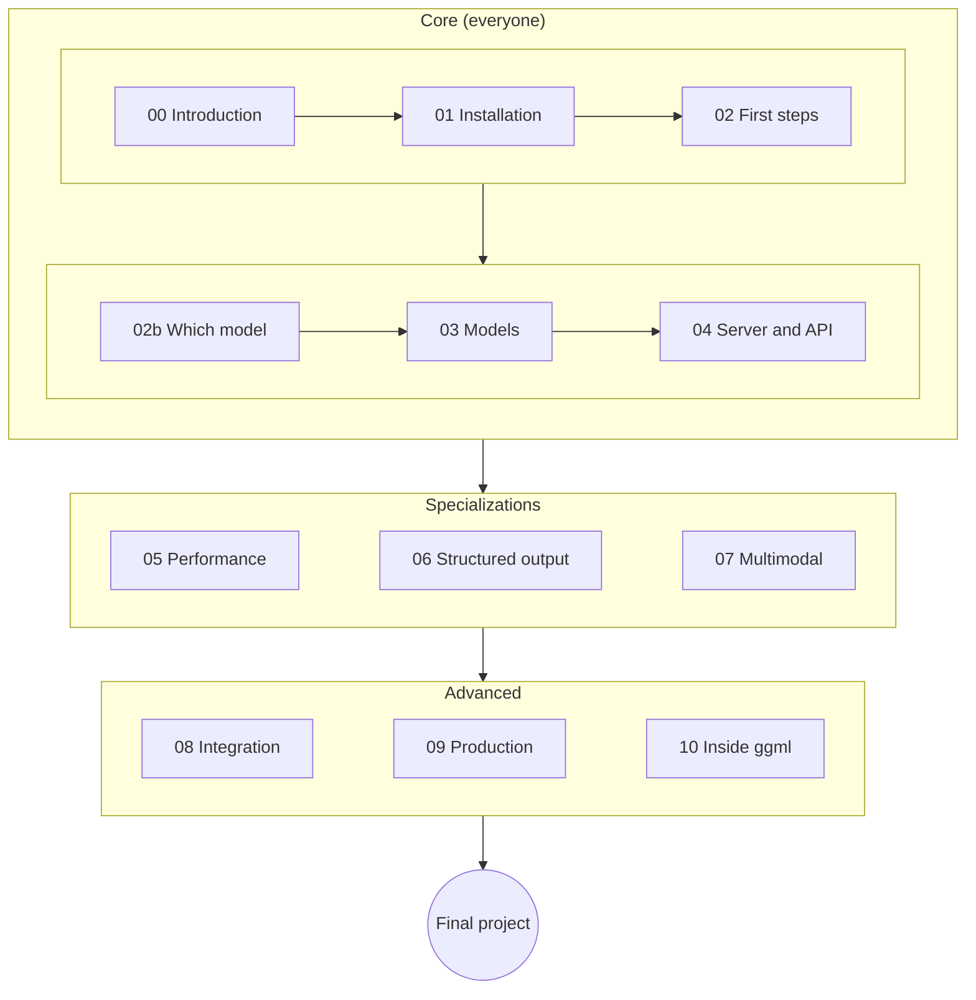

---
hide:
  - toc
  - navigation
---

# llama.cpp Practical Course

Run language (and vision) models **on your own computer**: laptop, PC, Mac, Raspberry Pi.
From installation to production, with guided labs and a final project.
Based on [llama.cpp](https://github.com/ggml-org/llama.cpp) v0.4.1 (build b11046, September 2026). By [Prof. Giuseppe Bosi](informazioni.md), CC BY 4.0 license.

!!! warning "If you install llama.cpp v0.7.0 or later"
    Since **v0.7.0** (2026-10-15) `llama serve` listens on **port 9931**, no longer 8080. Wherever the course says
    `http://127.0.0.1:8080` or `localhost:8080`, use `9931` **or** start the server with `--port 8080`. Everything else
    works the same. Details in [Reference version](versione.md).

-   :material-download:{ .lg .middle } **Start from scratch**

    ---

    Install llama.cpp on your machine and run your first model in 10 minutes.

    [:octicons-arrow-right-24: Module 01 · Installation](moduli/01-installazione/README.md)

-   :material-cpu-64-bit:{ .lg .middle } **The right model for you**

    ---

    Raspberry Pi, laptop without a GPU, Mac, 8 GB GPU: which model to choose and what to expect.

    [:octicons-arrow-right-24: Module 02b · Choosing the model](moduli/02b-scegliere-modello/README.md)

-   :material-flask-outline:{ .lg .middle } **30 labs**

    ---

    Hands-on exercises with steps, expected result and deliverable. Each lab sits under its module.

    [:octicons-arrow-right-24: Lab 02-01 · Your first model](laboratori/lab-02-01-primo-modello/README.md)

-   :material-trophy-outline:{ .lg .middle } **6 final projects**

    ---

    RAG assistant, production server, tool-calling agent, edge, quantization, documents.

    [:octicons-arrow-right-24: Final projects](progetti-finali/README.md)

## How the course is organized

Each **module** explains the theory with diagrams and ready-to-run commands; the **labs** are hands-on exercises
with steps, expected result and deliverable; the **final projects** combine several modules into something useful.
The left menu always shows every module with its labs; the right menu shows the sections of the page.

## Suggested paths

=== "User"
    You want to use models locally, privately and for free.

    **Modules:** 00 → 01 → 02 → 02b → 03 → 04 → 06 · **Projects:** P1 or P6

=== "Developer"
    You want to integrate a local model into your application.

    **Modules:** user path + 05 → 07 → 08 · **Projects:** P1, P3 or P6

=== "DevOps / MLOps"
    You want to serve models to others, reliably and measurably.

    **Modules:** user path + 05 → 09 · **Projects:** P2 or P5

=== "Advanced"
    You want to understand how it works inside and maybe contribute.

    **Modules:** all, including 10 · **Projects:** P4 or P5

## Syllabus

| # | Module | Labs |
|---|---|---|
| 00 | [Introduction to llama.cpp](moduli/00-introduzione/README.md) | 2 |
| 01 | [Installing on every platform](moduli/01-installazione/README.md) | 4 |
| 02 | [First steps: `llama cli`](moduli/02-primi-passi/README.md) | 3 |
| 02b | [Choosing the model for your machine](moduli/02b-scegliere-modello/README.md) | — |
| 03 | [Models, GGUF and quantization](moduli/03-modelli-gguf-quantizzazione/README.md) | 3 |
| 04 | [`llama serve`: server and API](moduli/04-server-api/README.md) | 4 |
| 05 | [Performance and optimization](moduli/05-prestazioni/README.md) | 4 |
| 06 | [Structured output: GBNF and JSON Schema](moduli/06-output-strutturato/README.md) | 2 |
| 07 | [Multimodality: vision, audio, voice](moduli/07-multimodale/README.md) | 2 |
| 08 | [Integrating llama.cpp into applications](moduli/08-integrazione-sviluppo/README.md) | 2 |
| 09 | [Going to production](moduli/09-deploy-produzione/README.md) | 2 |
| 10 | [Deep dives: inside ggml and llama.cpp](moduli/10-approfondimenti/README.md) | 2 |
| — | [Final projects](progetti-finali/README.md) | 6 briefs |

## What you need

- A computer with at least **8 GB of RAM** (16 recommended). A GPU is optional: the course also runs on CPU only.
- Linux, macOS or Windows; some familiarity with the terminal.
- For modules 08–10: basic Python and/or C++.

Quick check of your environment: [`verifica-ambiente.sh`](risorse/strumenti.md). llama.cpp version used
in the course: [b11046](versione.md).
