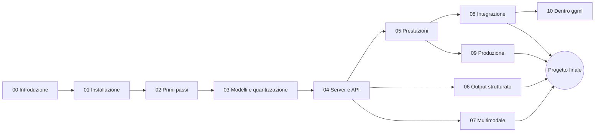

# Corso pratico di llama.cpp

Benvenuto. Questo è un corso **pratico** su [llama.cpp](https://github.com/ggml-org/llama.cpp), il motore di
inferenza in C/C++ che fa girare modelli linguistici (e visivi) in locale: sul tuo portatile, su un server,
su un Raspberry Pi. Parti dall'installazione, arrivi a metterlo in produzione, e lungo la strada fai
esperimenti veri con i tuoi modelli.

!!! info "Aggiornato a settembre 2026"
    Tutti i comandi sono verificati sulla versione indicata in [Versione di riferimento](versione.md).
    llama.cpp cambia ogni giorno: se qualcosa non torna, controlla prima lì.

## Come è organizzato

Ogni **modulo** spiega la teoria con schemi e comandi verificati; ogni **laboratorio** è un'esperienza pratica
con procedura, risultato atteso e consegna; i **progetti finali** combinano più moduli in qualcosa di utile.

## Percorsi consigliati

=== "Utente"
    Vuoi usare i modelli in locale, in modo privato e gratuito.

    **Moduli:** 00 → 01 → 02 → 03 → 04 → 06 · **Progetti:** P1 o P6

=== "Sviluppatore"
    Vuoi integrare un modello locale nella tua applicazione.

    **Moduli:** percorso utente + 05 → 07 → 08 · **Progetti:** P1, P3 o P6

=== "DevOps / MLOps"
    Vuoi servire modelli ad altri, in modo affidabile e misurabile.

    **Moduli:** percorso utente + 05 → 09 · **Progetti:** P2 o P5

=== "Avanzato"
    Vuoi capire come funziona dentro e magari contribuire.

    **Moduli:** tutti, incluso 10 · **Progetti:** P4 o P5

## Cosa ti serve

- Un computer con almeno **8 GB di RAM** (16 consigliati). GPU facoltativa: il corso gira anche solo su CPU.
- Linux, macOS o Windows; un po' di dimestichezza con il terminale.
- Per i moduli 08–10: basi di Python e/o C++.

Verifica rapida del tuo ambiente: [script `verifica-ambiente.sh`](risorse/strumenti.md).

## Programma

| # | Modulo | Lab |
|---|---|---|
| 00 | [Introduzione a llama.cpp](moduli/00-introduzione/README.md) | 2 |
| 01 | [Installazione su varie piattaforme](moduli/01-installazione/README.md) | 4 |
| 02 | [Primi passi: `llama cli`](moduli/02-primi-passi/README.md) | 3 |
| 03 | [Modelli, GGUF e quantizzazione](moduli/03-modelli-gguf-quantizzazione/README.md) | 3 |
| 04 | [`llama serve`: server e API](moduli/04-server-api/README.md) | 4 |
| 05 | [Prestazioni e ottimizzazione](moduli/05-prestazioni/README.md) | 4 |
| 06 | [Output strutturato: GBNF e JSON Schema](moduli/06-output-strutturato/README.md) | 2 |
| 07 | [Multimodalità: visione, audio, voce](moduli/07-multimodale/README.md) | 2 |
| 08 | [Integrare llama.cpp nelle applicazioni](moduli/08-integrazione-sviluppo/README.md) | 2 |
| 09 | [Messa in produzione](moduli/09-deploy-produzione/README.md) | 2 |
| 10 | [Approfondimenti: dentro ggml e llama.cpp](moduli/10-approfondimenti/README.md) | 2 |
| — | [Progetti di fine corso](progetti-finali/README.md) | 6 tracce |
