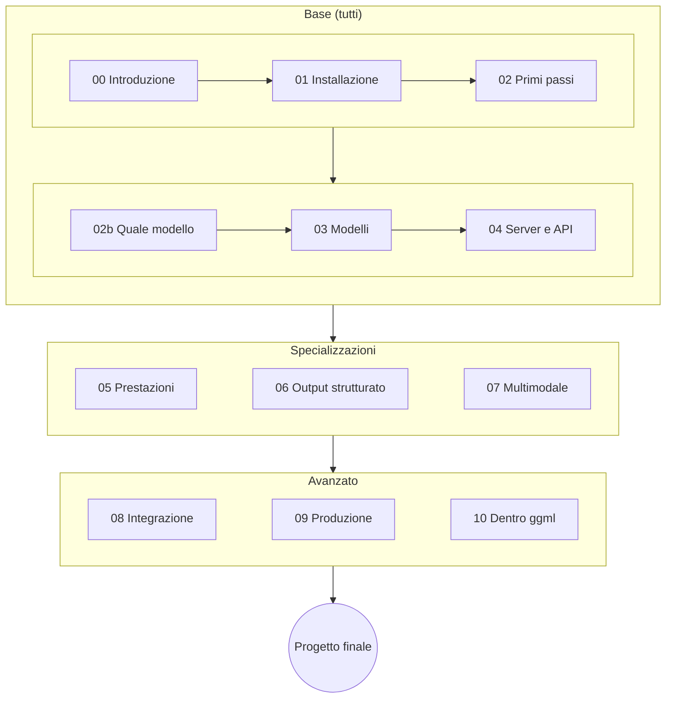

---
hide:
  - toc
  - navigation
---

# Corso pratico di llama.cpp

Fai girare modelli linguistici (e visivi) **sul tuo computer**: portatile, PC, Mac, Raspberry Pi.
Dall'installazione alla messa in produzione, con laboratori guidati, comandi verificati e un progetto finale.
Scritto e provato su [llama.cpp](https://github.com/ggml-org/llama.cpp) v0.4.1 (build b11046, settembre 2026). Di [Giuseppe Bosi](informazioni.md), licenza CC BY-SA 4.0.

!!! warning "Se installi llama.cpp oggi (v0.7.0 o successive)"
    Dalla **v0.7.0** (15/10/2026) `llama serve` ascolta sulla **porta 9931**, non più 8080. Dove il corso scrive
    `http://127.0.0.1:8080` o `localhost:8080`, usa `9931` **oppure** avvia il server con `--port 8080`. Tutto il resto
    funziona uguale. Dettagli in [Versione di riferimento](versione.md).

!!! info "Cosa è stato provato davvero"
    I comandi con il badge verificato sono stati eseguiti dall'autore su
    **Linux x86_64, solo CPU**. Le parti su **GPU, macOS, Windows, Android, audio e sintesi vocale** hanno il badge
    bozza: vengono dalla documentazione ufficiale e non sono state eseguite.
    I contenuti sono stati scritti con l'aiuto di un assistente IA e rivisti dall'autore ([Informazioni](informazioni.md)).

-   :material-download:{ .lg .middle } **Parti da zero**

    ---

    Installa llama.cpp sulla tua macchina e fai girare il primo modello in 10 minuti.

    [:octicons-arrow-right-24: Modulo 01 · Installazione](moduli/01-installazione/README.md)

-   :material-cpu-64-bit:{ .lg .middle } **Il modello giusto per te**

    ---

    Raspberry Pi, portatile senza GPU, Mac, GPU da 8 GB: quale modello scegliere e cosa aspettarsi.

    [:octicons-arrow-right-24: Modulo 02b · Scegliere il modello](moduli/02b-scegliere-modello/README.md)

-   :material-flask-outline:{ .lg .middle } **30 laboratori**

    ---

    Esperienze pratiche con procedura, risultato atteso e consegna. Ogni lab è sotto il suo modulo.

    [:octicons-arrow-right-24: Lab 02-01 · Il primo modello](laboratori/lab-02-01-primo-modello/README.md)

-   :material-trophy-outline:{ .lg .middle } **6 progetti finali**

    ---

    Assistente RAG, server in produzione, agente con strumenti, edge, quantizzazione, documenti.

    [:octicons-arrow-right-24: Progetti finali](progetti-finali/README.md)

## Come è organizzato il corso

Ogni **modulo** spiega la teoria con schemi e comandi verificati; i **laboratori** sono esperienze pratiche
con procedura, risultato atteso e consegna; i **progetti finali** combinano più moduli in qualcosa di utile.
Il menu a sinistra mostra sempre tutti i moduli con i loro laboratori; il menu a destra, i paragrafi della pagina.

## Percorsi consigliati

=== "Utente"
    Vuoi usare i modelli in locale, in modo privato e gratuito.

    **Moduli:** 00 → 01 → 02 → 02b → 03 → 04 → 06 · **Progetti:** P1 o P6

=== "Sviluppatore"
    Vuoi integrare un modello locale nella tua applicazione.

    **Moduli:** percorso utente + 05 → 07 → 08 · **Progetti:** P1, P3 o P6

=== "DevOps / MLOps"
    Vuoi servire modelli ad altri, in modo affidabile e misurabile.

    **Moduli:** percorso utente + 05 → 09 · **Progetti:** P2 o P5

=== "Avanzato"
    Vuoi capire come funziona dentro e magari contribuire.

    **Moduli:** tutti, incluso 10 · **Progetti:** P4 o P5

## Programma

| # | Modulo | Laboratori |
|---|---|---|
| 00 | [Introduzione a llama.cpp](moduli/00-introduzione/README.md) | 2 |
| 01 | [Installazione su varie piattaforme](moduli/01-installazione/README.md) | 4 |
| 02 | [Primi passi: `llama cli`](moduli/02-primi-passi/README.md) | 3 |
| 02b | [Scegliere il modello per la tua macchina](moduli/02b-scegliere-modello/README.md) | — |
| 03 | [Modelli, GGUF e quantizzazione](moduli/03-modelli-gguf-quantizzazione/README.md) | 3 |
| 04 | [`llama serve`: server e API](moduli/04-server-api/README.md) | 4 |
| 05 | [Prestazioni e ottimizzazione](moduli/05-prestazioni/README.md) | 4 |
| 06 | [Output strutturato: GBNF e JSON Schema](moduli/06-output-strutturato/README.md) | 2 |
| 07 | [Multimodalità: visione, audio, voce](moduli/07-multimodale/README.md) | 2 |
| 08 | [Integrare llama.cpp nelle applicazioni](moduli/08-integrazione-sviluppo/README.md) | 2 |
| 09 | [Messa in produzione](moduli/09-deploy-produzione/README.md) | 2 |
| 10 | [Approfondimenti: dentro ggml e llama.cpp](moduli/10-approfondimenti/README.md) | 2 |
| — | [Progetti di fine corso](progetti-finali/README.md) | 6 tracce |

## Cosa ti serve

- Un computer con almeno **8 GB di RAM** (16 consigliati). GPU facoltativa: il corso gira anche solo su CPU.
- Linux, macOS o Windows; un po' di dimestichezza con il terminale.
- Per i moduli 08–10: basi di Python e/o C++.

Verifica rapida del tuo ambiente: [`verifica-ambiente.sh`](risorse/strumenti.md). Versione di llama.cpp usata
nel corso: [b11046](versione.md).
