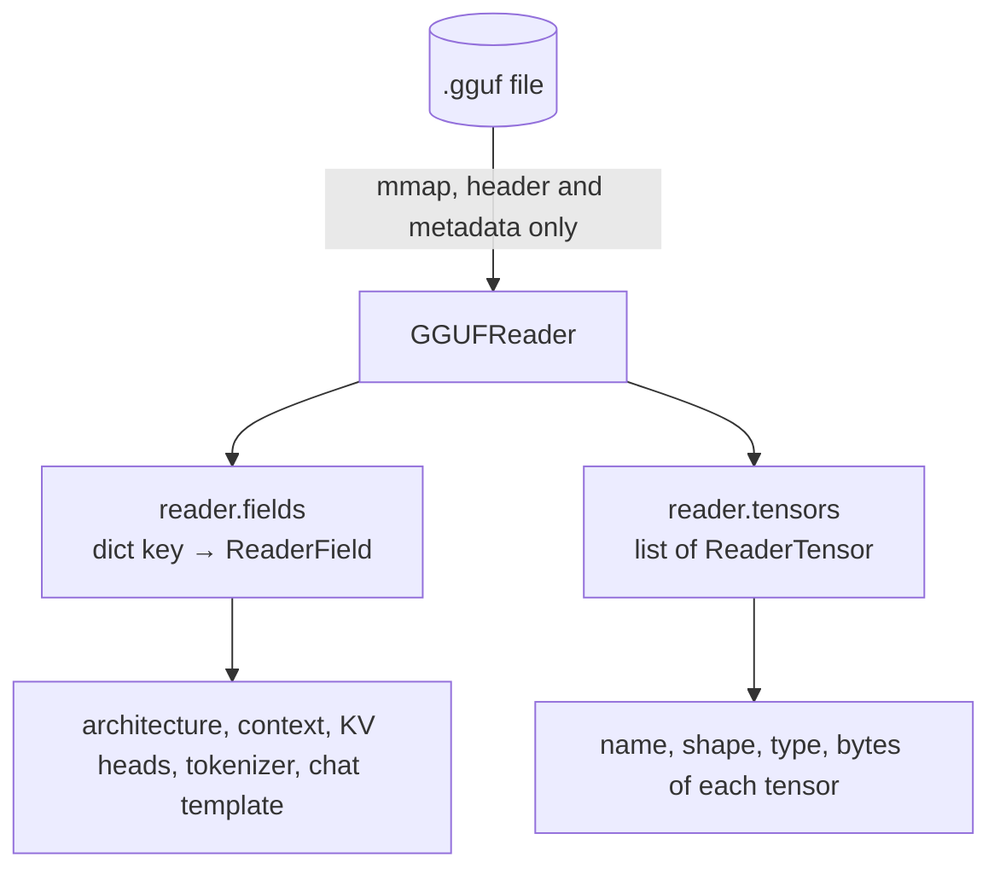

# Lab 00-02: Anatomy of a GGUF file

<div class="meta" markdown>
<span class="meta-item">:material-book-open-page-variant:{ .meta-icon } Module <a href="../../moduli/00-introduzione/README.md">00: Introduction to llama.cpp</a></span>
<span class="meta-item">:material-clock-outline:{ .meta-icon } 45 minutes</span>
</div>

## Objective

Open a GGUF file with the official Python tools (`pip install gguf`), read metadata, tokenizer and
chat template, count tensors by type and derive the real bits per weight. At the end you can tell, for any
GGUF, which architecture it has, how much context it supports, how it is quantized and which numbers the
memory estimate of the previous lab needs.

## Prerequisites

- Python 3.9+ and `pip`.
- A GGUF file on disk. If you have already done module 01: the course one, downloaded with
  `llama cli -hf ggml-org/Qwen3.5-0.8B-GGUF` (785 MiB). Otherwise download it with the browser from the
  Hugging Face page of the repository (`Qwen3.5-0.8B-Q8_0.gguf`) or use `LiquidAI/LFM2.5-230M-GGUF` (Q4_K_M, ~150 MiB).

## Materials

| What | Where | Notes |
|---|---|---|
| `gguf` package | PyPI, `pip install gguf` | it is the `gguf-py/` folder of the llama.cpp sources; it installs the commands `gguf-dump`, `gguf-set-metadata`, `gguf-new-metadata`, `gguf-convert-endian`, `gguf-editor-gui` |
| `anatomia_gguf.py` | in this folder | uses the `GGUFReader` API, summarizes metadata and tensors |
| `ggml-org/Qwen3.5-0.8B-GGUF` | `Qwen3.5-0.8B-Q8_0.gguf`, 785 MiB, Apache-2.0 | in the cache: `~/.cache/huggingface/hub/models--ggml-org--Qwen3.5-0.8B-GGUF/snapshots/<hash>/` |



## Steps

### 1. Install the package in a virtual environment

=== "Linux / macOS"
    ```bash
    python3 -m venv ~/gguf-venv
    source ~/gguf-venv/bin/activate
    pip install gguf
    gguf-dump --help | head -5
    ```

=== "Windows (PowerShell)"
    ```powershell
    py -m venv $HOME\gguf-venv
    & $HOME\gguf-venv\Scripts\Activate.ps1
    pip install gguf
    gguf-dump --help
    ```

The course uses `gguf 0.19.0`.

### 2. Find the file

```bash
llama cli -cl                                     # if you already have llama.cpp: list the cache
M=$(ls ~/.cache/huggingface/hub/models--ggml-org--Qwen3.5-0.8B-GGUF/snapshots/*/*.gguf)
ls -la "$M" "$(readlink -f "$M")"
```

The file in the `snapshots/` folder is a **symbolic link** to the real blob in `blobs/<sha256>`: remember this
when you mount the cache in Docker (lab 01-04).

### 3. `gguf-dump`: the metadata

```bash
gguf-dump --no-tensors "$M"
```

Output (shortened):

```text
* File is LITTLE endian, script is running on a LITTLE endian host.
* Dumping 44 key/value pair(s)
      1: UINT32     |        1 | GGUF.version = 3
      2: UINT64     |        1 | GGUF.tensor_count = 335
      3: UINT64     |        1 | GGUF.kv_count = 41
      4: STRING     |        1 | general.architecture = 'qwen35'
      6: STRING     |        1 | general.name = 'Qwen3.5-0.8B'
      8: STRING     |        1 | general.license = 'apache-2.0'
     15: UINT32     |        1 | qwen35.block_count = 25
     16: UINT32     |        1 | qwen35.context_length = 262144
     17: UINT32     |        1 | qwen35.embedding_length = 1024
     19: UINT32     |        1 | qwen35.attention.head_count = 8
     20: UINT32     |        1 | qwen35.attention.head_count_kv = 2
     24: UINT32     |        1 | qwen35.attention.key_length = 256
     31: UINT32     |        1 | qwen35.full_attention_interval = 4
     34: STRING     |        1 | tokenizer.ggml.model = 'gpt2'
     36: [STRING]   |   248320 | tokenizer.ggml.tokens = ['!', '"', '#', '$', '%', '&', ...]
     39: UINT32     |        1 | tokenizer.ggml.eos_token_id = 248046
     42: STRING     |        1 | tokenizer.chat_template = '\n…'
     44: UINT32     |        1 | general.file_type = 7
```

Write down: architecture, training context (262,144 tokens!), KV heads, `key_length`, `file_type`.
The `--json` and `--markdown` options produce the same content in formats that programs can read or that you
can paste into a document.

### 4. `gguf-dump`: the tensors

```bash
gguf-dump "$M" | sed -n '/Dumping 335 tensor/,$p' | head -15
```

```text
* Dumping 335 tensor(s)
      1:       1024 |  1024,     1,     1,     1 | F32     | output_norm.weight
      2:  254279680 |  1024, 248320,     1,     1 | Q8_0    | token_embd.weight
      3:    2097152 |  1024,  2048,     1,     1 | Q8_0    | blk.0.attn_gate.weight
      4:       1024 |  1024,     1,     1,     1 | F32     | blk.0.attn_norm.weight
      5:    6291456 |  1024,  6144,     1,     1 | Q8_0    | blk.0.attn_qkv.weight
      6:    3670016 |  3584,  1024,     1,     1 | Q8_0    | blk.0.ffn_down.weight
      …
```

The columns are: number of elements, shape (up to 4 dimensions), ggml type, name. Names follow a fixed
scheme: `token_embd`, `output_norm`, `blk.N.<sub-tensor>`. Notice that the normalization tensors
stay in F32 (they are tiny) and that `token_embd.weight` alone holds 254 million parameters, a third of the
model: in small models the vocabulary weighs a lot.

Count the types:

```bash
gguf-dump "$M" | sed -n '/Dumping 335 tensor/,$p' | grep -oE "\| (Q8_0|F32|F16|Q[0-9A-Z_]+) " | sort | uniq -c
```

```text
    140 | F32
    195 | Q8_0
```

### 5. The `GGUFReader` API with `anatomia_gguf.py`

```bash
python3 anatomia_gguf.py "$M"
```

```text
== File: …/Qwen3.5-0.8B-Q8_0.gguf
   versione GGUF 3, 44 coppie chiave/valore, 335 tensori

== Metadati generali
   general.name                     = Qwen3.5-0.8B
   general.architecture             = qwen35
   general.size_label               = 773M
   general.license                  = apache-2.0
   general.file_type                = 7

== Parametri architetturali (prefisso 'qwen35.')
   qwen35.block_count                       = 25
   qwen35.context_length                    = 262144
   qwen35.attention.head_count              = 8
   qwen35.attention.head_count_kv           = 2
   qwen35.attention.key_length              = 256
   qwen35.full_attention_interval           = 4

== Tokenizer
   tokenizer.ggml.model             = gpt2
   tokenizer.ggml.tokens            = [array di 248320 elementi]
   tokenizer.ggml.eos_token_id      = 248046
   tokenizer.chat_template          = 7755 caratteri, inizia con: '…'

== Tensori per tipo (byte su disco)
   Q8_0      195 tensori      782.6 MiB  ( 99.8 %)
   F32       140 tensori        1.9 MiB  (  0.2 %)
   totale    335 tensori      784.5 MiB

   parametri totali = 772.85 M  ->  8.52 bit per peso medi
```

Open the script: it is 80 lines. The core is

```python
from gguf import GGUFReader
r = GGUFReader(path)                                   # maps the file, does not load it
arch = r.fields["general.architecture"].contents()     # every field has .contents()
for t in r.tensors:                                    # ReaderTensor: name, shape, tensor_type, n_elements, n_bytes
    ...
```

With `--tensori` it also prints the full list. Look at blocks 3, 7, 11, 15, 19, 23: they are the only ones with
separate `attn_q`, `attn_k`, `attn_v` (classic attention); the others have `attn_qkv` plus `ssm_*` (recurrent
layers). This explains the "6 layers" of the KV cache in lab 00-01.

### 6. The chat template

```bash
python3 - "$M" <<'EOF'
import sys
from gguf import GGUFReader
r = GGUFReader(sys.argv[1])
print(r.fields["tokenizer.chat_template"].contents()[:1200])
EOF
```

It is a Jinja template: look for the `<|im_start|>`, `<|im_end|>` markers and the block that handles `enable_thinking`.
It is exactly what `llama cli` and `llama serve` apply to messages (`--jinja` is on by default): you
will use it in lab 02-03.

## Check

- [ ] `gguf-dump --no-tensors` shows 44 key/value pairs and 335 tensors.
- [ ] You can name the four numbers of the KV formula: 25 blocks (6 with attention), 2 KV heads, head_dim 256, maximum context 262,144.
- [ ] `anatomia_gguf.py` reports an average of 8.52 bits per weight: Q8_0 is 8.5 bits, the few F32 tensors raise the average.
- [ ] You printed the beginning of the chat template and recognized the `<|im_start|>` markers.

## Questions and variations

1. Why does `general.file_type = 7` correspond to Q8_0 while some tensors are F32? (The file type
   describes the **prevailing** quantization; norms and biases stay in F32.)
2. Calculate the size of `token_embd.weight` in MiB from elements × 8.5 / 8 and compare it with the
   `--tensori` output (257.66 MiB).
3. Repeat the analysis on a Q4_K_M GGUF of another model: which types do you find? Why does `Q4_K_M` also contain
   `Q6_K` tensors? (Tip: the most sensitive tensors, such as `attn_v` and `ffn_down`, get more bits.)
4. Variation: with `gguf-set-metadata` (make a copy first!) change `general.name` and check with `gguf-dump`.
   This is how you fix a wrong chat template without reconverting the model.
5. Variation: `gguf-dump --json "$M" | python3 -c "import json,sys; d=json.load(sys.stdin); print(d['metadata']['general.architecture'])"`.

## Deliverable

An `anatomia.md` file with: the output of `anatomia_gguf.py` on your GGUF, a "key → value → what it
is for" table for at least 8 metadata entries, the tensor count by type with the calculation of the average bits
per weight, and the first 10 lines of the chat template with the markers highlighted.
