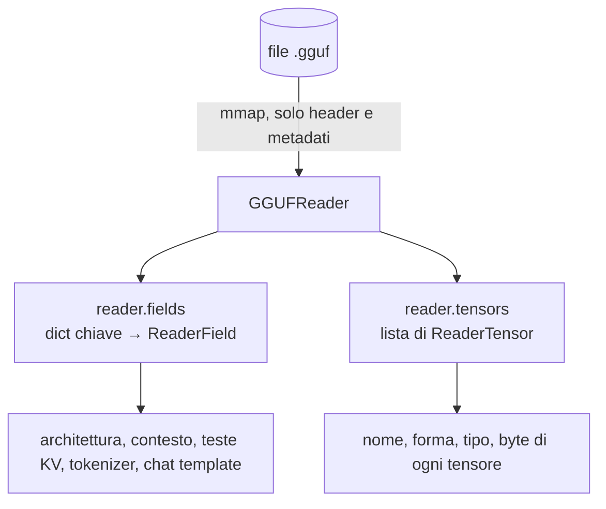

# Lab 00-02: Anatomia di un file GGUF

<div class="meta" markdown>
<span class="meta-item">:material-book-open-page-variant:{ .meta-icon } Modulo <a href="../../moduli/00-introduzione/README.md">00: Introduzione a llama.cpp</a></span>
<span class="meta-item">:material-clock-outline:{ .meta-icon } 45 minuti</span>
<span class="stato stato-verificato">verificato su b11046 · gguf 0.19.0</span>
</div>

## Obiettivo

Aprire un file GGUF con gli strumenti Python ufficiali (`pip install gguf`), leggere metadati, tokenizer e
chat template, contare i tensori per tipo e ricavare i bit per peso reali. Alla fine sai dire, di qualsiasi
GGUF, che architettura ha, quanto contesto supporta, com'è quantizzato e quali numeri servono alla stima di
memoria del lab precedente.

## Prerequisiti

- Python 3.9+ e `pip`.
- Un file GGUF sul disco. Se hai già fatto il modulo 01: quello del corso, scaricato con
  `llama cli -hf ggml-org/Qwen3.5-0.8B-GGUF` (785 MiB). Altrimenti scaricalo con il browser dalla pagina
  Hugging Face del repository (`Qwen3.5-0.8B-Q8_0.gguf`) o usa `LiquidAI/LFM2.5-230M-GGUF` (Q4_K_M, ~150 MiB).

## Materiale

| Cosa | Dove | Note |
|---|---|---|
| Pacchetto `gguf` | PyPI, `pip install gguf` | è la cartella `gguf-py/` dei sorgenti di llama.cpp; installa i comandi `gguf-dump`, `gguf-set-metadata`, `gguf-new-metadata`, `gguf-convert-endian`, `gguf-editor-gui` |
| `anatomia_gguf.py` | in questa cartella | usa l'API `GGUFReader`, riassume metadati e tensori |
| `ggml-org/Qwen3.5-0.8B-GGUF` | `Qwen3.5-0.8B-Q8_0.gguf`, 785 MiB, Apache-2.0 | in cache: `~/.cache/huggingface/hub/models--ggml-org--Qwen3.5-0.8B-GGUF/snapshots/<hash>/` |



## Procedura

### 1. Installa il pacchetto in un ambiente virtuale

=== "Linux / macOS"
    ```bash
    python3 -m venv ~/gguf-venv
    source ~/gguf-venv/bin/activate
    pip install gguf
    gguf-dump --help | head -5
    ```

=== "Windows (PowerShell)"
    ```powershell
    py -m venv $HOME\gguf-venv
    & $HOME\gguf-venv\Scripts\Activate.ps1
    pip install gguf
    gguf-dump --help
    ```

Versione verificata: `gguf 0.19.0`.

### 2. Trova il file

```bash
llama cli -cl                                     # se hai già llama.cpp: elenca la cache
M=$(ls ~/.cache/huggingface/hub/models--ggml-org--Qwen3.5-0.8B-GGUF/snapshots/*/*.gguf)
ls -la "$M" "$(readlink -f "$M")"
```

Il file nella cartella `snapshots/` è un **link simbolico** al blob vero in `blobs/<sha256>`: ricordatelo
quando monterai la cache in Docker (lab 01-04).

### 3. `gguf-dump`: i metadati

```bash
gguf-dump --no-tensors "$M"
```

Output (accorciato):

```text
* File is LITTLE endian, script is running on a LITTLE endian host.
* Dumping 44 key/value pair(s)
      1: UINT32     |        1 | GGUF.version = 3
      2: UINT64     |        1 | GGUF.tensor_count = 335
      3: UINT64     |        1 | GGUF.kv_count = 41
      4: STRING     |        1 | general.architecture = 'qwen35'
      6: STRING     |        1 | general.name = 'Qwen3.5-0.8B'
      8: STRING     |        1 | general.license = 'apache-2.0'
     15: UINT32     |        1 | qwen35.block_count = 25
     16: UINT32     |        1 | qwen35.context_length = 262144
     17: UINT32     |        1 | qwen35.embedding_length = 1024
     19: UINT32     |        1 | qwen35.attention.head_count = 8
     20: UINT32     |        1 | qwen35.attention.head_count_kv = 2
     24: UINT32     |        1 | qwen35.attention.key_length = 256
     31: UINT32     |        1 | qwen35.full_attention_interval = 4
     34: STRING     |        1 | tokenizer.ggml.model = 'gpt2'
     36: [STRING]   |   248320 | tokenizer.ggml.tokens = ['!', '"', '#', '$', '%', '&', ...]
     39: UINT32     |        1 | tokenizer.ggml.eos_token_id = 248046
     42: STRING     |        1 | tokenizer.chat_template = '\n…'
     44: UINT32     |        1 | general.file_type = 7
```

Annota: architettura, contesto di addestramento (262 144 token!), teste KV, `key_length`, `file_type`.
Le opzioni `--json` e `--markdown` producono lo stesso contenuto in formati leggibili da programmi o
incollabili in un documento.

### 4. `gguf-dump`: i tensori

```bash
gguf-dump "$M" | sed -n '/Dumping 335 tensor/,$p' | head -15
```

```text
* Dumping 335 tensor(s)
      1:       1024 |  1024,     1,     1,     1 | F32     | output_norm.weight
      2:  254279680 |  1024, 248320,     1,     1 | Q8_0    | token_embd.weight
      3:    2097152 |  1024,  2048,     1,     1 | Q8_0    | blk.0.attn_gate.weight
      4:       1024 |  1024,     1,     1,     1 | F32     | blk.0.attn_norm.weight
      5:    6291456 |  1024,  6144,     1,     1 | Q8_0    | blk.0.attn_qkv.weight
      6:    3670016 |  3584,  1024,     1,     1 | Q8_0    | blk.0.ffn_down.weight
      …
```

Le colonne sono: numero di elementi, forma (fino a 4 dimensioni), tipo ggml, nome. I nomi seguono uno
schema fisso: `token_embd`, `output_norm`, `blk.N.<sotto-tensore>`. Osserva che i tensori di normalizzazione
restano in F32 (sono minuscoli) e che `token_embd.weight` da solo vale 254 milioni di parametri, un terzo del
modello: nei modelli piccoli il vocabolario pesa molto.

Conta i tipi:

```bash
gguf-dump "$M" | sed -n '/Dumping 335 tensor/,$p' | grep -oE "\| (Q8_0|F32|F16|Q[0-9A-Z_]+) " | sort | uniq -c
```

```text
    140 | F32
    195 | Q8_0
```

### 5. L'API `GGUFReader` con `anatomia_gguf.py`

```bash
python3 anatomia_gguf.py "$M"
```

```text
== File: …/Qwen3.5-0.8B-Q8_0.gguf
   versione GGUF 3, 44 coppie chiave/valore, 335 tensori

== Metadati generali
   general.name                     = Qwen3.5-0.8B
   general.architecture             = qwen35
   general.size_label               = 773M
   general.license                  = apache-2.0
   general.file_type                = 7

== Parametri architetturali (prefisso 'qwen35.')
   qwen35.block_count                       = 25
   qwen35.context_length                    = 262144
   qwen35.attention.head_count              = 8
   qwen35.attention.head_count_kv           = 2
   qwen35.attention.key_length              = 256
   qwen35.full_attention_interval           = 4

== Tokenizer
   tokenizer.ggml.model             = gpt2
   tokenizer.ggml.tokens            = [array di 248320 elementi]
   tokenizer.ggml.eos_token_id      = 248046
   tokenizer.chat_template          = 7755 caratteri, inizia con: '…'

== Tensori per tipo (byte su disco)
   Q8_0      195 tensori      782.6 MiB  ( 99.8 %)
   F32       140 tensori        1.9 MiB  (  0.2 %)
   totale    335 tensori      784.5 MiB

   parametri totali = 772.85 M  ->  8.52 bit per peso medi
```

Apri lo script: sono 80 righe. Il cuore è

```python
from gguf import GGUFReader
r = GGUFReader(path)                                   # mappa il file, non lo carica
arch = r.fields["general.architecture"].contents()     # ogni campo ha .contents()
for t in r.tensors:                                    # ReaderTensor: name, shape, tensor_type, n_elements, n_bytes
    ...
```

Con `--tensori` stampa anche l'elenco completo. Guarda i blocchi 3, 7, 11, 15, 19, 23: sono gli unici con
`attn_q`, `attn_k`, `attn_v` separati (attenzione classica); gli altri hanno `attn_qkv` più `ssm_*` (strati
ricorrenti). Ecco spiegati i "6 layers" della KV cache del lab 00-01.

### 6. Il chat template

```bash
python3 - "$M" <<'EOF'
import sys
from gguf import GGUFReader
r = GGUFReader(sys.argv[1])
print(r.fields["tokenizer.chat_template"].contents()[:1200])
EOF
```

È un template Jinja: cerca i marcatori `<|im_start|>`, `<|im_end|>` e il blocco che gestisce `enable_thinking`.
È esattamente ciò che `llama cli` e `llama serve` applicano ai messaggi (`--jinja` è attivo di default): lo
userai nel lab 02-03.

## Verifica del risultato

- [ ] `gguf-dump --no-tensors` mostra 44 coppie chiave/valore e 335 tensori.
- [ ] Sai indicare i quattro numeri della formula KV: 25 blocchi (6 con attenzione), 2 teste KV, head_dim 256, contesto massimo 262 144.
- [ ] `anatomia_gguf.py` riporta 8,52 bit per peso medi: Q8_0 sono 8,5 bit, i pochi F32 alzano la media.
- [ ] Hai stampato l'inizio del chat template e riconosciuto i marcatori `<|im_start|>`.

## Domande e varianti

1. Perché `general.file_type = 7` corrisponde a Q8_0 mentre alcuni tensori sono F32? (Il tipo di file
   descrive la quantizzazione **prevalente**; norm e bias restano in F32.)
2. Calcola la dimensione di `token_embd.weight` in MiB da elementi × 8,5 / 8 e confrontala con l'output
   `--tensori` (257,66 MiB).
3. Ripeti l'analisi su un GGUF Q4_K_M di un altro modello: quali tipi trovi? Perché `Q4_K_M` contiene anche
   tensori `Q6_K`? (Suggerimento: i tensori più sensibili, come `attn_v` e `ffn_down`, ricevono più bit.)
4. Variante: con `gguf-set-metadata` (fai prima una copia!) cambia `general.name` e verifica con `gguf-dump`.
   È il modo in cui si corregge un chat template sbagliato senza riconvertire il modello.
5. Variante: `gguf-dump --json "$M" | python3 -c "import json,sys; d=json.load(sys.stdin); print(d['metadata']['general.architecture'])"`.

## Consegna

Un file `anatomia.md` con: l'output di `anatomia_gguf.py` sul tuo GGUF, una tabella "chiave → valore → a che
cosa serve" per almeno 8 metadati, il conteggio dei tensori per tipo con il calcolo dei bit per peso medi, e
le prime 10 righe del chat template con i marcatori evidenziati.
