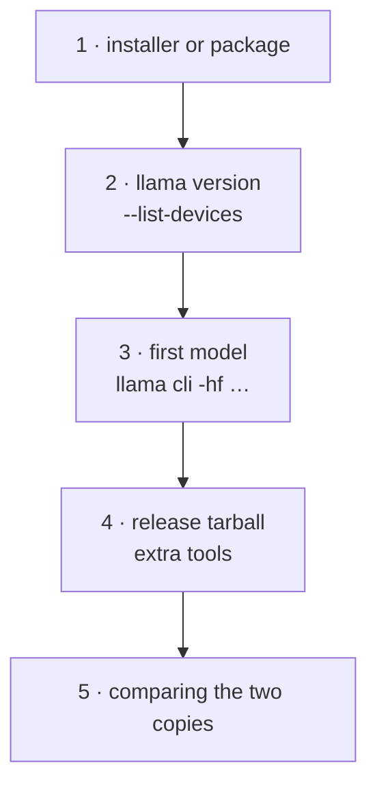

# Lab 01-01: Installing from binaries/packages

<div class="meta" markdown>
<span class="meta-item">:material-book-open-page-variant:{ .meta-icon } Module <a href="../../moduli/01-installazione/README.md">01: Installation on various platforms</a></span>
<span class="meta-item">:material-clock-outline:{ .meta-icon } 30 minutes</span>
</div>

## Objective

Install llama.cpp **without building** on your platform with two methods (installer or package manager
+ release tarball), check the version, backends and devices detected, and get the first model to answer.
At the end you have `llama` in your `PATH` and a `llama-bNNNNN/` folder with all the extra tools.

## Prerequisites

- A terminal and `curl` (Linux/macOS) or PowerShell (Windows).
- ~1 GB of free disk space (binaries + test model) and an Internet connection.
- No administrator privileges (except for winget/brew if you do not have them yet).

## Materials

| What | Where | Size |
|---|---|---|
| Installer | `https://llama.app/install.sh` | ~18 MB binary |
| Release tarball | `https://github.com/ggml-org/llama.cpp/releases/download/b11046/llama-b11046-bin-ubuntu-x64.tar.gz` (or the asset for your platform) | 16 MB |
| Test model | `ggml-org/Qwen3.5-0.8B-GGUF` (`Qwen3.5-0.8B-Q8_0.gguf`, Apache-2.0) | 785 MiB |



## Steps

### 1. Install with the quick method

=== "Linux"
    ```bash
    curl -LsSf https://llama.app/install.sh | sh
    export PATH="$HOME/.local/bin:$PATH"
    export SSL_CERT_FILE=/etc/ssl/certs/ca-certificates.crt        # (1)!
    echo 'export PATH="$HOME/.local/bin:$PATH"' >> ~/.bashrc
    echo 'export SSL_CERT_FILE=/etc/ssl/certs/ca-certificates.crt' >> ~/.bashrc
    ```

    1. Required on Debian/Ubuntu with the installer's static binary; on Fedora/RHEL the path is
       `/etc/pki/tls/certs/ca-bundle.crt`. Without it, the model download fails with `SSL connection failed`.

=== "macOS"
    ```bash
    curl -LsSf https://llama.app/install.sh | sh
    export PATH="$HOME/.local/bin:$PATH"
    echo 'export PATH="$HOME/.local/bin:$PATH"' >> ~/.zshrc
    ```
    Alternative: `brew install llama.cpp` (puts `llama` in `/opt/homebrew/bin`, already in the `PATH`).

=== "Windows (PowerShell)"
    ```powershell
    winget install llama.cpp
    ```
    Close and reopen PowerShell so that the `PATH` is updated.

Expected output of the installer on Linux without a GPU: `Probing CUDA...`, `Probing ROCm...`, `Probing Vulkan...`,
then the download of the CPU binary and a message reminding you to add `~/.local/bin` to the `PATH`.

### 2. Check version and devices

```bash
llama version
llama cli --list-devices
llama help all
```

```text
version: 0.4.1-dev (build 11046, commit 60081bb2b)
built with Clang 22.1.8 for Linux x86_64
Available devices:
  (none)
```

On a Mac you see a Metal device; on a PC with NVIDIA, `CUDA0: NVIDIA GeForce …` with free and total VRAM.
"(none)" on CPU only is normal. Note the compiler: `Clang 22.1.8` is the signature of the installer's binary.

### 3. The first model

```bash
llama cli -hf ggml-org/Qwen3.5-0.8B-GGUF -st -p "Rispondi con una sola parola: quale pianeta è il terzo dal Sole?" -n 30 -rea off
```

On the first run it downloads 785 MiB into the Hugging Face cache; then it prints the banner and the answer:

```text
build      : b11046-60081bb2b
model      : ggml-org/Qwen3.5-0.8B-GGUF
ftype      : Q8_0
modalities : text
…
> Rispondi con una sola parola: quale pianeta è il terzo dal Sole?
Marte

[ Prompt: 3.3 t/s | Generation: 0.3 t/s ]
```

The answer "Marte" (Mars) is wrong: a 0.8 B model in non-reasoning mode often makes mistakes. Try
without `-rea off` and look at the difference (and the time). The `[ Prompt … | Generation … ]` line is your first
benchmark: write it down.

```bash
llama cli -cl            # list the cache: "1. ggml-org/Qwen3.5-0.8B-GGUF:Q8_0"
```

### 4. The release tarball (extra tools)

=== "Linux"
    ```bash
    mkdir -p ~/llama-lab && cd ~/llama-lab
    V=b11046
    curl -LO https://github.com/ggml-org/llama.cpp/releases/download/$V/llama-$V-bin-ubuntu-x64.tar.gz
    tar -xzf llama-$V-bin-ubuntu-x64.tar.gz
    ls llama-$V | wc -l                      # 61 files
    ls llama-$V | grep -vE "\.so"            # the executables
    ./llama-$V/llama-cli --version
    ```
    On ARM64 (Raspberry Pi) replace `ubuntu-x64` with `ubuntu-arm64`; with a non-NVIDIA GPU try
    `ubuntu-vulkan-x64`.

=== "macOS"
    ```bash
    mkdir -p ~/llama-lab && cd ~/llama-lab
    V=b11046
    curl -LO https://github.com/ggml-org/llama.cpp/releases/download/$V/llama-$V-bin-macos-arm64.tar.gz
    tar -xzf llama-$V-bin-macos-arm64.tar.gz
    xattr -dr com.apple.quarantine llama-$V   # if macOS blocks execution
    ./llama-$V/llama-cli --version
    ```

=== "Windows (PowerShell)"
    ```powershell
    $V = "b11046"
    New-Item -ItemType Directory -Force $HOME\llama-lab | Out-Null; cd $HOME\llama-lab
    Invoke-WebRequest "https://github.com/ggml-org/llama.cpp/releases/download/$V/llama-$V-bin-win-cpu-x64.zip" -OutFile "llama-$V.zip"
    Expand-Archive "llama-$V.zip" -DestinationPath "llama-$V"
    Get-ChildItem "llama-$V" -Recurse -Filter *.exe | Select-Object Name
    ```
    With an NVIDIA GPU, download `-win-cuda-12.4-x64.zip` **and** `cudart-llama-bin-win-cuda-12.4-x64.zip`, and
    extract them into the same folder. With AMD/Intel: `-win-vulkan-x64.zip`.

```text
$ ./llama-b11046/llama-cli --version
version: 0.4.1-dev (build 11046, commit 60081bb2b)
built with GNU 11.4.0 for Linux x86_64
```

Same build, different compiler (GCC 11 versus Clang 22): they are two independent copies. In the tarball you find
`llama-imatrix`, `llama-gguf-split`, `llama-tokenize`, `llama-tts`, `llama-mtmd-cli`, `ggml-rpc-server`,
which the installer does not have.

### 5. Compare the two copies

```bash
which llama; file ~/.local/bin/llama | cut -c1-80      # statically linked
ldd ~/llama-lab/llama-b11046/llama-cli | grep -E "ssl|ggml|llama"
ls ~/llama-lab/llama-b11046/ | grep libggml-cpu        # sandybridge … zen4
~/llama-lab/llama-b11046/llama-tokenize --help | head -3
```

The `libggml-cpu-<arch>.so` files are the variants of the CPU backend: at startup the best one for your
CPU is loaded (with `-v`, look for `load_backend` in the log). The installer's binary is static: a single copy, no
`.so`, but it has the certificate problem.

## Check

- [ ] `llama version` prints build and platform; `llama cli --list-devices` lists the devices (or `(none)`).
- [ ] `llama cli -hf ggml-org/Qwen3.5-0.8B-GGUF …` downloaded the model and answered; `llama cli -cl` lists it.
- [ ] The `llama-b11046/` folder contains `llama-imatrix` and `llama-gguf-split`, and `llama-cli --version` reports the same build.
- [ ] You wrote down the `[ Prompt: … | Generation: … ]` line.

## Questions and variations

1. Why does `--list-devices` not list the CPU? What would it list on a laptop with an Intel iGPU and the Vulkan binary?
2. Run the installer again with `SKIP_VULKAN=1 SKIP_CUDA=1 SKIP_ROCM=1`: does anything change on your machine? When is it useful?
3. Variation: `LLAMA_VERSION=b11046 curl -LsSf https://llama.app/install.sh | sh` pins the build; if the bucket does not
   have that build, the script stops with `No version found`/a download error. Try with a recent build.
4. Variation (with a GPU): repeat step 3 with `-ngl 99 -v 2>&1 | grep "model buffer size"` and check that the
   model buffer is on the GPU device.
5. Variation: create an alias `alias llama-rel=~/llama-lab/llama-b11046/llama` and check that
   `llama-rel version` and `llama version` match.

## Deliverable

An `installazione.md` file with: platform and method used, output of `llama version` and `--list-devices`,
the model's answer with the speed line, the list of tarball executables that the installer
lacks, and the problems you ran into (certificates, `PATH`, Gatekeeper…) with their solution.
