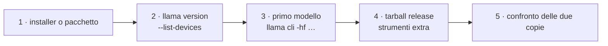

# Lab 01-01: Installazione da binari/pacchetti

> Modulo: [01: Installazione su varie piattaforme](../../moduli/01-installazione/README.md) · <span class="stato stato-verificato">verificato su b11046 · Linux x86_64</span> <span class="stato stato-bozza">macOS / Windows non verificati</span> · Durata stimata: 30 minuti

## Obiettivo

Installare llama.cpp **senza compilare** sulla tua piattaforma con due metodi (installer o gestore di pacchetti
+ tarball della release), verificare versione, backend e device rilevati, e far rispondere il primo modello.
Alla fine hai `llama` nel `PATH` e una cartella `llama-bNNNNN/` con tutti gli strumenti extra.

## Prerequisiti

- Un terminale e `curl` (Linux/macOS) o PowerShell (Windows).
- ~1 GB di disco libero (binari + modello di prova) e connessione a Internet.
- Nessun privilegio di amministratore (tranne winget/brew se non li hai già).

## Materiale

| Cosa | Dove | Dimensione |
|---|---|---|
| Installer | `https://llama.app/install.sh` | binario ~18 MB |
| Tarball release | `https://github.com/ggml-org/llama.cpp/releases/download/b11046/llama-b11046-bin-ubuntu-x64.tar.gz` (o l'asset della tua piattaforma) | 16 MB |
| Modello di prova | `ggml-org/Qwen3.5-0.8B-GGUF` (`Qwen3.5-0.8B-Q8_0.gguf`, Apache-2.0) | 785 MiB |



## Procedura

### 1. Installa con il metodo rapido

=== "Linux"
    ```bash
    curl -LsSf https://llama.app/install.sh | sh
    export PATH="$HOME/.local/bin:$PATH"
    export SSL_CERT_FILE=/etc/ssl/certs/ca-certificates.crt        # (1)!
    echo 'export PATH="$HOME/.local/bin:$PATH"' >> ~/.bashrc
    echo 'export SSL_CERT_FILE=/etc/ssl/certs/ca-certificates.crt' >> ~/.bashrc
    ```

    1. Necessario su Debian/Ubuntu con il binario statico dell'installer; su Fedora/RHEL il percorso è
       `/etc/pki/tls/certs/ca-bundle.crt`. Senza, il download del modello fallisce con `SSL connection failed`.

=== "macOS"
    ```bash
    curl -LsSf https://llama.app/install.sh | sh
    export PATH="$HOME/.local/bin:$PATH"
    echo 'export PATH="$HOME/.local/bin:$PATH"' >> ~/.zshrc
    ```
    Alternativa: `brew install llama.cpp` (mette `llama` in `/opt/homebrew/bin`, già nel `PATH`).

=== "Windows (PowerShell)"
    ```powershell
    winget install llama.cpp
    ```
    Chiudi e riapri PowerShell perché il `PATH` venga aggiornato.

Output atteso dell'installer su Linux senza GPU: `Probing CUDA...`, `Probing ROCm...`, `Probing Vulkan...`,
poi il download del binario CPU e un messaggio che ricorda di aggiungere `~/.local/bin` al `PATH`.

### 2. Verifica versione e device

```bash
llama version
llama cli --list-devices
llama help all
```

```text
version: 0.4.1-dev (build 11046, commit 60081bb2b)
built with Clang 22.1.8 for Linux x86_64
Available devices:
  (none)
```

Su un Mac vedrai un device Metal, su un PC con NVIDIA `CUDA0: NVIDIA GeForce …` con la VRAM libera e totale.
"(none)" su sola CPU è normale. Nota il compilatore: `Clang 22.1.8` è la firma del binario dell'installer.

### 3. Il primo modello

```bash
llama cli -hf ggml-org/Qwen3.5-0.8B-GGUF -st -p "Rispondi con una sola parola: quale pianeta è il terzo dal Sole?" -n 30 -rea off
```

Alla prima esecuzione scarica 785 MiB nella cache Hugging Face; poi stampa il banner e la risposta:

```text
build      : b11046-60081bb2b
model      : ggml-org/Qwen3.5-0.8B-GGUF
ftype      : Q8_0
modalities : text
…
> Rispondi con una sola parola: quale pianeta è il terzo dal Sole?
Marte

[ Prompt: 3.3 t/s | Generation: 0.3 t/s ]
```

Sì, sul VPS carico ha risposto "Marte": un modello da 0,8 B in modalità senza ragionamento sbaglia. Prova
senza `-rea off` e guarda la differenza (e il tempo). La riga `[ Prompt … | Generation … ]` è il tuo primo
benchmark: annotala.

```bash
llama cli -cl            # elenca la cache: "1. ggml-org/Qwen3.5-0.8B-GGUF:Q8_0"
```

### 4. Il tarball della release (strumenti extra)

=== "Linux"
    ```bash
    mkdir -p ~/llama-lab && cd ~/llama-lab
    V=b11046
    curl -LO https://github.com/ggml-org/llama.cpp/releases/download/$V/llama-$V-bin-ubuntu-x64.tar.gz
    tar -xzf llama-$V-bin-ubuntu-x64.tar.gz
    ls llama-$V | wc -l                      # 61 file
    ls llama-$V | grep -vE "\.so"            # gli eseguibili
    ./llama-$V/llama-cli --version
    ```
    Su ARM64 (Raspberry Pi) sostituisci `ubuntu-x64` con `ubuntu-arm64`; con una GPU non NVIDIA prova
    `ubuntu-vulkan-x64`.

=== "macOS"
    ```bash
    mkdir -p ~/llama-lab && cd ~/llama-lab
    V=b11046
    curl -LO https://github.com/ggml-org/llama.cpp/releases/download/$V/llama-$V-bin-macos-arm64.tar.gz
    tar -xzf llama-$V-bin-macos-arm64.tar.gz
    xattr -dr com.apple.quarantine llama-$V   # se macOS blocca l'esecuzione
    ./llama-$V/llama-cli --version
    ```

=== "Windows (PowerShell)"
    ```powershell
    $V = "b11046"
    New-Item -ItemType Directory -Force $HOME\llama-lab | Out-Null; cd $HOME\llama-lab
    Invoke-WebRequest "https://github.com/ggml-org/llama.cpp/releases/download/$V/llama-$V-bin-win-cpu-x64.zip" -OutFile "llama-$V.zip"
    Expand-Archive "llama-$V.zip" -DestinationPath "llama-$V"
    Get-ChildItem "llama-$V" -Recurse -Filter *.exe | Select-Object Name
    ```
    Con GPU NVIDIA scarica `-win-cuda-12.4-x64.zip` **e** `cudart-llama-bin-win-cuda-12.4-x64.zip`, ed
    estraili nella stessa cartella. Con AMD/Intel: `-win-vulkan-x64.zip`.

```text
$ ./llama-b11046/llama-cli --version
version: 0.4.1-dev (build 11046, commit 60081bb2b)
built with GNU 11.4.0 for Linux x86_64
```

Stessa build, compilatore diverso (GCC 11 contro Clang 22): sono due copie indipendenti. Nel tarball trovi
`llama-imatrix`, `llama-gguf-split`, `llama-tokenize`, `llama-tts`, `llama-mtmd-cli`, `ggml-rpc-server`,
che l'installer non ha.

### 5. Confronta le due copie

```bash
which llama; file ~/.local/bin/llama | cut -c1-80      # statically linked
ldd ~/llama-lab/llama-b11046/llama-cli | grep -E "ssl|ggml|llama"
ls ~/llama-lab/llama-b11046/ | grep libggml-cpu        # sandybridge … zen4
~/llama-lab/llama-b11046/llama-tokenize --help | head -3
```

Le `libggml-cpu-<arch>.so` sono le varianti del backend CPU: all'avvio viene caricata la migliore per la tua
CPU (con `-v` cerchi `load_backend` nel log). Il binario dell'installer è statico: una sola copia, nessuna
`.so`, ma il problema dei certificati.

## Verifica del risultato

- [ ] `llama version` stampa build e piattaforma; `llama cli --list-devices` elenca i device (o `(none)`).
- [ ] `llama cli -hf ggml-org/Qwen3.5-0.8B-GGUF …` ha scaricato il modello e risposto; `llama cli -cl` lo elenca.
- [ ] La cartella `llama-b11046/` contiene `llama-imatrix` e `llama-gguf-split` e `llama-cli --version` riporta la stessa build.
- [ ] Hai annotato la riga `[ Prompt: … | Generation: … ]`.

## Domande e varianti

1. Perché `--list-devices` non elenca la CPU? Che cosa elencherebbe su un portatile con iGPU Intel e binario Vulkan?
2. Rilancia l'installer con `SKIP_VULKAN=1 SKIP_CUDA=1 SKIP_ROCM=1`: cambia qualcosa sulla tua macchina? Quando è utile?
3. Variante: `LLAMA_VERSION=b11046 curl -LsSf https://llama.app/install.sh | sh` fissa la build; se il bucket non
   ha quella build lo script si ferma con `No version found`/errore di download. Prova con una build recente.
4. Variante (con GPU): ripeti il passo 3 con `-ngl 99 -v 2>&1 | grep "model buffer size"` e verifica che il
   buffer del modello sia sul device GPU.
5. Variante: crea un alias `alias llama-rel=~/llama-lab/llama-b11046/llama` e verifica che
   `llama-rel version` e `llama version` coincidano.

## Consegna

Un file `installazione.md` con: piattaforma e metodo usato, output di `llama version` e `--list-devices`,
la risposta del modello con la riga di velocità, l'elenco degli eseguibili del tarball che mancano
all'installer, e i problemi incontrati (certificati, `PATH`, Gatekeeper…) con la soluzione.
