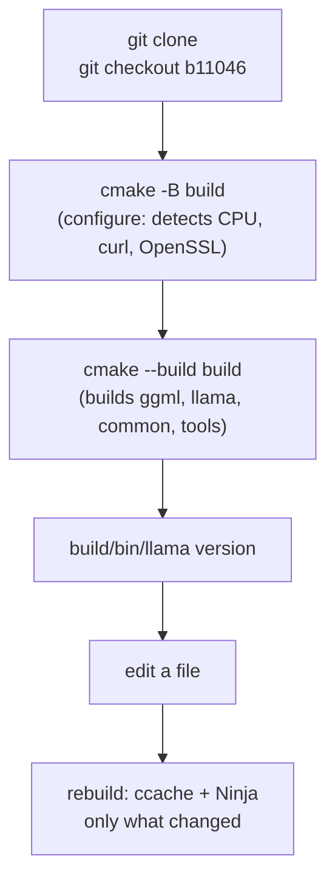

# Lab 01-02: Building from source (CPU)

<div class="meta" markdown>
<span class="meta-item">:material-book-open-page-variant:{ .meta-icon } Module <a href="../../moduli/01-installazione/README.md">01: Installation on various platforms</a></span>
<span class="meta-item">:material-clock-outline:{ .meta-icon } 45 minutes (+ build time)</span>
</div>

## Objective

Clone llama.cpp, pin the course reference build, build the CPU backend with CMake, measure
how long it takes and how much you save with Ninja and ccache. At the end you have a `build/bin/llama` with the same
version as the installer's binary, and you know how to rebuild in a minute after a change.

!!! note "Resources needed"
    The build uses all cores for 5-15 minutes and 2-3 GB of RAM: close heavy programs before you start it.

## Prerequisites

- Git, CMake ≥ 3.14, a C++17 compiler (GCC ≥ 9, Clang ≥ 10, MSVC 2022), 3 GB of disk space.
- Recommended: Ninja and ccache.
- Lab 01-01 done (to compare the binaries).

## Materials

| What | Where |
|---|---|
| Sources | `https://github.com/ggml-org/llama.cpp` (tag `b11046` = course build, tag `v0.4.1` = stable release) |
| Official guide | `docs/build.md` in the repository |
| Test model | `ggml-org/Qwen3.5-0.8B-GGUF`, already in the cache if you did lab 01-01 |



## Steps

### 1. Build tools

=== "Linux"
    ```bash
    sudo apt install build-essential cmake git ninja-build ccache libssl-dev libcurl4-openssl-dev   # Debian/Ubuntu
    # Fedora: sudo dnf install gcc-c++ cmake git ninja-build ccache openssl-devel libcurl-devel
    # Arch:   sudo pacman -S base-devel cmake git ninja ccache openssl curl
    cmake --version; ninja --version; ccache --version | head -1
    ```

=== "macOS"
    ```bash
    xcode-select --install          # if you do not have the command line tools yet
    brew install cmake ninja ccache
    cmake --version; ninja --version
    ```

=== "Windows (PowerShell)"
    Install **Visual Studio 2022 Community** and in the installer select the
    *Desktop development with C++* workload and the components *C++ CMake Tools for Windows*, *Git for Windows*,
    *C++ Clang Compiler for Windows*, *MSBuild support for LLVM (clang) toolset*. Always use a
    **Developer PowerShell for VS 2022** for the following commands.
    ```powershell
    cmake --version; git --version
    ```

### 2. Clone and pin the version

```bash
mkdir -p ~/llama-lab && cd ~/llama-lab
git clone https://github.com/ggml-org/llama.cpp src
cd src
git tag | grep -E "^b1104[0-9]$|^v0\.4\." | tail -5      # builds are bNNNNN tags, releases vX.Y.Z
git checkout b11046                                       # (1)!
git log -1 --oneline                                      # 60081bb2b …
```

1. `60081bb2b` is the commit that `llama version` reports for build 11046. To follow the latest stable
   release: `git checkout v0.4.1`. For `master`: skip the checkout (the course commands refer to `b11046`).

### 3. Configure and build (measuring)

=== "Linux / macOS"
    ```bash
    time cmake -B build -G Ninja -DCMAKE_BUILD_TYPE=Release      # (1)!
    time cmake --build build --config Release -j "$(nproc 2>/dev/null || sysctl -n hw.ncpu)"
    ls build/bin | head -20
    ./build/bin/llama version
    ```

    1. Look at the configuration output: `-- ccache found, compilation results will be cached`,
       `-- CURL found` (needed for `-hf`), `-- OpenSSL found` (HTTPS for `llama serve`), and the
       detected CPU instructions (`-- x86 detected` / `-- ARM detected`, then `GGML_AVX2`, etc.).

=== "Windows (PowerShell)"
    ```powershell
    Measure-Command { cmake -B build } | Select-Object TotalSeconds
    Measure-Command { cmake --build build --config Release -j 8 } | Select-Object TotalSeconds
    Get-ChildItem build\bin\Release\*.exe | Select-Object Name
    .\build\bin\Release\llama.exe version
    ```
    With the Visual Studio generator the binaries are in `build\bin\Release\`. Alternatively,
    `cmake --preset x64-windows-llvm-release` uses Ninja + Clang.

Expected output of `llama version`: `version: 0.4.1-dev (build 11046, commit 60081bb2b)` followed by `built with
GNU 13.x` (or Clang / MSVC) for your platform: the same build as the installer, built by you.
Write down the two times (configuration, build): roughly 5-15 minutes for the build on an
8-core laptop, much less on a desktop.

### 4. Rebuild with ccache: how much do you save?

```bash
ccache -z                                               # reset the statistics
touch src/llama-model.cpp                               # (1)!
time cmake --build build --config Release -j 8
ccache -s | grep -iE "hits|miss"                        # cache hits vs miss
rm -rf build && cmake -B build -G Ninja && time cmake --build build --config Release -j 8   # (2)!
ccache -s | grep -iE "hits|miss"
```

1. Changing a single file rebuilds that file and relinks: tens of seconds, not minutes.
2. With a full cache, even a build from scratch (`build` folder deleted) is almost all *cache hits*:
   this is why you install ccache **before** the first build.

### 5. Compare with the installer

```bash
./build/bin/llama version;  llama version
./build/bin/llama cli --list-devices
ldd ./build/bin/llama | grep -E "llama|ggml|curl|ssl"   # shared libraries in build/bin
./build/bin/llama cli -hf ggml-org/Qwen3.5-0.8B-GGUF -st -p "Ciao, chi sei? Una frase." -n 40 -rea off
```

The built binary uses `libllama.so`, `libggml*.so` in `build/bin/` (rpath): if you move it, bring the
libraries along or rebuild with `-DBUILD_SHARED_LIBS=OFF`. It does not have the certificate problem (it uses the system OpenSSL).
Compare the `[ Prompt … | Generation … ]` line with the one from lab 01-01: same CPU, same model,
differences within the variance.

### 6. Optional: `-DGGML_NATIVE=OFF` and static build

```bash
cmake -B build-portable -G Ninja -DGGML_NATIVE=OFF -DBUILD_SHARED_LIBS=OFF
cmake --build build-portable --config Release -j 8
ls build-portable/bin/ | grep -c "\.so"                 # 0: no shared libraries
ls build-portable/bin/ | grep libggml-cpu               # per-CPU variants, as in the tarball
```

`GGML_NATIVE=OFF` does not optimize for the CPU of the machine that builds, and produces the `libggml-cpu-<arch>` variants chosen at
runtime: this is how the release tarballs are built, and what you need if you distribute the binary to others.

## Check

- [ ] `git log -1 --oneline` shows `60081bb2b` and `./build/bin/llama version` reports `build 11046`.
- [ ] The configuration found ccache, CURL and OpenSSL (or you know which one is missing and why).
- [ ] You have three times: build from scratch, rebuild after `touch`, build from scratch with a full cache.
- [ ] `./build/bin/llama cli -hf …` answers using the model already in the cache (no new download).

## Questions and variations

1. Why is a build from scratch with a full ccache fast even if you deleted `build/`? What is not cached?
2. What changes between `git checkout b11046` and `git checkout v0.4.1`? Which of the two will you use in production?
3. Variation: build with `-DCMAKE_BUILD_TYPE=Debug` in `build-debug` and compare the generation speed
   (expect a collapse: the kernels are not optimized). It is only for `gdb`/`lldb`.
4. Variation: `-DGGML_BLAS=ON -DGGML_BLAS_VENDOR=OpenBLAS` (after `apt install libopenblas-dev`) and `llama bench -p 512`:
   does prompt processing change? And generation (`-n 32`)?
5. Variation: `-DLLAMA_BUILD_TESTS=ON` and `ctest --test-dir build -j 8`: how many tests pass?

## Deliverable

A `build.md` file with: platform, compiler and versions of cmake/ninja/ccache; the relevant lines of the
configuration (detected CPU, ccache/CURL/OpenSSL); the table of the three build times; the output of
`llama version` of the built binary next to the installer's; the generation speed compared.
