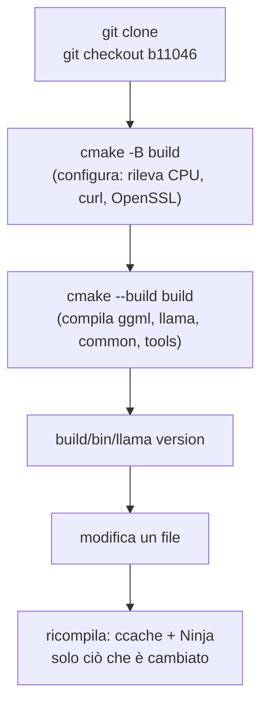

# Lab 01-02: Build dai sorgenti (CPU)

<div class="meta" markdown>
<span class="meta-item">:material-book-open-page-variant:{ .meta-icon } Modulo <a href="../../moduli/01-installazione/README.md">01: Installazione su varie piattaforme</a></span>
<span class="meta-item">:material-clock-outline:{ .meta-icon } 45 minuti (+ tempo di compilazione)</span>
<span class="stato stato-bozza">bozza · procedura dalla documentazione ufficiale, tempi non misurati dal corso</span>
</div>

## Obiettivo

Clonare llama.cpp, fissare la build di riferimento del corso, compilare il backend CPU con CMake, misurare
quanto ci vuole e quanto risparmi con Ninja e ccache. Alla fine hai `build/bin/llama` identico per versione
al binario dell'installer, e sai ricompilare in un minuto dopo una modifica.

!!! note "Non sul VPS condiviso"
    Questo lab si fa sul **tuo** computer: la compilazione occupa tutti i core per 5-15 minuti e 2-3 GB di RAM.
    Sul VPS del corso i tempi indicati non sono stati misurati.

## Prerequisiti

- Git, CMake ≥ 3.14, un compilatore C++17 (GCC ≥ 9, Clang ≥ 10, MSVC 2022), 3 GB di disco.
- Consigliati: Ninja e ccache.
- Lab 01-01 fatto (per confrontare i binari).

## Materiale

| Cosa | Dove |
|---|---|
| Sorgenti | `https://github.com/ggml-org/llama.cpp` (tag `b11046` = build del corso, tag `v0.4.1` = release stabile) |
| Guida ufficiale | `docs/build.md` nel repository |
| Modello di prova | `ggml-org/Qwen3.5-0.8B-GGUF`, già in cache se hai fatto il lab 01-01 |



## Procedura

### 1. Strumenti di compilazione

=== "Linux"
    ```bash
    sudo apt install build-essential cmake git ninja-build ccache libssl-dev libcurl4-openssl-dev   # Debian/Ubuntu
    # Fedora: sudo dnf install gcc-c++ cmake git ninja-build ccache openssl-devel libcurl-devel
    # Arch:   sudo pacman -S base-devel cmake git ninja ccache openssl curl
    cmake --version; ninja --version; ccache --version | head -1
    ```

=== "macOS"
    ```bash
    xcode-select --install          # se non hai già gli strumenti da riga di comando
    brew install cmake ninja ccache
    cmake --version; ninja --version
    ```

=== "Windows (PowerShell)"
    Installa **Visual Studio 2022 Community** e nel programma di installazione seleziona il workload
    *Desktop development with C++* e i componenti *C++ CMake Tools for Windows*, *Git for Windows*,
    *C++ Clang Compiler for Windows*, *MSBuild support for LLVM (clang) toolset*. Usa sempre un
    **Developer PowerShell for VS 2022** per i comandi seguenti.
    ```powershell
    cmake --version; git --version
    ```

### 2. Clona e fissa la versione

```bash
mkdir -p ~/llama-lab && cd ~/llama-lab
git clone https://github.com/ggml-org/llama.cpp src
cd src
git tag | grep -E "^b1104[0-9]$|^v0\.4\." | tail -5      # le build sono tag bNNNNN, le release vX.Y.Z
git checkout b11046                                       # (1)!
git log -1 --oneline                                      # 60081bb2b …
```

1. `60081bb2b` è il commit che `llama version` riporta per la build 11046. Per seguire l'ultima release
   stabile: `git checkout v0.4.1`. Per `master`: non fare il checkout (ma il corso non lo garantisce).

### 3. Configura e compila (misurando)

=== "Linux / macOS"
    ```bash
    time cmake -B build -G Ninja -DCMAKE_BUILD_TYPE=Release      # (1)!
    time cmake --build build --config Release -j "$(nproc 2>/dev/null || sysctl -n hw.ncpu)"
    ls build/bin | head -20
    ./build/bin/llama version
    ```

    1. Guarda l'output della configurazione: `-- ccache found, compilation results will be cached`,
       `-- CURL found` (necessario per `-hf`), `-- OpenSSL found` (HTTPS per `llama serve`), e le
       istruzioni CPU rilevate (`-- x86 detected` / `-- ARM detected`, poi `GGML_AVX2`, ecc.).

=== "Windows (PowerShell)"
    ```powershell
    Measure-Command { cmake -B build } | Select-Object TotalSeconds
    Measure-Command { cmake --build build --config Release -j 8 } | Select-Object TotalSeconds
    Get-ChildItem build\bin\Release\*.exe | Select-Object Name
    .\build\bin\Release\llama.exe version
    ```
    Con generatore Visual Studio i binari sono in `build\bin\Release\`. In alternativa
    `cmake --preset x64-windows-llvm-release` usa Ninja + Clang.

Output atteso di `llama version`: `version: 0.4.1-dev (build 11046, commit 60081bb2b)` seguito da `built with
GNU 13.x` (o Clang / MSVC) per la tua piattaforma: la stessa build dell'installer, compilata da te.
Segna i due tempi (configurazione, compilazione): indicativamente 5-15 minuti per la compilazione su un
portatile a 8 core, molto meno su un desktop.

### 4. Ricompila con ccache: quanto risparmi?

```bash
ccache -z                                               # azzera le statistiche
touch src/llama-model.cpp                               # (1)!
time cmake --build build --config Release -j 8
ccache -s | grep -iE "hits|miss"                        # cache hits vs miss
rm -rf build && cmake -B build -G Ninja && time cmake --build build --config Release -j 8   # (2)!
ccache -s | grep -iE "hits|miss"
```

1. Modificare un solo file ricompila quel file e rilinka: decine di secondi, non minuti.
2. Con la cache piena, anche una build da zero (cartella `build` cancellata) è quasi tutta *cache hit*:
   è il motivo per cui ccache va installato **prima** della prima compilazione.

### 5. Confronta con l'installer

```bash
./build/bin/llama version;  llama version
./build/bin/llama cli --list-devices
ldd ./build/bin/llama | grep -E "llama|ggml|curl|ssl"   # librerie condivise in build/bin
./build/bin/llama cli -hf ggml-org/Qwen3.5-0.8B-GGUF -st -p "Ciao, chi sei? Una frase." -n 40 -rea off
```

Il binario compilato usa `libllama.so`, `libggml*.so` in `build/bin/` (rpath): se lo sposti, porta con te le
librerie o ricompila con `-DBUILD_SHARED_LIBS=OFF`. Non ha il problema dei certificati (usa OpenSSL di sistema).
Confronta la riga `[ Prompt … | Generation … ]` con quella del lab 01-01: stessa CPU, stesso modello,
differenze entro la varianza.

### 6. Facoltativo: `-DGGML_NATIVE=OFF` e build statica

```bash
cmake -B build-portable -G Ninja -DGGML_NATIVE=OFF -DBUILD_SHARED_LIBS=OFF
cmake --build build-portable --config Release -j 8
ls build-portable/bin/ | grep -c "\.so"                 # 0: nessuna libreria condivisa
ls build-portable/bin/ | grep libggml-cpu               # varianti per CPU, come nel tarball
```

`GGML_NATIVE=OFF` non ottimizza per la CPU di chi compila e produce le varianti `libggml-cpu-<arch>` scelte a
runtime: è come vengono costruiti i tarball di release e ciò che serve se distribuisci il binario ad altri.

## Verifica del risultato

- [ ] `git log -1 --oneline` mostra `60081bb2b` e `./build/bin/llama version` riporta `build 11046`.
- [ ] La configurazione ha trovato ccache, CURL e OpenSSL (o sai quale manca e perché).
- [ ] Hai tre tempi: build da zero, ricompilazione dopo `touch`, build da zero con cache piena.
- [ ] `./build/bin/llama cli -hf …` risponde usando il modello già in cache (nessun nuovo download).

## Domande e varianti

1. Perché una build da zero con ccache pieno è veloce anche se hai cancellato `build/`? Che cosa non viene messo in cache?
2. Che cosa cambia tra `git checkout b11046` e `git checkout v0.4.1`? Quale dei due userai in produzione?
3. Variante: compila con `-DCMAKE_BUILD_TYPE=Debug` in `build-debug` e confronta la velocità di generazione
   (aspettati un crollo: i kernel non sono ottimizzati). Serve solo per `gdb`/`lldb`.
4. Variante: `-DGGML_BLAS=ON -DGGML_BLAS_VENDOR=OpenBLAS` (dopo `apt install libopenblas-dev`) e `llama bench -p 512`:
   cambia il prompt processing? E la generazione (`-n 32`)?
5. Variante: `-DLLAMA_BUILD_TESTS=ON` e `ctest --test-dir build -j 8`: quanti test passano?

## Consegna

Un file `build.md` con: piattaforma, compilatore e versioni di cmake/ninja/ccache; le righe rilevanti della
configurazione (CPU rilevata, ccache/CURL/OpenSSL); la tabella dei tre tempi di compilazione; l'output di
`llama version` del binario compilato accanto a quello dell'installer; la velocità di generazione a confronto.
