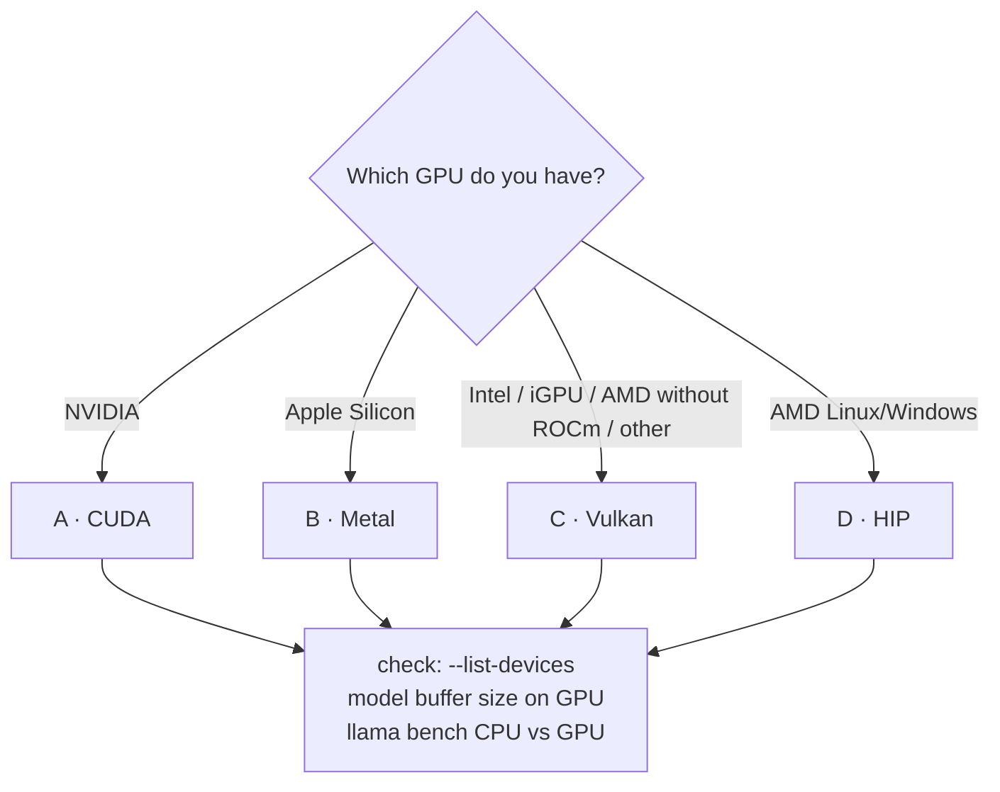

# Lab 01-03: Building with a GPU backend

<div class="meta" markdown>
<span class="meta-item">:material-book-open-page-variant:{ .meta-icon } Module <a href="../../moduli/01-installazione/README.md">01: Installation on various platforms</a></span>
<span class="meta-item">:material-clock-outline:{ .meta-icon } 60 minutes</span>
</div>

## Objective

Build llama.cpp with the backend of **your** GPU (one of four paths: CUDA, Metal, Vulkan, HIP),
check that the model really ends up in GPU memory and measure the gain over the CPU. This is a
lab with alternative paths: do only the one that matches your hardware; if you have no GPU,
the Vulkan path also works on many iGPUs, otherwise read it and move on to lab 01-04.

## Prerequisites

- Lab 01-02 completed (sources cloned in `~/llama-lab/src`, checkout `b11046`, working toolchain).
- The GPU driver installed and working (`nvidia-smi`, `rocminfo`, `vulkaninfo`, or an Apple Silicon Mac).
- 5-10 GB of disk space for SDK and build.

## Materials

| Path | SDK / packages | CMake flag |
|---|---|---|
| A · CUDA (NVIDIA) | CUDA Toolkit 12.x or 13.x | `-DGGML_CUDA=ON` |
| B · Metal (Apple Silicon) | Xcode Command Line Tools | none (ON by default) |
| C · Vulkan (any GPU) | Linux: `libvulkan-dev glslc spirv-headers`; Windows/macOS: LunarG Vulkan SDK | `-DGGML_VULKAN=ON` |
| D · HIP (AMD) | ROCm | `-DGGML_HIP=ON -DGPU_TARGETS=gfxNNNN` |
| Model | `ggml-org/Qwen3.5-0.8B-GGUF` (785 MiB) for the check; `ggml-org/gemma-3-4b-it-qat-GGUF:Q4_K_M` (~2.5 GB) to feel the difference | |



## Steps

### Path A · CUDA (NVIDIA)

```bash
nvidia-smi                                             # driver ok, free VRAM
nvcc --version                                         # CUDA Toolkit in the PATH
cd ~/llama-lab/src
cmake -B build-cuda -G Ninja -DGGML_CUDA=ON            # (1)!
cmake --build build-cuda --config Release -j 8         # 10-30 minutes: there are many CUDA kernels
./build-cuda/bin/llama cli --list-devices
```

1. By default it builds for the GPU present. If `nvcc` does not see it (`Cannot find valid GPU for '-arch=native'`),
   specify the compute capability: `-DCMAKE_CUDA_ARCHITECTURES="86"` (RTX 30x0) or `"89"` (RTX 40x0); for a
   binary for all GPUs, `-DGGML_NATIVE=OFF` (much longer build). Toolkit in a non-standard path:
   `-DCMAKE_CUDA_COMPILER=/opt/cuda-12.8/bin/nvcc`.

Expected output of `--list-devices`: `CUDA0: NVIDIA GeForce RTX … (NNNN MiB, NNNN MiB free)`.

### Path B · Metal (Apple Silicon)

```bash
cd ~/llama-lab/src
cmake -B build -G Ninja                                # Metal and Accelerate are already ON
cmake --build build --config Release -j 8
./build/bin/llama cli --list-devices                   # Metal: Apple M… (unified memory)
```

If you did lab 01-02 on a Mac, the binary you already have **is** this one: Metal was active. For a build
without GPU to compare: `cmake -B build-cpu -DGGML_METAL=OFF`.

### Path C · Vulkan

=== "Linux"
    ```bash
    sudo apt install libvulkan-dev glslc spirv-headers      # Debian/Ubuntu; Fedora: vulkan-loader-devel glslc spirv-headers-devel
    vulkaninfo --summary | grep -iE "deviceName|apiVersion"
    cd ~/llama-lab/src
    cmake -B build-vulkan -G Ninja -DGGML_VULKAN=ON
    cmake --build build-vulkan --config Release -j 8
    ./build-vulkan/bin/llama cli --list-devices
    ```

=== "macOS"
    Install the LunarG Vulkan SDK (check *KosmicKrisp*), then:
    ```bash
    source /path/to/vulkan-sdk/setup-env.sh
    cmake -B build-vulkan -G Ninja -DGGML_VULKAN=1 -DGGML_METAL=OFF
    cmake --build build-vulkan --config Release -j 8
    ```
    On a Mac, Vulkan goes through MoltenVK or KosmicKrisp (translation to Metal): it is only useful for experiments.

=== "Windows (PowerShell)"
    Install the LunarG Vulkan SDK with the default settings and Visual Studio 2022 with C++, then from the
    Developer PowerShell:
    ```powershell
    cmake -B build-vulkan -DGGML_VULKAN=ON
    cmake --build build-vulkan --config Release -j 8
    .\build-vulkan\bin\Release\llama.exe cli --list-devices
    ```
    Documented alternatives: w64devkit or MSYS2 (`pacman -S mingw-w64-ucrt-x86_64-{gcc,cmake,vulkan-devel,shaderc,spirv-headers}`).

Expected output in the log at load time: `ggml_vulkan: Found 1 Vulkan devices:` followed by
`ggml_vulkan: 0 = <nome GPU> | uma: 0 | fp16: 1 | warp size: 32 …` (`uma: 1` on shared-memory iGPUs).

### Path D · HIP (AMD)

=== "Linux"
    ```bash
    rocminfo | grep -m1 gfx                                  # e.g. gfx1100 (RX 7900), gfx1030 (RX 6800)
    cd ~/llama-lab/src
    HIPCXX="$(hipconfig -l)/clang" HIP_PATH="$(hipconfig -R)" \
      cmake -S . -B build-hip -G Ninja -DGGML_HIP=ON -DGPU_TARGETS=gfx1100 -DCMAKE_BUILD_TYPE=Release
    cmake --build build-hip --config Release -j 16
    ./build-hip/bin/llama cli --list-devices
    ```
    GPU not officially supported (e.g. gfx1035): `HSA_OVERRIDE_GFX_VERSION=10.3.0` (RDNA2) or `11.0.0`
    (RDNA3) in the runtime environment. Error `cannot find ROCm device library`: add
    `HIP_DEVICE_LIB_PATH=<cartella con oclc_abi_version_400.bc>`.

=== "Windows (PowerShell)"
    From the *x64 Native Tools Command Prompt for VS*:
    ```powershell
    set PATH=%HIP_PATH%\bin;%PATH%
    cmake -S . -B build-hip -G Ninja -DGPU_TARGETS=gfx1100 -DGGML_HIP=ON -DCMAKE_C_COMPILER=clang -DCMAKE_CXX_COMPILER=clang++ -DCMAKE_BUILD_TYPE=Release
    cmake --build build-hip
    ```
    `HSA_OVERRIDE_GFX_VERSION` does not work on Windows: if the GPU is not supported, use Vulkan.

### Checking the offload (all paths)

```bash
B=./build-cuda/bin       # or build / build-vulkan / build-hip
$B/llama cli -hf ggml-org/Qwen3.5-0.8B-GGUF -ngl 99 -st -p "ciao" -n 1 -rea off -v 2>&1 \
  | grep -E "model buffer size|KV buffer size|compute buffer size|memory breakdown|Host|CUDA0|Vulkan0|Metal|ROCm0"
```

Look for the lines `load_tensors: CUDA0 model buffer size = NNN MiB` (or `Vulkan0`, `Metal`, `ROCm0`) and
`llama_kv_cache: CUDA0 KV buffer size`: if the buffers are on `CPU`, the offload did not happen. The
`memory breakdown` table shows, for each device, how much is used by model, context and compute buffer. With `-ngl 0`
the weights stay on the CPU but the device can still take part in the computation; `--device none` turns it off completely.

### CPU versus GPU benchmark

```bash
M=$(ls ~/.cache/huggingface/hub/models--ggml-org--Qwen3.5-0.8B-GGUF/snapshots/*/*.gguf)
$B/llama bench -m "$M" -p 512 -n 128 -ngl 0  -r 3        # CPU only
$B/llama bench -m "$M" -p 512 -n 128 -ngl 99 -r 3        # everything on GPU
```

Output: a table with `pp512` (prompt processing, tokens/s) and `tg128` (generation). Expect a factor of
5-20× on pp and 3-10× on tg depending on the GPU; with a 0.8 B model in Q8_0 the GPU is almost wasted, so repeat with
`ggml-org/gemma-3-4b-it-qat-GGUF:Q4_K_M` (`llama download -hf …` then `-m`) if you have ≥ 4 GB of VRAM.

## Check

- [ ] `--list-devices` lists the device of the backend you built, with the available memory.
- [ ] In the load log with `-ngl 99`, the `model buffer size` is on the GPU device, not on `CPU`.
- [ ] `llama bench` shows higher `pp512` and `tg128` with `-ngl 99` than with `-ngl 0`.
- [ ] You can explain every CMake flag you used.

## Questions and variations

1. With a model larger than the VRAM, what does `-ngl 20` do? And `--fit on` (default) without `-ngl`?
2. Why does the concept of "copying the weights into VRAM" not exist on Apple Silicon?
3. Variation (NVIDIA): `GGML_CUDA_ENABLE_UNIFIED_MEMORY=1` with a model too large for the VRAM: does it work? How slow is it?
4. Variation: build with **two** backends (`-DGGML_CUDA=ON -DGGML_VULKAN=ON`) and choose at runtime with `--device Vulkan0`.
   With `-DGGML_BACKEND_DL=ON` the backends become `.so` files loaded on the fly: list them in `build/bin`.
5. Variation: compare your binary with the installer's (which detected CUDA/ROCm/Vulkan on its own):
   same speeds?

## Deliverable

A `gpu.md` file with: GPU and driver (`nvidia-smi`/`rocminfo`/`vulkaninfo`/`system_profiler`), the
CMake command used, the output of `--list-devices`, the `model buffer size` and `memory breakdown` lines with `-ngl 99`,
the `llama bench` CPU versus GPU table and a comment on the speedup factors.
