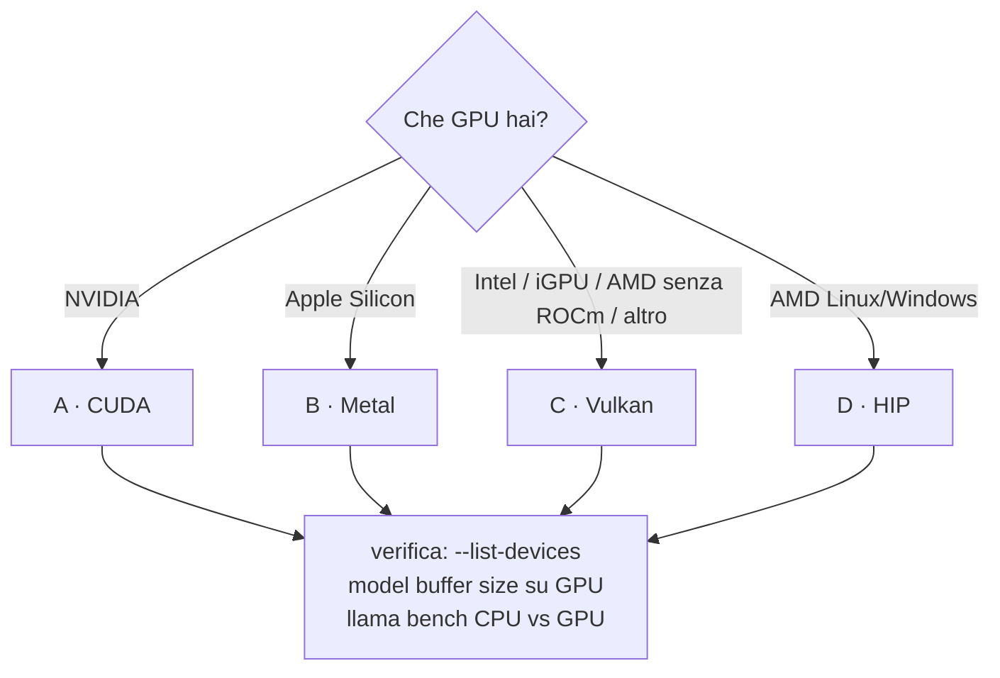

# Lab 01-03: Build con backend GPU

<div class="meta" markdown>
<span class="meta-item">:material-book-open-page-variant:{ .meta-icon } Modulo <a href="../../moduli/01-installazione/README.md">01: Installazione su varie piattaforme</a></span>
<span class="meta-item">:material-clock-outline:{ .meta-icon } 60 minuti</span>
</div>

## Obiettivo

Compilare llama.cpp con il backend della **tua** GPU (uno dei quattro percorsi: CUDA, Metal, Vulkan, HIP),
verificare che il modello finisca davvero in memoria GPU e misurare il guadagno rispetto alla CPU. È un
laboratorio a percorsi alternativi: fai solo quello che corrisponde al tuo hardware; se non hai una GPU,
il percorso Vulkan funziona anche su molte iGPU, altrimenti leggi e passa al lab 01-04.

## Prerequisiti

- Lab 01-02 completato (sorgenti clonati in `~/llama-lab/src`, checkout `b11046`, toolchain funzionante).
- Il driver della GPU installato e funzionante (`nvidia-smi`, `rocminfo`, `vulkaninfo`, o un Mac Apple Silicon).
- 5-10 GB di disco per SDK e build.

## Materiale

| Percorso | SDK / pacchetti | Flag CMake |
|---|---|---|
| A · CUDA (NVIDIA) | CUDA Toolkit 12.x o 13.x | `-DGGML_CUDA=ON` |
| B · Metal (Apple Silicon) | Xcode Command Line Tools | nessuno (ON di default) |
| C · Vulkan (qualsiasi GPU) | Linux: `libvulkan-dev glslc spirv-headers`; Windows/macOS: Vulkan SDK LunarG | `-DGGML_VULKAN=ON` |
| D · HIP (AMD) | ROCm | `-DGGML_HIP=ON -DGPU_TARGETS=gfxNNNN` |
| Modello | `ggml-org/Qwen3.5-0.8B-GGUF` (785 MiB) per la verifica; `ggml-org/gemma-3-4b-it-qat-GGUF:Q4_K_M` (~2,5 GB) per sentire la differenza | |



## Procedura

### Percorso A · CUDA (NVIDIA)

```bash
nvidia-smi                                             # driver ok, VRAM libera
nvcc --version                                         # CUDA Toolkit nel PATH
cd ~/llama-lab/src
cmake -B build-cuda -G Ninja -DGGML_CUDA=ON            # (1)!
cmake --build build-cuda --config Release -j 8         # 10-30 minuti: i kernel CUDA sono tanti
./build-cuda/bin/llama cli --list-devices
```

1. Di default compila per la GPU presente. Se `nvcc` non la vede (`Cannot find valid GPU for '-arch=native'`),
   indica la compute capability: `-DCMAKE_CUDA_ARCHITECTURES="86"` (RTX 30x0) o `"89"` (RTX 40x0); per un
   binario per tutte le GPU `-DGGML_NATIVE=OFF` (build molto più lunga). Toolkit in un percorso non standard:
   `-DCMAKE_CUDA_COMPILER=/opt/cuda-12.8/bin/nvcc`.

Output atteso di `--list-devices`: `CUDA0: NVIDIA GeForce RTX … (NNNN MiB, NNNN MiB free)`.

### Percorso B · Metal (Apple Silicon)

```bash
cd ~/llama-lab/src
cmake -B build -G Ninja                                # Metal e Accelerate sono già ON
cmake --build build --config Release -j 8
./build/bin/llama cli --list-devices                   # Metal: Apple M… (memoria unificata)
```

Se hai fatto il lab 01-02 su Mac, il binario che hai già **è** questo: Metal era attivo. Per una build
senza GPU da confrontare: `cmake -B build-cpu -DGGML_METAL=OFF`.

### Percorso C · Vulkan

=== "Linux"
    ```bash
    sudo apt install libvulkan-dev glslc spirv-headers      # Debian/Ubuntu; Fedora: vulkan-loader-devel glslc spirv-headers-devel
    vulkaninfo --summary | grep -iE "deviceName|apiVersion"
    cd ~/llama-lab/src
    cmake -B build-vulkan -G Ninja -DGGML_VULKAN=ON
    cmake --build build-vulkan --config Release -j 8
    ./build-vulkan/bin/llama cli --list-devices
    ```

=== "macOS"
    Installa il Vulkan SDK LunarG (spunta *KosmicKrisp*), poi:
    ```bash
    source /path/to/vulkan-sdk/setup-env.sh
    cmake -B build-vulkan -G Ninja -DGGML_VULKAN=1 -DGGML_METAL=OFF
    cmake --build build-vulkan --config Release -j 8
    ```
    Su Mac Vulkan passa da MoltenVK o KosmicKrisp (traduzione verso Metal): serve solo per esperimenti.

=== "Windows (PowerShell)"
    Installa il Vulkan SDK LunarG con le impostazioni di default e Visual Studio 2022 con C++, poi dal
    Developer PowerShell:
    ```powershell
    cmake -B build-vulkan -DGGML_VULKAN=ON
    cmake --build build-vulkan --config Release -j 8
    .\build-vulkan\bin\Release\llama.exe cli --list-devices
    ```
    Alternative documentate: w64devkit o MSYS2 (`pacman -S mingw-w64-ucrt-x86_64-{gcc,cmake,vulkan-devel,shaderc,spirv-headers}`).

Output atteso nel log al caricamento: `ggml_vulkan: Found 1 Vulkan devices:` seguito da
`ggml_vulkan: 0 = <nome GPU> | uma: 0 | fp16: 1 | warp size: 32 …` (`uma: 1` su iGPU a memoria condivisa).

### Percorso D · HIP (AMD)

=== "Linux"
    ```bash
    rocminfo | grep -m1 gfx                                  # es. gfx1100 (RX 7900), gfx1030 (RX 6800)
    cd ~/llama-lab/src
    HIPCXX="$(hipconfig -l)/clang" HIP_PATH="$(hipconfig -R)" \
      cmake -S . -B build-hip -G Ninja -DGGML_HIP=ON -DGPU_TARGETS=gfx1100 -DCMAKE_BUILD_TYPE=Release
    cmake --build build-hip --config Release -j 16
    ./build-hip/bin/llama cli --list-devices
    ```
    GPU non ufficialmente supportata (es. gfx1035): `HSA_OVERRIDE_GFX_VERSION=10.3.0` (RDNA2) o `11.0.0`
    (RDNA3) nell'ambiente a runtime. Errore `cannot find ROCm device library`: aggiungi
    `HIP_DEVICE_LIB_PATH=<cartella con oclc_abi_version_400.bc>`.

=== "Windows (PowerShell)"
    Dal *x64 Native Tools Command Prompt for VS*:
    ```powershell
    set PATH=%HIP_PATH%\bin;%PATH%
    cmake -S . -B build-hip -G Ninja -DGPU_TARGETS=gfx1100 -DGGML_HIP=ON -DCMAKE_C_COMPILER=clang -DCMAKE_CXX_COMPILER=clang++ -DCMAKE_BUILD_TYPE=Release
    cmake --build build-hip
    ```
    `HSA_OVERRIDE_GFX_VERSION` non funziona su Windows: se la GPU non è supportata usa Vulkan.

### Verifica dell'offload (tutti i percorsi)

```bash
B=./build-cuda/bin       # o build / build-vulkan / build-hip
$B/llama cli -hf ggml-org/Qwen3.5-0.8B-GGUF -ngl 99 -st -p "ciao" -n 1 -rea off -v 2>&1 \
  | grep -E "model buffer size|KV buffer size|compute buffer size|memory breakdown|Host|CUDA0|Vulkan0|Metal|ROCm0"
```

Cerca le righe `load_tensors: CUDA0 model buffer size = NNN MiB` (o `Vulkan0`, `Metal`, `ROCm0`) e
`llama_kv_cache: CUDA0 KV buffer size`: se i buffer sono su `CPU` l'offload non è avvenuto. La tabella
`memory breakdown` mostra per ogni device quanto è usato da modello, contesto, buffer di calcolo. Con `-ngl 0`
i pesi restano su CPU ma il device può ancora fare parte del calcolo; `--device none` lo spegne del tutto.

### Benchmark CPU contro GPU

```bash
M=$(ls ~/.cache/huggingface/hub/models--ggml-org--Qwen3.5-0.8B-GGUF/snapshots/*/*.gguf)
$B/llama bench -m "$M" -p 512 -n 128 -ngl 0  -r 3        # solo CPU
$B/llama bench -m "$M" -p 512 -n 128 -ngl 99 -r 3        # tutto su GPU
```

Output: una tabella con `pp512` (prompt processing, token/s) e `tg128` (generazione). Aspettati un fattore
5-20× su pp e 3-10× su tg secondo la GPU; con un 0,8 B in Q8_0 la GPU è quasi sprecata, ripeti con
`ggml-org/gemma-3-4b-it-qat-GGUF:Q4_K_M` (`llama download -hf …` poi `-m`) se hai ≥ 4 GB di VRAM.

## Verifica del risultato

- [ ] `--list-devices` elenca il device del backend compilato con la memoria disponibile.
- [ ] Nel log di caricamento con `-ngl 99` il `model buffer size` è sul device GPU, non su `CPU`.
- [ ] `llama bench` mostra `pp512` e `tg128` più alti con `-ngl 99` che con `-ngl 0`.
- [ ] Sai spiegare ogni flag CMake che hai usato.

## Domande e varianti

1. Con un modello più grande della VRAM, che cosa fa `-ngl 20`? E `--fit on` (default) senza `-ngl`?
2. Perché su Apple Silicon non esiste il concetto di "copiare i pesi nella VRAM"?
3. Variante (NVIDIA): `GGML_CUDA_ENABLE_UNIFIED_MEMORY=1` con un modello troppo grande per la VRAM: funziona? Quanto è lento?
4. Variante: compila con **due** backend (`-DGGML_CUDA=ON -DGGML_VULKAN=ON`) e scegli a runtime con `--device Vulkan0`.
   Con `-DGGML_BACKEND_DL=ON` i backend diventano `.so` caricate al volo: elencali in `build/bin`.
5. Variante: confronta il tuo binario con quello dell'installer (che ha rilevato CUDA/ROCm/Vulkan da solo):
   stesse velocità?

## Consegna

Un file `gpu.md` con: GPU e driver (`nvidia-smi`/`rocminfo`/`vulkaninfo`/`system_profiler`), il comando
CMake usato, l'output di `--list-devices`, le righe `model buffer size` e `memory breakdown` con `-ngl 99`,
la tabella di `llama bench` CPU contro GPU e un commento sui fattori di guadagno.
