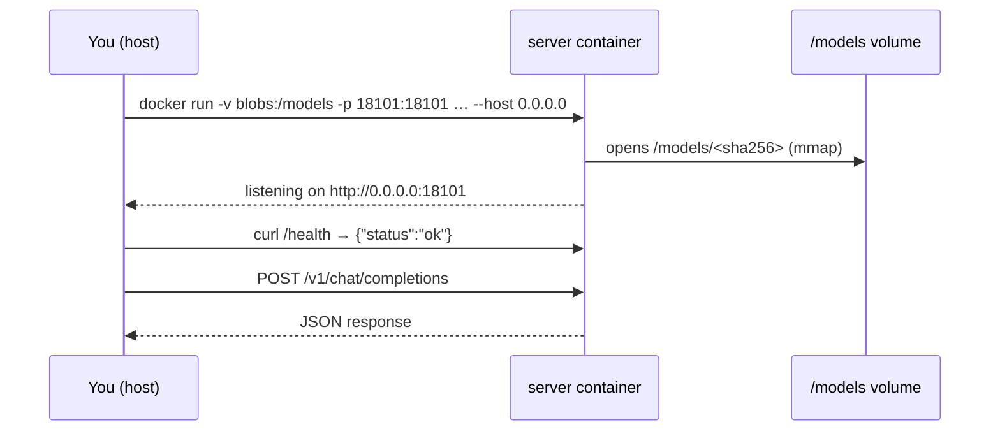

# Lab 01-04: llama.cpp in Docker

<div class="meta" markdown>
<span class="meta-item">:material-book-open-page-variant:{ .meta-icon } Module <a href="../../moduli/01-installazione/README.md">01: Installation on various platforms</a></span>
<span class="meta-item">:material-clock-outline:{ .meta-icon } 40 minutes</span>
</div>

## Objective

Run `llama-cli` and `llama-server` from the official `ghcr.io/ggml-org/llama.cpp` images, mounting the
model cache you already downloaded (without tripping over symbolic links), write a `docker-compose.yml` with
the `LLAMA_ARG_*` variables and, if you have an NVIDIA/AMD GPU, pass it to the container.

## Prerequisites

- Docker installed and working (`docker run --rm hello-world`), or Podman.
- The test model in the cache (lab 01-01) or a `.gguf` in a folder.
- For the GPU part: `nvidia-container-toolkit` (NVIDIA) or access to `/dev/dri` (AMD/Intel).

## Materials

| What | Where | Size |
|---|---|---|
| `ghcr.io/ggml-org/llama.cpp:light` | `llama-cli` + `llama-completion` | 308 MB downloaded (1.2 GB on disk) |
| `ghcr.io/ggml-org/llama.cpp:server` | `llama-server` with web UI | 308 MB |
| `ghcr.io/ggml-org/llama.cpp:full` | everything + Python conversion scripts | larger; needed in module 03 |
| Model | `ggml-org/Qwen3.5-0.8B-GGUF` in `~/.cache/huggingface/hub/models--ggml-org--Qwen3.5-0.8B-GGUF/` | 785 MiB |
| `docker-compose.yml` | in this folder | ready-made example |



## Steps

### 1. Pull the images and check the version

```bash
docker pull ghcr.io/ggml-org/llama.cpp:light
docker pull ghcr.io/ggml-org/llama.cpp:server
docker run --rm ghcr.io/ggml-org/llama.cpp:light --version
```

```text
version: 0.4.1-dev (build 11096, commit c550d2f60)
built with GNU 14.2.0 for Linux x86_64
```

The tag without a number follows the nightly builds: here it is `b11096`, newer than the course's `b11046`. To
pin the build: `ghcr.io/ggml-org/llama.cpp:server-b11046` (`docker manifest inspect` confirms that a tag exists
without downloading it).

```bash
docker run --rm --entrypoint /bin/sh ghcr.io/ggml-org/llama.cpp:light -c "ls /app"
```

In `/app` you find `llama-cli`, `llama-completion` and the `libggml-cpu-<arch>.so` files: the same structure as the tarball.

### 2. Find the model file (watch out for symbolic links)

```bash
H=~/.cache/huggingface/hub/models--ggml-org--Qwen3.5-0.8B-GGUF
ls -la $H/snapshots/*/                 # Qwen3.5-0.8B-Q8_0.gguf -> ../../blobs/37ae482d…
ls -la $H/blobs/                       # 37ae482d… (833 592 096 bytes): the real file
F=$(ls $H/blobs/)
```

If you mount `snapshots/` in the container, the link points to `../../blobs/`, which does not exist there. Three solutions:
mount `blobs/` (what we do), mount the whole `~/.cache/huggingface` at `/root/.cache/huggingface`,
or copy the file (`cp -L`) into a `models/` folder.

### 3. `light`: the CLI

```bash
docker run -it --rm -v "$H/blobs":/models ghcr.io/ggml-org/llama.cpp:light \
    -m /models/$F -st -p "Rispondi con una parola: capitale d'Italia?" -n 20 -rea off -t 3
```

`-it` is needed for interactive chat (without `-st -p` you enter the chat: `/exit` to leave). The entrypoint is
`/app/llama-cli`; for raw completion: `--entrypoint /app/llama-completion`.

### 4. `server`: the API

```bash
docker run -d --rm --name lab-server -v "$H/blobs":/models -p 127.0.0.1:18101:18101 \
    ghcr.io/ggml-org/llama.cpp:server \
    -m /models/$F -a qwen3.5-0.8b --host 0.0.0.0 --port 18101 -c 2048 -t 3      # (1)!
sleep 10; curl -s http://127.0.0.1:18101/health
curl -s http://127.0.0.1:18101/v1/models | head -c 200; echo
curl -s http://127.0.0.1:18101/v1/chat/completions -H "Content-Type: application/json" -d '{
  "model": "qwen3.5-0.8b",
  "messages": [{"role": "user", "content": "Di ciao in italiano, una parola."}],
  "max_tokens": 16, "chat_template_kwargs": {"enable_thinking": false}}'
docker logs lab-server 2>&1 | grep -E "listening|n_slots"
docker stop lab-server
```

1. `--host 0.0.0.0` is mandatory: inside the container the default `127.0.0.1` is not reachable through `-p`.
   `-p 127.0.0.1:18101:18101` publishes only on the host (not on the whole network). `-a` gives the model an alias.

Expected output:

```text
{"status":"ok"}
{"models":[{"name":"qwen3.5-0.8b","model":"qwen3.5-0.8b",…
{"choices":[{"finish_reason":"length","index":0,"message":{"role":"assistant","content":"Ciao! In italiano, la parola è **\"ciao\"**. È una"}}],…
srv    load_model: initializing, n_slots = 4, n_ctx_slot = 2048, kv_unified = 'true'
srv  llama_server: listening on http://0.0.0.0:18101
```

Open <http://127.0.0.1:18101> in the browser: it is the server's web UI (module 04).

### 5. Compose

The [`docker-compose.yml`](docker-compose.yml) file in this folder uses the `LLAMA_ARG_*` variables instead
of flags (every flag has one, you see it in `--help`):

```yaml
services:
  llama:
    image: ghcr.io/ggml-org/llama.cpp:server
    ports: ["127.0.0.1:18101:8080"]
    volumes: ["${HOME}/.cache/huggingface/hub/models--ggml-org--Qwen3.5-0.8B-GGUF/blobs:/models:ro"]
    environment:
      LLAMA_ARG_HOST: 0.0.0.0
      LLAMA_ARG_PORT: 8080
      LLAMA_ARG_MODEL: /models/37ae482d336108d23516fa35e8e0c4126688d81018b87178a18d752a1357814f
      LLAMA_ARG_ALIAS: qwen3.5-0.8b
      LLAMA_ARG_CTX_SIZE: 4096
      LLAMA_ARG_N_PARALLEL: 2
      LLAMA_ARG_THREADS: 3
    restart: unless-stopped
```

```bash
docker compose up -d && sleep 10 && curl -s http://127.0.0.1:18101/health && docker compose logs | tail -3
docker compose down
```

With `LLAMA_ARG_N_PARALLEL: 2` and `CTX_SIZE: 4096` the log says `n_slots = 2, n_ctx_slot = 2048`: the context
is split among the slots (module 00, common mistakes).

### 6. GPU passthrough (if you have one)

=== "NVIDIA"
    ```bash
    docker run --gpus all --rm -v "$H/blobs":/models -p 127.0.0.1:18101:18101 \
        ghcr.io/ggml-org/llama.cpp:server-cuda \
        -m /models/$F --host 0.0.0.0 --port 18101 -ngl 99
    ```
    You need `nvidia-container-toolkit` on the host. In Compose: `deploy.resources.reservations.devices` with
    `driver: nvidia, count: all, capabilities: [gpu]`. Tag `server-cuda13` for CUDA 13.

=== "AMD / Intel (Vulkan, ROCm, SYCL)"
    ```bash
    ls -la /dev/dri                                     # renderD128, card0/card1
    docker run --rm --device /dev/dri/renderD128:/dev/dri/renderD128 --device /dev/dri/card0:/dev/dri/card0 \
        -v "$H/blobs":/models -p 127.0.0.1:18101:18101 ghcr.io/ggml-org/llama.cpp:server-vulkan \
        -m /models/$F --host 0.0.0.0 --port 18101 -ngl 99
    ```
    `server-rocm` for HIP (needs the amdgpu driver on the host, often also `--group-add video`),
    `server-intel` for SYCL. The project's CI builds the GPU images without running them: if one does not start on your
    hardware, building locally (`docker build -f .devops/vulkan.Dockerfile --target server .`) is the official route.

Check in the log: `ggml_cuda_init: found 1 CUDA devices` / `ggml_vulkan: Found 1 Vulkan devices` and
`model buffer size` on the device.

## Check

- [ ] `docker run … :light --version` prints the image build.
- [ ] `light` answers the prompt with the model mounted from `blobs/`.
- [ ] `server` answers `{"status":"ok"}` on `/health` and on `/v1/chat/completions`; the log shows `listening on http://0.0.0.0:18101`.
- [ ] `docker compose up` starts the server from the `LLAMA_ARG_*` variables; `docker compose down` stops it.
- [ ] No container left over: `docker ps` is empty.

## Questions and variations

1. Why does `-p 8080:8080` without `--host 0.0.0.0` give "connection reset"? What does the container see as `127.0.0.1`?
2. What changes between mounting `blobs/` and mounting the whole `~/.cache/huggingface` at `/root/.cache/huggingface`?
   (Tip: with the second, `-hf` and `-cl` also work inside the container.)
3. Variation: use `:full` with `--entrypoint python3` to run `/app/convert_hf_to_gguf.py --help`.
4. Variation: `server` without `-m` starts the **router** (module 04): mount the whole cache and try `-cl`.
5. Variation: add `--api-key segreto` and observe the 401 without the `Authorization: Bearer` header.
6. Security: what risks does `-p 8080:8080` (without `127.0.0.1:`) carry on an exposed VPS? How do you solve it in module 09?

## Deliverable

A `docker.md` file with: the image's `--version` output, the `docker run` commands used (CLI and server)
with the JSON responses, your `docker-compose.yml`, the `n_slots`/`listening` log lines, and, if you have a GPU,
the lines that prove the offload in the container.
