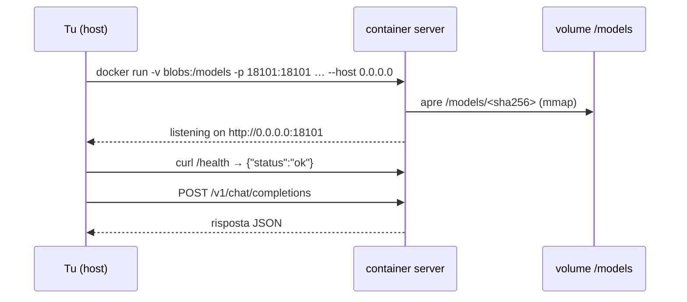

# Lab 01-04: llama.cpp in Docker

<div class="meta" markdown>
<span class="meta-item">:material-book-open-page-variant:{ .meta-icon } Modulo <a href="../../moduli/01-installazione/README.md">01: Installazione su varie piattaforme</a></span>
<span class="meta-item">:material-clock-outline:{ .meta-icon } 40 minuti</span>
<span class="stato stato-verificato">verificato su Linux x86_64 · immagini light/server b11096</span> <span class="stato stato-bozza">GPU passthrough non verificato</span>
</div>

## Obiettivo

Eseguire `llama-cli` e `llama-server` dalle immagini ufficiali `ghcr.io/ggml-org/llama.cpp`, montando la
cache dei modelli già scaricata (senza inciampare nei link simbolici), scrivere un `docker-compose.yml` con
le variabili `LLAMA_ARG_*` e, se hai una GPU NVIDIA/AMD, passarla al container.

## Prerequisiti

- Docker installato e funzionante (`docker run --rm hello-world`), oppure Podman.
- Il modello di prova in cache (lab 01-01) o un `.gguf` in una cartella.
- Per la parte GPU: `nvidia-container-toolkit` (NVIDIA) o accesso a `/dev/dri` (AMD/Intel).

## Materiale

| Cosa | Dove | Dimensione |
|---|---|---|
| `ghcr.io/ggml-org/llama.cpp:light` | `llama-cli` + `llama-completion` | 308 MB scaricati (1,2 GB su disco) |
| `ghcr.io/ggml-org/llama.cpp:server` | `llama-server` con web UI | 308 MB |
| `ghcr.io/ggml-org/llama.cpp:full` | tutto + script Python di conversione | più grande; serve nel modulo 03 |
| Modello | `ggml-org/Qwen3.5-0.8B-GGUF` in `~/.cache/huggingface/hub/models--ggml-org--Qwen3.5-0.8B-GGUF/` | 785 MiB |
| `docker-compose.yml` | in questa cartella | esempio pronto |



## Procedura

### 1. Scarica le immagini e controlla la versione

```bash
docker pull ghcr.io/ggml-org/llama.cpp:light
docker pull ghcr.io/ggml-org/llama.cpp:server
docker run --rm ghcr.io/ggml-org/llama.cpp:light --version
```

```text
version: 0.4.1-dev (build 11096, commit c550d2f60)
built with GNU 14.2.0 for Linux x86_64
```

Il tag senza numero segue le build notturne: qui è la `b11096`, più recente della `b11046` del corso. Per
fissare la build: `ghcr.io/ggml-org/llama.cpp:server-b11046` (esiste, verificato con `docker manifest inspect`).

```bash
docker run --rm --entrypoint /bin/sh ghcr.io/ggml-org/llama.cpp:light -c "ls /app"
```

In `/app` trovi `llama-cli`, `llama-completion` e le `libggml-cpu-<arch>.so`: la stessa struttura del tarball.

### 2. Trova il file del modello (attenzione ai link simbolici)

```bash
H=~/.cache/huggingface/hub/models--ggml-org--Qwen3.5-0.8B-GGUF
ls -la $H/snapshots/*/                 # Qwen3.5-0.8B-Q8_0.gguf -> ../../blobs/37ae482d…
ls -la $H/blobs/                       # 37ae482d… (833 592 096 byte): il file vero
F=$(ls $H/blobs/)
```

Se monti `snapshots/` nel container il link punta a `../../blobs/`, che lì non esiste. Tre soluzioni:
montare `blobs/` (quello che facciamo), montare tutta `~/.cache/huggingface` in `/root/.cache/huggingface`,
oppure copiare il file (`cp -L`) in una cartella `models/`.

### 3. `light`: la CLI

```bash
docker run -it --rm -v "$H/blobs":/models ghcr.io/ggml-org/llama.cpp:light \
    -m /models/$F -st -p "Rispondi con una parola: capitale d'Italia?" -n 20 -rea off -t 3
```

`-it` serve per la chat interattiva (senza `-st -p` entri nella chat: `/exit` per uscire). L'entrypoint è
`/app/llama-cli`; per il completamento grezzo: `--entrypoint /app/llama-completion`.

### 4. `server`: l'API

```bash
docker run -d --rm --name lab-server -v "$H/blobs":/models -p 127.0.0.1:18101:18101 \
    ghcr.io/ggml-org/llama.cpp:server \
    -m /models/$F -a qwen3.5-0.8b --host 0.0.0.0 --port 18101 -c 2048 -t 3      # (1)!
sleep 10; curl -s http://127.0.0.1:18101/health
curl -s http://127.0.0.1:18101/v1/models | head -c 200; echo
curl -s http://127.0.0.1:18101/v1/chat/completions -H "Content-Type: application/json" -d '{
  "model": "qwen3.5-0.8b",
  "messages": [{"role": "user", "content": "Di ciao in italiano, una parola."}],
  "max_tokens": 16, "chat_template_kwargs": {"enable_thinking": false}}'
docker logs lab-server 2>&1 | grep -E "listening|n_slots"
docker stop lab-server
```

1. `--host 0.0.0.0` è obbligatorio: dentro il container il default `127.0.0.1` non è raggiungibile da `-p`.
   `-p 127.0.0.1:18101:18101` pubblica solo sull'host (non su tutta la rete). `-a` dà un alias al modello.

Output verificato:

```text
{"status":"ok"}
{"models":[{"name":"qwen3.5-0.8b","model":"qwen3.5-0.8b",…
{"choices":[{"finish_reason":"length","index":0,"message":{"role":"assistant","content":"Ciao! In italiano, la parola è **\"ciao\"**. È una"}}],…
srv    load_model: initializing, n_slots = 4, n_ctx_slot = 2048, kv_unified = 'true'
srv  llama_server: listening on http://0.0.0.0:18101
```

Apri <http://127.0.0.1:18101> nel browser: è la web UI del server (modulo 04).

### 5. Compose

Il file [`docker-compose.yml`](docker-compose.yml) di questa cartella usa le variabili `LLAMA_ARG_*` invece
dei flag (ogni flag ne ha una, la vedi in `--help`):

```yaml
services:
  llama:
    image: ghcr.io/ggml-org/llama.cpp:server
    ports: ["127.0.0.1:18101:8080"]
    volumes: ["${HOME}/.cache/huggingface/hub/models--ggml-org--Qwen3.5-0.8B-GGUF/blobs:/models:ro"]
    environment:
      LLAMA_ARG_HOST: 0.0.0.0
      LLAMA_ARG_PORT: 8080
      LLAMA_ARG_MODEL: /models/37ae482d336108d23516fa35e8e0c4126688d81018b87178a18d752a1357814f
      LLAMA_ARG_ALIAS: qwen3.5-0.8b
      LLAMA_ARG_CTX_SIZE: 4096
      LLAMA_ARG_N_PARALLEL: 2
      LLAMA_ARG_THREADS: 3
    restart: unless-stopped
```

```bash
docker compose up -d && sleep 10 && curl -s http://127.0.0.1:18101/health && docker compose logs | tail -3
docker compose down
```

Con `LLAMA_ARG_N_PARALLEL: 2` e `CTX_SIZE: 4096` il log dice `n_slots = 2, n_ctx_slot = 2048`: il contesto
si divide tra gli slot (modulo 00, errori comuni).

### 6. GPU passthrough (se ce l'hai)

=== "NVIDIA"
    ```bash
    docker run --gpus all --rm -v "$H/blobs":/models -p 127.0.0.1:18101:18101 \
        ghcr.io/ggml-org/llama.cpp:server-cuda \
        -m /models/$F --host 0.0.0.0 --port 18101 -ngl 99
    ```
    Serve `nvidia-container-toolkit` sull'host. In Compose: `deploy.resources.reservations.devices` con
    `driver: nvidia, count: all, capabilities: [gpu]`. Tag `server-cuda13` per CUDA 13.

=== "AMD / Intel (Vulkan, ROCm, SYCL)"
    ```bash
    ls -la /dev/dri                                     # renderD128, card0/card1
    docker run --rm --device /dev/dri/renderD128:/dev/dri/renderD128 --device /dev/dri/card0:/dev/dri/card0 \
        -v "$H/blobs":/models -p 127.0.0.1:18101:18101 ghcr.io/ggml-org/llama.cpp:server-vulkan \
        -m /models/$F --host 0.0.0.0 --port 18101 -ngl 99
    ```
    `server-rocm` per HIP (serve il driver amdgpu sull'host, spesso anche `--group-add video`),
    `server-intel` per SYCL. Le immagini GPU sono costruite ma non testate dalla CI: se non partono, la
    compilazione locale (`docker build -f .devops/vulkan.Dockerfile --target server .`) è la via ufficiale.

Verifica nel log: `ggml_cuda_init: found 1 CUDA devices` / `ggml_vulkan: Found 1 Vulkan devices` e
`model buffer size` sul device.

## Verifica del risultato

- [ ] `docker run … :light --version` stampa la build dell'immagine.
- [ ] `light` risponde al prompt con il modello montato da `blobs/`.
- [ ] `server` risponde `{"status":"ok"}` su `/health` e a `/v1/chat/completions`; il log mostra `listening on http://0.0.0.0:18101`.
- [ ] `docker compose up` avvia il server dalle variabili `LLAMA_ARG_*`; `docker compose down` lo ferma.
- [ ] Nessun container rimasto: `docker ps` vuoto.

## Domande e varianti

1. Perché `-p 8080:8080` senza `--host 0.0.0.0` dà "connection reset"? Che cosa vede il container come `127.0.0.1`?
2. Che cosa cambia tra montare `blobs/` e montare tutta `~/.cache/huggingface` in `/root/.cache/huggingface`?
   (Suggerimento: con la seconda, `-hf` e `-cl` funzionano anche dentro il container.)
3. Variante: usa `:full` con `--entrypoint python3` per lanciare `/app/convert_hf_to_gguf.py --help`.
4. Variante: `server` senza `-m` avvia il **router** (modulo 04): monta la cache intera e prova `-cl`.
5. Variante: aggiungi `--api-key segreto` e osserva il 401 senza header `Authorization: Bearer`.
6. Sicurezza: quali rischi ha `-p 8080:8080` (senza `127.0.0.1:`) su un VPS esposto? Come lo risolvi nel modulo 09?

## Consegna

Un file `docker.md` con: output di `--version` dell'immagine, i comandi `docker run` usati (CLI e server)
con le risposte JSON, il tuo `docker-compose.yml`, le righe di log `n_slots`/`listening`, e, se hai una GPU,
le righe che provano l'offload nel container.
