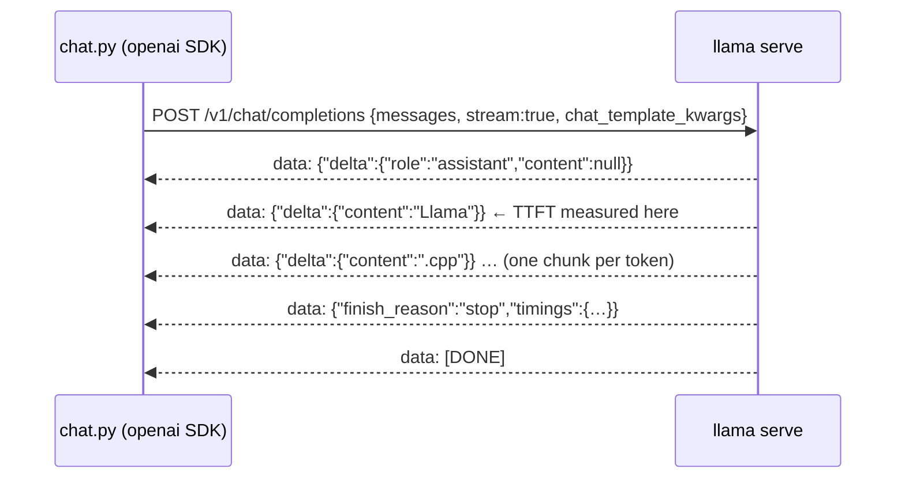

# Lab 04-02: OpenAI-compatible clients

<div class="meta" markdown>
<span class="meta-item">:material-book-open-page-variant:{ .meta-icon } Module <a href="../../moduli/04-server-api/README.md">04: `llama serve`: server and API</a></span>
<span class="meta-item">:material-clock-outline:{ .meta-icon } 40 minutes</span>
</div>

## Objective

Talk to `llama serve` from your own program, without `curl`: first with the official `openai` SDK in Python
(full response and streaming), then with native Node.js `fetch` and no dependencies at all. By the end you know
where llama.cpp's "extra" fields (`timings`, `chat_template_kwargs`) go when you use an SDK
designed for another provider, and you know how to measure time to first token.

## Prerequisites

- Lab [04-01](../lab-04-01-server-e-webui/README.md) completed (you can start the server and read `timings`).
- Python 3.10+ with `pip`; Node.js **18 or later** (for native `fetch` and `TextDecoderStream`; the examples use 22).
- Ubuntu with the installer binary: `export SSL_CERT_FILE=/etc/ssl/certs/ca-certificates.crt`.

## Materials

| What | Where | Size |
|---|---|---|
| `ggml-org/Qwen3.5-0.8B-GGUF` (file `Qwen3.5-0.8B-Q8_0.gguf`, Apache 2.0) | Hugging Face, via `-hf` | 785 MiB |
| [`chat.py`](chat.py): Python client with the `openai` SDK (`--stream` for streaming) | lab folder | 3 KB |
| [`chat.mjs`](chat.mjs): Node.js client with `fetch`, hand-written SSE parser (`--stream`) | lab folder | 2 KB |
| `openai` package (PyPI) | `pip install openai` (version 3.18.0) | ~10 MB with dependencies |

## Steps

1. **Start the server** in a terminal and leave it open (one slot is enough):

    ```bash
    llama serve -hf ggml-org/Qwen3.5-0.8B-GGUF --host 127.0.0.1 --port 8080 -c 2048 -np 1 -a qwen-0.8b
    ```

    Wait for `srv  llama_server: listening on http://127.0.0.1:8080` (or `curl -s localhost:8080/health`).

2. **Set up the Python environment** in a second terminal, inside the lab folder:

    ```bash
    cd corso/laboratori/lab-04-02-client-openai
    python3 -m venv .venv && source .venv/bin/activate    # Windows: .venv\Scripts\activate
    pip install openai
    ```

3. **Read `chat.py`** before running it. The three lines that matter:

    ```python
    client = OpenAI(base_url="http://127.0.0.1:8080/v1", api_key="no-key-required")   # (1)!
    EXTRA = {"chat_template_kwargs": {"enable_thinking": False}}                       # (2)!
    r = client.chat.completions.create(model="local", messages=..., extra_body=EXTRA)  # (3)!
    ```

    1. Compared with "real" OpenAI code only `base_url` changes; `api_key` must have some value
       (the SDK rejects an empty string), or the key passed to the server with `--api-key`.
    2. Parameters the OpenAI API does not know (here: turning off Qwen3.5's thinking) go in `extra_body`:
       the SDK copies them into the JSON as they are.
    3. `model` is ignored by a single-model server (the `-a` alias applies); it becomes mandatory in router mode.

4. **Full response**:

    ```bash
    python chat.py
    ```

    Output (b11046, 6 vCPU machine without GPU):

    ```
    Llamà.cpp è una libreria C++ per la gestione di chiamate di sistema, progettata per semplificare l'uso …

    [finish_reason=stop prompt=41 tok, completion=39 tok, 12.7s]
    [server: cache_n=0 prompt 12.4 t/s, generazione 4.2 t/s]
    ```

    The second line comes from `r.usage`; the third from the `timings` field, which **is not in the SDK's data model**:
    Pydantic keeps it in `r.model_extra["timings"]`. (The answer is made up: a 0.8 B model does not know llama.cpp; what matters here is how the data travels, not the content.)

5. **Streaming**:

    ```bash
    python chat.py --stream
    ```

    ```
    Llama.cpp è un framework Python per la generazione di modelli di linguaggio …
    [39 chunk, primo token dopo 1.11s, totale 15.4s]
    ```

    With `stream=True` the SDK returns an iterator: each item is an already decoded SSE chunk, with
    `chunk.choices[0].delta.content` (often a word or part of a word). The script measures **time to first
    token** (TTFT): it is the prompt processing time plus the first generation step, and it is what the user perceives
    as "responsiveness". The first chunk has `delta.role = "assistant"` and a null `content`: that is why the code checks
    `if delta.content`.

6. **Node.js without dependencies**. Read `chat.mjs`: the request is a `fetch` with `JSON.stringify(body)`, and
   streaming is a ten-line hand-written SSE parser (it accumulates text in a buffer, splits on lines,
   keeps only those that start with `data: `, stops on `[DONE]`). Try it:

    ```bash
    node chat.mjs
    node chat.mjs --stream
    ```

    ```
    Ecco tre usi principali di un server locale per modelli di linguaggio (LLM):

    1.  **Analisi e Generazione di Contenuti**: …
    [80 token, 4.3 t/s]
    ```

    With `--stream` the text appears piece by piece, then `[80 token, 4.5 t/s]` (from the `timings` of the last chunk) and
    `[fine]` when `data: [DONE]` arrives. `finish_reason` here is `length`: 80 tokens are not enough for three points.

7. **Switch server without touching the code**: both scripts read `LLAMA_URL`.

    ```bash
    LLAMA_URL=http://127.0.0.1:8081 python chat.py
    ```

8. **With an API key**. Restart the server with `--api-key segreta123` and run `python chat.py` again: you get
   `openai.AuthenticationError: Error code: 401 - {'error': {'message': 'Invalid API Key', 'type': 'authentication_error', 'code': 401}}`.
   Set `API_KEY = "segreta123"` in `chat.py` and in `chat.mjs` uncomment the header
   `Authorization: Bearer …`. If you remove the `api_key` argument from the constructor, the SDK reads the
   `OPENAI_API_KEY` environment variable by itself: `OPENAI_API_KEY=segreta123 python chat.py` goes through.

9. **Stop the server** with ++ctrl+c++.



## Check the result

- [ ] `python chat.py` prints the answer, then `usage` and the line `[server: cache_n=… t/s]` taken from `model_extra`.
- [ ] `python chat.py --stream` shows the text growing and a TTFT of 1-3 s on CPU (it depends on the machine).
- [ ] `node chat.mjs --stream` ends with `[fine]` after `data: [DONE]`.
- [ ] With `--api-key` on the server, the client without a key gets `401` and with the key it works.

## Questions and variants

- Run `python chat.py` twice in a row: `cache_n` goes from 0 to a value close to the `prompt` tokens. Why?
  (reread § 6 of module 04).
- Raise `max_tokens` to 300 and compare `finish_reason`: when is it `length` and when `stop`?
- In the Node client send `"stream_options": {"include_usage": true}`: `usage` also appears in the last chunk.
- Remove `chat_template_kwargs` and run again with `max_tokens: 80`: the model "thinks" and `content` can stay empty,
  while the Python SDK exposes the reasoning in `delta.model_extra["reasoning_content"]`.
- Anthropic variant: the same server answers on `/v1/messages`; if you have the `anthropic` SDK, try
  `Anthropic(base_url="http://127.0.0.1:8080", api_key="nokey")` with the mandatory `max_tokens`.
- Browser variant: `chat.mjs` also runs in an HTML page (same `fetch`); if the page is served from another
  origin remember `--cors-origins`.

## Deliverable

A file `lab-04-02.md` with: the outputs of `chat.py` (full and stream, with the TTFT), those of `chat.mjs`, the error
line you got in step 8 and a three-line answer to the question: "which lines would you change to move the
same script from the local server to the real OpenAI API?".
