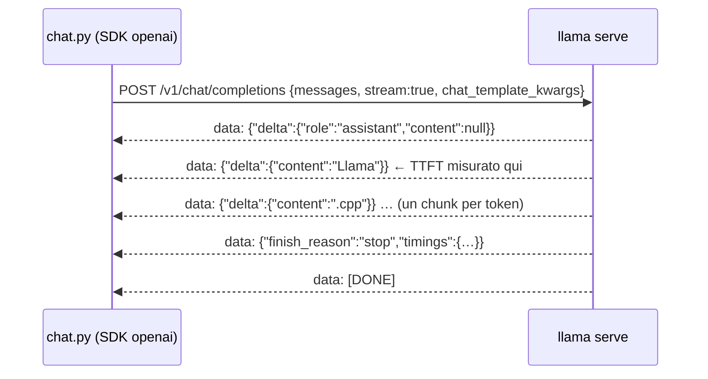

# Client compatibili OpenAI

> Modulo: [04: `llama serve`: server e API](../../moduli/04-server-api/README.md) · <span class="stato stato-verificato">verificato su b11046</span> · Durata stimata: 40 minuti

## Obiettivo

Parlare con `llama serve` da un programma tuo, senza `curl`: prima con l'SDK ufficiale `openai` in Python
(risposta intera e streaming), poi con `fetch` nativo di Node.js senza alcuna dipendenza. Alla fine sai
dove finiscono i campi "extra" di llama.cpp (`timings`, `chat_template_kwargs`) quando passi da un SDK
pensato per un altro fornitore, e sai misurare il tempo al primo token.

## Prerequisiti

- Lab [04-01](../lab-04-01-server-e-webui/README.md) completato (sai avviare il server e leggere `timings`).
- Python 3.10+ con `pip`; Node.js **18 o superiore** (per `fetch` e `TextDecoderStream` nativi; provato con 22).
- Ubuntu con binario dell'installer: `export SSL_CERT_FILE=/etc/ssl/certs/ca-certificates.crt`.

## Materiale

| Cosa | Dove | Dimensione |
|---|---|---|
| `ggml-org/Qwen3.5-0.8B-GGUF` (file `Qwen3.5-0.8B-Q8_0.gguf`, Apache 2.0) | Hugging Face, via `-hf` | 785 MiB |
| [`chat.py`](chat.py): client Python con SDK `openai` (`--stream` per lo streaming) | cartella del lab | 3 KB |
| [`chat.mjs`](chat.mjs): client Node.js con `fetch`, parser SSE a mano (`--stream`) | cartella del lab | 2 KB |
| pacchetto `openai` (PyPI) | `pip install openai` (provato con 3.18.0) | ~10 MB con dipendenze |

## Procedura

1. **Avvia il server** in un terminale e lascialo aperto (un solo slot basta):

    ```bash
    llama serve -hf ggml-org/Qwen3.5-0.8B-GGUF --host 127.0.0.1 --port 8080 -c 2048 -np 1 -a qwen-0.8b
    ```

    Aspetta `srv  llama_server: listening on http://127.0.0.1:8080` (o `curl -s localhost:8080/health`).

2. **Prepara l'ambiente Python** in un secondo terminale, dentro la cartella del lab:

    ```bash
    cd corso/laboratori/lab-04-02-client-openai
    python3 -m venv .venv && source .venv/bin/activate    # Windows: .venv\Scripts\activate
    pip install openai
    ```

3. **Leggi `chat.py`** prima di lanciarlo. Le tre righe che contano:

    ```python
    client = OpenAI(base_url="http://127.0.0.1:8080/v1", api_key="no-key-required")   # (1)!
    EXTRA = {"chat_template_kwargs": {"enable_thinking": False}}                       # (2)!
    r = client.chat.completions.create(model="local", messages=..., extra_body=EXTRA)  # (3)!
    ```

    1. Rispetto al codice "vero" per OpenAI cambia solo `base_url`; `api_key` deve avere un valore qualsiasi
       (l'SDK rifiuta la stringa vuota), oppure la chiave passata al server con `--api-key`.
    2. I parametri che l'API OpenAI non conosce (qui: spegnere il thinking di Qwen3.5) si passano in `extra_body`:
       l'SDK li copia nel JSON così come sono.
    3. `model` è ignorato dal server a modello singolo (vale l'alias `-a`); diventa obbligatorio in router mode.

4. **Risposta intera**:

    ```bash
    python chat.py
    ```

    Output reale (b11046, VPS a 6 vCPU):

    ```
    Llamà.cpp è una libreria C++ per la gestione di chiamate di sistema, progettata per semplificare l'uso …

    [finish_reason=stop prompt=41 tok, completion=39 tok, 12.7s]
    [server: cache_n=0 prompt 12.4 t/s, generazione 4.2 t/s]
    ```

    La seconda riga viene da `r.usage`; la terza dal campo `timings`, che **non è nel modello dati dell'SDK**:
    Pydantic lo conserva in `r.model_extra["timings"]`. (Il contenuto è sbagliato: un modello da 0,8B non sa
    cos'è llama.cpp. Il lab serve a provare il canale, non la conoscenza del modello.)

5. **Streaming**:

    ```bash
    python chat.py --stream
    ```

    ```
    Llama.cpp è un framework Python per la generazione di modelli di linguaggio …
    [39 chunk, primo token dopo 1.11s, totale 15.4s]
    ```

    Con `stream=True` l'SDK restituisce un iteratore: ogni elemento è un chunk SSE già decodificato, con
    `chunk.choices[0].delta.content` (spesso una parola o un pezzo di parola). Lo script misura il **tempo al primo
    token** (TTFT): è il tempo di prompt processing più il primo passo di generazione, ed è ciò che l'utente percepisce
    come "reattività". Il primo chunk ha `delta.role = "assistant"` e `content` nullo: per questo il codice controlla
    `if delta.content`.

6. **Node.js senza dipendenze**. Leggi `chat.mjs`: la richiesta è una `fetch` con `JSON.stringify(body)`, e lo
   streaming è un parser SSE scritto a mano di dieci righe (accumula il testo in un buffer, taglia sulle righe,
   considera solo quelle che iniziano con `data: `, si ferma su `[DONE]`). Provalo:

    ```bash
    node chat.mjs
    node chat.mjs --stream
    ```

    ```
    Ecco tre usi principali di un server locale per modelli di linguaggio (LLM):

    1.  **Analisi e Generazione di Contenuti**: …
    [80 token, 4.3 t/s]
    ```

    Con `--stream` il testo compare pezzo per pezzo, poi `[80 token, 4.5 t/s]` (dal `timings` dell'ultimo chunk) e
    `[fine]` quando arriva `data: [DONE]`. `finish_reason` qui è `length`: 80 token non bastano per tre punti.

7. **Cambia server senza toccare il codice**: entrambi gli script leggono `LLAMA_URL`.

    ```bash
    LLAMA_URL=http://127.0.0.1:8081 python chat.py
    ```

8. **Con chiave API**. Riavvia il server con `--api-key segreta123` e rilancia `python chat.py`: ottieni
   `openai.AuthenticationError: Error code: 401 - {'error': {'message': 'Invalid API Key', 'type': 'authentication_error', 'code': 401}}`
   (verificato). Metti `API_KEY = "segreta123"` in `chat.py` e in `chat.mjs` scommenta l'header
   `Authorization: Bearer …`. Se togli l'argomento `api_key` dal costruttore, l'SDK legge da solo la variabile
   d'ambiente `OPENAI_API_KEY` (verificato: `OPENAI_API_KEY=segreta123 python …` passa).

9. **Ferma il server** con ++ctrl+c++.



## Verifica del risultato

- [ ] `python chat.py` stampa la risposta, poi `usage` e la riga `[server: cache_n=… t/s]` presa da `model_extra`.
- [ ] `python chat.py --stream` mostra il testo che cresce e un TTFT di 1-3 s su CPU (dipende dalla macchina).
- [ ] `node chat.mjs --stream` termina con `[fine]` dopo `data: [DONE]`.
- [ ] Con `--api-key` sul server, il client senza chiave riceve `401` e con la chiave funziona.

## Domande e varianti

- Lancia `python chat.py` due volte di seguito: `cache_n` passa da 0 a un valore vicino a `prompt` token. Perché?
  (rileggi § 6 del modulo 04).
- Alza `max_tokens` a 300 e confronta `finish_reason`: quando è `length` e quando `stop`?
- Nel client Node manda `"stream_options": {"include_usage": true}`: nell'ultimo chunk compare anche `usage`.
- Togli `chat_template_kwargs` e rilancia con `max_tokens: 80`: il modello "pensa" e `content` può restare vuoto,
  mentre l'SDK Python espone il ragionamento in `delta.model_extra["reasoning_content"]`.
- Variante Anthropic: lo stesso server risponde su `/v1/messages`; se hai l'SDK `anthropic`, prova
  `Anthropic(base_url="http://127.0.0.1:8080", api_key="nokey")` con `max_tokens` obbligatorio.
- Variante browser: `chat.mjs` gira anche in una pagina HTML (stesso `fetch`); se la pagina è servita da un'altra
  origine ricorda `--cors-origins`.

## Consegna

Un file `lab-04-02.md` con: gli output di `chat.py` (intero e stream, con il TTFT), quelli di `chat.mjs`, la riga
di errore ottenuta al punto 8 e una risposta di tre righe alla domanda: "quali righe cambieresti per passare lo
stesso script dal server locale all'API OpenAI vera?".
