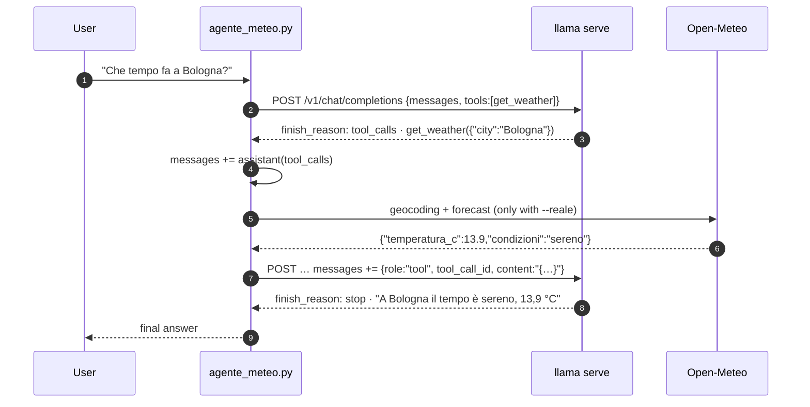

# Lab 04-04: Tool calling

<div class="meta" markdown>
<span class="meta-item">:material-book-open-page-variant:{ .meta-icon } Module <a href="../../moduli/04-server-api/README.md">04: `llama serve`: server and API</a></span>
<span class="meta-item">:material-clock-outline:{ .meta-icon } 60 minutes</span>
</div>

## Objective

Build a minimal agent: the model receives the description of a `get_weather` function, decides to call it,
**you** run it in Python and send it the result back, and the model writes the answer. First with fake weather
(fixed values, no network: it helps you understand the loop), then with real data from Open-Meteo, a public API with no key.
Along the way you see the two classic mistakes of small models: answering with made-up data instead of calling the
tool, and ignoring `tool_choice`.

## Prerequisites

- Lab [04-02](../lab-04-02-client-openai/README.md) (`openai` SDK installed, `extra_body`).
- An internet connection for the "real" part (`geocoding-api.open-meteo.com` and `api.open-meteo.com`).
- A model with a "tool-aware" chat template: Qwen3.5 is one (`/props` → `chat_template_caps.supports_tools: true`).

## Materials

| What | Where | Size |
|---|---|---|
| `ggml-org/Qwen3.5-0.8B-GGUF` (file `Qwen3.5-0.8B-Q8_0.gguf`, Apache 2.0) | Hugging Face, via `-hf` | 785 MiB |
| [`agente_meteo.py`](agente_meteo.py): tool definition, the `tool_calls → execution → role: tool` loop, fake and real version | lab folder | 6 KB |

## The loop



The server runs nothing: it puts the tool description in the prompt (through the chat template), constrains the output
to the model's call format and **parses** the response into `tool_calls`. Everything else,
running the function and sending back the result, is the client's job: that is, the script's.

## Steps

1. **Server** (a single slot, thinking turned off by the script per request):

    ```bash
    llama serve -hf ggml-org/Qwen3.5-0.8B-GGUF --host 127.0.0.1 --port 8080 -c 2048 -np 1 -a qwen-0.8b
    ```

2. **Read `agente_meteo.py`** from the top: `TOOLS` (OpenAI format: `type: "function"`, `name`, `description`,
   `parameters` in JSON Schema), the two implementations `get_weather_finto` / `get_weather_reale`, and the
   `agente()` function that holds the loop:

    ```python
    r = client.chat.completions.create(model=MODEL, messages=messaggi, tools=TOOLS,
                                       tool_choice=scelta, temperature=0, max_tokens=120, extra_body=EXTRA)
    msg = r.choices[0].message
    if not msg.tool_calls:                       # (1)!
        return msg.content
    messaggi.append({"role": "assistant", "content": msg.content or "",
                     "tool_calls": [tc.model_dump() for tc in msg.tool_calls]})   # (2)!
    for tc in msg.tool_calls:
        risultato = esegui_tool(tc.function.name, json.loads(tc.function.arguments), reale)
        messaggi.append({"role": "tool", "tool_call_id": tc.id,
                         "content": json.dumps(risultato, ensure_ascii=False)})    # (3)!
    ```

    1. No `tool_calls`: this is the final answer, the loop ends.
    2. The assistant message **with** the `tool_calls` goes back into the conversation, otherwise the model
       does not know it asked for anything.
    3. One `role: "tool"` message for each call, tied to its `tool_call_id`. `arguments` arrives as a
       JSON string: decode it with `json.loads`.

3. **Fake weather**:

    ```bash
    cd corso/laboratori/lab-04-04-tool-calling
    python agente_meteo.py
    ```

    ```
    Domanda: Che tempo fa a Bologna?  (meteo finto)
      [giro 1] il modello chiama get_weather({'city': 'Bologna'})
      [giro 1] risultato: {'city': 'Bologna', 'temperatura_c': 24.5, 'vento_kmh': 12, 'condizioni': 'sereno', 'fonte': 'finto'}
    Risposta: A Bologna il tempo è sereno con una temperatura di 24,5°C.
    ```

    Two HTTP requests: the first returns with `finish_reason: "tool_calls"`, the second with `"stop"`. Try
    `python agente_meteo.py "Che tempo fa a Milano?"`: the fake function always answers 24.5 °C, and that is fine.

4. **Real weather**:

    ```bash
    python agente_meteo.py --reale
    python agente_meteo.py --reale "Che tempo fa a Palermo e a Torino?"
    ```

    ```
    Domanda: Che tempo fa a Bologna?  (meteo REALE)
      [giro 1] il modello chiama get_weather({'city': 'Bologna'})
      [giro 1] risultato: {'city': 'Bologna', 'temperatura_c': 13.9, 'vento_kmh': 5.4, 'condizioni': 'sereno', 'fonte': 'open-meteo.com'}
    Risposta: A Bologna il tempo è sereno con una temperatura di 13,9 °C.
    ```
    ```
    Domanda: Che tempo fa a Palermo e a Torino?  (meteo REALE)
      [giro 1] il modello chiama get_weather({'city': 'Palermo'})
      [giro 1] risultato: {'city': 'Palermo', 'temperatura_c': 22.1, 'vento_kmh': 3.6, 'condizioni': 'prevalentemente sereno', …}
      [giro 1] il modello chiama get_weather({'city': 'Torino'})
      [giro 1] risultato: {'city': 'Torino', 'temperatura_c': 18.3, 'vento_kmh': 6.6, 'condizioni': 'coperto', …}
    Risposta: A Palermo il tempo è prevalentemente sereno con una temperatura di 22.1°C. A Torino il tempo è coperto con una temperatura di 18.3°C.
    ```

    With two cities the model emitted **two `tool_calls` in the same turn** (Qwen3.5 supports parallel
    calls: `chat_template_caps.supports_parallel_tool_calls`); the script runs them all and sends back two
    `tool` messages. `get_weather_reale` makes two HTTP calls: geocoding (city → coordinates) and `forecast` with
    `current=temperature_2m,wind_speed_10m,weather_code`; the WMO code is translated into Italian by the `CODICI_WMO` table.

5. **When the model does not call the tool**. Change the system prompt to
   `"Usa gli strumenti quando servono. Rispondi in italiano, in breve."` and run `python agente_meteo.py` again.
   Result:

    ```
    Domanda: Che tempo fa a Bologna?  (meteo finto)
    Risposta: Il meteo attuale a Bologna è: **9°C, 12 km/h, condizioni nuvolose**.
    ```

    No `[giro 1]` line: the model **made up** the weather. Seven extra words in the system prompt are enough to
    send a 0.8B model down a different path. Put the original prompt back (`"Usa gli strumenti quando servono."`).

6. **`tool_choice`**. With `--forza` the script sends `tool_choice="required"` on the first turn:

    ```bash
    python agente_meteo.py --forza
    ```

    With Qwen3.5-0.8B and the "long" prompt from step 5 the model ignores the requirement and answers in text:
    `"required"` does not force the call, as already noted in module 04. With larger models
    or different templates it works: always check it on your model, do not trust the parameter name.

7. **Look at what really travels**. The cost of tools is in the prompt: repeat the question from step 3 with `curl`
   (request in § 9 of module 04) and compare `usage.prompt_tokens`: 297 with `tools`, 27 without. Every turn
   of the loop pays this price again (the prompt cache reuses the prefix, but the first turn pays it in full).

8. **Stop the server** with ++ctrl+c++.

## Check the result

- [ ] `python agente_meteo.py` shows `[giro 1] il modello chiama get_weather({'city': 'Bologna'})` and an answer with 24.5 °C.
- [ ] `--reale` returns today's temperature (compare it with a weather site).
- [ ] With two cities you see two `tool_calls` in the same turn and an answer that mentions both.
- [ ] You reproduced at least once the "made-up" answer without a tool call and know why it happened.

## Questions and variants

- What happens if you remove the line that adds the `assistant` message with the `tool_calls` (step 2, note 2)?
  Try it: many templates reject a `tool` message without the call that precedes it.
- Add a second tool `get_time(city)` that returns the local time (use `zoneinfo`): does the model pick
  the right one? And with "che ore sono e che tempo fa a Roma?" does it call both?
- Add a `unit` parameter (`"C"|"F"`) with `enum` in the schema: does the model fill it in correctly? Remember
  that the grammar generated from the schema constrains the *shape* of the arguments, not whether they make sense.
- Make `esegui_tool` return an error (`{"error": "città non trovata"}`): does the model explain it to the user or
  retry with another city?
- With `-ctk q4_0` (KV cache quantized to 4 bits) the calls become less reliable: try it and count the failures over 10 runs.
- Anthropic variant: the same loop works on `/v1/messages` with `tools` in Anthropic format
  (`input_schema`, `tool_use`/`tool_result` blocks).

## Deliverable

A file `lab-04-04.md` with: the outputs of steps 3, 4 (two cities) and 5; the full JSON of the two requests from
step 3 (add a `print(json.dumps(messaggi, ensure_ascii=False, indent=1))` before the second call);
the code of the second tool from the variant and an example run.
