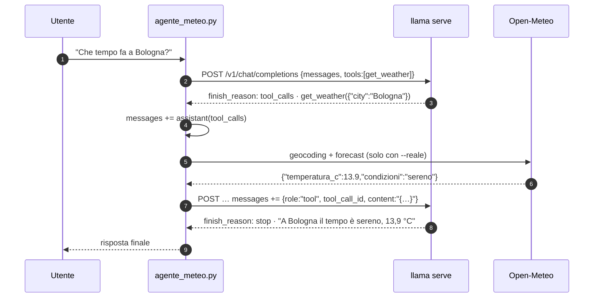

# Lab 04-04: Tool calling

<div class="meta" markdown>
<span class="meta-item">:material-book-open-page-variant:{ .meta-icon } Modulo <a href="../../moduli/04-server-api/README.md">04: `llama serve`: server e API</a></span>
<span class="meta-item">:material-clock-outline:{ .meta-icon } 60 minuti</span>
<span class="stato stato-verificato">verificato su b11046</span>
</div>

## Obiettivo

Costruire un agente minimo: il modello riceve la descrizione di una funzione `get_weather`, decide di chiamarla,
**tu** la esegui in Python e gli rimandi il risultato, lui formula la risposta. Prima con un meteo finto
(valori fissi, nessuna rete: serve a capire il ciclo), poi con dati reali da Open-Meteo, un'API pubblica senza chiave.
Lungo la strada vedi i due errori classici dei modelli piccoli: rispondere inventando invece di chiamare lo
strumento, e ignorare `tool_choice`.

## Prerequisiti

- Lab [04-02](../lab-04-02-client-openai/README.md) (SDK `openai` installato, `extra_body`).
- Connessione internet per la parte "reale" (`geocoding-api.open-meteo.com` e `api.open-meteo.com`).
- Un modello con chat template "tool-aware": Qwen3.5 lo è (`/props` → `chat_template_caps.supports_tools: true`).

## Materiale

| Cosa | Dove | Dimensione |
|---|---|---|
| `ggml-org/Qwen3.5-0.8B-GGUF` (file `Qwen3.5-0.8B-Q8_0.gguf`, Apache 2.0) | Hugging Face, via `-hf` | 785 MiB |
| [`agente_meteo.py`](agente_meteo.py): definizione del tool, ciclo `tool_calls → esecuzione → role: tool`, versione finta e reale | cartella del lab | 6 KB |

## Il ciclo



Il server non esegue nulla: mette la descrizione dei tool nel prompt (tramite il chat template), vincola l'output
al formato di chiamata del modello e **analizza** la risposta trasformandola in `tool_calls`. Tutto il resto,
eseguire la funzione e rimandare il risultato, è compito del client: cioè dello script.

## Procedura

1. **Server** (un solo slot, thinking spento dallo script per richiesta):

    ```bash
    llama serve -hf ggml-org/Qwen3.5-0.8B-GGUF --host 127.0.0.1 --port 8080 -c 2048 -np 1 -a qwen-0.8b
    ```

2. **Leggi `agente_meteo.py`** dall'alto: `TOOLS` (formato OpenAI: `type: "function"`, `name`, `description`,
   `parameters` in JSON Schema), le due implementazioni `get_weather_finto` / `get_weather_reale`, e la funzione
   `agente()` che contiene il ciclo:

    ```python
    r = client.chat.completions.create(model=MODEL, messages=messaggi, tools=TOOLS,
                                       tool_choice=scelta, temperature=0, max_tokens=120, extra_body=EXTRA)
    msg = r.choices[0].message
    if not msg.tool_calls:                       # (1)!
        return msg.content
    messaggi.append({"role": "assistant", "content": msg.content or "",
                     "tool_calls": [tc.model_dump() for tc in msg.tool_calls]})   # (2)!
    for tc in msg.tool_calls:
        risultato = esegui_tool(tc.function.name, json.loads(tc.function.arguments), reale)
        messaggi.append({"role": "tool", "tool_call_id": tc.id,
                         "content": json.dumps(risultato, ensure_ascii=False)})    # (3)!
    ```

    1. Nessuna `tool_calls`: è la risposta finale, il ciclo termina.
    2. Il messaggio dell'assistente **con** le `tool_calls` va rimesso nella conversazione, altrimenti il modello
       non sa di aver chiesto nulla.
    3. Un messaggio `role: "tool"` per ogni chiamata, agganciato al suo `tool_call_id`. `arguments` arriva come
       stringa JSON: va decodificata con `json.loads`.

3. **Meteo finto**:

    ```bash
    cd corso/laboratori/lab-04-04-tool-calling
    python agente_meteo.py
    ```

    ```
    Domanda: Che tempo fa a Bologna?  (meteo finto)
      [giro 1] il modello chiama get_weather({'city': 'Bologna'})
      [giro 1] risultato: {'city': 'Bologna', 'temperatura_c': 24.5, 'vento_kmh': 12, 'condizioni': 'sereno', 'fonte': 'finto'}
    Risposta: A Bologna il tempo è sereno con una temperatura di 24,5°C.
    ```

    Due richieste HTTP: la prima torna con `finish_reason: "tool_calls"`, la seconda con `"stop"`. Prova
    `python agente_meteo.py "Che tempo fa a Milano?"`: la funzione finta risponde sempre 24,5 °C, e va bene così.

4. **Meteo reale**:

    ```bash
    python agente_meteo.py --reale
    python agente_meteo.py --reale "Che tempo fa a Palermo e a Torino?"
    ```

    ```
    Domanda: Che tempo fa a Bologna?  (meteo REALE)
      [giro 1] il modello chiama get_weather({'city': 'Bologna'})
      [giro 1] risultato: {'city': 'Bologna', 'temperatura_c': 13.9, 'vento_kmh': 5.4, 'condizioni': 'sereno', 'fonte': 'open-meteo.com'}
    Risposta: A Bologna il tempo è sereno con una temperatura di 13,9 °C.
    ```
    ```
    Domanda: Che tempo fa a Palermo e a Torino?  (meteo REALE)
      [giro 1] il modello chiama get_weather({'city': 'Palermo'})
      [giro 1] risultato: {'city': 'Palermo', 'temperatura_c': 22.1, 'vento_kmh': 3.6, 'condizioni': 'prevalentemente sereno', …}
      [giro 1] il modello chiama get_weather({'city': 'Torino'})
      [giro 1] risultato: {'city': 'Torino', 'temperatura_c': 18.3, 'vento_kmh': 6.6, 'condizioni': 'coperto', …}
    Risposta: A Palermo il tempo è prevalentemente sereno con una temperatura di 22.1°C. A Torino il tempo è coperto con una temperatura di 18.3°C.
    ```

    Con due città il modello ha emesso **due `tool_calls` nello stesso giro** (Qwen3.5 supporta le chiamate
    parallele: `chat_template_caps.supports_parallel_tool_calls`); lo script le esegue tutte e rimanda due
    messaggi `tool`. `get_weather_reale` fa due chiamate HTTP: geocoding (città → coordinate) e `forecast` con
    `current=temperature_2m,wind_speed_10m,weather_code`; il codice WMO è tradotto in italiano dalla tabella `CODICI_WMO`.

5. **Quando il modello non chiama lo strumento**. Cambia il prompt di sistema in
   `"Usa gli strumenti quando servono. Rispondi in italiano, in breve."` e rilancia `python agente_meteo.py`.
   Risultato reale:

    ```
    Domanda: Che tempo fa a Bologna?  (meteo finto)
    Risposta: Il meteo attuale a Bologna è: **9°C, 12 km/h, condizioni nuvolose**.
    ```

    Nessuna riga `[giro 1]`: il modello ha **inventato** il meteo. Sette parole in più nel system prompt bastano a
    far cambiare strada a un modello da 0,8B. Rimetti il prompt originale (`"Usa gli strumenti quando servono."`).

6. **`tool_choice`**. Con `--forza` lo script manda `tool_choice="required"` al primo giro:

    ```bash
    python agente_meteo.py --forza
    ```

    Con Qwen3.5-0.8B e il prompt "lungo" del punto 5 il modello ha ignorato l'obbligo e ha risposto a testo
    (verificato: `"required"` non ha forzato la chiamata, come già notato nel modulo 04). Con modelli più grandi
    o template diversi funziona: controllalo sempre sul tuo modello, non fidarti del nome del parametro.

7. **Guarda cosa viaggia davvero**. Il costo dei tool è nel prompt: ripeti la domanda del punto 3 con `curl`
   (richiesta nel § 9 del modulo 04) e confronta `usage.prompt_tokens`: 297 con `tools`, 27 senza. Ogni giro
   del ciclo ripaga questo prezzo (la prompt cache riusa il prefisso, ma il primo giro lo paga per intero).

8. **Ferma il server** con ++ctrl+c++.

## Verifica del risultato

- [ ] `python agente_meteo.py` mostra `[giro 1] il modello chiama get_weather({'city': 'Bologna'})` e una risposta con 24,5 °C.
- [ ] `--reale` restituisce la temperatura odierna (confrontala con un sito meteo).
- [ ] Con due città vedi due `tool_calls` nello stesso giro e una risposta che le cita entrambe.
- [ ] Hai riprodotto almeno una volta la risposta "inventata" senza chiamata allo strumento e sai perché è successo.

## Domande e varianti

- Cosa succede se rimuovi la riga che aggiunge il messaggio `assistant` con le `tool_calls` (punto 2, nota 2)?
  Provalo: molti template rifiutano un messaggio `tool` senza la chiamata che lo precede.
- Aggiungi un secondo strumento `get_time(city)` che restituisce l'ora locale (usa `zoneinfo`): il modello sceglie
  quello giusto? E con "che ore sono e che tempo fa a Roma?" li chiama entrambi?
- Aggiungi un parametro `unit` (`"C"|"F"`) con `enum` nello schema: il modello lo compila correttamente? Ricorda
  che la grammatica generata dallo schema vincola la *forma* degli argomenti, non che siano sensati.
- Fai restituire a `esegui_tool` un errore (`{"error": "città non trovata"}`): il modello lo spiega all'utente o
  riprova con un'altra città?
- Con `-ctk q4_0` (KV cache quantizzata a 4 bit) le chiamate diventano meno affidabili: provalo e conta i fallimenti su 10 esecuzioni.
- Variante Anthropic: lo stesso ciclo funziona su `/v1/messages` con `tools` in formato Anthropic
  (`input_schema`, blocchi `tool_use`/`tool_result`).

## Consegna

Un file `lab-04-04.md` con: gli output dei punti 3, 4 (due città) e 5; il JSON completo delle due richieste del
punto 3 (aggiungi un `print(json.dumps(messaggi, ensure_ascii=False, indent=1))` prima della seconda chiamata);
il codice del secondo strumento della variante e un esempio di esecuzione.
