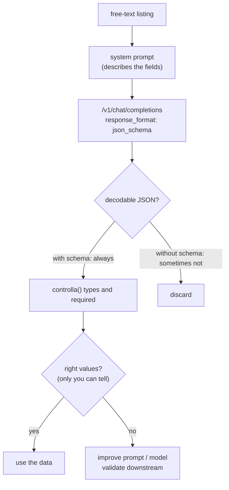

# Lab 06-02: Extracting data as JSON

<div class="meta" markdown>
<span class="meta-item">:material-book-open-page-variant:{ .meta-icon } Module <a href="../../moduli/06-output-strutturato/README.md">06: Structured output: GBNF grammars and JSON Schema</a></span>
<span class="meta-item">:material-clock-outline:{ .meta-icon } 60 minutes</span>
</div>

## Objective

Turn three free-form real estate listings into JSON objects with typed fields, using
`response_format` with a JSON Schema on `/v1/chat/completions`. Compare with the same request without the constraint,
then do the part no grammar does for you: check that the **values** are right.

## Prerequisites

- Lab [04-01](../lab-04-01-server-e-webui/README.md) (server running, `curl`) and module 06 § 3-4 (what the converter converts).
- Python 3 (standard library only).

## Materials

| What | Where | Size |
|---|---|---|
| `ggml-org/Qwen3.5-0.8B-GGUF` (file `Qwen3.5-0.8B-Q8_0.gguf`, Apache 2.0) | Hugging Face, via `-hf` | 785 MiB |
| [`annunci.txt`](annunci.txt): three listings separated by `===` (Bologna, Padova, Ravenna) | lab folder | 0.5 KB |
| [`schema-annuncio.json`](schema-annuncio.json): schema with `enum`, `integer` + `minimum/maximum`, `boolean`, `maxLength`, `required`, `additionalProperties: false` | lab folder | 0.7 KB |
| [`estrai.py`](estrai.py): sends each listing with `response_format` (or without, with `--senza-schema`) and applies minimal checks | lab folder | 4 KB |

## Steps

1. **Server** with a single slot, an alias and `-c 2048` (one listing plus the system prompt fit in ~250 tokens):

    ```bash
    llama serve -hf ggml-org/Qwen3.5-0.8B-GGUF --host 127.0.0.1 --port 8080 -c 2048 -np 1 -a qwen-0.8b
    ```

2. **Read the schema** and ask yourself, for each constraint, whether the converter will enforce it (table in § 3 of the module):
   `enum` yes; `integer` with `minimum`/`maximum` yes; `maxLength` yes; `required` yes (and in schema order);
   `additionalProperties: false` is the default anyway. The `note` field is not in `required`: the model may omit it.

3. **Read the system prompt in `estrai.py`**. It lists the fields and their meaning ("locali: integer; if not
   stated, estimate from the text", "prezzo_euro: for rentals, the monthly rent") because **the schema does not reach the
   model**: without this description the model does not know `locali` exists until the grammar forces it
   token by token, and at that point it guesses.

4. **With the schema**:

    ```bash
    cd corso/laboratori/lab-06-02-estrazione-json
    python3 estrai.py
    ```

    Output:

    ```
    server http://127.0.0.1:8080 · 3 annunci · vincolo schema: SÌ

    --- annuncio 1: Vendesi luminoso trilocale di 85 mq in zona Saragozza a Bolo…
      {"titolo": "Luminoso trilocale", "tipo": "appartamento", "citta": "Bologna", "metri_quadri": 85, "locali": 2, "prezzo_euro": 245000, "ascensore": true, "note": "Cantina inclusa"}
      controlli superati

    --- annuncio 2: Affittasi ufficio open space di circa 140 metri quadri nel c…
      {"titolo": "Ufficio Open Space", "tipo": "ufficio", "citta": "Padova", "metri_quadri": 140, "locali": 2, "prezzo_euro": 1900, "ascensore": false, "note": "opzionale"}
      controlli superati

    --- annuncio 3: Villa indipendente a Ravenna, 6 locali su due piani, 220 mq,…
      {"titolo": "Villa indipendente Ravenna", "tipo": "appartamento", "citta": "Ravenna", "metri_quadri": 220, "locali": 6, "prezzo_euro": 520000, "ascensore": true, "note": "Da ristrutturare parzialmente"}
      controlli superati

    risultato: 3/3 annunci validi. Ora confronta i VALORI con il testo: sono giusti?
    ```

    Three JSON objects out of three decode, all required fields are present, all types are right. Now do what
    the last line asks.

5. **Hunt for errors in the values**. Compare each object with `annunci.txt`. The errors in the output above:

    | Listing | Field | Model | Text | Why |
    |---|---|---|---|---|
    | 1 | `locali` | 2 | "trilocale" = 3 | missing lexical knowledge |
    | 2 | `note` | `"opzionale"` | (nothing) | it copied the word "opzionale" from the system prompt |
    | 3 | `tipo` | `appartamento` | "Villa indipendente" | `enum` respected, wrong value |
    | 3 | `ascensore` | `true` | not mentioned | the `boolean` forces a choice: it chose |

    None of these can be detected by a schema: they are all allowed values. `metri_quadri`, `prezzo_euro`,
    `citta` and the office's monthly rent are right in all three.

6. **Without the schema**, same prompt:

    ```bash
    python3 estrai.py --senza-schema
    ```

    ```
    --- annuncio 1 …
      {"titolo": "Luminoso trilocale", …, "locali": "intero", …}
      controlli falliti: locali non è un intero: 'intero'
    --- annuncio 2 …
      {…, "locali": "2", …, "note": null}
      controlli falliti: locali non è un intero: '2'
    --- annuncio 3 …
      {…, "locali": "6 locali", …}
      controlli falliti: locali non è un intero: '6 locali'

    risultato: 0/3 annunci validi.
    ```

    The model returned decodable JSON (this time without a Markdown fence, which is not guaranteed), but `locali`
    is a string in all three cases: `"intero"` copied from the prompt, `"2"`, `"6 locali"`. This is the error the
    grammar removes: `"locali": ` followed by a digit, no choice.

7. **Look at the outgoing request**. Add `print(json.dumps(body["response_format"])[:200])` in `chiedi()`:
   the form sent is the OpenAI one, `{"type": "json_schema", "json_schema": {"name": "annuncio", "schema": {…}}}`,
   which the server accepts along with `{"type": "json_schema", "schema": {…}}`. With `curl` you can send the same
   thing by hand (§ 4 of the module).

8. **Fix it with the prompt, not the schema**. Add to the system prompt: «trilocale = 3 locali, bilocale = 2;
   villa → tipo "villa"; ascensore false se non citato; note solo se presenti nel testo, altrimenti ometti il campo»
   (three-room = 3 rooms, two-room = 2; villa → type "villa"; elevator false if not mentioned; notes only if present in the text, otherwise omit the field).
   Run it again and count how many errors from step 5 disappear: **three out of four** (`locali: 3`, `note` omitted
   for the office, `ascensore: false` for the villa), but the villa stays `tipo: "appartamento"` even with the rule written
   in the prompt. The prompt helps, the real solution is a more capable model; the grammar only gives you certainty about the format.

9. **Make the schema stricter**: `"citta": {"type": "string", "enum": ["Bologna", "Padova", "Ravenna"]}` and
   `"locali": {"type": "integer", "minimum": 1, "maximum": 8}`. Run it again: the grammar now enforces these
   ranges too (remember: `minimum/maximum` apply only to `integer`).

10. **Stop the server** with ++ctrl+c++.



## Check the result

- [ ] With the schema: 3/3 decodable JSON objects with all `required` fields and correct types.
- [ ] Without the schema: at least one listing with a field of the wrong type or not decodable.
- [ ] You filled in the table of value errors (at least three) and can explain why the schema does not see them.
- [ ] You measured how many errors disappear by changing only the prompt.

## Questions and variations

- Remove `"additionalProperties": false` from the schema: does anything change? (No: it is already the llama.cpp default; with
  `true` the model could add keys at will).
- Use `"prezzo_euro": {"type": "number", "minimum": 0}` instead of `integer`: can the model write `-1`?
  (Yes: bounds are ignored for `number`).
- Use `"type": "json_object"` without a schema: how many listings pass `controlla()`?
- Do the same work with the `openai` SDK and `response_format={"type": "json_schema", "json_schema": {...}}`:
  only the transport changes.
- With Pydantic: define `class Annuncio(BaseModel)` and pass `Annuncio.model_json_schema()`; then
  `Annuncio.model_validate_json(content)` as downstream validation (remember the `additionalProperties` default).
- Measure `timings.predicted_per_second` with and without the schema over 10 runs: is there a measurable cost to the constraint
  with a schema of this size?
- A larger model (`ggml-org/gemma-3-4b-it-qat-GGUF`, ~3 GB): how many errors from step 5 disappear on their own?

## Deliverable

A file `lab-06-02.md` with: the two outputs of `estrai.py`; the table of value errors; the modified system prompt
and the "before/after" count; the strict schema from step 9 and a sample output; the answer to the
question "which of the four errors in step 5 could be avoided with the schema alone, and how?".
