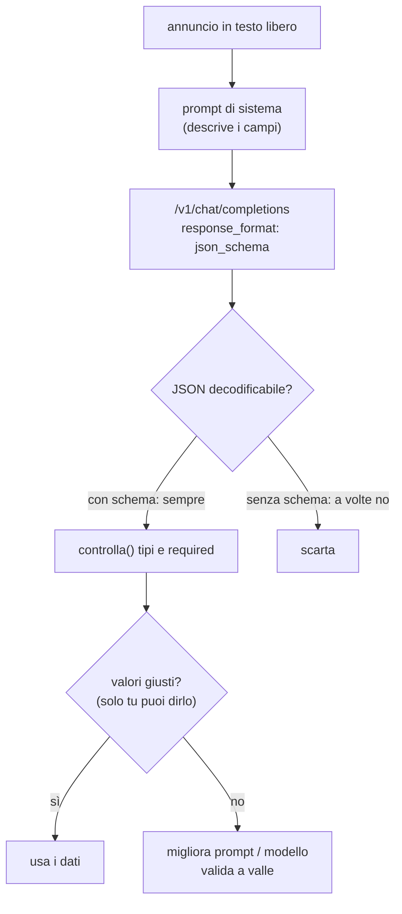

# Estrazione dati in JSON

> Modulo: [06: Output strutturato: grammatiche GBNF e JSON Schema](../../moduli/06-output-strutturato/README.md) · <span class="stato stato-verificato">verificato su b11046</span> · Durata stimata: 60 minuti

## Obiettivo

Trasformare tre annunci immobiliari scritti a mano libera in oggetti JSON con campi tipizzati, usando
`response_format` con un JSON Schema su `/v1/chat/completions`. Confrontare con la stessa richiesta senza vincolo,
e poi fare la parte che nessuna grammatica fa per te: controllare che i **valori** siano giusti.

## Prerequisiti

- Lab [04-01](../lab-04-01-server-e-webui/README.md) (server attivo, `curl`) e modulo 06 § 3-4 (cosa converte il convertitore).
- Python 3 (solo libreria standard).

## Materiale

| Cosa | Dove | Dimensione |
|---|---|---|
| `ggml-org/Qwen3.5-0.8B-GGUF` (file `Qwen3.5-0.8B-Q8_0.gguf`, Apache 2.0) | Hugging Face, via `-hf` | 785 MiB |
| [`annunci.txt`](annunci.txt): tre annunci separati da `===` (Bologna, Padova, Ravenna) | cartella del lab | 0,5 KB |
| [`schema-annuncio.json`](schema-annuncio.json): schema con `enum`, `integer` + `minimum/maximum`, `boolean`, `maxLength`, `required`, `additionalProperties: false` | cartella del lab | 0,7 KB |
| [`estrai.py`](estrai.py): manda ogni annuncio con `response_format` (o senza, con `--senza-schema`) e applica controlli minimi | cartella del lab | 4 KB |

## Procedura

1. **Server** con un solo slot, alias e `-c 2048` (un annuncio + il prompt di sistema stanno in ~250 token):

    ```bash
    llama serve -hf ggml-org/Qwen3.5-0.8B-GGUF --host 127.0.0.1 --port 8080 -c 2048 -np 1 -a qwen-0.8b
    ```

2. **Leggi lo schema** e chiediti, per ogni vincolo, se il convertitore lo farà rispettare (tabella § 3 del modulo):
   `enum` sì; `integer` con `minimum`/`maximum` sì; `maxLength` sì; `required` sì (e nell'ordine dello schema);
   `additionalProperties: false` è comunque il default. Il campo `note` non è in `required`: il modello può ometterlo.

3. **Leggi il prompt di sistema in `estrai.py`**. Elenca i campi e il loro significato ("locali: intero; se non
   indicato stima dal testo", "prezzo_euro: per gli affitti il canone mensile") perché **lo schema non arriva al
   modello**: senza questa descrizione il modello non sa che `locali` esiste finché la grammatica non glielo impone
   token per token, e a quel punto tira a indovinare.

4. **Con schema**:

    ```bash
    cd corso/laboratori/lab-06-02-estrazione-json
    python3 estrai.py
    ```

    Output reale:

    ```
    server http://127.0.0.1:8080 · 3 annunci · vincolo schema: SÌ

    --- annuncio 1: Vendesi luminoso trilocale di 85 mq in zona Saragozza a Bolo…
      {"titolo": "Luminoso trilocale", "tipo": "appartamento", "citta": "Bologna", "metri_quadri": 85, "locali": 2, "prezzo_euro": 245000, "ascensore": true, "note": "Cantina inclusa"}
      controlli superati

    --- annuncio 2: Affittasi ufficio open space di circa 140 metri quadri nel c…
      {"titolo": "Ufficio Open Space", "tipo": "ufficio", "citta": "Padova", "metri_quadri": 140, "locali": 2, "prezzo_euro": 1900, "ascensore": false, "note": "opzionale"}
      controlli superati

    --- annuncio 3: Villa indipendente a Ravenna, 6 locali su due piani, 220 mq,…
      {"titolo": "Villa indipendente Ravenna", "tipo": "appartamento", "citta": "Ravenna", "metri_quadri": 220, "locali": 6, "prezzo_euro": 520000, "ascensore": true, "note": "Da ristrutturare parzialmente"}
      controlli superati

    risultato: 3/3 annunci validi. Ora confronta i VALORI con il testo: sono giusti?
    ```

    Tre JSON su tre decodificabili, tutti i campi obbligatori presenti, tutti i tipi giusti. Ora fai quello che
    chiede l'ultima riga.

5. **Caccia agli errori nei valori**. Confronta ogni oggetto con `annunci.txt`. Trovati nelle prove:

    | Annuncio | Campo | Modello | Testo | Perché |
    |---|---|---|---|---|
    | 1 | `locali` | 2 | "trilocale" = 3 | conoscenza lessicale mancante |
    | 2 | `note` | `"opzionale"` | (nulla) | ha copiato la parola "opzionale" dal prompt di sistema |
    | 3 | `tipo` | `appartamento` | "Villa indipendente" | `enum` rispettato, valore sbagliato |
    | 3 | `ascensore` | `true` | non citato | il `boolean` obbliga a scegliere: ha scelto |

    Nessuno di questi è rilevabile da uno schema: sono tutti valori ammessi. `metri_quadri`, `prezzo_euro`,
    `citta` e il canone mensile dell'ufficio sono invece giusti in tutti e tre.

6. **Senza schema**, stesso prompt:

    ```bash
    python3 estrai.py --senza-schema
    ```

    ```
    --- annuncio 1 …
      {"titolo": "Luminoso trilocale", …, "locali": "intero", …}
      controlli falliti: locali non è un intero: 'intero'
    --- annuncio 2 …
      {…, "locali": "2", …, "note": null}
      controlli falliti: locali non è un intero: '2'
    --- annuncio 3 …
      {…, "locali": "6 locali", …}
      controlli falliti: locali non è un intero: '6 locali'

    risultato: 0/3 annunci validi.
    ```

    Il modello ha restituito JSON decodificabile (stavolta senza recinzione Markdown, non è garantito), ma `locali`
    è una stringa in tutti e tre i casi: `"intero"` copiato dal prompt, `"2"`, `"6 locali"`. È l'errore che la
    grammatica elimina: `"locali": ` seguito da una cifra, per forza.

7. **Guarda la richiesta che parte**. Aggiungi `print(json.dumps(body["response_format"])[:200])` in `chiedi()`:
   la forma inviata è quella OpenAI, `{"type": "json_schema", "json_schema": {"name": "annuncio", "schema": {…}}}`,
   che il server accetta insieme a `{"type": "json_schema", "schema": {…}}`. Con `curl` puoi mandare la stessa
   cosa a mano (§ 4 del modulo).

8. **Correggi con il prompt, non con lo schema**. Aggiungi al prompt di sistema: «trilocale = 3 locali, bilocale = 2;
   villa → tipo "villa"; ascensore false se non citato; note solo se presenti nel testo, altrimenti ometti il campo».
   Rilancia e conta quanti errori del punto 5 spariscono. Verificato: **tre su quattro** (`locali: 3`, `note` omesso
   nell'ufficio, `ascensore: false` nella villa), ma la villa resta `tipo: "appartamento"` anche con la regola scritta
   nel prompt. Il prompt aiuta, la soluzione vera è un modello più capace; la grammatica ti dà solo la certezza del formato.

9. **Rendi lo schema più severo**: `"citta": {"type": "string", "enum": ["Bologna", "Padova", "Ravenna"]}` e
   `"locali": {"type": "integer", "minimum": 1, "maximum": 8}`. Rilancia: la grammatica ora impone anche questi
   intervalli (ricorda: `minimum/maximum` valgono solo per `integer`).

10. **Ferma il server** con ++ctrl+c++.



## Verifica del risultato

- [ ] Con schema: 3/3 JSON decodificabili con tutti i campi `required` e i tipi corretti.
- [ ] Senza schema: almeno un annuncio con un campo del tipo sbagliato o non decodificabile.
- [ ] Hai compilato la tabella degli errori nei valori (almeno tre) e sai spiegare perché lo schema non li vede.
- [ ] Hai misurato quanti errori spariscono cambiando solo il prompt.

## Domande e varianti

- Togli `"additionalProperties": false` dallo schema: cambia qualcosa? (No: è già il default di llama.cpp; con
  `true` il modello potrebbe aggiungere chiavi a piacere).
- Aggiungi `"prezzo_euro": {"type": "number", "minimum": 0}` al posto di `integer`: il modello può scrivere `-1`?
  (Sì: gli estremi sono ignorati per `number`).
- Usa `"type": "json_object"` senza schema: quanti annunci passano `controlla()`?
- Fai lo stesso lavoro con l'SDK `openai` e `response_format={"type": "json_schema", "json_schema": {...}}`:
  cambia solo il trasporto.
- Con Pydantic: definisci `class Annuncio(BaseModel)` e passa `Annuncio.model_json_schema()`; poi
  `Annuncio.model_validate_json(content)` come validazione a valle (ricorda il default di `additionalProperties`).
- Misura `timings.predicted_per_second` con e senza schema su 10 esecuzioni: c'è un costo misurabile del vincolo
  con uno schema di questa taglia?
- Un modello più grande (`ggml-org/gemma-3-4b-it-qat-GGUF`, ~3 GB): quanti errori del punto 5 spariscono da soli?

## Consegna

Un file `lab-06-02.md` con: i due output di `estrai.py`; la tabella degli errori nei valori; il prompt di sistema
modificato e il conteggio "prima/dopo"; lo schema severo del punto 9 e un esempio di output; la risposta alla
domanda "quale dei quattro errori del punto 5 potrebbe essere evitato solo con lo schema, e come?".
