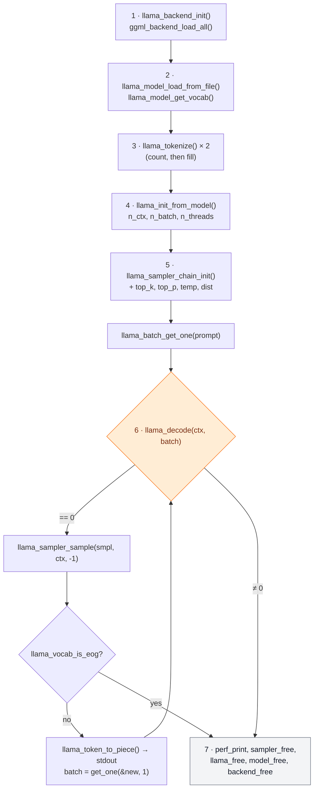

# Lab 08-01: A C++ program with libllama

<div class="meta" markdown>
<span class="meta-item">:material-book-open-page-variant:{ .meta-icon } Module <a href="../../moduli/08-integrazione-sviluppo/README.md">08: Integrating llama.cpp into applications</a></span>
<span class="meta-item">:material-clock-outline:{ .meta-icon } 60 min</span>
</div>

## Objective

Write a minimal text generator in C++ **without** going through the server: open a GGUF with the `libllama` C API,
tokenize a prompt, run `llama_decode`, sample tokens with a sampler chain and print them as they come.
Then build it with CMake in the two official ways (bundled sources or installed library) and understand what each call does,
so you can read `llama.h` on your own when you need something the HTTP API does not expose.

## Prerequisites

- Module 01 (building: `cmake`, a C++17 compiler, `git`) and section 4 of module 08 (function table).
- Basic C/C++: pointers, `std::vector`, `std::string`.
- A small GGUF already downloaded (you find its path with `llama cli -cl` and in the HF cache, module 02).
- 2 GB of free RAM for the test model; to build `libllama` from source, 5-10 minutes of CPU.

## Materials

| What | Source | Size | License |
|---|---|---|---|
| [`main.cpp`](main.cpp) | this folder | 130 lines, commented in Italian | MIT |
| [`CMakeLists.txt`](CMakeLists.txt) | this folder | picks between `add_subdirectory` and `find_package` on its own | MIT |
| `ggml-org/Qwen3.5-0.8B-GGUF` (`Qwen3.5-0.8B-Q8_0.gguf`) | Hugging Face | 785 MB | Apache 2.0 |
| `examples/simple/simple.cpp` and `include/llama.h` | [llama.cpp repository](https://github.com/ggml-org/llama.cpp) | the official reference `main.cpp` derives from | MIT |

`main.cpp` is `simple.cpp` rewritten in Italian with three differences: a real sampling chain (top-k, top-p,
temperature, random draw) instead of `greedy`, a log filter that silences the `INFO` lines during loading,
and the thread count from the command line. The decoding loop is identical.

## Steps

### 1. The call sequence

Every program using `libllama` follows the same order; the diagram is the map of `main.cpp` (the numbers are the comments
in the source).



### 2. `main.cpp` block by block

Open [`main.cpp`](main.cpp) next to this page. Each block is compared with `simple.cpp` and with the signature in `llama.h`.

**Block 1: backend.** `llama_log_set(log_silenzioso, nullptr)` installs a callback that drops messages below `WARN`
(without it, loading prints dozens of `print_info` lines). `llama_backend_init()` initializes ggml;
`ggml_backend_load_all()` (declared in `ggml-backend.h`, included by `llama.h`) loads the **dynamic** backends: the
`libggml-cpu-<arch>.so` files and, if present, `libggml-cuda.so`, `libggml-vulkan.so`… looking for them in the
executable's folder. `simple.cpp` calls only `ggml_backend_load_all()`: `llama_backend_init()` is almost empty today but it is
the official partner of `llama_backend_free()`, so we keep it.

**Block 2: model.** `llama_model_default_params()` returns a struct with the defaults; `n_gpu_layers = 0` keeps everything
on CPU (in `simple.cpp` it is 99, meaning "everything on the GPU if there is one"). `llama_model_load_from_file()` maps the GGUF into memory
(mmap) and returns `nullptr` on failure. The vocabulary is a separate object: `llama_model_get_vocab(model)`, to
pass to all token functions.

**Block 3: tokenization.** The signature is
`llama_tokenize(vocab, text, text_len, tokens, n_tokens_max, add_special, parse_special)`.
Called with `tokens = nullptr`, it returns a **negative** number: `-N`, how many tokens it would need. That is why the
code does `n_prompt = -llama_tokenize(...)`, allocates the `std::vector` and calls the function again to fill it. `add_special =
true` adds the BOS token if the model expects one; `parse_special = true` interprets special tokens written in the
text (e.g. `<|im_start|>`).

**Block 4: context.** `llama_context_default_params()` then: `n_ctx = n_prompt + n_predict` (a KV cache just
large enough: in a real app use 4096, or 0 for "the model's own"); `n_batch = n_prompt` so the whole prompt
fits in a single `llama_decode`; `n_threads`/`n_threads_batch` (generation / prompt); `no_perf = false` enables the
counters that `llama_perf_context_print` will print. `llama_init_from_model(model, cparams)` allocates the KV cache and the
compute buffers: this is where memory usage grows.

**Block 5: sampler chain.** `llama_sampler_chain_init(sparams)` creates an empty chain (with `sparams.no_perf = false`,
otherwise the sampler statistics come out as zero); `llama_sampler_chain_add` adds, in order,
`llama_sampler_init_top_k(40)`, `llama_sampler_init_top_p(0.95f, 1)` (the second argument is `min_keep`),
`llama_sampler_init_temp(0.8f)` and finally `llama_sampler_init_dist(LLAMA_DEFAULT_SEED)`, which actually draws a token
from the distribution. These are the `llama cli` defaults (module 05). `simple.cpp` uses only `llama_sampler_init_greedy()`:
always the most probable token, deterministic output. The chain **takes ownership** of the samplers you add.

**Block 5 bis: printing the prompt.** `llama_token_to_piece(vocab, id, buf, sizeof(buf), 0, true)` writes the token's
piece of text into `buf` and returns how many bytes it wrote (negative if the buffer is too small). It does **not** add the
`\0`: that is why you use `fwrite(buf, 1, n, stdout)` and not `printf("%s")`. It shows you how the tokenizer split
the prompt.

**Block 6: the loop.** `llama_batch_get_one(token_prompt.data(), n)` builds a batch for a single sequence with
automatic positions (no allocation: the batch points to your vector, which must stay alive). Then, while
`n_pos + batch.n_tokens < n_prompt + n_predict`:

1. `llama_decode(ctx, batch)`: runs the model on the batch and updates the KV cache. `0` = ok; `1` = no space in the
   KV cache (shrink the batch or raise `n_ctx`); `2` = aborted by the callback; `-1` = invalid batch; `< -1` fatal error.
2. `llama_sampler_sample(smpl, ctx, -1)`: applies the chain to the logits of the **last** token in the batch (`idx = -1`) and returns
   the new token. After the first iteration every batch has a single token, so `-1` and `0` coincide.
3. `llama_vocab_is_eog(vocab, tok)`: true for EOS and the other end-of-generation tokens (`<|im_end|>`, `<end_of_turn>`…).
4. Print with `llama_token_to_piece` and `fflush` (so you see the streaming), then `batch = llama_batch_get_one(&nuovo_token, 1)`:
   the next step decodes only the token just generated, the KV cache remembers everything else.

`simple.cpp` also has a branch for **encoder-decoder** models (`llama_model_has_encoder` → `llama_encode` and the
`decoder_start_token`): T5 and similar. `main.cpp` omits it because current chat models are decoder-only.

**Block 7: statistics and cleanup.** `llama_log_set(nullptr, nullptr)` restores the default logger, otherwise
`llama_perf_sampler_print` and `llama_perf_context_print` (which go through the log at `INFO` level) would print
nothing. Then you free in reverse order of creation: `llama_sampler_free(smpl)` (it also frees the chain's
samplers: never free them one by one), `llama_free(ctx)`, `llama_model_free(model)`, `llama_backend_free()`.

!!! note "The APIs in `llama.h` (b11046, 1646 lines)"
    All the functions used by `main.cpp` are in the current header and none is marked `DEPRECATED`. The old
    forms you will see in tutorials (`llama_load_model_from_file`, `llama_new_context_with_model`, `llama_free_model`,
    `llama_token_eos`, `llama_n_vocab`) still exist but with a deprecation warning: use the new ones.

### 3. Building with CMake

`CMakeLists.txt` first tries sources in a `llama.cpp/` subfolder, otherwise it looks for an installed library.

=== "(a) sources with add_subdirectory"
    ```bash
    cd corso/laboratori/lab-08-01-c-api
    git clone --depth 1 https://github.com/ggml-org/llama.cpp     # or git submodule add
    cmake -B build -DCMAKE_BUILD_TYPE=Release                       # + -DGGML_CUDA=ON, -DGGML_VULKAN=ON... as in module 01
    cmake --build build -j 4
    ```
    The `CMakeLists.txt` sets `LLAMA_BUILD_TOOLS`, `LLAMA_BUILD_EXAMPLES`, `LLAMA_BUILD_TESTS`, `LLAMA_BUILD_SERVER` to
    `OFF`: you build only `libllama` and `libggml`, not `llama-cli` and friends. `target_link_libraries(generatore PRIVATE llama)`
    brings along the includes (`llama.h`, `ggml.h`) and libraries. Advantage: header and library come from the same
    build by construction; to update, run `git pull` in the subfolder.

=== "(b) installed library with find_package"
    ```bash
    # once only: build and install llama.cpp into a prefix of your choice
    git clone https://github.com/ggml-org/llama.cpp && cd llama.cpp
    cmake -B build -DCMAKE_BUILD_TYPE=Release -DLLAMA_BUILD_TOOLS=OFF -DLLAMA_BUILD_EXAMPLES=OFF -DLLAMA_BUILD_TESTS=OFF
    cmake --build build -j 4
    cmake --install build --prefix ~/llama-install        # copies include/, lib/ and lib/cmake/llama/llama-config.cmake

    # then, in the lab (without the llama.cpp/ subfolder)
    cd corso/laboratori/lab-08-01-c-api
    cmake -B build -DCMAKE_BUILD_TYPE=Release -DCMAKE_PREFIX_PATH=~/llama-install
    cmake --build build -j 4
    ```
    `find_package(llama REQUIRED)` reads `llama-config.cmake` from the prefix and imports the `llama` target. With `brew install
    llama.cpp` or conda-forge the file is already in the package manager's prefix (`$(brew --prefix)`). If `libllama.so` is missing
    at run time, add `~/llama-install/lib` to `LD_LIBRARY_PATH` (Linux) or `DYLD_LIBRARY_PATH` (macOS), or
    build llama.cpp with `-DBUILD_SHARED_LIBS=OFF`.

??? info "(c) The third way: header + tarball `.so`, without CMake"
    ```bash
    curl -sLO https://raw.githubusercontent.com/ggml-org/llama.cpp/b11046/include/llama.h     # same tag as the tarball!
    # you also need ggml.h, ggml-backend.h, ggml-cpu.h, ggml-opt.h from the ggml/include folder of the same tag
    g++ -std=c++17 -O2 -I include main.cpp -L ~/llama-lab/rel/llama-b11046 -lllama -lggml -lggml-base -o generatore
    LD_LIBRARY_PATH=~/llama-lab/rel/llama-b11046 ./generatore modello.gguf "…" 32 3
    ```
    The backends are separate `.so` files that `ggml_backend_load_all()` looks for next to the executable: if you get
    `no backends are loaded`, copy the `libggml-cpu-*.so` files into the binary's folder or use `ggml_backend_load_all_from_path(dir)`.
    Headers and libraries must come from the **same build**: `llama_context_params` changes between versions and a mismatch
    is a silent crash.

### 4. Running

```bash
MODELLO=$(ls ~/.cache/huggingface/hub/models--ggml-org--Qwen3.5-0.8B-GGUF/snapshots/*/Qwen3.5-0.8B-Q8_0.gguf)
./build/generatore "$MODELLO" "Il linguaggio C è" 32 3      # prompt, n_predict, n_threads
```

Expected output (on a 6 vCPU machine without a GPU, 3 threads; the text changes on every run because the seed is random):

```text
Il linguaggio C è uno dei linguaggi di programmazione più popolari nel mondo…

generati 32 token
sampler print info: …
llama_perf_context_print:        load time = …
llama_perf_context_print: prompt eval time = … /     5 tokens
llama_perf_context_print:        eval time = … /    31 runs   (… tokens per second)
llama_perf_context_print:     graphs reused =         22
```

This is a **raw completion**: there is no chat template, the model continues the sentence. With Qwen3.5 (a "thinking" model)
a prompt phrased as a question can produce odd text: for a real chat you must format the messages with the GGUF's
template (via `libcommon`/Jinja as the cli and server do), which this lab deliberately does not do.

## Check the result

- [ ] `cmake -B build` prints `libllama: compilo dai sorgenti in llama.cpp/` **or** `libllama: cerco un'installazione…` and finishes without errors.
- [ ] The program first prints the prompt (rebuilt from the tokens) and then the continuation, one token at a time.
- [ ] `generati N token` with N ≤ `n_predict`; if N is smaller, the model emitted an end token (`llama_vocab_is_eog`).
- [ ] `llama_perf_context_print` reports `prompt eval time` with as many tokens as the prompt and `eval time` with `n_predict - 1` runs.
- [ ] Run twice with the same prompt, the text changes (`dist` sampler with a random seed).

## Questions and variations

1. Replace the four samplers with `llama_sampler_init_greedy()`: does the output become deterministic? And if you keep the chain
   but pass a fixed seed to `llama_sampler_init_dist(42)`?
2. Set `cparams.n_ctx = n_prompt + 4` and ask for 32 tokens: which code does `llama_decode` return, and at which iteration?
   Handle it without exiting (tip: `llama_get_memory` + `llama_memory_seq_rm`, table in module 08).
3. Print the **logits** instead of the token: `llama_get_logits_ith(ctx, -1)` returns `llama_vocab_n_tokens(vocab)` floats.
   Find the top 5 and show them with `llama_token_to_piece`. It is the first step toward your own sampler.
4. Apply the chat template by hand: `llama_model_chat_template(model, nullptr)` returns the GGUF's Jinja string;
   `llama_chat_apply_template(...)` applies it **only** if it is among the known templates (`chatml` for Qwen is). Compare the
   answer with and without the template.
5. Build with a GPU backend (`-DGGML_CUDA=ON` or `-DGGML_VULKAN=ON` in case (a)) and raise `n_gpu_layers` to 99: how much
   does `eval time` change?
6. Measure the cost of `llama_init_from_model`: allocate `n_ctx = 32768` and watch RAM with `ps`. Then try `type_k`/`type_v`
   = `GGML_TYPE_Q8_0` (the equivalent of `-ctk q8_0`).

## Deliverable

A file `lab08-01.md` with: the CMake configure command you used and the `libllama: …` line it printed; the full output
of one run (generated text + `llama_perf_*` statistics); the answer to question 2 with the return code
you observed; and, optionally, the diff of one of variations 1, 3 or 4.
