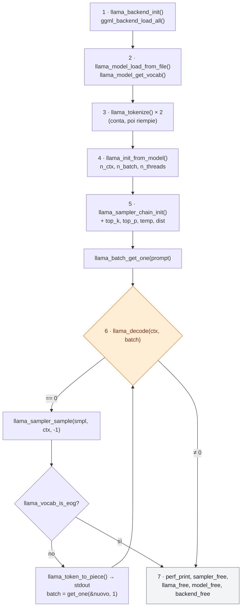

# Lab 08-01: Un programma C++ con libllama

<div class="meta" markdown>
<span class="meta-item">:material-book-open-page-variant:{ .meta-icon } Modulo <a href="../../moduli/08-integrazione-sviluppo/README.md">08: Integrare llama.cpp nelle applicazioni</a></span>
<span class="meta-item">:material-clock-outline:{ .meta-icon } 60 min</span>
<span class="stato stato-verificato">API confrontate con `llama.h` e `examples/simple/simple.cpp` (b11046)</span> <span class="stato stato-bozza">build CMake (add_subdirectory / find_package): da verificare</span>
</div>

## Obiettivo

Scrivere un generatore di testo minimo in C++ **senza** passare dal server: aprire un GGUF con la C API di `libllama`,
tokenizzare un prompt, far girare `llama_decode`, campionare i token con una catena di sampler e stamparli man mano.
Poi compilarlo con CMake nei due modi ufficiali (sorgenti inclusi o libreria installata) e capire cosa fa ogni chiamata,
in modo da poter leggere `llama.h` da solo quando ti servirà qualcosa che l'API HTTP non espone.

## Prerequisiti

- Modulo 01 (compilazione: `cmake`, un compilatore C++17, `git`) e la sezione 4 del modulo 08 (tabella delle funzioni).
- Conoscenze base di C/C++: puntatori, `std::vector`, `std::string`.
- Un GGUF piccolo già scaricato (il percorso lo trovi con `llama cli -cl` e nella cache HF, modulo 02).
- 2 GB di RAM liberi per il modello di prova; per compilare `libllama` dai sorgenti, 5-10 minuti di CPU.

## Materiale

| Cosa | Fonte | Dimensione | Licenza |
|---|---|---|---|
| [`main.cpp`](main.cpp) | questa cartella | 130 righe, commentato in italiano | MIT |
| [`CMakeLists.txt`](CMakeLists.txt) | questa cartella | sceglie da solo tra `add_subdirectory` e `find_package` | MIT |
| `ggml-org/Qwen3.5-0.8B-GGUF` (`Qwen3.5-0.8B-Q8_0.gguf`) | Hugging Face | 785 MB | Apache 2.0 |
| `examples/simple/simple.cpp` e `include/llama.h` | [repository llama.cpp](https://github.com/ggml-org/llama.cpp) | il riferimento ufficiale da cui deriva `main.cpp` | MIT |

`main.cpp` è `simple.cpp` riscritto in italiano con tre differenze: una catena di campionamento vera (top-k, top-p,
temperatura, estrazione casuale) al posto del `greedy`, un filtro dei log che tace le righe `INFO` del caricamento,
e il numero di thread da riga di comando. Il ciclo di decodifica è identico.

## Procedura

### 1. La sequenza di chiamate

Ogni programma con `libllama` segue lo stesso ordine; il diagramma è la mappa di `main.cpp` (i numeri sono i commenti
nel sorgente).



### 2. `main.cpp` blocco per blocco

Apri [`main.cpp`](main.cpp) accanto a questa pagina. Ogni blocco è confrontato con `simple.cpp` e con la firma in `llama.h`.

**Blocco 1: backend.** `llama_log_set(log_silenzioso, nullptr)` installa un callback che scarta i messaggi sotto `WARN`
(senza, il caricamento stampa decine di righe `print_info`). `llama_backend_init()` inizializza ggml;
`ggml_backend_load_all()` (dichiarata in `ggml-backend.h`, incluso da `llama.h`) carica i backend **dinamici**: le
`libggml-cpu-<arch>.so` e, se ci sono, `libggml-cuda.so`, `libggml-vulkan.so`… cercandole nella cartella
dell'eseguibile. `simple.cpp` chiama solo `ggml_backend_load_all()`: `llama_backend_init()` oggi è quasi vuota ma è
la coppia ufficiale di `llama_backend_free()`, quindi la teniamo.

**Blocco 2: modello.** `llama_model_default_params()` restituisce una struct con i default; `n_gpu_layers = 0` tiene tutto
su CPU (in `simple.cpp` è 99, cioè "tutto sulla GPU se c'è"). `llama_model_load_from_file()` mappa il GGUF in memoria
(mmap) e restituisce `nullptr` se fallisce. Il vocabolario è un oggetto separato: `llama_model_get_vocab(model)`, da
passare a tutte le funzioni sui token.

**Blocco 3: tokenizzazione.** La firma è
`llama_tokenize(vocab, text, text_len, tokens, n_tokens_max, add_special, parse_special)`.
Chiamata con `tokens = nullptr`, restituisce un numero **negativo**: `-N`, quanti token servirebbero. Per questo il
codice fa `n_prompt = -llama_tokenize(...)`, alloca il `std::vector` e richiama la funzione per riempirlo. `add_special =
true` aggiunge il token BOS se il modello lo prevede; `parse_special = true` interpreta i token speciali scritti nel
testo (es. `<|im_start|>`).

**Blocco 4: contesto.** `llama_context_default_params()` poi: `n_ctx = n_prompt + n_predict` (KV cache appena
sufficiente: in un'app reale metti 4096 o 0 per "quello del modello"); `n_batch = n_prompt` così l'intero prompt
entra in una sola `llama_decode`; `n_threads`/`n_threads_batch` (generazione / prompt); `no_perf = false` abilita i
contatori che `llama_perf_context_print` stamperà. `llama_init_from_model(model, cparams)` alloca la KV cache e i
buffer di calcolo: è qui che l'uso di memoria cresce.

**Blocco 5: catena di sampler.** `llama_sampler_chain_init(sparams)` crea una catena vuota (con `sparams.no_perf = false`,
altrimenti le statistiche del sampler escono a zero); `llama_sampler_chain_add` aggiunge in ordine
`llama_sampler_init_top_k(40)`, `llama_sampler_init_top_p(0.95f, 1)` (il secondo argomento è `min_keep`),
`llama_sampler_init_temp(0.8f)` e infine `llama_sampler_init_dist(LLAMA_DEFAULT_SEED)`, che estrae davvero un token
dalla distribuzione. Sono i default di `llama cli` (modulo 05). `simple.cpp` usa solo `llama_sampler_init_greedy()`:
sempre il token più probabile, output deterministico. La catena **prende possesso** dei sampler aggiunti.

**Blocco 5 bis: stampa del prompt.** `llama_token_to_piece(vocab, id, buf, sizeof(buf), 0, true)` scrive in `buf` il
pezzo di testo del token e restituisce quanti byte ha scritto (negativo se il buffer è piccolo). **Non** aggiunge lo
`\0`: per questo si usa `fwrite(buf, 1, n, stdout)` e non `printf("%s")`. Serve a vedere come il tokenizer ha spezzato
il prompt.

**Blocco 6: il ciclo.** `llama_batch_get_one(token_prompt.data(), n)` costruisce un batch per una sola sequenza con
posizioni automatiche (nessuna allocazione: il batch punta al tuo vettore, che deve restare vivo). Poi, finché
`n_pos + batch.n_tokens < n_prompt + n_predict`:

1. `llama_decode(ctx, batch)`: esegue il modello sul batch e aggiorna la KV cache. `0` = ok; `1` = niente spazio nella
   KV cache (riduci il batch o alza `n_ctx`); `2` = interrotto dal callback; `-1` = batch non valido; `< -1` errore fatale.
2. `llama_sampler_sample(smpl, ctx, -1)`: applica la catena ai logit dell'**ultimo** token del batch (`idx = -1`) e restituisce
   il nuovo token. Dopo la prima iterazione ogni batch ha un solo token, quindi `-1` e `0` coincidono.
3. `llama_vocab_is_eog(vocab, tok)`: vero per EOS e gli altri token di fine generazione (`<|im_end|>`, `<end_of_turn>`…).
4. Stampa con `llama_token_to_piece` e `fflush` (così vedi lo streaming), poi `batch = llama_batch_get_one(&nuovo_token, 1)`:
   il prossimo passo decodifica solo il token appena generato, la KV cache ricorda tutto il resto.

`simple.cpp` ha in più un ramo per i modelli **encoder-decoder** (`llama_model_has_encoder` → `llama_encode` e il
`decoder_start_token`): T5 e simili. `main.cpp` lo omette perché i modelli di chat correnti sono solo decoder.

**Blocco 7: statistiche e pulizia.** `llama_log_set(nullptr, nullptr)` ripristina il logger di default, altrimenti
`llama_perf_sampler_print` e `llama_perf_context_print` (che passano dal log a livello `INFO`) non stamperebbero
nulla. Poi si libera in ordine inverso alla creazione: `llama_sampler_free(smpl)` (libera anche i sampler della
catena: mai liberarli uno a uno), `llama_free(ctx)`, `llama_model_free(model)`, `llama_backend_free()`.

!!! note "Verifica delle API contro `llama.h` (b11046, 1646 righe)"
    Tutte le funzioni usate da `main.cpp` sono presenti nell'header corrente, nessuna è marcata `DEPRECATED`. Le forme
    vecchie che vedrai nei tutorial (`llama_load_model_from_file`, `llama_new_context_with_model`, `llama_free_model`,
    `llama_token_eos`, `llama_n_vocab`) esistono ancora ma con avviso di deprecazione: usa quelle nuove.

### 3. Compilare con CMake

`CMakeLists.txt` prova prima i sorgenti in una sottocartella `llama.cpp/`, altrimenti cerca una libreria installata.

=== "(a) sorgenti con add_subdirectory"
    ```bash
    cd corso/laboratori/lab-08-01-c-api
    git clone --depth 1 https://github.com/ggml-org/llama.cpp     # oppure git submodule add
    cmake -B build -DCMAKE_BUILD_TYPE=Release                       # + -DGGML_CUDA=ON, -DGGML_VULKAN=ON... come nel modulo 01
    cmake --build build -j 4
    ```
    Il `CMakeLists.txt` imposta `LLAMA_BUILD_TOOLS`, `LLAMA_BUILD_EXAMPLES`, `LLAMA_BUILD_TESTS`, `LLAMA_BUILD_SERVER` a
    `OFF`: compili solo `libllama` e `libggml`, non `llama-cli` e compagnia. `target_link_libraries(generatore PRIVATE llama)`
    porta con sé include (`llama.h`, `ggml.h`) e librerie. Vantaggio: header e libreria sono per costruzione della stessa
    build; per aggiornare fai `git pull` nella sottocartella.

=== "(b) libreria installata con find_package"
    ```bash
    # una volta sola: compila e installa llama.cpp in un prefisso a tua scelta
    git clone https://github.com/ggml-org/llama.cpp && cd llama.cpp
    cmake -B build -DCMAKE_BUILD_TYPE=Release -DLLAMA_BUILD_TOOLS=OFF -DLLAMA_BUILD_EXAMPLES=OFF -DLLAMA_BUILD_TESTS=OFF
    cmake --build build -j 4
    cmake --install build --prefix ~/llama-install        # copia include/, lib/ e lib/cmake/llama/llama-config.cmake

    # poi, nel lab (senza la sottocartella llama.cpp/)
    cd corso/laboratori/lab-08-01-c-api
    cmake -B build -DCMAKE_BUILD_TYPE=Release -DCMAKE_PREFIX_PATH=~/llama-install
    cmake --build build -j 4
    ```
    `find_package(llama REQUIRED)` legge `llama-config.cmake` dal prefisso e importa il target `llama`. Con `brew install
    llama.cpp` o conda-forge il file è già nel prefisso del gestore (`$(brew --prefix)`). Se all'esecuzione manca
    `libllama.so`, aggiungi `~/llama-install/lib` a `LD_LIBRARY_PATH` (Linux) o `DYLD_LIBRARY_PATH` (macOS), oppure
    compila llama.cpp con `-DBUILD_SHARED_LIBS=OFF`.

<span class="stato stato-bozza">da verificare: le due configurazioni CMake non sono state compilate sul VPS del corso (macchina condivisa, vedi nota sotto). Il redattore del modulo 08 ha compilato `main.cpp` direttamente con `g++` contro le `.so` del tarball b11046 e gli header dello stesso tag.</span>

??? info "(c) Il terzo modo: header + `.so` del tarball, senza CMake"
    ```bash
    curl -sLO https://raw.githubusercontent.com/ggml-org/llama.cpp/b11046/include/llama.h     # stesso tag del tarball!
    # servono anche ggml.h, ggml-backend.h, ggml-cpu.h, ggml-opt.h dalla cartella ggml/include dello stesso tag
    g++ -std=c++17 -O2 -I include main.cpp -L ~/llama-lab/rel/llama-b11046 -lllama -lggml -lggml-base -o generatore
    LD_LIBRARY_PATH=~/llama-lab/rel/llama-b11046 ./generatore modello.gguf "…" 32 3
    ```
    I backend sono `.so` separati che `ggml_backend_load_all()` cerca accanto all'eseguibile: se ottieni
    `no backends are loaded`, copia le `libggml-cpu-*.so` nella cartella del binario o usa `ggml_backend_load_all_from_path(dir)`.
    Header e librerie devono essere della **stessa build**: `llama_context_params` cambia tra versioni e un mismatch
    è un crash silenzioso.

### 4. Eseguire

```bash
MODELLO=$(ls ~/.cache/huggingface/hub/models--ggml-org--Qwen3.5-0.8B-GGUF/snapshots/*/Qwen3.5-0.8B-Q8_0.gguf)
./build/generatore "$MODELLO" "Il linguaggio C è" 32 3      # prompt, n_predict, n_threads
```

Output atteso (dal modulo 08, ottenuto sul VPS con 3 thread; il testo cambia a ogni esecuzione perché il seme è casuale):

```text
Il linguaggio C è uno dei linguaggi di programmazione più popolari nel mondo…

generati 32 token
sampler print info: …
llama_perf_context_print:        load time = …
llama_perf_context_print: prompt eval time = … /     5 tokens
llama_perf_context_print:        eval time = … /    31 runs   (… tokens per second)
llama_perf_context_print:     graphs reused =         22
```

È un **completamento grezzo**: non c'è chat template, il modello continua la frase. Con Qwen3.5 (modello "thinking")
un prompt in forma di domanda può produrre testo strano: per una chat vera devi formattare i messaggi con il template
del GGUF (via `libcommon`/Jinja come fanno cli e server), cosa che questo lab non fa di proposito.

## Verifica del risultato

- [ ] `cmake -B build` stampa `libllama: compilo dai sorgenti in llama.cpp/` **oppure** `libllama: cerco un'installazione…` e finisce senza errori.
- [ ] Il programma stampa prima il prompt (ricostruito dai token) e poi la continuazione, un token alla volta.
- [ ] `generati N token` con N ≤ `n_predict`; se N è minore, il modello ha emesso un token di fine (`llama_vocab_is_eog`).
- [ ] `llama_perf_context_print` riporta `prompt eval time` con tanti token quanti quelli del prompt e `eval time` con `n_predict - 1` run.
- [ ] Lanciato due volte con lo stesso prompt, il testo cambia (sampler `dist` con seme casuale).

## Domande e varianti

1. Sostituisci i quattro sampler con `llama_sampler_init_greedy()`: l'output diventa deterministico? E se lasci la catena
   ma passi un seme fisso a `llama_sampler_init_dist(42)`?
2. Metti `cparams.n_ctx = n_prompt + 4` e chiedi 32 token: quale codice restituisce `llama_decode` e a quale iterazione?
   Gestiscilo senza uscire (suggerimento: `llama_get_memory` + `llama_memory_seq_rm`, tabella nel modulo 08).
3. Stampa i **logit** invece del token: `llama_get_logits_ith(ctx, -1)` restituisce `llama_vocab_n_tokens(vocab)` float.
   Trova i 5 più alti e mostrali con `llama_token_to_piece`. È il primo passo verso un sampler tuo.
4. Applica il chat template a mano: `llama_model_chat_template(model, nullptr)` restituisce la stringa Jinja del GGUF;
   `llama_chat_apply_template(...)` la applica **solo** se è tra i template noti (`chatml` per Qwen lo è). Confronta la
   risposta con e senza template.
5. Compila con un backend GPU (`-DGGML_CUDA=ON` o `-DGGML_VULKAN=ON` nel caso (a)) e alza `n_gpu_layers` a 99: quanto
   cambia `eval time`?
6. Misura il costo di `llama_init_from_model`: alloca `n_ctx = 32768` e guarda la RAM con `ps`. Poi prova `type_k`/`type_v`
   = `GGML_TYPE_Q8_0` (l'equivalente di `-ctk q8_0`).

## Consegna

Un file `lab08-01.md` con: il comando di configurazione CMake usato e la riga `libllama: …` stampata; l'output completo
di un'esecuzione (testo generato + statistiche `llama_perf_*`); la risposta alla domanda 2 con il codice di ritorno
osservato; e, a scelta, il diff di una delle varianti 1, 3 o 4.
