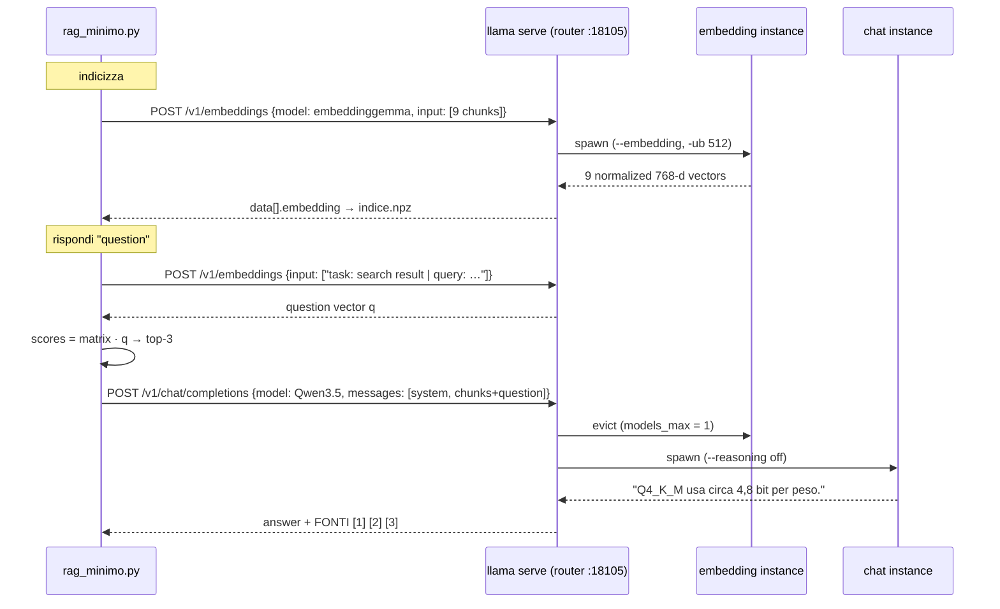

# Lab 08-02: Minimal RAG

<div class="meta" markdown>
<span class="meta-item">:material-book-open-page-variant:{ .meta-icon } Module <a href="../../moduli/08-integrazione-sviluppo/README.md">08: Integrating llama.cpp into applications</a></span>
<span class="meta-item">:material-clock-outline:{ .meta-icon } 45 min</span>
</div>

## Objective

Build a complete but tiny RAG (*Retrieval-Augmented Generation*) with **only** two `llama serve` endpoints
and two Python libraries (`numpy`, `requests`): split four documents into chunks, turn them into vectors with
`/v1/embeddings`, find the chunks closest to a question with cosine similarity and have the chat model
answer while citing the chunks it used. All with **a single server** in router mode that swaps the embedding model
and the chat model in memory.

## Prerequisites

- Module 04 (server, `/v1/chat/completions`, `curl`) and section 6 of module 08 (embeddings, cosine, RAG flow).
- Python 3 with `numpy` and `requests` (`pip install numpy requests`, or a venv).
- 1.5 GB of free RAM: the two models are never in memory together (`--models-max 1`).

## Materials

| What | Source | Size | License |
|---|---|---|---|
| `ggml-org/embeddinggemma-300M-GGUF:Q8_0` (embedding, 768 dimensions) | Hugging Face | 334 MB | Gemma Terms |
| `ggml-org/Qwen3.5-0.8B-GGUF:Q8_0` (chat) | Hugging Face | 785 MB | Apache 2.0 |
| [`rag_minimo.py`](rag_minimo.py) | this folder | 130 lines: `indicizza`, `cerca`, `rispondi` | |
| [`modelli.ini`](modelli.ini) | this folder | preset for the router (`--models-preset`) | |
| `documenti/` ([installazione](documenti/installazione.txt), [server](documenti/server.txt), [quantizzazione](documenti/quantizzazione.txt), [multimodale](documenti/multimodale.txt)) | this folder | 4 `.txt` files (installation, server, quantization, multimodal), ~850 bytes each | |
| `indice.npz` | generated by the script | 45 KB, 9 × 768 float32 matrix + sources + texts | |

## Steps

### 1. The flow as a call sequence

The RAG block diagram is in [module 08](../../moduli/08-integrazione-sviluppo/README.md#6-embeddings-vector-search-rag);
here you see **who calls whom**: the script talks only to the router, which starts and stops the two models.



### 2. Reading `rag_minimo.py`

Open [`rag_minimo.py`](rag_minimo.py): five functions, in flow order.

- **`spezza_in_chunk(testo)`**: splits by paragraphs (blank lines), normalizes whitespace and merges consecutive paragraphs
  until they exceed `MAX_CARATTERI_CHUNK = 500`. No *overlap*: it is the simplest choice, and with
  short paragraphs it works. The 4 documents yield **9 chunks**.
- **`embedding(testi)`**: a `POST` to `/v1/embeddings` with `{"model": …, "input": [list]}`. The response is in OpenAI
  format: `data[i].embedding` and `data[i].index`; the script sorts by `index` and builds a `numpy` matrix
  `(n, 768)`. The server already normalizes the vectors (`--embd-normalize 2`, default).
- **`indicizza()`**: reads `documenti/*.txt`, splits, prepends the prefix `title: none | text: ` to each chunk
  and saves three arrays in `indice.npz`: `matrice`, `fonti` (file name), `testi`.
- **`cerca(domanda, k)`**: embedding of the question with the prefix `task: search result | query: `, then
  `punteggi = idx["matrice"] @ q`. With unit-norm vectors the dot product **is** the cosine similarity: no
  division by the norms. `np.argsort(-punteggi)[:k]` gives the best `k` indices (`RAG_TOP_K = 3`).
- **`rispondi(domanda)`**: numbers the chunks `[1] (file) text`, puts them in the `user` message along with the question and
  asks the chat model, with a `system` message that says "use ONLY the chunks, cite [n], if they are not enough say you don't know".
  `temperature 0.2`, `max_tokens 200` and `chat_template_kwargs: {"enable_thinking": false}` (otherwise Qwen3.5 reasons
  for hundreds of tokens). Then it prints the answer and the `FONTI` (sources) list with the similarity score.

!!! tip "EmbeddingGemma prefixes"
    `PREFISSO_QUERY` and `PREFISSO_DOC` come from the model card: EmbeddingGemma is trained with a different prefix
    for questions and documents, and without them the scores drop. If you change the embedding model (`RAG_EMBED_MODEL`), read
    its card: many do not want prefixes at all.

The environment variables `RAG_URL`, `RAG_CHAT_URL`, `RAG_EMBED_MODEL`, `RAG_CHAT_MODEL`, `RAG_TOP_K` (with defaults in the
docstring) let you point to two separate servers or change models without touching the code.

### 3. The `modelli.ini` preset

In router mode (`llama serve` without `-m`/`-hf`) each model is started as a child process with its own flags.
The problem: `/v1/embeddings` on EmbeddingGemma **fails** if the instance does not start with `--embedding` (module 08,
"Common mistakes"). The INI preset solves it: each section is a model, the keys are flags without the leading dashes
(long forms, short forms or `LLAMA_ARG_*` variables).

```ini
version = 1

[*]                       ; values shared by all models
c = 4096
np = 1

[ggml-org/embeddinggemma-300M-GGUF:Q8_0]
embedding = true          ; required for /v1/embeddings
ub = 512                  ; micro-batch: embedding input must be processed in one go

[ggml-org/Qwen3.5-0.8B-GGUF:Q8_0]
reasoning = off           ; no "thinking" (same as -rea off)
```

Priority: command-line flags > model section > `[*]`. With `GET /v1/models` the router shows for
each model the `args` it will start it with (`--hf-repo … --ctx-size 4096 --parallel 1 --reasoning off --threads 3`,
where `--threads 3` comes from the `-t 3` passed to the router) and the field `"source": "preset"`.

### 4. Starting the router

Both models must be in the cache (`llama cli -cl` lists them; if they are missing, `llama download -hf <repo>:Q8_0`).

```bash
cd corso/laboratori/lab-08-02-rag-minimo
llama serve --host 127.0.0.1 --port 18105 --models-preset modelli.ini --models-max 1 -t 3
```

Expected output:

```text
W srv  llama_server:     router mode
I srv  llama_server: starting server in router mode. models will be automatically loaded on-demand
I srv  llama_server: listening on http://127.0.0.1:18105
```

`--models-max 1` keeps a single model in memory at a time: when a request arrives for the other one, the router
queues it, unloads the idle one (`evicting idle LRU`) and starts the new one. On a laptop with 8 GB you can raise it
to 2 and save the ~10 s reload on every switch.

### 5. Indexing

In a second terminal:

```bash
export RAG_URL=http://127.0.0.1:18105
python rag_minimo.py indicizza
```

Output on a 6 vCPU machine without a GPU (3 threads; 45 s in total, almost all of it for the first model load):

```text
9 frammenti da …/lab-08-02-rag-minimo/documenti
indice salvato in …/lab-08-02-rag-minimo/indice.npz: matrice (9, 768)
```

In the router log: `spawning server instance with name=ggml-org/embeddinggemma-300M-GGUF:Q8_0 on port 39011` (the child's
random port), `n_slots = 1, n_ctx_slot = 2048`, then `proxying request to model … on port 39011`.
This is how you **rebuild `indice.npz`**: delete it and rerun `indicizza` every time you change the documents or the
embedding model (vectors from different models are not comparable).

### 6. Searching and answering

```bash
python rag_minimo.py cerca "Quanti bit per peso usa Q4_K_M?"
```

```text
0.600  quantizzazione.txt: La quantizzazione riduce la precisione dei pesi da 16 bit a un numero minore di bit per peso. Q8_0 usa circa 8...
0.401  quantizzazione.txt: Il comando "llama quantize modello-f16.gguf modello-q4.gguf Q4_K_M" produce il file quantizzato. Con una matri...
0.310  quantizzazione.txt: Quantizzazione e formato GGUF GGUF è il formato di file di llama.cpp: un unico file contiene i metadati del mo...
```

All three chunks come from the right document and the first contains the answer. Now generation:

```bash
python rag_minimo.py rispondi "Quanti bit per peso usa Q4_K_M?"
```

Output on the same machine (1 min 13 s: unloading the embedding model, loading Qwen, 445 prompt tokens at 21 t/s, 21 tokens generated
at 5.4 t/s):

```text
RISPOSTA:
Q4_K_M usa circa 4,8 bit per peso.

FONTI:
  [1] quantizzazione.txt (sim 0.600): La quantizzazione riduce la precisione dei pesi da 16 bit a un numero minore di bit per pe...
  [2] quantizzazione.txt (sim 0.401): Il comando "llama quantize modello-f16.gguf modello-q4.gguf Q4_K_M" produce il file quanti...
  [3] quantizzazione.txt (sim 0.310): Quantizzazione e formato GGUF GGUF è il formato di file di llama.cpp: un unico file contie...
```

In the log: `models_max reached, request for name=ggml-org/Qwen3.5-0.8B-GGUF:Q8_0 queued at position 1`, `evicting idle
LRU name=ggml-org/embeddinggemma-300M-GGUF:Q8_0`, `instance … exited with status 0`, `loading queued model`.

Second question, about another document:

```bash
python rag_minimo.py rispondi "Come si risolve l'errore SSL connection failed?"
```

```text
RISPOSTA:
La soluzione è esportare SSL_CERT_FILE=/etc/ssl/certs/ca-certificates.crt.

FONTI:
  [1] installazione.txt (sim 0.437): Esistono anche i gestori di pacchetti: "winget install llama.cpp" su Windows, "brew instal...
  [2] installazione.txt (sim 0.283): Installazione di llama.cpp Il modo consigliato da llama.app per installare llama.cpp è l'i...
  [3] server.txt (sim 0.240): Il server HTTP di llama.cpp Il comando "llama serve" avvia un server HTTP con un'API compa...
```

A correct answer, but look at the similarities: 0.44 against 0.60 before, and chunk [1] **contains** the
SSL sentence only because the chunker merged two paragraphs (the second and third of `installazione.txt`). With
shorter chunks or a larger embedding model the "SSL" question would have matched better.

The 0.8B Qwen3.5 model, despite the instruction, **did not cite `[1]`** in the text in this run: a small
model follows the format inconsistently. The script prints the `FONTI` list anyway, so traceability does not
depend on the model's goodwill.

### 7. Shutting down

In the router terminal press ++ctrl+c++, or run `pkill -f "port 18105"`. The router also closes its child processes.

## Check the result

- [ ] `GET /v1/models` on the router lists the two models with `"source": "preset"` and, for EmbeddingGemma, `--embedding` in the `args`.
- [ ] `indicizza` prints `9 frammenti` and `matrice (9, 768)`; `indice.npz` is ~45 KB.
- [ ] `cerca` on the Q4_K_M question puts `quantizzazione.txt` first with similarity ≈ 0.6.
- [ ] `rispondi` produces a correct answer and the `FONTI` list with three chunks.
- [ ] The router log shows `evicting idle LRU` and `loading queued model` on every model switch.

## Questions and variations

1. Remove the `PREFISSO_QUERY`/`PREFISSO_DOC` prefixes and reindex: how do the `cerca` scores change?
2. Set `MAX_CARATTERI_CHUNK` to 200 and add a 50-character overlap between consecutive chunks. Does the SSL
   question get a higher similarity?
3. Ask a question the documents do **not** answer ("Quanto costa una GPU H100?"): does the model admit it does not know,
   as the `system` message asks, or does it make something up? Try with `temperature 0` and with a larger model (`RAG_CHAT_MODEL`).
4. Raise `--models-max 2` and time `rispondi` on the second question: how much did the model switch cost?
5. Replace the router with two separate servers (`--embedding --port 18106` and chat on `18107`) using `RAG_URL` and
   `RAG_CHAT_URL`: what changes in the preset, in RAM and in time?
6. Add **reranking**: after `cerca` with `k = 6`, send the question and chunks to `/v1/rerank` with a reranker model
   (`ggml-org/Qwen3-reranker-0.6B-Q8_0-GGUF`, section `rerank = true` in the preset with `pooling = rank`) and keep the best 3.
7. With `numpy` compute the similarity between all chunks (`matrice @ matrice.T`): which two chunks from different
   documents are closest? Does it make sense?

## Deliverable

A file `lab08-02.md` with: the output of `indicizza`, `cerca` and `rispondi` on two questions (one answered in the
documents, one not); the router log lines showing the model switch; the answer to question 1 or 2
with before/after scores; and a new `.txt` document you added to `documenti/`, with a question that finds it.
