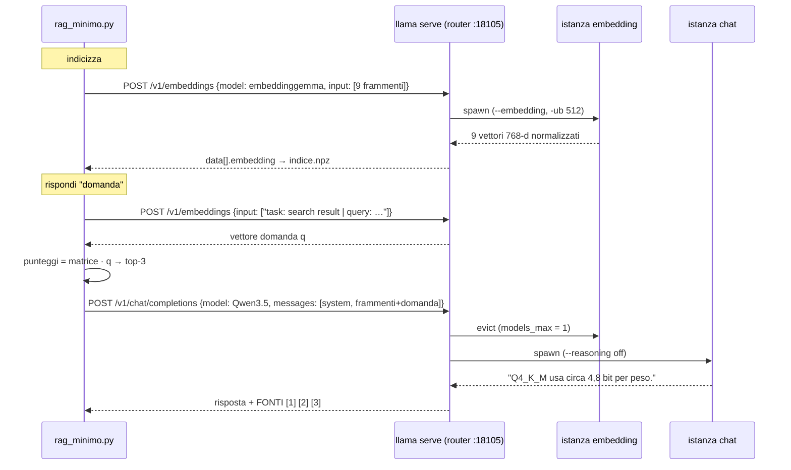

# Lab 08-02: RAG minimo

<div class="meta" markdown>
<span class="meta-item">:material-book-open-page-variant:{ .meta-icon } Modulo <a href="../../moduli/08-integrazione-sviluppo/README.md">08: Integrare llama.cpp nelle applicazioni</a></span>
<span class="meta-item">:material-clock-outline:{ .meta-icon } 45 min</span>
<span class="stato stato-verificato">verificato su b11046 (CPU, router + preset, 23/09/2026)</span>
</div>

## Obiettivo

Costruire un RAG (*Retrieval-Augmented Generation*) completo ma minuscolo, con **solo** due endpoint di `llama serve`
e due librerie Python (`numpy`, `requests`): spezzare quattro documenti in frammenti, trasformarli in vettori con
`/v1/embeddings`, cercare i frammenti più vicini a una domanda con la similarità coseno e far rispondere il modello di
chat citando i frammenti usati. Il tutto con **un solo server** in modalità router che alterna in memoria il modello
di embedding e quello di chat.

## Prerequisiti

- Modulo 04 (server, `/v1/chat/completions`, `curl`) e la sezione 6 del modulo 08 (embedding, coseno, flusso RAG).
- Python 3 con `numpy` e `requests` (`pip install numpy requests`, o un venv).
- 1,5 GB di RAM liberi: i due modelli non stanno mai in memoria insieme (`--models-max 1`).

## Materiale

| Cosa | Fonte | Dimensione | Licenza |
|---|---|---|---|
| `ggml-org/embeddinggemma-300M-GGUF:Q8_0` (embedding, 768 dimensioni) | Hugging Face | 334 MB | Gemma Terms |
| `ggml-org/Qwen3.5-0.8B-GGUF:Q8_0` (chat) | Hugging Face | 785 MB | Apache 2.0 |
| [`rag_minimo.py`](rag_minimo.py) | questa cartella | 130 righe: `indicizza`, `cerca`, `rispondi` | |
| [`modelli.ini`](modelli.ini) | questa cartella | preset per il router (`--models-preset`) | |
| [`documenti/`](documenti/) | questa cartella | 4 file `.txt` (installazione, server, quantizzazione, multimodale), ~850 byte l'uno | |
| `indice.npz` | generato dallo script | 45 KB, matrice 9 × 768 float32 + fonti + testi | |

## Procedura

### 1. Il flusso in una sequenza di chiamate

Il diagramma a blocchi del RAG è nel [modulo 08](../../moduli/08-integrazione-sviluppo/README.md#6-embedding-ricerca-vettoriale-rag);
qui vedi **chi chiama chi**: lo script parla solo con il router, che avvia e spegne i due modelli.



### 2. Leggere `rag_minimo.py`

Apri [`rag_minimo.py`](rag_minimo.py): cinque funzioni, nell'ordine del flusso.

- **`spezza_in_chunk(testo)`**: divide per paragrafi (righe vuote), normalizza gli spazi e accorpa paragrafi consecutivi
  finché non superano `MAX_CARATTERI_CHUNK = 500`. Nessuna sovrapposizione (*overlap*): è la scelta più semplice, e con
  paragrafi brevi funziona. Dai 4 documenti escono **9 frammenti**.
- **`embedding(testi)`**: una `POST` a `/v1/embeddings` con `{"model": …, "input": [lista]}`. La risposta è in formato
  OpenAI: `data[i].embedding` e `data[i].index`; lo script riordina per `index` e costruisce una matrice `numpy`
  `(n, 768)`. Il server normalizza già i vettori (`--embd-normalize 2`, default).
- **`indicizza()`**: legge `documenti/*.txt`, spezza, aggiunge a ogni frammento il prefisso `title: none | text: `
  e salva in `indice.npz` tre array: `matrice`, `fonti` (nome file), `testi`.
- **`cerca(domanda, k)`**: embedding della domanda con il prefisso `task: search result | query: `, poi
  `punteggi = idx["matrice"] @ q`. Con vettori a norma 1 il prodotto scalare **è** la similarità coseno: niente
  divisioni per le norme. `np.argsort(-punteggi)[:k]` dà i `k` indici migliori (`RAG_TOP_K = 3`).
- **`rispondi(domanda)`**: numera i frammenti `[1] (file) testo`, li mette nel messaggio `user` insieme alla domanda e
  chiede al modello di chat, con un `system` che impone "usa SOLO i frammenti, cita [n], se non basta di' che non lo sai".
  `temperature 0.2`, `max_tokens 200` e `chat_template_kwargs: {"enable_thinking": false}` (Qwen3.5 altrimenti ragiona
  per centinaia di token). Poi stampa la risposta e l'elenco `FONTI` con il punteggio di similarità.

!!! tip "I prefissi di EmbeddingGemma"
    `PREFISSO_QUERY` e `PREFISSO_DOC` vengono dalla scheda del modello: EmbeddingGemma è addestrato con un prefisso
    diverso per domande e documenti e senza i punteggi calano. Se cambi modello di embedding (`RAG_EMBED_MODEL`), leggi
    la sua scheda: molti non li vogliono affatto.

Le variabili d'ambiente `RAG_URL`, `RAG_CHAT_URL`, `RAG_EMBED_MODEL`, `RAG_CHAT_MODEL`, `RAG_TOP_K` (con i default nel
docstring) permettono di puntare a due server separati o cambiare modelli senza toccare il codice.

### 3. Il preset `modelli.ini`

In modalità router (`llama serve` senza `-m`/`-hf`) ogni modello viene avviato come processo figlio con i propri flag.
Il problema: `/v1/embeddings` su EmbeddingGemma **fallisce** se l'istanza non parte con `--embedding` (modulo 08,
"Errori comuni"). Il preset INI risolve: ogni sezione è un modello, le chiavi sono i flag senza trattini iniziali
(forme lunghe, corte o variabili `LLAMA_ARG_*`).

```ini
version = 1

[*]                       ; valori comuni a tutti i modelli
c = 4096
np = 1

[ggml-org/embeddinggemma-300M-GGUF:Q8_0]
embedding = true          ; obbligatorio per /v1/embeddings
ub = 512                  ; micro-batch: l'input di embedding va elaborato in un colpo solo

[ggml-org/Qwen3.5-0.8B-GGUF:Q8_0]
reasoning = off           ; niente "thinking" (equivale a -rea off)
```

Priorità: flag da riga di comando > sezione del modello > `[*]`. Verificato con `GET /v1/models`: il router mostra per
ogni modello gli `args` con cui lo avvierà (`--hf-repo … --ctx-size 4096 --parallel 1 --reasoning off --threads 3`,
dove `--threads 3` arriva dal `-t 3` passato al router) e il campo `"source": "preset"`.

### 4. Avviare il router

I due modelli devono essere in cache (`llama cli -cl` li elenca; se mancano, `llama download -hf <repo>:Q8_0`).

```bash
cd corso/laboratori/lab-08-02-rag-minimo
llama serve --host 127.0.0.1 --port 18105 --models-preset modelli.ini --models-max 1 -t 3
```

Output atteso:

```text
W srv  llama_server:     router mode
I srv  llama_server: starting server in router mode. models will be automatically loaded on-demand
I srv  llama_server: listening on http://127.0.0.1:18105
```

`--models-max 1` tiene in memoria un solo modello alla volta: quando arriva una richiesta per l'altro, il router
lo mette in coda, scarica quello inattivo (`evicting idle LRU`) e avvia il nuovo. Su un portatile con 8 GB puoi alzare
a 2 e risparmiare i ~10 s di ricarica a ogni cambio.

### 5. Indicizzare

In un secondo terminale:

```bash
export RAG_URL=http://127.0.0.1:18105
python rag_minimo.py indicizza
```

Output reale (VPS, 3 thread; 45 s in tutto, quasi tutti per il primo caricamento del modello):

```text
9 frammenti da …/lab-08-02-rag-minimo/documenti
indice salvato in …/lab-08-02-rag-minimo/indice.npz: matrice (9, 768)
```

Nel log del router: `spawning server instance with name=ggml-org/embeddinggemma-300M-GGUF:Q8_0 on port 39011` (porta
casuale del figlio), `n_slots = 1, n_ctx_slot = 2048`, poi `proxying request to model … on port 39011`.
Questo è il modo per **ricreare `indice.npz`**: cancellalo e rilancia `indicizza` ogni volta che cambi i documenti o il
modello di embedding (i vettori di modelli diversi non sono confrontabili).

### 6. Cercare e rispondere

```bash
python rag_minimo.py cerca "Quanti bit per peso usa Q4_K_M?"
```

```text
0.600  quantizzazione.txt: La quantizzazione riduce la precisione dei pesi da 16 bit a un numero minore di bit per peso. Q8_0 usa circa 8...
0.401  quantizzazione.txt: Il comando "llama quantize modello-f16.gguf modello-q4.gguf Q4_K_M" produce il file quantizzato. Con una matri...
0.310  quantizzazione.txt: Quantizzazione e formato GGUF GGUF è il formato di file di llama.cpp: un unico file contiene i metadati del mo...
```

I tre frammenti vengono tutti dal documento giusto e il primo contiene la risposta. Ora la generazione:

```bash
python rag_minimo.py rispondi "Quanti bit per peso usa Q4_K_M?"
```

Output reale (1 min 13 s: scarico dell'embedding, caricamento di Qwen, 445 token di prompt a 21 t/s, 21 token generati
a 5,4 t/s):

```text
RISPOSTA:
Q4_K_M usa circa 4,8 bit per peso.

FONTI:
  [1] quantizzazione.txt (sim 0.600): La quantizzazione riduce la precisione dei pesi da 16 bit a un numero minore di bit per pe...
  [2] quantizzazione.txt (sim 0.401): Il comando "llama quantize modello-f16.gguf modello-q4.gguf Q4_K_M" produce il file quanti...
  [3] quantizzazione.txt (sim 0.310): Quantizzazione e formato GGUF GGUF è il formato di file di llama.cpp: un unico file contie...
```

Nel log: `models_max reached, request for name=ggml-org/Qwen3.5-0.8B-GGUF:Q8_0 queued at position 1`, `evicting idle
LRU name=ggml-org/embeddinggemma-300M-GGUF:Q8_0`, `instance … exited with status 0`, `loading queued model`.

Seconda domanda, su un altro documento:

```bash
python rag_minimo.py rispondi "Come si risolve l'errore SSL connection failed?"
```

```text
RISPOSTA:
La soluzione è esportare SSL_CERT_FILE=/etc/ssl/certs/ca-certificates.crt.

FONTI:
  [1] installazione.txt (sim 0.437): Esistono anche i gestori di pacchetti: "winget install llama.cpp" su Windows, "brew instal...
  [2] installazione.txt (sim 0.283): Installazione di llama.cpp Il modo consigliato da llama.app per installare llama.cpp è l'i...
  [3] server.txt (sim 0.240): Il server HTTP di llama.cpp Il comando "llama serve" avvia un server HTTP con un'API compa...
```

Risposta corretta, ma guarda le similarità: 0.44 contro 0.60 di prima, e il frammento [1] è quello che **contiene** la
frase sull'SSL solo perché il chunker ha accorpato due paragrafi (il secondo e il terzo di `installazione.txt`). Con
frammenti più corti o un modello di embedding più grande la domanda "SSL" si sarebbe agganciata meglio.

Il modello Qwen3.5 da 0.8B, nonostante l'istruzione, in questa esecuzione **non ha citato `[1]`** nel testo: un modello
piccolo segue il formato in modo incostante. Lo script stampa comunque l'elenco `FONTI`, quindi la tracciabilità non
dipende dalla buona volontà del modello.

### 7. Spegnere

Nel terminale del router ++ctrl+c++, oppure `pkill -f "port 18105"`. Il router chiude anche i processi figli.

## Verifica del risultato

- [ ] `GET /v1/models` sul router elenca i due modelli con `"source": "preset"` e, per EmbeddingGemma, `--embedding` negli `args`.
- [ ] `indicizza` stampa `9 frammenti` e `matrice (9, 768)`; `indice.npz` pesa ~45 KB.
- [ ] `cerca` sulla domanda Q4_K_M mette `quantizzazione.txt` al primo posto con similarità ≈ 0.6.
- [ ] `rispondi` produce una risposta corretta e l'elenco `FONTI` con tre frammenti.
- [ ] Nel log del router compaiono `evicting idle LRU` e `loading queued model` a ogni cambio di modello.

## Domande e varianti

1. Togli i prefissi `PREFISSO_QUERY`/`PREFISSO_DOC` e reindicizza: come cambiano i punteggi di `cerca`?
2. Porta `MAX_CARATTERI_CHUNK` a 200 e aggiungi una sovrapposizione di 50 caratteri tra frammenti consecutivi. La domanda
   sull'SSL ottiene una similarità più alta?
3. Fai una domanda a cui i documenti **non** rispondono ("Quanto costa una GPU H100?"): il modello ammette di non saperlo,
   come chiede il `system`, o inventa? Prova con `temperature 0` e con un modello più grande (`RAG_CHAT_MODEL`).
4. Alza `--models-max 2` e misura il tempo di `rispondi` alla seconda domanda: quanto costava il cambio di modello?
5. Sostituisci il router con due server separati (`--embedding --port 18106` e chat su `18107`) usando `RAG_URL` e
   `RAG_CHAT_URL`: cosa cambia nel preset, nella RAM e nel tempo?
6. Aggiungi il **reranking**: dopo `cerca` con `k = 6`, manda domanda e frammenti a `/v1/rerank` con un modello reranker
   (`ggml-org/Qwen3-reranker-0.6B-Q8_0-GGUF`, sezione `rerank = true` nel preset con `pooling = rank`) e tieni i 3 migliori.
7. Con `numpy` calcola la similarità tra tutti i frammenti (`matrice @ matrice.T`): quali due frammenti di documenti
   diversi sono più vicini? Ha senso?

## Consegna

Un file `lab08-02.md` con: l'output di `indicizza`, di `cerca` e di `rispondi` su due domande (una con risposta nei
documenti, una senza); le righe del log del router che mostrano il cambio di modello; la risposta alla domanda 1 o 2
con i punteggi prima/dopo; e un nuovo documento `.txt` aggiunto da te a `documenti/`, con una domanda che lo trova.
