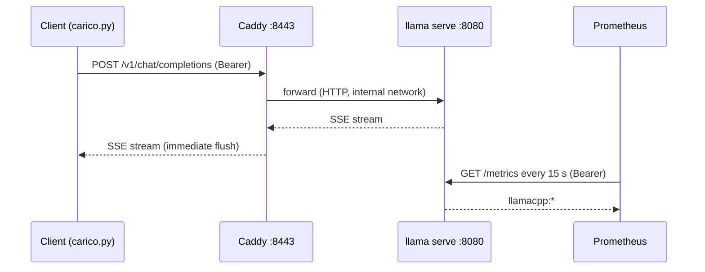

# Lab 09-02: Proxy and monitoring

<div class="meta" markdown>
<span class="meta-item">:material-book-open-page-variant:{ .meta-icon } Module <a href="../../moduli/09-deploy-produzione/README.md">09: Going to production</a></span>
<span class="meta-item">:material-clock-outline:{ .meta-icon } 90-120 minutes</span>
</div>

## Objective

Put `llama serve` behind Caddy with HTTPS and an API key, collect metrics with Prometheus, build
a Grafana dashboard and use it to read what happens under load: how many requests end up queued,
how many tokens per second, how much of the prompt cache you reuse.



## Prerequisites

- [Lab 01-04](../lab-01-04-docker/README.md) (Docker and Compose working) and [lab 09-01](../lab-09-01-servizio/README.md) (API key and `/health` concepts).
- ~3 GB of free RAM for the stack (server with Qwen3.5-0.8B ≈ 1.2 GB, Prometheus + Grafana ≈ 0.5 GB, Caddy negligible).
- Free ports: 8443 (Caddy), 9090 (Prometheus, localhost only), 3000 (Grafana, localhost only).

## Materials

Everything is in this lab's folder:

| File | Role |
|---|---|
| [`compose.yaml`](compose.yaml) | four services: `llama`, `caddy`, `prometheus`, `grafana` |
| [`Caddyfile`](Caddyfile) | HTTPS on `localhost` with an internal certificate, public `/health`, Bearer passed through |
| [`prometheus.yml`](prometheus.yml) | scrape of `/metrics` with the API key |
| [`grafana/provisioning/datasources/prometheus.yml`](grafana/provisioning/datasources/prometheus.yml) | Prometheus preconfigured as a data source |
| [`api-keys.txt.example`](api-keys.txt.example) | to copy to `api-keys.txt` |
| [`carico.py`](carico.py) | load generator (standard library only) |
| Model | `ggml-org/Qwen3.5-0.8B-GGUF` → `Qwen3.5-0.8B-Q8_0.gguf`, 785 MiB, Apache-2.0 |

## Steps

### 1. Preparing the model and key

```bash
cd corso/laboratori/lab-09-02-proxy-monitoraggio
mkdir -p models
# copy the file from the Hugging Face cache (or download it with llama download and then copy it)
cp ~/.cache/huggingface/hub/models--ggml-org--Qwen3.5-0.8B-GGUF/snapshots/*/Qwen3.5-0.8B-Q8_0.gguf models/
cp api-keys.txt.example api-keys.txt
sed -i "s/chiave-di-prova-cambiami/$(openssl rand -hex 16)/" api-keys.txt prometheus.yml   # (1)!
cat api-keys.txt
```

1. The same key must end up both in the file read by the server and in Prometheus's `authorization` section: `/metrics` is not public.

### 2. Reading `compose.yaml`

Before starting it, look in the file for the answers to these questions: why does `llama` have no `ports:`? What does
`start_period` do? Why does `caddy` have `depends_on … condition: service_healthy`? Why are Prometheus and Grafana
published only on `127.0.0.1`?

### 3. Starting the stack

```bash
docker compose up -d
watch -n 2 docker compose ps        # wait until llama is "Up (healthy)" and caddy "Up"
```

Expected output of `docker compose ps` after 1-2 minutes:

```
NAME                  IMAGE                                          STATUS
lab-09-02-caddy-1     caddy:2                                        Up 40 seconds
lab-09-02-grafana-1   grafana/grafana:12.1.0                         Up 2 minutes
lab-09-02-llama-1     ghcr.io/ggml-org/llama.cpp:server-b11046       Up 2 minutes (healthy)
lab-09-02-prometheus-1 prom/prometheus:v3.5.0                        Up 2 minutes
```

Caddy starts **after** the server is healthy. In the server logs: `docker compose logs llama | grep -E "n_slots|listening"`.

### 4. Testing the proxy

```bash
KEY=$(grep -v '^#' api-keys.txt | head -1)
curl -sk https://localhost:8443/health; echo                      # (1)!
curl -sk https://localhost:8443/v1/models; echo                   # 401: key missing
curl -sk https://localhost:8443/v1/chat/completions \
  -H "Authorization: Bearer $KEY" -H "Content-Type: application/json" \
  -d '{"messages":[{"role":"user","content":"Ciao, chi sei?"}],"max_tokens":40,"chat_template_kwargs":{"enable_thinking":false}}' | python3 -m json.tool | head -20
```

1. `-k` because the certificate is issued by Caddy's internal CA (`tls internal`). With a real domain and Let's Encrypt you do not need it.

Then streaming: add `"stream": true` and watch the chunks arrive one at a time (that is `flush_interval -1`
in the Caddyfile; comment it out, run `docker compose restart caddy`, and try again: they all arrive together).

Also look at the proxy access logs: `docker compose logs caddy | tail -3` (one JSON line per request, with
status and duration).

### 5. Prometheus

Open http://localhost:9090/targets: the `llamacpp` job must be **UP**. If it is DOWN with `401`, the key in
`prometheus.yml` does not match the server's (`docker compose restart prometheus` after fixing it).

In the search bar try: `llamacpp:tokens_predicted_total`, then `rate(llamacpp:tokens_predicted_total[1m])`.
Make a few requests and watch the values change (the scrape runs every 15 s).

### 6. Grafana: the dashboard

Open http://localhost:3000 (admin / cambiami). The Prometheus data source is already there. Create a dashboard
with these panels:

| # | Title | Type | PromQL query |
|---|---|---|---|
| 1 | Generated tokens / s | Time series | `rate(llamacpp:tokens_predicted_total[1m])` |
| 2 | Prompt tokens / s | Time series | `rate(llamacpp:prompt_tokens_total[1m])` |
| 3 | Requests in progress and queued | Time series (2 queries) | `llamacpp:requests_processing` · `llamacpp:requests_deferred` |
| 4 | Busy slots per decode | Gauge (max = `-np`) | `llamacpp:n_busy_slots_per_decode` |
| 5 | Prompt cache hit | Stat (%) | `rate(llamacpp:prompt_tokens_cached_total[5m]) / (rate(llamacpp:prompt_tokens_total[5m]) + rate(llamacpp:prompt_tokens_cached_total[5m]))` |
| 6 | Seconds per generated token | Stat | `rate(llamacpp:tokens_predicted_seconds_total[5m]) / rate(llamacpp:tokens_predicted_total[5m])` |
| 7 | Server up | Stat (0/1, red/green) | `up{job="llamacpp"}` |

Set the refresh interval to 10 s (top right) and save the dashboard. Export the JSON
(Share → Export) and put it in the lab folder: it is part of the deliverable.

### 7. Under load

```bash
python3 carico.py --url https://localhost:8443 --key "$KEY" --n 2 --insecure
python3 carico.py --url https://localhost:8443 --key "$KEY" --n 6 --insecure
```

Expected output (indicative values on a 4-core CPU):

```
== 2 richieste in parallelo, max_tokens=32, durata totale 9.8 s
  #0: primo token dopo 1.41 s, totale 9.6 s, 32 chunk
  #1: primo token dopo 1.52 s, totale 9.8 s, 32 chunk
  latenza al primo token: mediana 1.47 s, max 1.52 s
  throughput aggregato: 6.5 token/s
  /metrics: +64 token generati, +58 token di prompt, requests_deferred ora = 0

== 6 richieste in parallelo, max_tokens=32, durata totale 31.2 s
  #0: primo token dopo 1.6 s ...
  #2: primo token dopo 11.9 s ...      ← ha aspettato uno slot libero
  ...
  latenza al primo token: mediana 12.1 s, max 22.4 s
```

With `-np 2` and 6 requests, four end up queued: during the test watch panel 3 (`requests_deferred`
rises to 4) and panel 4 (busy slots = 2). The aggregate throughput stays similar: the machine was already saturated.

### 8. Changing the sizing

Set `LLAMA_ARG_N_PARALLEL` to 4 in `compose.yaml` (with `LLAMA_ARG_CTX_SIZE: 8192` each slot drops to 2048
tokens), run `docker compose up -d llama`, wait for `healthy` and repeat the test with `--n 6`. Compare: time to
first token, aggregate throughput, `requests_deferred`. On CPU expect almost the same total throughput and
a lower per-user speed; on GPU the aggregate throughput grows.

### 9. Shutting down

```bash
docker compose down          # add -v to also delete the volumes (Prometheus/Grafana data)
```

## Check the result

- [ ] `https://localhost:8443/health` returns 200 without a key; `/v1/models` returns 401 without a key and 200 with one.
- [ ] The `llamacpp` target in Prometheus is UP and `llamacpp:tokens_predicted_total` grows after a request.
- [ ] The dashboard has at least 5 of the 7 panels and shows the `requests_deferred` peak during `carico.py --n 6`.
- [ ] You can explain in words the difference between the two tests (`-np 2` vs `-np 4`).

## Questions and variations

1. Enable `basic_auth` in the Caddyfile (uncomment it, generate the hash with `docker compose exec caddy caddy hash-password --plaintext ...`) and `LLAMA_ARG_UI: 1`: the web UI now asks for a username and password; do the APIs still require the Bearer? Why yes?
2. Remove `condition: service_healthy` and run `docker compose up -d --force-recreate`: what does the proxy answer in the first few seconds?
3. Replace Caddy with Nginx using the `??? note` block from the module (image `nginx:alpine`, self-signed certificate with `openssl req -x509`). Which of the two configurations is longer, and why?
4. Add an alert in Prometheus (`rules.yml`) for `llamacpp:requests_deferred > 0` for 2 minutes and check that it fires with `carico.py --n 8`.
5. With a real domain: change `localhost` to `llm.tuodominio.it`, remove `tls internal`, publish `80:80` and `443:443`. What must be true on the DNS and firewall side for Caddy to obtain the certificate?
6. Router mode: remove `LLAMA_ARG_MODEL`, mount the folder with two GGUFs on `/models` and add `LLAMA_ARG_MODELS_DIR: /models`. What must you change in `prometheus.yml` (`?model=`) and in the request body?

## Deliverable

- Final `compose.yaml`, `Caddyfile`, `prometheus.yml` (keys redacted) and the exported dashboard JSON.
- A screenshot of the dashboard during the `--n 6` test.
- The output of `carico.py` in the three configurations (`-np 2` with `--n 2` and `--n 6`, `-np 4` with `--n 6`) and 5 lines of commentary: how many concurrent users could your machine handle with a time to first token under 3 seconds?
