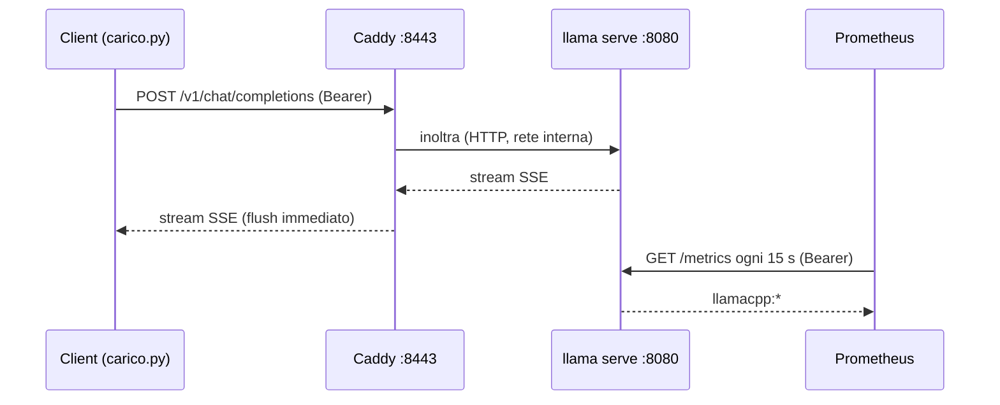

# Proxy e monitoraggio

> Modulo: [09: Messa in produzione](../../moduli/09-deploy-produzione/README.md) · <span class="stato stato-verificato">verificato su b11046</span> (Caddyfile e `compose.yaml` validati; metriche lette dal server reale) · Durata stimata: 90-120 minuti

## Obiettivo

Mettere `llama serve` dietro Caddy con HTTPS e chiave API, raccogliere le metriche con Prometheus, costruire
una dashboard Grafana e usarla per leggere cosa succede sotto carico: quante richieste finiscono in coda,
quanti token al secondo, quanta cache del prompt riusi.



## Prerequisiti

- [Lab 01-04](../lab-01-04-docker/README.md) (Docker e Compose funzionanti) e [lab 09-01](../lab-09-01-servizio/README.md) (concetti di chiave API e `/health`).
- ~3 GB di RAM liberi per lo stack (server con Qwen3.5-0.8B ≈ 1,2 GB, Prometheus + Grafana ≈ 0,5 GB, Caddy trascurabile).
- Porte libere: 8443 (Caddy), 9090 (Prometheus, solo localhost), 3000 (Grafana, solo localhost).

## Materiale

Tutto nella cartella di questo lab:

| File | Ruolo |
|---|---|
| [`compose.yaml`](compose.yaml) | quattro servizi: `llama`, `caddy`, `prometheus`, `grafana` |
| [`Caddyfile`](Caddyfile) | HTTPS su `localhost` con certificato interno, `/health` pubblico, Bearer passante |
| [`prometheus.yml`](prometheus.yml) | scrape di `/metrics` con la chiave API |
| [`grafana/provisioning/datasources/prometheus.yml`](grafana/provisioning/datasources/prometheus.yml) | Prometheus già configurato come data source |
| [`api-keys.txt.example`](api-keys.txt.example) | da copiare in `api-keys.txt` |
| [`carico.py`](carico.py) | generatore di carico (solo libreria standard) |
| Modello | `ggml-org/Qwen3.5-0.8B-GGUF` → `Qwen3.5-0.8B-Q8_0.gguf`, 785 MiB, Apache-2.0 |

## Procedura

### 1. Preparare modello e chiave

```bash
cd corso/laboratori/lab-09-02-proxy-monitoraggio
mkdir -p models
# copia il file dalla cache Hugging Face (o scaricalo con llama download e poi copialo)
cp ~/.cache/huggingface/hub/models--ggml-org--Qwen3.5-0.8B-GGUF/snapshots/*/Qwen3.5-0.8B-Q8_0.gguf models/
cp api-keys.txt.example api-keys.txt
sed -i "s/chiave-di-prova-cambiami/$(openssl rand -hex 16)/" api-keys.txt prometheus.yml   # (1)!
cat api-keys.txt
```

1. La stessa chiave deve finire sia nel file letto dal server sia nella sezione `authorization` di Prometheus: `/metrics` non è pubblico.

### 2. Leggere `compose.yaml`

Prima di avviarlo, cerca nel file le risposte a queste domande: perché `llama` non ha `ports:`? Cosa fa
`start_period`? Perché `caddy` ha `depends_on … condition: service_healthy`? Perché Prometheus e Grafana
sono pubblicati solo su `127.0.0.1`?

### 3. Avviare lo stack

```bash
docker compose up -d
watch -n 2 docker compose ps        # aspetta che llama sia "Up (healthy)" e caddy "Up"
```

Output atteso di `docker compose ps` dopo 1-2 minuti:

```
NAME                  IMAGE                                          STATUS
lab-09-02-caddy-1     caddy:2                                        Up 40 seconds
lab-09-02-grafana-1   grafana/grafana:12.1.0                         Up 2 minutes
lab-09-02-llama-1     ghcr.io/ggml-org/llama.cpp:server-b11046       Up 2 minutes (healthy)
lab-09-02-prometheus-1 prom/prometheus:v3.5.0                        Up 2 minutes
```

Caddy parte **dopo** che il server è healthy. Nei log del server: `docker compose logs llama | grep -E "n_slots|listening"`.

### 4. Provare il proxy

```bash
KEY=$(grep -v '^#' api-keys.txt | head -1)
curl -sk https://localhost:8443/health; echo                      # (1)!
curl -sk https://localhost:8443/v1/models; echo                   # 401: manca la chiave
curl -sk https://localhost:8443/v1/chat/completions \
  -H "Authorization: Bearer $KEY" -H "Content-Type: application/json" \
  -d '{"messages":[{"role":"user","content":"Ciao, chi sei?"}],"max_tokens":40,"chat_template_kwargs":{"enable_thinking":false}}' | python3 -m json.tool | head -20
```

1. `-k` perché il certificato è emesso dalla CA interna di Caddy (`tls internal`). Con un dominio vero e Let's Encrypt non serve.

Poi lo streaming: aggiungi `"stream": true` e osserva che i chunk arrivano uno alla volta (è `flush_interval -1`
nel Caddyfile; commentalo, `docker compose restart caddy`, e riprova: arrivano tutti insieme).

Vedi anche i log di accesso del proxy: `docker compose logs caddy | tail -3` (una riga JSON per richiesta, con
status e durata).

### 5. Prometheus

Apri http://localhost:9090/targets: il job `llamacpp` deve essere **UP**. Se è DOWN con `401`, la chiave in
`prometheus.yml` non coincide con quella del server (`docker compose restart prometheus` dopo averla corretta).

Nella barra di ricerca prova: `llamacpp:tokens_predicted_total`, poi `rate(llamacpp:tokens_predicted_total[1m])`.
Fai qualche richiesta e guarda i valori cambiare (lo scrape è ogni 15 s).

### 6. Grafana: la dashboard

Apri http://localhost:3000 (admin / cambiami). Il data source Prometheus è già presente. Crea una dashboard
con questi pannelli:

| # | Titolo | Tipo | Query PromQL |
|---|---|---|---|
| 1 | Token generati / s | Time series | `rate(llamacpp:tokens_predicted_total[1m])` |
| 2 | Prompt token / s | Time series | `rate(llamacpp:prompt_tokens_total[1m])` |
| 3 | Richieste in corso e in coda | Time series (2 query) | `llamacpp:requests_processing` · `llamacpp:requests_deferred` |
| 4 | Slot occupati per decode | Gauge (max = `-np`) | `llamacpp:n_busy_slots_per_decode` |
| 5 | Cache hit del prompt | Stat (%) | `rate(llamacpp:prompt_tokens_cached_total[5m]) / (rate(llamacpp:prompt_tokens_total[5m]) + rate(llamacpp:prompt_tokens_cached_total[5m]))` |
| 6 | Secondi per token generato | Stat | `rate(llamacpp:tokens_predicted_seconds_total[5m]) / rate(llamacpp:tokens_predicted_total[5m])` |
| 7 | Server up | Stat (0/1, rosso/verde) | `up{job="llamacpp"}` |

Imposta l'intervallo di aggiornamento a 10 s (in alto a destra) e salva la dashboard. Esporta il JSON
(Share → Export) e mettilo nella cartella del lab: farà parte della consegna.

### 7. Sotto carico

```bash
python3 carico.py --url https://localhost:8443 --key "$KEY" --n 2 --insecure
python3 carico.py --url https://localhost:8443 --key "$KEY" --n 6 --insecure
```

Output atteso (valori indicativi su CPU a 4 core):

```
== 2 richieste in parallelo, max_tokens=32, durata totale 9.8 s
  #0: primo token dopo 1.41 s, totale 9.6 s, 32 chunk
  #1: primo token dopo 1.52 s, totale 9.8 s, 32 chunk
  latenza al primo token: mediana 1.47 s, max 1.52 s
  throughput aggregato: 6.5 token/s
  /metrics: +64 token generati, +58 token di prompt, requests_deferred ora = 0

== 6 richieste in parallelo, max_tokens=32, durata totale 31.2 s
  #0: primo token dopo 1.6 s ...
  #2: primo token dopo 11.9 s ...      ← ha aspettato uno slot libero
  ...
  latenza al primo token: mediana 12.1 s, max 22.4 s
```

Con `-np 2` e 6 richieste, quattro finiscono in coda: durante il test guarda il pannello 3 (`requests_deferred`
sale a 4) e il pannello 4 (slot occupati = 2). Il throughput aggregato resta simile: la macchina era già satura.

### 8. Cambiare il dimensionamento

Porta `LLAMA_ARG_N_PARALLEL` a 4 in `compose.yaml` (con `LLAMA_ARG_CTX_SIZE: 8192` ogni slot scende a 2048
token), `docker compose up -d llama`, aspetta `healthy` e ripeti il test con `--n 6`. Confronta: latenza al
primo token, throughput aggregato, `requests_deferred`. Su CPU aspettati un throughput totale quasi uguale e
una velocità per utente più bassa; su GPU il throughput aggregato cresce.

### 9. Spegnere

```bash
docker compose down          # aggiungi -v per cancellare anche i volumi (dati di Prometheus/Grafana)
```

## Verifica del risultato

- [ ] `https://localhost:8443/health` risponde 200 senza chiave; `/v1/models` risponde 401 senza chiave e 200 con.
- [ ] Il target `llamacpp` in Prometheus è UP e `llamacpp:tokens_predicted_total` cresce dopo una richiesta.
- [ ] La dashboard ha almeno 5 dei 7 pannelli e mostra il picco di `requests_deferred` durante `carico.py --n 6`.
- [ ] Sai spiegare a parole la differenza tra i due test (`-np 2` vs `-np 4`).

## Domande e varianti

1. Attiva `basic_auth` nel Caddyfile (decommenta, genera l'hash con `docker compose exec caddy caddy hash-password --plaintext ...`) e `LLAMA_ARG_UI: 1`: la web UI ora chiede utente e password; le API continuano a volere il Bearer? Perché sì?
2. Rimuovi `condition: service_healthy` e fai `docker compose up -d --force-recreate`: che cosa risponde il proxy nei primi secondi?
3. Sostituisci Caddy con Nginx usando il blocco `??? note` del modulo (immagine `nginx:alpine`, certificato autofirmato con `openssl req -x509`). Quale delle due configurazioni è più lunga e perché?
4. Aggiungi un alert in Prometheus (`rules.yml`) per `llamacpp:requests_deferred > 0` per 2 minuti e verifica che scatti con `carico.py --n 8`.
5. Con un dominio vero: cambia `localhost` in `llm.tuodominio.it`, togli `tls internal`, pubblica `80:80` e `443:443`. Cosa deve essere vero lato DNS e firewall perché Caddy ottenga il certificato?
6. Router mode: togli `LLAMA_ARG_MODEL`, monta la cartella con due GGUF su `/models` e aggiungi `LLAMA_ARG_MODELS_DIR: /models`. Cosa devi cambiare in `prometheus.yml` (`?model=`) e nel body delle richieste?

## Consegna

- `compose.yaml`, `Caddyfile`, `prometheus.yml` finali (chiavi oscurate) e il JSON esportato della dashboard.
- Uno screenshot della dashboard durante il test con `--n 6`.
- L'output di `carico.py` nelle tre configurazioni (`-np 2` con `--n 2` e `--n 6`, `-np 4` con `--n 6`) e 5 righe di commento: quanti utenti concorrenti reggerebbe la tua macchina con una latenza al primo token sotto i 3 secondi?
