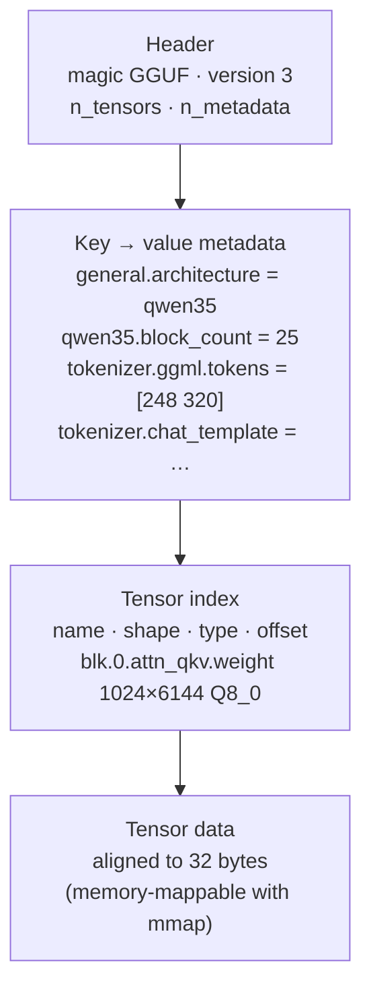

# Module 00: Introduction to llama.cpp

This module gives you the map: what llama.cpp is, how it is built inside, what a GGUF file contains, and how to
tell **before downloading** whether a model fits in your computer's memory. You don't need to install
anything yet: the two labs use only Python.

## What you will learn

- Why running a language model locally makes sense (and when it doesn't).
- How **ggml → libllama → tools** are stacked, and where Ollama, LM Studio and llama-cpp-python fit.
- What a **GGUF** file contains and how to read its metadata.
- What "quantizing" a model means and what it costs in quality and memory.
- How to estimate **weights + KV cache + overhead** with a formula and check it in the logs.
- How to find your way between stable `vX.Y.Z` releases and nightly `bNNNNN` builds.

## 1. Local inference: why

"Inference" is the phase in which an already trained model produces an answer: it takes a **prompt**, splits it into
**tokens** (word fragments) and generates one token at a time. Running it locally means the model runs on
your hardware instead of on a remote API.

| Reason | What changes in practice |
|---|---|
| **Privacy** | Documents, code and conversations never leave the machine. No data processing agreement to sign. |
| **Cost** | Zero cost per token: a laptop generating 10 tokens/s all day costs only electricity. |
| **Offline** | It works on a plane, on a construction site, on an isolated network, on a Raspberry Pi. |
| **Control** | You choose the model, the version, the sampling parameters, the output grammar. No surprise deprecations. |
| **Latency** | The first token arrives in tens of milliseconds, with no network round trip. |

And the limits: an 8-billion-parameter model on a laptop is not GPT-class; on CPU, generation runs
from 2 to 15 tokens/s; memory is the constraint you will hit first. The whole course revolves around these three
trade-offs: **quality, speed, memory**.

## 2. llama.cpp and ggml: history and architecture

llama.cpp was born in March 2023, when Georgi Gerganov rewrote LLaMA inference in pure C/C++, with no
dependencies, to run it on a MacBook. In three years it has become **the** local inference engine: ~129k
stars on GitHub, MIT license, one nightly release a day, and the foundation of Ollama, LM Studio, Jan and dozens
of mobile apps. The project is maintained by the **ggml-org** organization.

Inside, it has three layers:

<figure class="schema" markdown>

<figcaption>The three layers of llama.cpp. Dashed boxes are external projects that use libllama.</figcaption>
</figure>

1. **ggml** is the tensor library: it defines the quantized types (`Q4_K`, `Q8_0`, …), builds a compute
   graph and runs it on a **backend**: CPU (with AVX2, AVX-512 and NEON variants chosen at runtime), CUDA, Metal,
   Vulkan, HIP, SYCL, OpenCL and others. It is a separate project ([ggml-org/ggml](https://github.com/ggml-org/ggml))
   included in the llama.cpp sources.
2. **libllama** (`libllama.so`, C API in `include/llama.h`) knows what a language model is: it loads a
   GGUF, tokenizes, builds the graph for the specific architecture (llama, qwen, gemma, …), manages the
   **KV cache** and sampling.
3. **The tools** are programs that use libllama: since 2026 there is a single `llama` binary with subcommands
   (`llama cli`, `llama serve`, `llama bench`, `llama quantize`, …). The old names `llama-cli`, `llama-server`
   still exist in the tarballs and Docker images: in the course we use the new form.

!!! tip "What the others use"
    Ollama, LM Studio, Jan, GPT4All and the "local chat" phone apps embed libllama (or ggml) and put
    an interface and a model catalog on top of it. `llama-cpp-python` is a Python binding of the same
    library. Learning llama.cpp means understanding what happens underneath all of them.

## 3. The GGUF format

GGUF (GGML Universal Format) is **a single file** that contains everything needed to run the model:
weights, tokenizer, chat template, architectural parameters. No separate `config.json`, no folders of
`safetensors` to keep in sync.



Metadata keys have a prefix: `general.*` (name, license, file type), `<architecture>.*`
(model dimensions), `tokenizer.ggml.*` (vocabulary and special tokens), `tokenizer.chat_template` (the
Jinja template that turns `system/user/assistant` messages into the text the model expects). Here are
the real values of the course test model, `ggml-org/Qwen3.5-0.8B-GGUF`, read with `gguf-dump`:

```text
general.architecture = 'qwen35'
general.name = 'Qwen3.5-0.8B'
general.size_label = '773M'
general.license = 'apache-2.0'
general.file_type = 7                      # (1)!
qwen35.block_count = 25
qwen35.context_length = 262144
qwen35.embedding_length = 1024
qwen35.attention.head_count = 8
qwen35.attention.head_count_kv = 2         # (2)!
qwen35.attention.key_length = 256
qwen35.full_attention_interval = 4         # (3)!
tokenizer.ggml.model = 'gpt2'
tokenizer.ggml.tokens = [248320 elementi]
tokenizer.chat_template = '{%- set image_count = …'
```

1. `file_type = 7` means Q8_0: the `ftype` field you see in the `llama cli` banner.
2. 8 attention heads but only 2 K/V heads: this is *Grouped Query Attention* (GQA), which shrinks the KV cache 4 times.
3. Qwen3.5 is a **hybrid** model: only 1 block in 4 is classic attention, the others are recurrent layers (SSM) with no KV cache. You will see it count in the memory estimate.

Why the format matters: a GGUF is opened with **mmap**, meaning the operating system maps the file into memory and
loads pages only when they are needed. Loading is almost instant, and two processes that open the same
model share the pages. Module [03](../03-modelli-gguf-quantizzazione/README.md) explains how to
create a GGUF from a Hugging Face model and how to quantize it.

## 4. Quantization, the concept

A model is trained with 16- or 32-bit weights. **Quantizing** means rewriting them with fewer bits,
in blocks: for example `Q4_0` groups 32 weights, stores one 16-bit scale and each weight in 4 bits
(4 + 16/32 = **4.5 bits per weight**). The `K` families (`Q4_K_M`, `Q5_K_M`, `Q6_K`) use smarter blocks with
two-level scales; the `IQ` ones go below 3 bits with codebooks.

| Format | Bits/weight (approx.) | 8 B parameters take | Quality (rule of thumb) |
|---|---|---|---|
| F16 / BF16 | 16 | 15 GiB | reference |
| Q8_0 | 8.5 | 8 GiB | indistinguishable from F16 |
| Q6_K | 6.6 | 6.2 GiB | negligible loss |
| Q5_K_M | 5.7 | 5.3 GiB | excellent trade-off |
| **Q4_K_M** | 4.85 | 4.6 GiB | **the de facto standard** |
| Q4_0 | 4.5 | 4.2 GiB | slightly worse, but the fastest on ARM |
| Q3_K_M | 3.9 | 3.7 GiB | visible degradation on small models |
| Q2_K / IQ2 | 2–2.6 | 2–2.5 GiB | only for very large models |

Two rules that almost always hold: **a larger model at 4 bits beats a smaller model at 8 bits**
(an 8B Q4_K_M is better than a 4B Q8_0), and below 4 bits the loss grows fast, the more so the
smaller the model. You will measure all this with `llama perplexity` in module 03.

## 5. Estimating memory: weights + KV cache + overhead

The question you will ask most often is "does it fit?". The answer has three terms.

<figure class="schema" markdown>

<figcaption>Example of an 8B model in Q4_K_M with an 8,192-token context: the weights dominate, but the KV cache grows with the context.</figcaption>
</figure>

**Weights** = parameters × bits per weight / 8. This matches the size of the GGUF file (give or take a few MiB of
metadata). For 8.19 billion parameters in Q4_K_M: 8.19e9 × 4.85 / 8 ≈ **4.6 GiB**.

**KV cache**: for every token in the context the model keeps the K and V vectors of every attention layer,
so it doesn't have to recompute them for each new token. The formula:

```text
KV cache = 2 × n_layer × n_kv_heads × head_dim × ctx × byte per elemento
```

where the 2 counts K and V, `n_kv_heads` is `attention.head_count_kv` (not `head_count`!), `head_dim` is
`attention.key_length`, `ctx` is the context you request with `-c`, and the bytes per element are 2 for F16 (the
default) or about 1 with `-ctk q8_0 -ctv q8_0`. For Qwen3-8B (36 layers, 8 KV heads, head_dim 128) at 8,192
tokens in F16: 2 × 36 × 8 × 128 × 8,192 × 2 = **1.12 GiB**, that is 144 KiB per token. Double the context and
the KV cache doubles; with `llama serve -np 4` the total context is split into 4 slots, but if you increase it to
compensate, the cache grows accordingly.

**Overhead**: compute buffers for the batch, logits over the whole vocabulary, tokenizer, any multimodal
projector. From a few hundred MiB up to 10% of the weights: it is the least predictable term.

Check on the test model (`llama cli -v` log with `-c 4096`, build 11046):

```text
llama_kv_cache: size =   48.00 MiB (  4096 cells,   6 layers,  1/1 seqs), K (f16):   24.00 MiB, V (f16):   24.00 MiB
llama_memory_recurrent: size =   19.27 MiB (     1 cells,  24 layers,  1 seqs  0 rs_seq), R (f32): 1.27 MiB, S (f32): 18.00 MiB
sched_reserve:        CPU compute buffer size =    46.16 MiB
common_memory_breakdown_print: | memory breakdown [MiB] | total  free  self  model  context  compute |
common_memory_breakdown_print: |   - Host               |                  877 =  763 +     67 +     46 |
```

The formula gives 2 × 6 × 2 × 256 × 4,096 × 2 = 50,331,648 bytes = **48 MiB**: exactly the value in the log.
Note the "6 layers": Qwen3.5 has 25 blocks but only 6 with a KV cache. The `memory breakdown` line is the total
you care about: 763 MiB of weights + 67 of context (KV + recurrent state) + 46 of compute buffers.

!!! tip "`--fit` does the math for you"
    Since 0.4, `llama cli` and `llama serve` have `--fit on` by default: they measure the free memory of the devices and
    reduce the context or the GPU layers to fit (`common_fit_params: successfully fit params…` in the log). You
    still need the manual estimate to choose the model **before** downloading 5 GB.

## 6. The ecosystem

- **Hugging Face** is the model warehouse. You find GGUFs with the `library=gguf` filter (or "apps =
  llama.cpp"); `llama cli -hf utente/repo:QUANT` downloads them into the standard cache `~/.cache/huggingface/hub/`,
  shared with the other tools. Reliable repositories: `ggml-org` (official), `unsloth`, `bartowski`.
- **Ollama** packages libllama with a model registry and its own API; **LM Studio** and **Jan** are
  desktop apps; **llama-cpp-python** exposes the library in Python. They all read GGUF: a file downloaded for
  llama.cpp works there too.
- **llama.app** is the official site with the installer and the documentation of the `llama cli` and `llama serve` commands.

## 7. Versions: `vX.Y.Z` and `bNNNNN`

Every commit on `master` produces a numbered **nightly build** (`b11046`, `b11095`, …) with binaries for all
platforms: these are the ones you see on the GitHub *Releases* page. Since mid-2026 there are also **semantic
releases** `vX.Y.Z` (`v0.4.1` of 09/14/2026 points to build `b10964`): MAJOR changes when the C API changes,
MINOR for new features and models, PATCH for fixes. The installer and the package managers follow the
releases; `llama version` tells you both:

```text
$ llama version
version: 0.4.1-dev (build 11046, commit 60081bb2b)
built with Clang 22.1.8 for Linux x86_64
```

The `-dev` suffix marks a nightly build after the release. The course uses the build listed in
[Reference version](../../versione.md).

## Summary

| Concept | Remember |
|---|---|
| ggml | tensor library + backends (CPU, CUDA, Metal, Vulkan, …) |
| libllama | loads GGUF, tokenizes, runs the graph, manages KV cache and sampling |
| `llama <comando>` | single 2026 binary; `llama-cli`/`llama-server` are the old names |
| GGUF | one file: metadata + tokenizer + chat template + tensors, openable with mmap |
| Quantization | fewer bits per weight; Q4_K_M is the standard, Q8_0 is almost lossless |
| Weights | parameters × bits/weight / 8 |
| KV cache | 2 × layers × kv_heads × head_dim × ctx × bytes/element |
| Overhead | 300 MiB … 10% of the weights |
| `vX.Y.Z` / `bNNNNN` | stable release / nightly build |

## Common mistakes

!!! warning "Using `head_count` instead of `head_count_kv`"
    With GQA there are 4-8 times more attention heads than KV heads: the estimate would come out 4-8 times too large.

!!! warning "Forgetting that the server context is multiplied by the slots"
    `llama serve -c 8192 -np 4` allocates the KV cache for 8,192 **total** tokens split into 4 slots of 2,048 (log:
    `n_ctx_slot = 2048`). If you want 8k for each user you must request `-c 32768`, and the KV cache quadruples.

!!! warning "Looking only at the file size"
    A 4.6 GiB model does not run in 5 GiB of free memory: at an 8k context you need 6-6.5 GiB. And the operating
    system, the browser and the terminal need memory too.

!!! warning "Confusing `b11046` with the version"
    `llama update` takes you to the latest **release**, not the latest nightly build. If a tutorial cites `bNNNNN`,
    you find that build on the GitHub *Releases* page (`LLAMA_VERSION=bNNNNN` for the installer, if it is in the bucket).

## Labs in this module

- [Lab 00-01: Estimating the memory of a model](../../laboratori/lab-00-01-stima-memoria/README.md): you compute
  by hand and with `stima_memoria.py` the memory of three models in three quantizations, and compare with the real log.
- [Lab 00-02: Anatomy of a GGUF file](../../laboratori/lab-00-02-anatomia-gguf/README.md): you read metadata and
  tensors with `gguf-dump` and with the `GGUFReader` API.

## Check

1. In which of the three layers (ggml, libllama, tools) does the code that runs a matrix multiplication on GPU live?
2. Does a GGUF contain the chat template? Where?
3. How many bits per weight does `Q4_0` have, and why isn't it exactly 4?
4. A model has 32 layers, 32 attention heads, 8 KV heads, head_dim 128. How much KV cache in F16 for 16,384 tokens?
5. Why does Qwen3.5-0.8B have 25 blocks while the log says `6 layers` for the KV cache?
6. What is the difference between `v0.4.1` and `b10964`?
7. Between an 8B in Q4_K_M and a 4B in Q8_0, which take about the same memory, which one is usually the better choice?
8. What does `--fit on` do, and why do you still need the manual estimate?

??? success "Solutions"
    1. In ggml: the backends (CUDA, Metal, Vulkan…) are implementations of ggml. libllama only describes the graph.
    2. Yes: in the metadata key `tokenizer.chat_template`, as a Jinja template.
    3. 4.5: each block of 32 weights at 4 bits carries one F16 scale (16 bits), that is 0.5 extra bits per weight.
    4. 2 × 32 × 8 × 128 × 16,384 × 2 bytes = 2,147,483,648 bytes = 2 GiB (using the 8 KV heads, not the 32).
    5. It is a hybrid architecture: `full_attention_interval = 4`, so only one block in four has classic
       attention; the others are recurrent layers with a fixed-size state (`llama_memory_recurrent`).
    6. `v0.4.1` is a semantic release (stable, followed by the installer and the packages); `b10964` is the number of the
       nightly build that release corresponds to. Later builds have version `0.4.1-dev`.
    7. The 8B in Q4_K_M: for the same memory, the larger model at 4 bits is usually more capable.
    8. It measures the free memory of the devices and reduces the context or the offloaded layers to avoid running out of memory.
       You need the estimate before the download, to choose model and quantization, and to size the server.

## References

- Repository: <https://github.com/ggml-org/llama.cpp> · site and docs: <https://llama.app>
- GGUF specification: <https://github.com/ggml-org/ggml/blob/master/docs/gguf.md>
- ggml: <https://github.com/ggml-org/ggml>
- GGUF models on Hugging Face: <https://huggingface.co/models?library=gguf&sort=trending>
- Release process: <https://github.com/ggml-org/llama.cpp/blob/master/docs/release.md>
- [Course glossary](../../risorse/glossario.md) · [Recommended models](../../risorse/modelli-consigliati.md)
