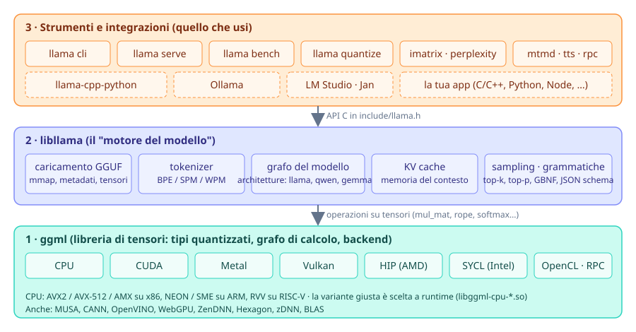
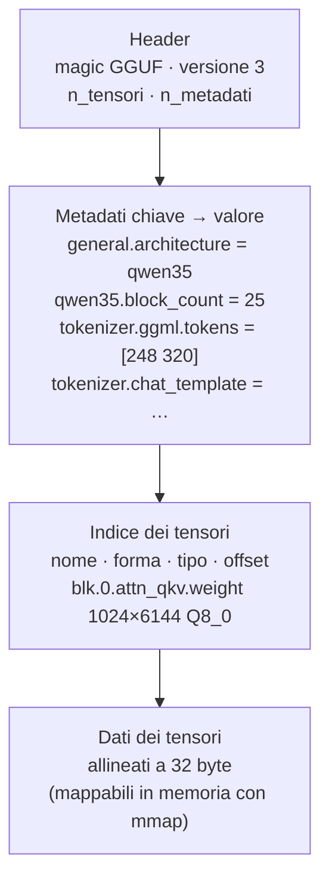
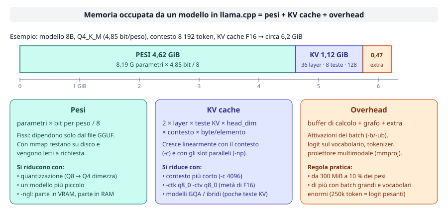

# Modulo 00: Introduzione a llama.cpp

<div class="meta" markdown>
<span class="stato stato-verificato">verificato su b11046</span>
</div>

Questo modulo ti dà la mappa: cos'è llama.cpp, com'è fatto dentro, che cosa c'è in un file GGUF e come
capire **prima di scaricare** se un modello sta nella memoria del tuo computer. Non serve ancora installare
niente: i due laboratori usano solo Python.

## Cosa imparerai

- Perché ha senso far girare un modello linguistico in locale (e quando non ne ha).
- Come sono impilati **ggml → libllama → strumenti**, e dove si collocano Ollama, LM Studio, llama-cpp-python.
- Che cosa contiene un file **GGUF** e come leggerne i metadati.
- Che cosa significa "quantizzare" un modello e quanto costa in qualità e memoria.
- Come stimare **pesi + KV cache + overhead** con una formula e verificarla nei log.
- Come orientarti tra release stabili `vX.Y.Z` e build notturne `bNNNNN`.

## 1. Inferenza locale: perché

"Inferenza" è la fase in cui un modello già addestrato produce una risposta: prende un **prompt**, lo spezza in
**token** (frammenti di parole) e genera un token alla volta. Farla in locale vuol dire che il modello gira sul
tuo hardware invece che su un'API remota.

| Motivo | Cosa cambia in pratica |
|---|---|
| **Privacy** | I documenti, il codice, le conversazioni non lasciano la macchina. Nessun contratto di trattamento dati da firmare. |
| **Costi** | Zero costo per token: un portatile che genera 10 token/s tutto il giorno costa solo corrente. |
| **Offline** | Funziona in aereo, in cantiere, su una rete isolata, su un Raspberry Pi. |
| **Controllo** | Scegli tu il modello, la versione, i parametri di campionamento, la grammatica dell'output. Nessuna deprecazione a sorpresa. |
| **Latenza** | Il primo token arriva in decine di millisecondi, senza andata e ritorno in rete. |

E i limiti: un modello da 8 miliardi di parametri su un portatile non è GPT-class; su CPU la generazione va
da 2 a 15 token/s; la memoria è il vincolo che incontrerai per primo. Tutto il corso gira intorno a questi tre
compromessi: **qualità, velocità, memoria**.

## 2. llama.cpp e ggml: storia e architettura

llama.cpp nasce nel marzo 2023, quando Georgi Gerganov riscrive l'inferenza di LLaMA in C/C++ puro, senza
dipendenze, per farla girare su un MacBook. In tre anni è diventato **il** motore di inferenza locale: ~129k
stelle su GitHub, licenza MIT, una release notturna al giorno, e la base di Ollama, LM Studio, Jan e di decine
di app mobili. Il progetto è mantenuto dall'organizzazione **ggml-org**.

Dentro è a tre livelli:

<figure class="schema" markdown>

<figcaption>I tre livelli di llama.cpp. Le caselle tratteggiate sono progetti esterni che usano libllama.</figcaption>
</figure>

1. **ggml** è la libreria di tensori: definisce i tipi quantizzati (`Q4_K`, `Q8_0`, …), costruisce un grafo di
   calcolo e lo esegue su un **backend**: CPU (con varianti AVX2, AVX-512, NEON scelte a runtime), CUDA, Metal,
   Vulkan, HIP, SYCL, OpenCL e altri. È un progetto separato ([ggml-org/ggml](https://github.com/ggml-org/ggml))
   incluso nei sorgenti di llama.cpp.
2. **libllama** (`libllama.so`, API C in `include/llama.h`) sa che cosa è un modello linguistico: carica un
   GGUF, tokenizza, costruisce il grafo per la specifica architettura (llama, qwen, gemma, …), gestisce la
   **KV cache** e il campionamento.
3. **Gli strumenti** sono programmi che usano libllama: dal 2026 c'è un binario unico `llama` con sottocomandi
   (`llama cli`, `llama serve`, `llama bench`, `llama quantize`, …). I vecchi nomi `llama-cli`, `llama-server`
   esistono ancora nei tarball e nelle immagini Docker: nel corso usiamo la forma nuova.

!!! tip "Che cosa usano gli altri"
    Ollama, LM Studio, Jan, GPT4All e le app "chat locale" per telefono incorporano libllama (o ggml) e ci
    mettono sopra un'interfaccia e un catalogo di modelli. `llama-cpp-python` è un binding Python della stessa
    libreria. Imparare llama.cpp vuol dire capire che cosa succede sotto a tutti questi.

## 3. Il formato GGUF

GGUF (GGML Universal Format) è **un unico file** che contiene tutto ciò che serve per eseguire il modello:
pesi, tokenizer, chat template, parametri architetturali. Niente `config.json` a parte, niente cartelle di
`safetensors` da tenere allineate.



Le chiavi dei metadati hanno un prefisso: `general.*` (nome, licenza, tipo di file), `<architettura>.*`
(dimensioni del modello), `tokenizer.ggml.*` (vocabolario e token speciali), `tokenizer.chat_template` (il
template Jinja che trasforma i messaggi `system/user/assistant` nel testo che il modello si aspetta). Ecco
i valori reali del modello di prova del corso, `ggml-org/Qwen3.5-0.8B-GGUF`, letti con `gguf-dump`:

```text
general.architecture = 'qwen35'
general.name = 'Qwen3.5-0.8B'
general.size_label = '773M'
general.license = 'apache-2.0'
general.file_type = 7                      # (1)!
qwen35.block_count = 25
qwen35.context_length = 262144
qwen35.embedding_length = 1024
qwen35.attention.head_count = 8
qwen35.attention.head_count_kv = 2         # (2)!
qwen35.attention.key_length = 256
qwen35.full_attention_interval = 4         # (3)!
tokenizer.ggml.model = 'gpt2'
tokenizer.ggml.tokens = [248320 elementi]
tokenizer.chat_template = '{%- set image_count = …'
```

1. `file_type = 7` significa Q8_0: il campo `ftype` che vedi nel banner di `llama cli`.
2. 8 teste di attenzione ma solo 2 teste K/V: è la *Grouped Query Attention* (GQA), che riduce la KV cache di 4 volte.
3. Qwen3.5 è un modello **ibrido**: solo 1 blocco su 4 è attenzione classica, gli altri sono strati ricorrenti (SSM) senza KV cache. Lo vedrai contare nella stima di memoria.

Perché il formato conta: un GGUF si apre con **mmap**, cioè il sistema operativo mappa il file in memoria e
carica le pagine solo quando servono. Il caricamento è quasi istantaneo e due processi che aprono lo stesso
modello condividono le pagine. Il modulo [03](../03-modelli-gguf-quantizzazione/README.md) spiega come si
crea un GGUF da un modello Hugging Face e come si quantizza.

## 4. Quantizzazione, in concetto

Un modello viene addestrato con pesi a 16 o 32 bit. **Quantizzare** vuol dire riscriverli con meno bit,
a blocchi: ad esempio `Q4_0` raggruppa 32 pesi, salva una scala a 16 bit e ogni peso in 4 bit
(4 + 16/32 = **4,5 bit per peso**). Le famiglie `K` (`Q4_K_M`, `Q5_K_M`, `Q6_K`) usano blocchi più furbi con
scale a due livelli; le `IQ` scendono sotto i 3 bit con tabelle di codici.

| Formato | Bit/peso (circa) | 8 B parametri occupano | Qualità (regola pratica) |
|---|---|---|---|
| F16 / BF16 | 16 | 15 GiB | riferimento |
| Q8_0 | 8,5 | 8 GiB | indistinguibile da F16 |
| Q6_K | 6,6 | 6,2 GiB | perdita trascurabile |
| Q5_K_M | 5,7 | 5,3 GiB | ottimo compromesso |
| **Q4_K_M** | 4,85 | 4,6 GiB | **lo standard di fatto** |
| Q4_0 | 4,5 | 4,2 GiB | leggermente peggiore, ma il più veloce su ARM |
| Q3_K_M | 3,9 | 3,7 GiB | degrado visibile su modelli piccoli |
| Q2_K / IQ2 | 2–2,6 | 2–2,5 GiB | solo per modelli molto grandi |

Due regole che valgono quasi sempre: **un modello più grande a 4 bit batte un modello più piccolo a 8 bit**
(un 8B Q4_K_M è meglio di un 4B Q8_0), e sotto i 4 bit la perdita cresce in fretta, tanto più quanto più
piccolo è il modello. Misurerai tutto questo con `llama perplexity` nel modulo 03.

## 5. Stimare la memoria: pesi + KV cache + overhead

La domanda che ti farai più spesso è "ci sta?". La risposta ha tre addendi.

<figure class="schema" markdown>

<figcaption>Esempio di un modello 8B in Q4_K_M con 8 192 token di contesto: i pesi dominano, ma la KV cache cresce con il contesto.</figcaption>
</figure>

**Pesi** = parametri × bit per peso / 8. Coincide con la dimensione del file GGUF (a meno di qualche MiB di
metadati). Per 8,19 miliardi di parametri in Q4_K_M: 8,19e9 × 4,85 / 8 ≈ **4,6 GiB**.

**KV cache**: per ogni token del contesto il modello conserva i vettori K e V di ogni strato di attenzione,
così non deve ricalcolarli a ogni nuovo token. La formula:

```text
KV cache = 2 × n_layer × n_kv_heads × head_dim × ctx × byte per elemento
```

dove il 2 conta K e V, `n_kv_heads` è `attention.head_count_kv` (non `head_count`!), `head_dim` è
`attention.key_length`, `ctx` è il contesto che chiedi con `-c`, e i byte per elemento sono 2 per F16 (il
default) o circa 1 con `-ctk q8_0 -ctv q8_0`. Per Qwen3-8B (36 strati, 8 teste KV, head_dim 128) a 8 192
token in F16: 2 × 36 × 8 × 128 × 8 192 × 2 = **1,12 GiB**, cioè 144 KiB per token. Raddoppi il contesto,
raddoppia la KV cache; con `llama serve -np 4` il contesto totale si divide in 4 slot, ma se lo aumenti per
compensare la cache cresce di conseguenza.

**Overhead**: buffer di calcolo per il batch, logit sull'intero vocabolario, tokenizer, eventuale proiettore
multimodale. Da qualche centinaio di MiB fino al 10 % dei pesi: è l'addendo meno prevedibile.

Verifica sul modello di prova (log di `llama cli -v` con `-c 4096`, build 11046):

```text
llama_kv_cache: size =   48.00 MiB (  4096 cells,   6 layers,  1/1 seqs), K (f16):   24.00 MiB, V (f16):   24.00 MiB
llama_memory_recurrent: size =   19.27 MiB (     1 cells,  24 layers,  1 seqs  0 rs_seq), R (f32): 1.27 MiB, S (f32): 18.00 MiB
sched_reserve:        CPU compute buffer size =    46.16 MiB
common_memory_breakdown_print: | memory breakdown [MiB] | total  free  self  model  context  compute |
common_memory_breakdown_print: |   - Host               |                  877 =  763 +     67 +     46 |
```

La formula dà 2 × 6 × 2 × 256 × 4 096 × 2 = 50 331 648 byte = **48 MiB**: esattamente il valore nel log.
Nota i "6 layers": Qwen3.5 ha 25 blocchi ma solo 6 con KV cache. La riga `memory breakdown` è il totale
che ti interessa: 763 MiB di pesi + 67 di contesto (KV + stato ricorrente) + 46 di buffer di calcolo.

!!! tip "`--fit` fa i conti per te"
    Dalla 0.4 `llama cli` e `llama serve` hanno `--fit on` di default: misurano la memoria libera dei device e
    riducono contesto o strati in GPU per starci (`common_fit_params: successfully fit params…` nel log). La
    stima a mano ti serve comunque per scegliere il modello **prima** di scaricare 5 GB.

## 6. L'ecosistema

- **Hugging Face** è il magazzino dei modelli. I GGUF si trovano con il filtro `library=gguf` (o "apps =
  llama.cpp"); `llama cli -hf utente/repo:QUANT` li scarica nella cache standard `~/.cache/huggingface/hub/`,
  condivisa con gli altri strumenti. Repository affidabili: `ggml-org` (ufficiali), `unsloth`, `bartowski`.
- **Ollama** impacchetta libllama con un registro di modelli e un'API propria; **LM Studio** e **Jan** sono
  app desktop; **llama-cpp-python** espone la libreria in Python. Tutti leggono GGUF: un file scaricato per
  llama.cpp funziona anche lì.
- **llama.app** è il sito ufficiale con installer e documentazione dei comandi `llama cli` e `llama serve`.

## 7. Versioni: `vX.Y.Z` e `bNNNNN`

Ogni commit su `master` produce una **build notturna** numerata (`b11046`, `b11095`, …) con binari per tutte
le piattaforme: sono quelle che vedi nella pagina GitHub *Releases*. Da metà 2026 ci sono anche **release
semantiche** `vX.Y.Z` (`v0.4.1` del 14/09/2026 punta alla build `b10964`): MAJOR cambia quando cambia l'API C,
MINOR per nuove funzioni e modelli, PATCH per correzioni. L'installer e i gestori di pacchetti seguono le
release; `llama version` ti dice entrambe le cose:

```text
$ llama version
version: 0.4.1-dev (build 11046, commit 60081bb2b)
built with Clang 22.1.8 for Linux x86_64
```

Il suffisso `-dev` indica una build notturna successiva alla release. Il corso è verificato sulla build in
[Versione di riferimento](../../versione.md).

## Riepilogo

| Concetto | Da ricordare |
|---|---|
| ggml | libreria di tensori + backend (CPU, CUDA, Metal, Vulkan, …) |
| libllama | carica GGUF, tokenizza, esegue il grafo, gestisce KV cache e sampling |
| `llama <comando>` | binario unico 2026; `llama-cli`/`llama-server` sono i nomi vecchi |
| GGUF | un file: metadati + tokenizer + chat template + tensori, apribile con mmap |
| Quantizzazione | meno bit per peso; Q4_K_M è lo standard, Q8_0 è quasi lossless |
| Pesi | parametri × bit/peso / 8 |
| KV cache | 2 × layer × kv_heads × head_dim × ctx × byte/elemento |
| Overhead | 300 MiB … 10 % dei pesi |
| `vX.Y.Z` / `bNNNNN` | release stabile / build notturna |

## Errori comuni

!!! warning "Usare `head_count` invece di `head_count_kv`"
    Con GQA le teste di attenzione sono 4-8 volte più delle teste KV: la stima verrebbe 4-8 volte troppo grande.

!!! warning "Dimenticare che il contesto del server si moltiplica per gli slot"
    `llama serve -c 8192 -np 4` alloca la KV cache per 8 192 token **totali** divisi in 4 slot da 2 048 (log:
    `n_ctx_slot = 2048`). Se vuoi 8k per ogni utente devi chiedere `-c 32768`, e la KV cache quadruplica.

!!! warning "Guardare solo la dimensione del file"
    Un modello da 4,6 GiB non gira in 5 GiB liberi: a 8k di contesto servono 6-6,5 GiB. E il sistema
    operativo, il browser e il terminale hanno bisogno di memoria anche loro.

!!! warning "Confondere `b11046` con la versione"
    `llama update` porta all'ultima **release**, non all'ultima build notturna. Se un tutorial cita `bNNNNN`,
    trovi quella build nella pagina GitHub *Releases* (`LLAMA_VERSION=bNNNNN` per l'installer, se presente nel bucket).

## Laboratori di questo modulo

- [Lab 00-01: Stimare la memoria di un modello](../../laboratori/lab-00-01-stima-memoria/README.md): calcoli
  a mano e con `stima_memoria.py` la memoria di tre modelli in tre quantizzazioni, e confronti con il log reale.
- [Lab 00-02: Anatomia di un file GGUF](../../laboratori/lab-00-02-anatomia-gguf/README.md): leggi metadati e
  tensori con `gguf-dump` e con l'API `GGUFReader`.

## Verifica

1. In quale dei tre livelli (ggml, libllama, strumenti) vive il codice che esegue una moltiplicazione di matrici su GPU?
2. Un GGUF contiene il chat template? Dove?
3. Quanti bit per peso ha `Q4_0` e perché non sono esattamente 4?
4. Un modello ha 32 strati, 32 teste di attenzione, 8 teste KV, head_dim 128. Quanta KV cache in F16 per 16 384 token?
5. Perché Qwen3.5-0.8B ha 25 blocchi ma il log dice `6 layers` per la KV cache?
6. Che cosa cambia tra `v0.4.1` e `b10964`?
7. Tra un 8B in Q4_K_M e un 4B in Q8_0, che occupano circa la stessa memoria, quale conviene di solito?
8. Che cosa fa `--fit on` e perché la stima a mano serve lo stesso?

??? success "Soluzioni"
    1. In ggml: i backend (CUDA, Metal, Vulkan…) sono implementazioni di ggml. libllama descrive solo il grafo.
    2. Sì: nella chiave di metadati `tokenizer.chat_template`, come template Jinja.
    3. 4,5: ogni blocco di 32 pesi a 4 bit porta una scala F16 (16 bit), cioè 0,5 bit per peso in più.
    4. 2 × 32 × 8 × 128 × 16 384 × 2 byte = 2 147 483 648 byte = 2 GiB (usando le 8 teste KV, non le 32).
    5. È un'architettura ibrida: `full_attention_interval = 4`, quindi solo un blocco su quattro ha attenzione
       classica; gli altri sono strati ricorrenti con uno stato a dimensione fissa (`llama_memory_recurrent`).
    6. `v0.4.1` è una release semantica (stabile, seguita da installer e pacchetti); `b10964` è il numero della
       build notturna a cui quella release corrisponde. Le build successive hanno versione `0.4.1-dev`.
    7. L'8B in Q4_K_M: a parità di memoria il modello più grande a 4 bit di solito è più capace.
    8. Misura la memoria libera dei device e riduce contesto o strati offloadati per non andare out-of-memory.
       La stima serve prima del download, per scegliere modello e quantizzazione, e per dimensionare il server.

## Riferimenti

- Repository: <https://github.com/ggml-org/llama.cpp> · sito e docs: <https://llama.app>
- Specifica GGUF: <https://github.com/ggml-org/ggml/blob/master/docs/gguf.md>
- ggml: <https://github.com/ggml-org/ggml>
- Modelli GGUF su Hugging Face: <https://huggingface.co/models?library=gguf&sort=trending>
- Processo di release: <https://github.com/ggml-org/llama.cpp/blob/master/docs/release.md>
- [Glossario del corso](../../risorse/glossario.md) · [Modelli consigliati](../../risorse/modelli-consigliati.md)
