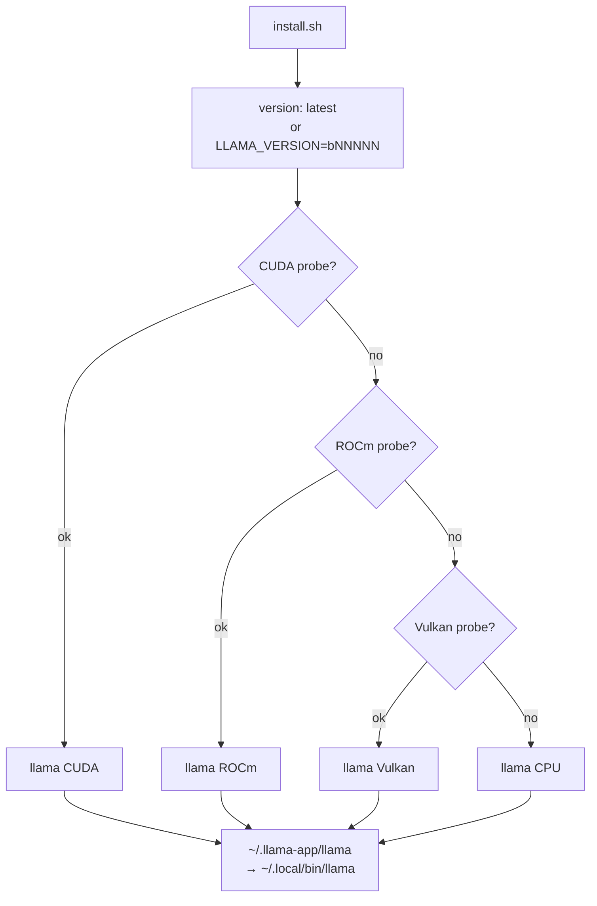

# Module 01: Installation on different platforms

There are five ways to get llama.cpp: the llama.app installer, a package manager, the prebuilt
binaries from the release page, Docker, and building from source. All of them give you the same commands (`llama cli`,
`llama serve`, …). This module helps you pick the right one for your machine, understand which
**backend** (CPU, CUDA, Metal, Vulkan, …) you are using, and check it.

## What you will learn

- Choose the installation method based on operating system and GPU.
- Use the installer `curl -LsSf https://llama.app/install.sh | sh` and fix the TLS certificate problem.
- Read release asset names (`llama-bNNNNN-bin-<os>-<backend>-<arch>`) and pick the right one.
- Run `llama-cli` and `llama-server` from the official Docker images, with and without a GPU.
- Build with CMake and the flags for each backend; build on Raspberry Pi and Android.
- Check the version and detected devices, update, and pin a version.

## 1. Which method for which machine

<figure class="schema" markdown>

<figcaption>First decide whether you need to build (almost never), then choose based on your hardware. The final check is the same for everyone.</figcaption>
</figure>

| Platform | llama.app installer | Package manager | Release binaries | Docker | Source | Available GPU backends |
|---|---|---|---|---|---|---|
| Linux x86_64 | ✅ (CUDA → ROCm → Vulkan → CPU) | brew, conda, nix | CPU, Vulkan, ROCm, SYCL, OpenVINO (**no CUDA**) | ✅ CPU, cuda, rocm, vulkan, intel, musa | ✅ | CUDA, HIP, Vulkan, SYCL |
| Linux ARM64 (Raspberry Pi, ARM servers) | ✅ | brew, conda, nix | CPU, Vulkan | ✅ arm64 CPU, cuda, vulkan | ✅ | Vulkan |
| macOS Apple Silicon | ✅ (Metal) | brew, port, conda, nix | `macos-arm64` (Metal included) | — (no GPU in containers) | ✅ | Metal (default) |
| macOS Intel | ✅ | brew, port, nix | `macos-x64` | — | ✅ | CPU |
| Windows x64 | winget (the script is for sh) | winget, conda | CPU, CUDA 12.4/13.3, Vulkan, ROCm, SYCL, OpenVINO | via WSL2 | ✅ VS 2022 | CUDA, Vulkan, HIP, SYCL |
| Windows ARM64 (Snapdragon X) | — | — | CPU arm64, CUDA 13.4 arm64, `opencl-adreno-arm64` | — | ✅ arm64 preset | OpenCL (Adreno) |
| Android | — (Termux: build it) | — | `android-arm64.tar.gz` | — | ✅ Termux or NDK | OpenCL (Adreno), Vulkan |

!!! tip "In one sentence"
    Laptop or server without a GPU, Mac, Linux with NVIDIA: **installer**. Windows: **winget** or the release zip.
    Server or CI: **Docker**. Exotic backends, patches, Android NDK: **build it**.

## 2. Quick path: the llama.app installer

=== "Linux"
    ```bash
    curl -LsSf https://llama.app/install.sh | sh
    export PATH="$HOME/.local/bin:$PATH"          # the script reminds you if it is missing
    llama version
    ```

=== "macOS"
    ```bash
    curl -LsSf https://llama.app/install.sh | sh
    export PATH="$HOME/.local/bin:$PATH"
    llama version                                  # Metal backend
    ```

=== "Windows (PowerShell)"
    ```powershell
    winget install llama.cpp
    llama version
    ```
    The `install.sh` script is for POSIX shells: on Windows use winget (updated with every release), the release
    zip (section 4), or WSL2 with the Linux instructions.

What the script does: it detects `uname -s` / `uname -m`, asks the
`huggingface.co/buckets/ggml-org` bucket for the latest version, then on Linux it **tries CUDA → ROCm → Vulkan →
CPU in order**, downloading a small "probe" executable for each; on macOS it takes the Metal binary directly.
The binary lands in `~/.llama-app/llama` and is copied to `~/.local/bin/llama`. You do not need root.



Useful environment variables: `LLAMA_VERSION=b11046` pins a build (only those present in the bucket),
`SKIP_CUDA=1`, `SKIP_ROCM=1`, `SKIP_VULKAN=1` skip a probe (useful when a broken driver makes detection
fail), `SKIP_INSTALL=1` downloads into `~/.llama-app` without copying to `~/.local/bin`, `HF_TOKEN` lets you
go through the Hugging Face proxy authenticated. On a Linux machine without a GPU (Ubuntu 24.04):

```text
$ llama version
version: 0.4.1-dev (build 11046, commit 60081bb2b)
built with Clang 22.1.8 for Linux x86_64
$ llama cli --list-devices
Available devices:
  (none)
```

"(none)" is correct: the CPU is not listed among the offload devices.

!!! warning "On Ubuntu 24.04: `SSL connection failed`"
    The installer binary is **static** (built with Clang 22) and does not know where your distribution keeps
    its TLS certificates. The first `llama cli -hf …` can fail with
    `E get_repo_commit: error: HTTPLIB failed: SSL connection failed`. Fix:
    ```bash
    export SSL_CERT_FILE=/etc/ssl/certs/ca-certificates.crt      # Debian/Ubuntu
    # Fedora/RHEL: /etc/pki/tls/certs/ca-bundle.crt
    echo 'export SSL_CERT_FILE=/etc/ssl/certs/ca-certificates.crt' >> ~/.bashrc
    ```
    The release tarball binaries and the ones you build yourself use the system TLS libraries and do not have this problem.

The installer binary contains the main subcommands (`llama help all`): `serve`, `cli`, `update`,
`download`, `completion`, `bench`, `batched-bench`, `fit-params`, `quantize`, `perplexity`, `version`,
`licenses`. It does **not** contain `imatrix`, `gguf-split`, `tokenize`, `tts`, `mtmd-cli`, `rpc-server`: for
those you need the release tarball or a build from source (sections 4 and 6).

## 3. Package managers

| System | Command | Notes |
|---|---|---|
| Windows | `winget install llama.cpp` | updated automatically with every release |
| macOS / Linux | `brew install llama.cpp` | formula updated with every release; includes Metal on Mac |
| macOS | `sudo port install llama.cpp` | MacPorts |
| Windows / macOS / Linux | `conda install -c conda-forge llama.cpp` | CUDA (Win/Linux), Vulkan (Win/Linux), Metal (macOS) variants; also `mamba` and `pixi global install llama.cpp` |
| macOS / Linux (Nix) | `nix profile install nixpkgs#llama-cpp` | or `nix-env --file '<nixpkgs>' --install --attr llama-cpp` |

Packages follow the `vX.Y.Z` releases, so they can be a few days behind the nightly
builds. They are the right choice when you want llama.cpp to update together with the rest of the system.

## 4. Prebuilt binaries from the release page

Every `bNNNNN` build on <https://github.com/ggml-org/llama.cpp/releases> has one archive per
system × backend × architecture combination. The real names (build b10964, same scheme for the others):

| Asset | Backend | Size | Notes |
|---|---|---|---|
| `llama-bNNNNN-bin-ubuntu-x64.tar.gz` | CPU | 16 MB | `libggml-cpu-<arch>.so` from sandybridge to zen4/sapphirerapids, chosen at runtime |
| `-ubuntu-arm64.tar.gz` | CPU | | Raspberry Pi 4/5, ARM servers |
| `-ubuntu-vulkan-x64.tar.gz` / `-vulkan-arm64` | Vulkan | 28 MB | any GPU with a Vulkan driver |
| `-ubuntu-rocm-10.0-x64.tar.gz` | HIP | 217 MB | requires ROCm 10 installed |
| `-ubuntu-sycl-fp16-x64.tar.gz` | SYCL | | requires oneAPI of the same version |
| `-ubuntu-openvino-2026.3.1-x64.tar.gz` | OpenVINO | | Intel CPU/GPU/NPU |
| `-ubuntu-s390x.tar.gz` | CPU | | IBM Z |
| `-macos-arm64.tar.gz` | Metal | 10 MB | Apple Silicon |
| `-macos-x64.tar.gz` | CPU | | Intel Mac |
| `-win-cpu-x64.zip` / `-win-cpu-arm64.zip` | CPU | 17 MB | |
| `-win-cuda-12.4-x64.zip` **+** `cudart-llama-bin-win-cuda-12.4-x64.zip` | CUDA | 242 + 373 MB | the second one contains the CUDA runtime DLLs: extract it **into the same folder** |
| `-win-cuda-13.3-x64.zip` / `-win-cuda-13.4-arm64.zip` | CUDA | | same, with its own `cudart-…` |
| `-win-vulkan-x64.zip` | Vulkan | 30 MB | the simplest path for AMD/Intel on Windows |
| `-win-rocm-10.0-x64.zip` / `-win-sycl-x64.zip` / `-win-openvino-2026.3.1-x64.zip` | HIP / SYCL / OpenVINO | | |
| `-win-opencl-adreno-arm64.zip` | OpenCL | | Snapdragon X |
| `-android-arm64.tar.gz` | CPU | 67 MB | for use in Termux or via `adb` |
| `-xcframework.zip` | | | library for iOS/macOS (Xcode) |
| `-ui.tar.gz` | | | the server web UI, already inside `llama-server` |

!!! warning "No CUDA for Linux in the releases"
    On Linux with an NVIDIA GPU there is no CUDA tarball: use the installer (which detects it), Docker
    `server-cuda`, conda-forge, or build it. The Windows CUDA build exists, but remember the second `cudart` zip.

=== "Linux"
    ```bash
    V=b11046
    curl -LO https://github.com/ggml-org/llama.cpp/releases/download/$V/llama-$V-bin-ubuntu-x64.tar.gz
    tar -xzf llama-$V-bin-ubuntu-x64.tar.gz          # creates the llama-b11046/ folder
    cd llama-$V && ./llama version && ls
    ```

=== "macOS"
    ```bash
    V=b11046
    curl -LO https://github.com/ggml-org/llama.cpp/releases/download/$V/llama-$V-bin-macos-arm64.tar.gz
    tar -xzf llama-$V-bin-macos-arm64.tar.gz && cd llama-$V
    xattr -dr com.apple.quarantine .                  # if Gatekeeper blocks the downloaded binaries
    ./llama version
    ```

=== "Windows (PowerShell)"
    ```powershell
    $V = "b11046"
    Invoke-WebRequest "https://github.com/ggml-org/llama.cpp/releases/download/$V/llama-$V-bin-win-cpu-x64.zip" -OutFile llama.zip
    Expand-Archive llama.zip -DestinationPath llama-$V
    cd llama-$V; .\llama.exe version
    ```

The Ubuntu tarball (61 files, 41 MB extracted) contains **both** `llama` **and** the old executables
`llama-cli`, `llama-server`, `llama-bench`, `llama-quantize`, `llama-perplexity`, `llama-imatrix`,
`llama-gguf-split`, `llama-tokenize`, `llama-tts`, `llama-mtmd-cli`, `ggml-rpc-server`, plus the libraries
`libllama.so`, `libggml*.so`, `libmtmd.so`. The binaries are built on Ubuntu 22.04 with GCC 11 and use the
system libraries (OpenSSL): they work on Ubuntu 22.04+ and equivalent distributions.

```text
$ ~/llama-lab/rel/llama-b11046/llama-cli --version
version: 0.4.1-dev (build 11046, commit 60081bb2b)
built with GNU 11.4.0 for Linux x86_64
```

## 5. Docker

Official images at `ghcr.io/ggml-org/llama.cpp:` + **variant** + optional backend suffix:

| Variant | Contains | Platforms |
|---|---|---|
| `full` | `llama-cli`, `llama-completion`, all the tools **and the Python conversion scripts** (`convert_hf_to_gguf.py`) | amd64, arm64, s390x |
| `light` | only `llama-cli` and `llama-completion` | amd64, arm64, s390x |
| `server` | only `llama-server` (with web UI) | amd64, arm64, s390x |

Suffixes: `-cuda` (CUDA 12), `-cuda13`, `-rocm`, `-musa`, `-intel` (SYCL), `-vulkan`, `-openvino`, `-s390x`.
Example: `ghcr.io/ggml-org/llama.cpp:server-cuda`. The images follow the nightly builds (the tag without a
number is the latest: for example `light` → `build 11096`).

```bash
# Interactive CLI (default entrypoint: /app/llama-cli)
docker run -it --rm -v /percorso/modelli:/models ghcr.io/ggml-org/llama.cpp:light -m /models/modello.gguf

# Server: -p publishes the port, --host 0.0.0.0 is required inside the container
docker run --rm -v /percorso/modelli:/models -p 8080:8080 ghcr.io/ggml-org/llama.cpp:server \
    -m /models/modello.gguf --host 0.0.0.0 --port 8080 -c 4096

# NVIDIA GPU (requires nvidia-container-toolkit on the host)
docker run --gpus all --rm -v /percorso/modelli:/models -p 8080:8080 ghcr.io/ggml-org/llama.cpp:server-cuda \
    -m /models/modello.gguf --host 0.0.0.0 --port 8080 -ngl 99

# AMD / Intel GPU: pass the DRM devices instead of --gpus
docker run --rm --device /dev/dri/renderD128:/dev/dri/renderD128 --device /dev/dri/card0:/dev/dri/card0 \
    -v /percorso/modelli:/models -p 8080:8080 ghcr.io/ggml-org/llama.cpp:server-vulkan \
    -m /models/modello.gguf --host 0.0.0.0 --port 8080 -ngl 99
```

Container log with the model from the mounted Hugging Face cache:

```text
srv    load_model: loading model '/models/37ae482d…814f'
srv    load_model: initializing, n_slots = 4, n_ctx_slot = 2048, kv_unified = 'true'
srv  llama_server: listening on http://0.0.0.0:18101
$ curl -s http://127.0.0.1:18101/health
{"status":"ok"}
```

!!! warning "The Hugging Face cache is made of symbolic links"
    `~/.cache/huggingface/hub/<repo>/snapshots/<hash>/modello.gguf` is a link to `../../blobs/<sha256>`.
    If you mount only `snapshots/`, the link inside the container points to nothing. Mount the `blobs/` folder (and
    pass `-m /models/<sha256>`), or mount all of `~/.cache/huggingface`, or copy the file.

Every flag has an `LLAMA_ARG_*` environment variable (you see them in `--help`), handy in Compose:

```yaml
services:
  llama:
    image: ghcr.io/ggml-org/llama.cpp:server
    ports: ["8080:8080"]
    volumes: ["./models:/models"]
    environment:
      LLAMA_ARG_HOST: 0.0.0.0
      LLAMA_ARG_PORT: 8080
      LLAMA_ARG_MODEL: /models/modello.gguf
      LLAMA_ARG_CTX_SIZE: 4096
      LLAMA_ARG_N_PARALLEL: 2
```

To build an image with a different CUDA: `docker build -t local/llama.cpp:server-cuda --target server
-f .devops/cuda.Dockerfile .` from source (`CUDA_VERSION` defaults to 12.8.1). The project CI builds the
GPU images but does not run them: for details see [docs/docker.md](https://github.com/ggml-org/llama.cpp/blob/master/docs/docker.md).

## 6. Building from source with CMake

You need it when you want a backend that is not distributed (CANN, WebGPU, ZenDNN, KleidiAI…), when you must apply a
patch or follow `master`, or on platforms without binaries (Termux, RISC-V). On a modern computer the CPU build
takes 5-15 minutes.

=== "Linux"
    ```bash
    sudo apt install build-essential cmake git ninja-build ccache libssl-dev   # Debian/Ubuntu
    # Fedora: sudo dnf install gcc-c++ cmake git ninja-build ccache openssl-devel
    git clone https://github.com/ggml-org/llama.cpp && cd llama.cpp
    git checkout b11046                                # (1)!
    cmake -B build -G Ninja                            # (2)!
    cmake --build build --config Release -j 8
    ./build/bin/llama version
    ```

    1. Pins the course build; without `checkout` you build `master` (the current nightly build).
    2. Ninja parallelizes on its own; ccache is detected automatically if installed.

=== "macOS"
    ```bash
    xcode-select --install                             # command line tools
    brew install cmake ninja ccache
    git clone https://github.com/ggml-org/llama.cpp && cd llama.cpp
    cmake -B build -G Ninja                            # Metal and Accelerate are ON by default
    cmake --build build --config Release -j 8
    ./build/bin/llama version
    ```

=== "Windows (PowerShell)"
    Install Visual Studio 2022 Community with the **Desktop development with C++** workload (it brings along
    CMake, Git, the Clang compiler, and MSBuild for LLVM). Open a *Developer PowerShell for VS 2022*:
    ```powershell
    git clone https://github.com/ggml-org/llama.cpp; cd llama.cpp
    cmake -B build
    cmake --build build --config Release -j 8
    .\build\bin\Release\llama.exe version
    ```
    Windows on ARM: `cmake --preset arm64-windows-llvm-release -D GGML_OPENMP_FETCH=ON` then
    `cmake --build build-arm64-windows-llvm-release` (from the *ARM64 Native Tools Command Prompt*).

The binaries land in `build/bin/` (on Windows with multi-config generators: `build/bin/Release/`). General
options: `-DBUILD_SHARED_LIBS=OFF` for static executables, `-DCMAKE_BUILD_TYPE=Debug` for debugging,
`-DLLAMA_CURL=ON` is the default (`-hf` downloads; you need `libcurl4-openssl-dev` on Debian/Ubuntu if it is missing),
`-DGGML_NATIVE=OFF` for a binary that is portable to other CPUs.

### Flags per backend

| Backend | Hardware | CMake flag | Prerequisites |
|---|---|---|---|
| CPU | all | (none) | C++17 compiler |
| BLAS | CPU | `-DGGML_BLAS=ON -DGGML_BLAS_VENDOR=OpenBLAS` | OpenBLAS; speeds up only the prompt with batch > 32 |
| Metal | Apple Silicon | ON by default on macOS (`-DGGML_METAL=OFF` to turn it off) | Xcode CLT |
| CUDA | NVIDIA | `-DGGML_CUDA=ON` (+ `-DCMAKE_CUDA_ARCHITECTURES="86;89"` to choose the GPUs, `-DGGML_NATIVE=OFF` for all of them) | CUDA Toolkit |
| HIP | AMD | `-DGGML_HIP=ON -DGPU_TARGETS=gfx1100` with `HIPCXX="$(hipconfig -l)/clang" HIP_PATH="$(hipconfig -R)"` | ROCm; `rocminfo \| grep gfx` for the target |
| Vulkan | any GPU | `-DGGML_VULKAN=ON` | Linux: `libvulkan-dev glslc spirv-headers`; Windows: LunarG Vulkan SDK; check with `vulkaninfo` |
| SYCL | Intel Arc / iGPU | `-DGGML_SYCL=ON -DCMAKE_C_COMPILER=icx -DCMAKE_CXX_COMPILER=icpx` after `source /opt/intel/oneapi/setvars.sh` | oneAPI Base Toolkit |
| OpenCL | Adreno (Snapdragon) | `-DGGML_OPENCL=ON` | OpenCL headers + ICD loader |
| MUSA | Moore Threads | `-DGGML_MUSA=ON` | MUSA SDK |
| CANN | Ascend NPU | `-DGGML_CANN=on` | CANN toolkit |
| WebGPU | all (Dawn) | `-DGGML_WEBGPU=ON` | Dawn |
| ZenDNN | AMD EPYC | `-DGGML_ZENDNN=ON` | downloads and builds ZenDNN on the first build |
| KleidiAI | ARM64 | `-DGGML_CPU_KLEIDIAI=ON` | arm64 only |
| RPC | network | `-DGGML_RPC=ON` | module 05 |

You can combine several backends in one binary (`-DGGML_CUDA=ON -DGGML_VULKAN=ON`) and choose at runtime
with `--device`; with `-DGGML_BACKEND_DL=ON` the backends become dynamically loaded libraries, the same
mechanism as the `libggml-cpu-*.so` in the tarball. Even with `-ngl 0` the GPU can be used for some
operations: to turn it off completely, use `--device none`.

## 7. GPU backends: what to expect

- **CUDA** (NVIDIA): the most mature and fastest backend. With `-ngl 99` (or `auto`) the whole model goes into VRAM.
  Runtime variables: `CUDA_VISIBLE_DEVICES`, `GGML_CUDA_ENABLE_UNIFIED_MEMORY=1` (uses RAM when VRAM
  runs out, instead of crashing). In the log, look for `ggml_cuda_init: found 1 CUDA devices` and
  `load_tensors: CUDA0 model buffer size`.
- **Metal** (Apple): unified memory, so no CPU↔GPU copy; a Mac with 32 GB runs models of
  ~24 GB. `-ngl 0` disables the GPU. Log: `ggml_metal_init`.
- **HIP** (AMD, Linux and Windows): the same code as CUDA, translated. If the GPU is not officially supported:
  `HSA_OVERRIDE_GFX_VERSION=11.0.0` (RDNA3) or `10.3.0` (RDNA2), Linux only.
- **Vulkan**: works on NVIDIA, AMD, Intel, iGPUs, Raspberry Pi 5, and Android; a bit slower than CUDA/HIP but
  without proprietary SDKs. Log: `ggml_vulkan: Found 1 Vulkan devices` followed by the device name.
- **SYCL** (Intel Arc, 11th gen+ iGPUs): requires oneAPI of the same version the binary was built
  with; `ONEAPI_DEVICE_SELECTOR="level_zero:0"` to choose the device.
- **OpenCL** (Adreno 750/830/X1-85…): for Snapdragon 8 Gen 3 / 8 Elite / X Elite; supported quantizations Q4_0, Q4_K,
  Q6_K, Q8_0.

## 8. Edge platforms: Raspberry Pi, ARM64, Android

**Raspberry Pi 4/5 and ARM64 servers** (64-bit Ubuntu/Raspberry Pi OS): the installer works (`uname -m` =
`aarch64` → CPU or Vulkan binary), the tarball is `-ubuntu-arm64.tar.gz`, the `arm64` Docker image is the
same `ghcr.io/ggml-org/llama.cpp:server`. When you build, `cmake -B build` detects NEON and dotprod on its own;
`-DGGML_CPU_KLEIDIAI=ON` adds the Arm micro-kernels. On the Pi 5 (8 GB), with a 1-2B model in Q4_0
(the fastest format on ARM), expect token generation on the order of a few tokens per second.

**Android with Termux** (no root): Termux is a terminal emulator with a Linux environment. Get it from F-Droid
or GitHub (the Play Store version is experimental):

```bash
apt update && apt upgrade -y
apt install git cmake clang libandroid-spawn
git clone https://github.com/ggml-org/llama.cpp && cd llama.cpp
cmake -B build && cmake --build build --config Release -j 4
curl -L "https://huggingface.co/ggml-org/Qwen3.5-0.8B-GGUF/resolve/main/Qwen3.5-0.8B-Q8_0.gguf" -o ~/qwen.gguf
./build/bin/llama-cli -m ~/qwen.gguf -c 4096 -p "ciao"
```

Put the model in `~/` (not on `/sdcard`, which is slower) and **always set `-c`** (4096 is fine): without it,
the model's context (262k for Qwen3.5) would blow up memory and Android would kill Termux. As an
alternative to building, you can extract `llama-bNNNNN-bin-android-arm64.tar.gz`.

**Android with the NDK** (cross-compiling from the PC, then `adb`):

```bash
export ANDROID_NDK=/percorso/ndk
cmake -DCMAKE_TOOLCHAIN_FILE=$ANDROID_NDK/build/cmake/android.toolchain.cmake \
      -DANDROID_ABI=arm64-v8a -DANDROID_PLATFORM=android-28 \
      -DGGML_NATIVE=OFF -DGGML_OPENMP=OFF -DGGML_LLAMAFILE=OFF -DLLAMA_OPENSSL=OFF \
      -B build-android                                                        # (1)!
cmake --build build-android --config Release -j 8
cmake --install build-android --prefix install-android --config Release
adb shell "mkdir /data/local/tmp/llama.cpp"
adb push install-android /data/local/tmp/llama.cpp/
adb push modello.gguf /data/local/tmp/llama.cpp/
adb shell
cd /data/local/tmp/llama.cpp && LD_LIBRARY_PATH=lib ./bin/llama-simple -m modello.gguf -c 4096 -p "ciao"  # (2)!
```

1. `GGML_NATIVE=OFF` because the host CPU is not the phone's CPU; `GGML_OPENMP=OFF` and `LLAMA_OPENSSL=OFF`
   because OpenMP and OpenSSL are not part of the NDK's stable native APIs; `GGML_LLAMAFILE=OFF` because
   llamafile does not support Android. Add `-DGGML_CPU_KLEIDIAI=ON` for the Arm kernels.
2. Android does not look for libraries in `lib/` on its own: you need `LD_LIBRARY_PATH`.

For the Adreno GPU, add `-DGGML_OPENCL=ON -DBUILD_SHARED_LIBS=OFF` after installing the OpenCL headers and
ICD loader in the NDK sysroot (procedure in `docs/backend/OPENCL.md`). There is also an Android Studio binding
in `examples/llama.android`.

## 9. Checking the installation

Whatever method you chose, three commands:

```bash
llama version                    # version, build, compiler, platform
llama cli --list-devices         # offload devices: (none) on CPU only, otherwise CUDA0 / Vulkan0 / Metal…
llama cli -hf ggml-org/Qwen3.5-0.8B-GGUF -st -p "Rispondi con una parola: capitale d'Italia?" -n 20 -rea off
```

The third one downloads 785 MiB into the Hugging Face cache, prints the banner (`build`, `model`, `ftype Q8_0`,
`modalities text`), answers, and exits (`-st` = single turn, `-rea off` turns off "thinking"). On a GPU add
`-ngl 99` and look in the log for the `model buffer size` line with the name of your backend. With the old names:
`llama-cli --version`, `llama-cli -hf …`.

## 10. Updating and pinning a version

| Method | Update | Pin |
|---|---|---|
| Installer | `llama update` (latest release) or rerun `install.sh` | `LLAMA_VERSION=bNNNNN curl -LsSf https://llama.app/install.sh \| sh` |
| winget / brew / port / conda / nix | `winget upgrade llama.cpp`, `brew upgrade llama.cpp`, … | package manager pin (`brew pin llama.cpp`) |
| Tarball / zip | download the new build into a new folder | keep the `llama-bNNNNN/` folders side by side |
| Docker | `docker pull` | use the tag with the build number (`server-b11046`) instead of `latest` |
| Source | `git pull && cmake --build build` | `git checkout bNNNNN` (builds are tags) or `git checkout v0.4.1` |

Pinning the version is what the course does: all commands refer to the build in
[Reference version](../../versione.md); if you update and something changes, look there first.

## Summary

| What | Command / name |
|---|---|
| Installer (Linux, macOS) | `curl -LsSf https://llama.app/install.sh \| sh` → `~/.local/bin/llama` |
| Certificates (Linux + installer) | `export SSL_CERT_FILE=/etc/ssl/certs/ca-certificates.crt` |
| Windows | `winget install llama.cpp` or `llama-bNNNNN-bin-win-<backend>-x64.zip` (+ `cudart-…` for CUDA) |
| Tarball with all the tools | `llama-bNNNNN-bin-ubuntu-x64.tar.gz` (16 MB) |
| Docker | `ghcr.io/ggml-org/llama.cpp:{full,light,server}[-cuda\|-rocm\|-vulkan\|-intel\|-musa]` |
| Build | `cmake -B build [-DGGML_CUDA=ON \| -DGGML_VULKAN=ON \| -DGGML_HIP=ON \| -DGGML_SYCL=ON]` + `cmake --build build --config Release -j 8` |
| Android | Termux: `apt install git cmake clang libandroid-spawn` + normal build; NDK: toolchain + `GGML_NATIVE=OFF` |
| Check | `llama version`, `llama cli --list-devices`, `llama cli -hf … -st -p … -n 20` |

## Common mistakes

!!! warning "`llama: command not found` right after the installer"
    `~/.local/bin` is not in the current shell's `PATH`: run `export PATH="$HOME/.local/bin:$PATH"` and add it
    to `~/.bashrc` or `~/.zshrc`.

!!! warning "`SSL connection failed` on the first `-hf`"
    See section 2: `SSL_CERT_FILE`. It is not a network or Hugging Face problem.

!!! warning "Windows CUDA: `cudart64_12.dll` not found"
    You extracted only `llama-bNNNNN-bin-win-cuda-12.4-x64.zip`. You also need
    `cudart-llama-bin-win-cuda-12.4-x64.zip` in the same folder (or the CUDA Toolkit installed).

!!! warning "Docker: `failed to open GGUF file` with the Hugging Face cache mounted"
    You mounted `snapshots/`: the file is a symbolic link to `blobs/`. Mount `blobs/` or the whole cache.

!!! warning "Docker server unreachable from the host"
    `--host 0.0.0.0` is missing: inside the container the default `127.0.0.1` is not published by `-p`.

!!! warning "The installer binary does not have `llama imatrix` / `gguf-split` / `tokenize`"
    They are in the release tarball and in the source. Keep them side by side: same build, no conflict.

!!! warning "CUDA build: `nvcc warning: Cannot find valid GPU for '-arch=native'`"
    CMake does not see the GPU: pass `-DCMAKE_CUDA_ARCHITECTURES="86"` (your card's compute capability)
    or `-DGGML_NATIVE=OFF` to build for all of them (large binary, long build).

## Labs in this module

- [Lab 01-01: Installation from binaries/packages](../../laboratori/lab-01-01-binari-precompilati/README.md): installer or
  package manager on your platform, tarball with all the tools, version and device check.
- [Lab 01-02: Building from source (CPU)](../../laboratori/lab-01-02-build-sorgenti-cpu/README.md): clone, checkout
  of the course build, CMake + Ninja + ccache, timing comparison.
- [Lab 01-03: Build with a GPU backend](../../laboratori/lab-01-03-build-gpu/README.md): alternative CUDA /
  Metal / Vulkan / HIP paths and offload check.
- [Lab 01-04: llama.cpp in Docker](../../laboratori/lab-01-04-docker/README.md): `light` and `server` with the model
  cache mounted, Compose, GPU passthrough.

## Review questions

1. On Linux with an NVIDIA GPU, which methods give you the CUDA backend without building?
2. What does `install.sh` do when the CUDA probe fails?
3. Why can the installer binary fail to find the TLS certificates while the tarball one does not?
4. Which two archives do you need to use CUDA on Windows from the release page?
5. Which Docker image contains `convert_hf_to_gguf.py`? And which one do you use for a server with an AMD GPU?
6. What happens if you mount `~/.cache/huggingface/hub/<repo>/snapshots/` in a container?
7. Why does the NDK build have `GGML_NATIVE=OFF` and `LLAMA_OPENSSL=OFF`?
8. How do you pin build `b11046` with the installer, with git, and with Docker?

??? success "Solutions"
    1. The llama.app installer (CUDA probe), Docker `*-cuda`, conda-forge (CUDA variant). Not the tarball: there is no `ubuntu-cuda`.
    2. It moves on to the next probe: ROCm, then Vulkan, and finally the CPU binary.
    3. It is static (Clang 22) and does not read the distribution's OpenSSL configuration; the tarball is linked against the
       system TLS libraries, which know where the certificates are. `SSL_CERT_FILE` points the static binary to the bundle.
    4. `llama-bNNNNN-bin-win-cuda-12.4-x64.zip` and `cudart-llama-bin-win-cuda-12.4-x64.zip`, extracted into the same folder.
    5. `full` (also `full-cuda`, …). For AMD: `server-rocm` (or `server-vulkan`), passing the `/dev/dri` devices.
    6. The `.gguf` files in there are symbolic links to `../../blobs/`: in the container the target does not exist and
       loading fails. Mount `blobs/` or the entire cache.
    7. The PC's CPU is not the phone's CPU (no native optimizations); OpenSSL is not part of the NDK's stable native
       APIs, so you cannot link it.
    8. `LLAMA_VERSION=b11046 curl -LsSf https://llama.app/install.sh | sh`; `git checkout b11046`; the image tag
       with the build number (`ghcr.io/ggml-org/llama.cpp:server-b11046`) instead of the `latest` tag.

## References

- Installation (llama.app): <https://llama.app/docs/installation>
- Package managers: <https://github.com/ggml-org/llama.cpp/blob/master/docs/install.md>
- Releases and assets: <https://github.com/ggml-org/llama.cpp/releases>
- Docker: <https://github.com/ggml-org/llama.cpp/blob/master/docs/docker.md>
- Building and backends: <https://github.com/ggml-org/llama.cpp/blob/master/docs/build.md>
- Android: <https://github.com/ggml-org/llama.cpp/blob/master/docs/android.md>
- OpenCL (Adreno): <https://github.com/ggml-org/llama.cpp/blob/master/docs/backend/OPENCL.md> ·
  SYCL (Intel): <https://github.com/ggml-org/llama.cpp/blob/master/docs/backend/SYCL.md>
- [Reference version](../../versione.md)
