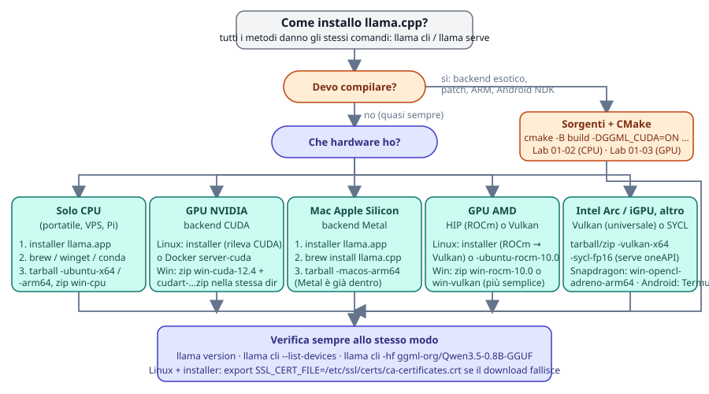
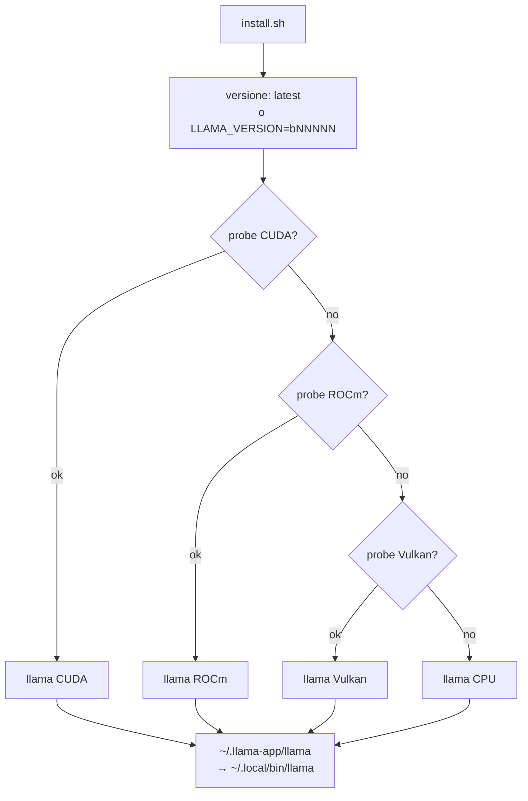

# Modulo 01: Installazione su varie piattaforme

Ci sono cinque modi per avere llama.cpp: l'installer di llama.app, un gestore di pacchetti, i binari
precompilati della pagina release, Docker, la compilazione. Tutti danno gli stessi comandi (`llama cli`,
`llama serve`, …). Questo modulo ti aiuta a scegliere quello giusto per la tua macchina, a capire quale
**backend** (CPU, CUDA, Metal, Vulkan, …) stai usando e a verificarlo.

## Cosa imparerai

- Scegliere il metodo di installazione in base a sistema operativo e GPU.
- Usare l'installer `curl -LsSf https://llama.app/install.sh | sh` e risolvere il problema dei certificati TLS.
- Leggere i nomi degli asset di release (`llama-bNNNNN-bin-<os>-<backend>-<arch>`) e scegliere quello giusto.
- Far girare `llama-cli` e `llama-server` dalle immagini Docker ufficiali, con e senza GPU.
- Compilare con CMake e i flag di ogni backend; compilare su Raspberry Pi e Android.
- Verificare versione e device rilevati, aggiornare e fissare una versione.

## 1. Quale metodo per quale macchina

<figure class="schema" markdown>

<figcaption>Prima decidi se devi compilare (quasi mai), poi scegli in base all'hardware. La verifica finale è uguale per tutti.</figcaption>
</figure>

| Piattaforma | Installer llama.app | Gestore pacchetti | Binari release | Docker | Sorgenti | Backend GPU disponibili |
|---|---|---|---|---|---|---|
| Linux x86_64 | ✅ (CUDA → ROCm → Vulkan → CPU) | brew, conda, nix | CPU, Vulkan, ROCm, SYCL, OpenVINO (**no CUDA**) | ✅ CPU, cuda, rocm, vulkan, intel, musa | ✅ | CUDA, HIP, Vulkan, SYCL |
| Linux ARM64 (Raspberry Pi, server ARM) | ✅ | brew, conda, nix | CPU, Vulkan | ✅ arm64 CPU, cuda, vulkan | ✅ | Vulkan |
| macOS Apple Silicon | ✅ (Metal) | brew, port, conda, nix | `macos-arm64` (Metal incluso) | — (niente GPU nei container) | ✅ | Metal (default) |
| macOS Intel | ✅ | brew, port, nix | `macos-x64` | — | ✅ | CPU |
| Windows x64 | winget (lo script è per sh) | winget, conda | CPU, CUDA 12.4/13.3, Vulkan, ROCm, SYCL, OpenVINO | via WSL2 | ✅ VS 2022 | CUDA, Vulkan, HIP, SYCL |
| Windows ARM64 (Snapdragon X) | — | — | CPU arm64, CUDA 13.4 arm64, `opencl-adreno-arm64` | — | ✅ preset arm64 | OpenCL (Adreno) |
| Android | — (Termux: compila) | — | `android-arm64.tar.gz` | — | ✅ Termux o NDK | OpenCL (Adreno), Vulkan |

!!! tip "In una frase"
    Portatile o server senza GPU, Mac, Linux con NVIDIA: **installer**. Windows: **winget** o lo zip della release.
    Server o CI: **Docker**. Backend esotici, patch, Android NDK: **compila**.

## 2. Via rapida: l'installer di llama.app

=== "Linux"
    ```bash
    curl -LsSf https://llama.app/install.sh | sh
    export PATH="$HOME/.local/bin:$PATH"          # lo script te lo ricorda se manca
    llama version
    ```

=== "macOS"
    ```bash
    curl -LsSf https://llama.app/install.sh | sh
    export PATH="$HOME/.local/bin:$PATH"
    llama version                                  # backend Metal
    ```

=== "Windows (PowerShell)"
    ```powershell
    winget install llama.cpp
    llama version
    ```
    Lo script `install.sh` è per shell POSIX: su Windows usa winget (aggiornato a ogni release), lo zip
    della release (sezione 4) o WSL2 con le istruzioni Linux.

Che cosa fa lo script: rileva `uname -s` / `uname -m`, chiede al bucket
`huggingface.co/buckets/ggml-org` l'ultima versione, poi su Linux **prova in ordine CUDA → ROCm → Vulkan →
CPU** scaricando un piccolo eseguibile "probe" per ciascuno; su macOS prende direttamente il binario Metal.
Il binario finisce in `~/.llama-app/llama` e viene copiato in `~/.local/bin/llama`. Non serve root.



Variabili d'ambiente utili: `LLAMA_VERSION=b11046` fissa una build (solo quelle presenti nel bucket),
`SKIP_CUDA=1`, `SKIP_ROCM=1`, `SKIP_VULKAN=1` saltano un probe (utile se un driver rotto fa fallire il
rilevamento), `SKIP_INSTALL=1` scarica in `~/.llama-app` senza copiare in `~/.local/bin`, `HF_TOKEN` per
passare dal proxy di Hugging Face autenticati. Su una macchina Linux senza GPU (Ubuntu 24.04):

```text
$ llama version
version: 0.4.1-dev (build 11046, commit 60081bb2b)
built with Clang 22.1.8 for Linux x86_64
$ llama cli --list-devices
Available devices:
  (none)
```

"(none)" è corretto: la CPU non è elencata tra i device di offload.

!!! warning "Su Ubuntu 24.04: `SSL connection failed`"
    Il binario dell'installer è **statico** (compilato con Clang 22) e non sa dove la tua distribuzione tiene
    i certificati TLS. Il primo `llama cli -hf …` può fallire con
    `E get_repo_commit: error: HTTPLIB failed: SSL connection failed`. Soluzione:
    ```bash
    export SSL_CERT_FILE=/etc/ssl/certs/ca-certificates.crt      # Debian/Ubuntu
    # Fedora/RHEL: /etc/pki/tls/certs/ca-bundle.crt
    echo 'export SSL_CERT_FILE=/etc/ssl/certs/ca-certificates.crt' >> ~/.bashrc
    ```
    I binari del tarball di release e quelli compilati usano le librerie TLS di sistema e non hanno il problema.

Il binario dell'installer contiene i sottocomandi principali (`llama help all`): `serve`, `cli`, `update`,
`download`, `completion`, `bench`, `batched-bench`, `fit-params`, `quantize`, `perplexity`, `version`,
`licenses`. **Non** contiene `imatrix`, `gguf-split`, `tokenize`, `tts`, `mtmd-cli`, `rpc-server`: per
quelli serve il tarball della release o la compilazione (sezioni 4 e 6).

## 3. Gestori di pacchetti

| Sistema | Comando | Note |
|---|---|---|
| Windows | `winget install llama.cpp` | aggiornato automaticamente a ogni release |
| macOS / Linux | `brew install llama.cpp` | formula aggiornata a ogni release; su Mac include Metal |
| macOS | `sudo port install llama.cpp` | MacPorts |
| Windows / macOS / Linux | `conda install -c conda-forge llama.cpp` | varianti CUDA (Win/Linux), Vulkan (Win/Linux), Metal (macOS); anche `mamba` e `pixi global install llama.cpp` |
| macOS / Linux (Nix) | `nix profile install nixpkgs#llama-cpp` | o `nix-env --file '<nixpkgs>' --install --attr llama-cpp` |

I pacchetti seguono le release `vX.Y.Z`, quindi possono essere qualche giorno indietro rispetto alle build
notturne. Sono la scelta giusta quando vuoi che llama.cpp si aggiorni insieme al resto del sistema.

## 4. Binari precompilati dalla pagina release

Ogni build `bNNNNN` su <https://github.com/ggml-org/llama.cpp/releases> ha un archivio per combinazione
sistema × backend × architettura. I nomi reali (build b10964, schema identico per le altre):

| Asset | Backend | Dimensione | Note |
|---|---|---|---|
| `llama-bNNNNN-bin-ubuntu-x64.tar.gz` | CPU | 16 MB | `libggml-cpu-<arch>.so` da sandybridge a zen4/sapphirerapids, scelta a runtime |
| `-ubuntu-arm64.tar.gz` | CPU | | Raspberry Pi 4/5, server ARM |
| `-ubuntu-vulkan-x64.tar.gz` / `-vulkan-arm64` | Vulkan | 28 MB | qualsiasi GPU con driver Vulkan |
| `-ubuntu-rocm-10.0-x64.tar.gz` | HIP | 217 MB | serve ROCm 10 installato |
| `-ubuntu-sycl-fp16-x64.tar.gz` | SYCL | | serve oneAPI della stessa versione |
| `-ubuntu-openvino-2026.3.1-x64.tar.gz` | OpenVINO | | Intel CPU/GPU/NPU |
| `-ubuntu-s390x.tar.gz` | CPU | | IBM Z |
| `-macos-arm64.tar.gz` | Metal | 10 MB | Apple Silicon |
| `-macos-x64.tar.gz` | CPU | | Mac Intel |
| `-win-cpu-x64.zip` / `-win-cpu-arm64.zip` | CPU | 17 MB | |
| `-win-cuda-12.4-x64.zip` **+** `cudart-llama-bin-win-cuda-12.4-x64.zip` | CUDA | 242 + 373 MB | il secondo contiene le DLL del runtime CUDA: scompattalo **nella stessa cartella** |
| `-win-cuda-13.3-x64.zip` / `-win-cuda-13.4-arm64.zip` | CUDA | | idem con il proprio `cudart-…` |
| `-win-vulkan-x64.zip` | Vulkan | 30 MB | la via più semplice per AMD/Intel su Windows |
| `-win-rocm-10.0-x64.zip` / `-win-sycl-x64.zip` / `-win-openvino-2026.3.1-x64.zip` | HIP / SYCL / OpenVINO | | |
| `-win-opencl-adreno-arm64.zip` | OpenCL | | Snapdragon X |
| `-android-arm64.tar.gz` | CPU | 67 MB | da usare in Termux o via `adb` |
| `-xcframework.zip` | | | libreria per iOS/macOS (Xcode) |
| `-ui.tar.gz` | | | la web UI del server, già dentro `llama-server` |

!!! warning "Niente CUDA per Linux nelle release"
    Su Linux con GPU NVIDIA non esiste un tarball CUDA: usa l'installer (che lo rileva), Docker
    `server-cuda`, conda-forge, oppure compila. Il Windows CUDA c'è, ma ricordati il secondo zip `cudart`.

=== "Linux"
    ```bash
    V=b11046
    curl -LO https://github.com/ggml-org/llama.cpp/releases/download/$V/llama-$V-bin-ubuntu-x64.tar.gz
    tar -xzf llama-$V-bin-ubuntu-x64.tar.gz          # crea la cartella llama-b11046/
    cd llama-$V && ./llama version && ls
    ```

=== "macOS"
    ```bash
    V=b11046
    curl -LO https://github.com/ggml-org/llama.cpp/releases/download/$V/llama-$V-bin-macos-arm64.tar.gz
    tar -xzf llama-$V-bin-macos-arm64.tar.gz && cd llama-$V
    xattr -dr com.apple.quarantine .                  # se Gatekeeper blocca i binari scaricati
    ./llama version
    ```

=== "Windows (PowerShell)"
    ```powershell
    $V = "b11046"
    Invoke-WebRequest "https://github.com/ggml-org/llama.cpp/releases/download/$V/llama-$V-bin-win-cpu-x64.zip" -OutFile llama.zip
    Expand-Archive llama.zip -DestinationPath llama-$V
    cd llama-$V; .\llama.exe version
    ```

Il tarball Ubuntu (61 file, 41 MB estratti) contiene **sia** `llama` **sia** i vecchi eseguibili
`llama-cli`, `llama-server`, `llama-bench`, `llama-quantize`, `llama-perplexity`, `llama-imatrix`,
`llama-gguf-split`, `llama-tokenize`, `llama-tts`, `llama-mtmd-cli`, `ggml-rpc-server`, più le librerie
`libllama.so`, `libggml*.so`, `libmtmd.so`. I binari sono compilati su Ubuntu 22.04 con GCC 11 e usano le
librerie di sistema (OpenSSL): funzionano su Ubuntu 22.04+ e distribuzioni equivalenti.

```text
$ ~/llama-lab/rel/llama-b11046/llama-cli --version
version: 0.4.1-dev (build 11046, commit 60081bb2b)
built with GNU 11.4.0 for Linux x86_64
```

## 5. Docker

Immagini ufficiali su `ghcr.io/ggml-org/llama.cpp:` + **variante** + eventuale suffisso backend:

| Variante | Contiene | Piattaforme |
|---|---|---|
| `full` | `llama-cli`, `llama-completion`, tutti gli strumenti **e gli script Python di conversione** (`convert_hf_to_gguf.py`) | amd64, arm64, s390x |
| `light` | solo `llama-cli` e `llama-completion` | amd64, arm64, s390x |
| `server` | solo `llama-server` (con web UI) | amd64, arm64, s390x |

Suffissi: `-cuda` (CUDA 12), `-cuda13`, `-rocm`, `-musa`, `-intel` (SYCL), `-vulkan`, `-openvino`, `-s390x`.
Esempio: `ghcr.io/ggml-org/llama.cpp:server-cuda`. Le immagini seguono le build notturne (il tag senza
numero è l'ultima: per esempio `light` → `build 11096`).

```bash
# CLI interattiva (entrypoint di default: /app/llama-cli)
docker run -it --rm -v /percorso/modelli:/models ghcr.io/ggml-org/llama.cpp:light -m /models/modello.gguf

# Server: -p pubblica la porta, --host 0.0.0.0 è obbligatorio dentro il container
docker run --rm -v /percorso/modelli:/models -p 8080:8080 ghcr.io/ggml-org/llama.cpp:server \
    -m /models/modello.gguf --host 0.0.0.0 --port 8080 -c 4096

# GPU NVIDIA (serve nvidia-container-toolkit sull'host)
docker run --gpus all --rm -v /percorso/modelli:/models -p 8080:8080 ghcr.io/ggml-org/llama.cpp:server-cuda \
    -m /models/modello.gguf --host 0.0.0.0 --port 8080 -ngl 99

# GPU AMD / Intel: si passano i device DRM invece di --gpus
docker run --rm --device /dev/dri/renderD128:/dev/dri/renderD128 --device /dev/dri/card0:/dev/dri/card0 \
    -v /percorso/modelli:/models -p 8080:8080 ghcr.io/ggml-org/llama.cpp:server-vulkan \
    -m /models/modello.gguf --host 0.0.0.0 --port 8080 -ngl 99
```

Log del container con il modello della cache Hugging Face montato:

```text
srv    load_model: loading model '/models/37ae482d…814f'
srv    load_model: initializing, n_slots = 4, n_ctx_slot = 2048, kv_unified = 'true'
srv  llama_server: listening on http://0.0.0.0:18101
$ curl -s http://127.0.0.1:18101/health
{"status":"ok"}
```

!!! warning "La cache di Hugging Face è fatta di link simbolici"
    `~/.cache/huggingface/hub/<repo>/snapshots/<hash>/modello.gguf` è un link a `../../blobs/<sha256>`.
    Se monti solo `snapshots/` il link dentro il container punta nel vuoto. Monta la cartella `blobs/` (e
    passa `-m /models/<sha256>`), oppure monta tutta `~/.cache/huggingface`, oppure copia il file.

Ogni flag ha una variabile d'ambiente `LLAMA_ARG_*` (le vedi in `--help`), comoda in Compose:

```yaml
services:
  llama:
    image: ghcr.io/ggml-org/llama.cpp:server
    ports: ["8080:8080"]
    volumes: ["./models:/models"]
    environment:
      LLAMA_ARG_HOST: 0.0.0.0
      LLAMA_ARG_PORT: 8080
      LLAMA_ARG_MODEL: /models/modello.gguf
      LLAMA_ARG_CTX_SIZE: 4096
      LLAMA_ARG_N_PARALLEL: 2
```

Per costruire un'immagine con un CUDA diverso: `docker build -t local/llama.cpp:server-cuda --target server
-f .devops/cuda.Dockerfile .` dai sorgenti (`CUDA_VERSION` di default 12.8.1). La CI del progetto costruisce le
immagini GPU ma non le esegue: per i dettagli vedi [docs/docker.md](https://github.com/ggml-org/llama.cpp/blob/master/docs/docker.md).

## 6. Compilare dai sorgenti con CMake

Serve quando vuoi un backend non distribuito (CANN, WebGPU, ZenDNN, KleidiAI…), quando devi applicare una
patch o seguire `master`, o su piattaforme senza binari (Termux, RISC-V). Su un computer moderno la build CPU
richiede 5-15 minuti.

=== "Linux"
    ```bash
    sudo apt install build-essential cmake git ninja-build ccache libssl-dev   # Debian/Ubuntu
    # Fedora: sudo dnf install gcc-c++ cmake git ninja-build ccache openssl-devel
    git clone https://github.com/ggml-org/llama.cpp && cd llama.cpp
    git checkout b11046                                # (1)!
    cmake -B build -G Ninja                            # (2)!
    cmake --build build --config Release -j 8
    ./build/bin/llama version
    ```

    1. Fissa la build del corso; senza `checkout` compili `master` (build notturna del momento).
    2. Ninja parallelizza da solo; ccache viene rilevato automaticamente se installato.

=== "macOS"
    ```bash
    xcode-select --install                             # strumenti da riga di comando
    brew install cmake ninja ccache
    git clone https://github.com/ggml-org/llama.cpp && cd llama.cpp
    cmake -B build -G Ninja                            # Metal e Accelerate sono ON di default
    cmake --build build --config Release -j 8
    ./build/bin/llama version
    ```

=== "Windows (PowerShell)"
    Installa Visual Studio 2022 Community con il workload **Desktop development with C++** (porta con sé
    CMake, Git, il compilatore Clang e MSBuild per LLVM). Apri un *Developer PowerShell for VS 2022*:
    ```powershell
    git clone https://github.com/ggml-org/llama.cpp; cd llama.cpp
    cmake -B build
    cmake --build build --config Release -j 8
    .\build\bin\Release\llama.exe version
    ```
    Windows on ARM: `cmake --preset arm64-windows-llvm-release -D GGML_OPENMP_FETCH=ON` poi
    `cmake --build build-arm64-windows-llvm-release` (da *ARM64 Native Tools Command Prompt*).

I binari finiscono in `build/bin/` (su Windows con generatori multi-config: `build/bin/Release/`). Opzioni
generali: `-DBUILD_SHARED_LIBS=OFF` per eseguibili statici, `-DCMAKE_BUILD_TYPE=Debug` per il debug,
`-DLLAMA_CURL=ON` è il default (download `-hf`; serve `libcurl4-openssl-dev` su Debian/Ubuntu se manca),
`-DGGML_NATIVE=OFF` per un binario portabile su altre CPU.

### Flag per backend

| Backend | Hardware | Flag CMake | Prerequisiti |
|---|---|---|---|
| CPU | tutti | (nessuno) | compilatore C++17 |
| BLAS | CPU | `-DGGML_BLAS=ON -DGGML_BLAS_VENDOR=OpenBLAS` | OpenBLAS; accelera solo il prompt con batch > 32 |
| Metal | Apple Silicon | ON di default su macOS (`-DGGML_METAL=OFF` per spegnere) | Xcode CLT |
| CUDA | NVIDIA | `-DGGML_CUDA=ON` (+ `-DCMAKE_CUDA_ARCHITECTURES="86;89"` per scegliere le GPU, `-DGGML_NATIVE=OFF` per tutte) | CUDA Toolkit |
| HIP | AMD | `-DGGML_HIP=ON -DGPU_TARGETS=gfx1100` con `HIPCXX="$(hipconfig -l)/clang" HIP_PATH="$(hipconfig -R)"` | ROCm; `rocminfo \| grep gfx` per il target |
| Vulkan | qualsiasi GPU | `-DGGML_VULKAN=ON` | Linux: `libvulkan-dev glslc spirv-headers`; Windows: Vulkan SDK LunarG; controlla con `vulkaninfo` |
| SYCL | Intel Arc / iGPU | `-DGGML_SYCL=ON -DCMAKE_C_COMPILER=icx -DCMAKE_CXX_COMPILER=icpx` dopo `source /opt/intel/oneapi/setvars.sh` | oneAPI Base Toolkit |
| OpenCL | Adreno (Snapdragon) | `-DGGML_OPENCL=ON` | OpenCL headers + ICD loader |
| MUSA | Moore Threads | `-DGGML_MUSA=ON` | MUSA SDK |
| CANN | Ascend NPU | `-DGGML_CANN=on` | CANN toolkit |
| WebGPU | tutti (Dawn) | `-DGGML_WEBGPU=ON` | Dawn |
| ZenDNN | AMD EPYC | `-DGGML_ZENDNN=ON` | scarica e compila ZenDNN al primo build |
| KleidiAI | ARM64 | `-DGGML_CPU_KLEIDIAI=ON` | solo arm64 |
| RPC | rete | `-DGGML_RPC=ON` | modulo 05 |

Si possono combinare più backend in un binario (`-DGGML_CUDA=ON -DGGML_VULKAN=ON`) e scegliere a runtime
con `--device`; con `-DGGML_BACKEND_DL=ON` i backend diventano librerie caricate dinamicamente, lo stesso
meccanismo delle `libggml-cpu-*.so` del tarball. Anche con `-ngl 0` la GPU può essere usata per qualche
operazione: per spegnerla del tutto `--device none`.

## 7. Backend GPU: che cosa aspettarsi

- **CUDA** (NVIDIA): il backend più maturo e veloce. Con `-ngl 99` (o `auto`) tutto il modello va in VRAM.
  Variabili runtime: `CUDA_VISIBLE_DEVICES`, `GGML_CUDA_ENABLE_UNIFIED_MEMORY=1` (usa la RAM quando la VRAM
  finisce, invece di andare in crash). Nel log cerchi `ggml_cuda_init: found 1 CUDA devices` e
  `load_tensors: CUDA0 model buffer size`.
- **Metal** (Apple): memoria unificata, quindi niente copia CPU↔GPU; un Mac con 32 GB fa girare modelli da
  ~24 GB. `-ngl 0` disabilita la GPU. Log: `ggml_metal_init`.
- **HIP** (AMD, Linux e Windows): stesso codice di CUDA tradotto. Se la GPU non è ufficialmente supportata:
  `HSA_OVERRIDE_GFX_VERSION=11.0.0` (RDNA3) o `10.3.0` (RDNA2), solo su Linux.
- **Vulkan**: funziona su NVIDIA, AMD, Intel, iGPU, Raspberry Pi 5 e Android; un po' più lento di CUDA/HIP ma
  senza SDK proprietari. Log: `ggml_vulkan: Found 1 Vulkan devices` seguito dal nome del device.
- **SYCL** (Intel Arc, iGPU 11ª gen+): richiede oneAPI della stessa versione con cui è stato compilato il
  binario; `ONEAPI_DEVICE_SELECTOR="level_zero:0"` per scegliere il device.
- **OpenCL** (Adreno 750/830/X1-85…): per Snapdragon 8 Gen 3 / 8 Elite / X Elite; quantizzazioni Q4_0, Q4_K,
  Q6_K, Q8_0 supportate.

## 8. Piattaforme edge: Raspberry Pi, ARM64, Android

**Raspberry Pi 4/5 e server ARM64** (Ubuntu/Raspberry Pi OS a 64 bit): l'installer funziona (`uname -m` =
`aarch64` → binario CPU o Vulkan), il tarball è `-ubuntu-arm64.tar.gz`, l'immagine Docker `arm64` è la
stessa `ghcr.io/ggml-org/llama.cpp:server`. Compilando, `cmake -B build` rileva NEON e dotprod da solo;
`-DGGML_CPU_KLEIDIAI=ON` aggiunge i micro-kernel Arm. Sul Pi 5 (8 GB) aspettati, con un modello 1-2B in Q4_0
(il formato più veloce su ARM), una generazione dell'ordine di pochi token al secondo.

**Android con Termux** (nessun root): Termux è un emulatore di terminale con un ambiente Linux. Da F-Droid
o GitHub (la versione Play Store è sperimentale):

```bash
apt update && apt upgrade -y
apt install git cmake clang libandroid-spawn
git clone https://github.com/ggml-org/llama.cpp && cd llama.cpp
cmake -B build && cmake --build build --config Release -j 4
curl -L "https://huggingface.co/ggml-org/Qwen3.5-0.8B-GGUF/resolve/main/Qwen3.5-0.8B-Q8_0.gguf" -o ~/qwen.gguf
./build/bin/llama-cli -m ~/qwen.gguf -c 4096 -p "ciao"
```

Metti il modello in `~/` (non su `/sdcard`, è più lento) e **imposta sempre `-c`** (4096 va bene): senza,
il contesto del modello (262k per Qwen3.5) farebbe esplodere la memoria e Android ucciderebbe Termux. In
alternativa alla compilazione puoi scompattare `llama-bNNNNN-bin-android-arm64.tar.gz`.

**Android con NDK** (cross-compilazione dal PC, poi `adb`):

```bash
export ANDROID_NDK=/percorso/ndk
cmake -DCMAKE_TOOLCHAIN_FILE=$ANDROID_NDK/build/cmake/android.toolchain.cmake \
      -DANDROID_ABI=arm64-v8a -DANDROID_PLATFORM=android-28 \
      -DGGML_NATIVE=OFF -DGGML_OPENMP=OFF -DGGML_LLAMAFILE=OFF -DLLAMA_OPENSSL=OFF \
      -B build-android                                                        # (1)!
cmake --build build-android --config Release -j 8
cmake --install build-android --prefix install-android --config Release
adb shell "mkdir /data/local/tmp/llama.cpp"
adb push install-android /data/local/tmp/llama.cpp/
adb push modello.gguf /data/local/tmp/llama.cpp/
adb shell
cd /data/local/tmp/llama.cpp && LD_LIBRARY_PATH=lib ./bin/llama-simple -m modello.gguf -c 4096 -p "ciao"  # (2)!
```

1. `GGML_NATIVE=OFF` perché la CPU dell'host non è quella del telefono; `GGML_OPENMP=OFF` e `LLAMA_OPENSSL=OFF`
   perché OpenMP e OpenSSL non fanno parte delle API native stabili dell'NDK; `GGML_LLAMAFILE=OFF` perché
   llamafile non supporta Android. Aggiungi `-DGGML_CPU_KLEIDIAI=ON` per i kernel Arm.
2. Android non cerca le librerie in `lib/` da solo: serve `LD_LIBRARY_PATH`.

Per la GPU Adreno aggiungi `-DGGML_OPENCL=ON -DBUILD_SHARED_LIBS=OFF` dopo aver installato OpenCL headers e
ICD loader nel sysroot dell'NDK (procedura in `docs/backend/OPENCL.md`). C'è anche un binding Android Studio
in `examples/llama.android`.

## 9. Verificare l'installazione

Qualunque metodo tu abbia scelto, tre comandi:

```bash
llama version                    # versione, build, compilatore, piattaforma
llama cli --list-devices         # device di offload: (none) su sola CPU, altrimenti CUDA0 / Vulkan0 / Metal…
llama cli -hf ggml-org/Qwen3.5-0.8B-GGUF -st -p "Rispondi con una parola: capitale d'Italia?" -n 20 -rea off
```

Il terzo scarica 785 MiB nella cache Hugging Face, stampa il banner (`build`, `model`, `ftype Q8_0`,
`modalities text`), risponde ed esce (`-st` = single turn, `-rea off` spegne il "thinking"). Su GPU aggiungi
`-ngl 99` e cerca nel log la riga `model buffer size` con il nome del tuo backend. Con i vecchi nomi:
`llama-cli --version`, `llama-cli -hf …`.

## 10. Aggiornare e fissare una versione

| Metodo | Aggiornare | Fissare |
|---|---|---|
| Installer | `llama update` (ultima release) o rilanciare `install.sh` | `LLAMA_VERSION=bNNNNN curl -LsSf https://llama.app/install.sh \| sh` |
| winget / brew / port / conda / nix | `winget upgrade llama.cpp`, `brew upgrade llama.cpp`, … | pin del gestore (`brew pin llama.cpp`) |
| Tarball / zip | scaricare la nuova build in una nuova cartella | tenere le cartelle `llama-bNNNNN/` affiancate |
| Docker | `docker pull` | usare il tag con il numero di build (`server-b11046`) invece di `latest` |
| Sorgenti | `git pull && cmake --build build` | `git checkout bNNNNN` (le build sono tag) o `git checkout v0.4.1` |

Fissare la versione è quello che fa il corso: tutti i comandi si riferiscono alla build in
[Versione di riferimento](../../versione.md); se aggiorni e qualcosa cambia, guarda prima lì.

## Riepilogo

| Cosa | Comando / nome |
|---|---|
| Installer (Linux, macOS) | `curl -LsSf https://llama.app/install.sh \| sh` → `~/.local/bin/llama` |
| Certificati (Linux + installer) | `export SSL_CERT_FILE=/etc/ssl/certs/ca-certificates.crt` |
| Windows | `winget install llama.cpp` o `llama-bNNNNN-bin-win-<backend>-x64.zip` (+ `cudart-…` per CUDA) |
| Tarball con tutti gli strumenti | `llama-bNNNNN-bin-ubuntu-x64.tar.gz` (16 MB) |
| Docker | `ghcr.io/ggml-org/llama.cpp:{full,light,server}[-cuda\|-rocm\|-vulkan\|-intel\|-musa]` |
| Compilare | `cmake -B build [-DGGML_CUDA=ON \| -DGGML_VULKAN=ON \| -DGGML_HIP=ON \| -DGGML_SYCL=ON]` + `cmake --build build --config Release -j 8` |
| Android | Termux: `apt install git cmake clang libandroid-spawn` + build normale; NDK: toolchain + `GGML_NATIVE=OFF` |
| Verifica | `llama version`, `llama cli --list-devices`, `llama cli -hf … -st -p … -n 20` |

## Errori comuni

!!! warning "`llama: command not found` subito dopo l'installer"
    `~/.local/bin` non è nel `PATH` della shell corrente: `export PATH="$HOME/.local/bin:$PATH"` e aggiungilo
    a `~/.bashrc` o `~/.zshrc`.

!!! warning "`SSL connection failed` al primo `-hf`"
    Vedi sezione 2: `SSL_CERT_FILE`. Non è un problema di rete o di Hugging Face.

!!! warning "Windows CUDA: `cudart64_12.dll` non trovata"
    Hai scompattato solo `llama-bNNNNN-bin-win-cuda-12.4-x64.zip`. Serve anche
    `cudart-llama-bin-win-cuda-12.4-x64.zip` nella stessa cartella (o il CUDA Toolkit installato).

!!! warning "Docker: `failed to open GGUF file` con la cache Hugging Face montata"
    Hai montato `snapshots/`: il file è un link simbolico a `blobs/`. Monta `blobs/` o tutta la cache.

!!! warning "Docker server irraggiungibile dall'host"
    Manca `--host 0.0.0.0`: dentro il container il default `127.0.0.1` non è pubblicato da `-p`.

!!! warning "Il binario dell'installer non ha `llama imatrix` / `gguf-split` / `tokenize`"
    Sono nel tarball di release e nei sorgenti. Tienili affiancati: stessa build, nessun conflitto.

!!! warning "Build CUDA: `nvcc warning: Cannot find valid GPU for '-arch=native'`"
    CMake non vede la GPU: passa `-DCMAKE_CUDA_ARCHITECTURES="86"` (la compute capability della tua scheda)
    oppure `-DGGML_NATIVE=OFF` per compilare per tutte (binario grande, build lunga).

## Laboratori di questo modulo

- [Lab 01-01: Installazione da binari/pacchetti](../../laboratori/lab-01-01-binari-precompilati/README.md): installer o
  gestore di pacchetti sulla tua piattaforma, tarball con tutti gli strumenti, verifica di versione e device.
- [Lab 01-02: Build dai sorgenti (CPU)](../../laboratori/lab-01-02-build-sorgenti-cpu/README.md): clone, checkout
  della build del corso, CMake + Ninja + ccache, confronto dei tempi.
- [Lab 01-03: Build con backend GPU](../../laboratori/lab-01-03-build-gpu/README.md): percorsi alternativi CUDA /
  Metal / Vulkan / HIP e verifica dell'offload.
- [Lab 01-04: llama.cpp in Docker](../../laboratori/lab-01-04-docker/README.md): `light` e `server` con la cache
  dei modelli montata, Compose, GPU passthrough.

## Verifica

1. Su Linux con una GPU NVIDIA, quali metodi ti danno il backend CUDA senza compilare?
2. Che cosa fa `install.sh` quando il probe CUDA fallisce?
3. Perché il binario dell'installer può non trovare i certificati TLS mentre quello del tarball sì?
4. Quali due archivi servono per usare CUDA su Windows dalla pagina release?
5. Quale immagine Docker contiene `convert_hf_to_gguf.py`? E quale userai per un server con GPU AMD?
6. Che cosa succede se monti `~/.cache/huggingface/hub/<repo>/snapshots/` in un container?
7. Perché nell'NDK build ci sono `GGML_NATIVE=OFF` e `LLAMA_OPENSSL=OFF`?
8. Come fissi la build `b11046` con l'installer, con git e con Docker?

??? success "Soluzioni"
    1. Installer di llama.app (probe CUDA), Docker `*-cuda`, conda-forge (variante CUDA). Non il tarball: non esiste `ubuntu-cuda`.
    2. Passa al probe successivo: ROCm, poi Vulkan, infine il binario CPU.
    3. È statico (Clang 22) e non legge la configurazione OpenSSL della distribuzione; il tarball è linkato alle
       librerie TLS di sistema che sanno dove sono i certificati. `SSL_CERT_FILE` indica il bundle al binario statico.
    4. `llama-bNNNNN-bin-win-cuda-12.4-x64.zip` e `cudart-llama-bin-win-cuda-12.4-x64.zip`, scompattati nella stessa cartella.
    5. `full` (anche `full-cuda`, …). Per AMD: `server-rocm` (o `server-vulkan`), passando i device `/dev/dri`.
    6. I `.gguf` lì dentro sono link simbolici verso `../../blobs/`: nel container il bersaglio non esiste e il
       caricamento fallisce. Monta `blobs/` o l'intera cache.
    7. La CPU del PC non è quella del telefono (niente ottimizzazioni native); OpenSSL non fa parte delle API
       native stabili dell'NDK, quindi non si può linkare.
    8. `LLAMA_VERSION=b11046 curl -LsSf https://llama.app/install.sh | sh`; `git checkout b11046`; tag
       dell'immagine con il numero di build (`ghcr.io/ggml-org/llama.cpp:server-b11046`) invece del tag `latest`.

## Riferimenti

- Installazione (llama.app): <https://llama.app/docs/installation>
- Gestori di pacchetti: <https://github.com/ggml-org/llama.cpp/blob/master/docs/install.md>
- Release e asset: <https://github.com/ggml-org/llama.cpp/releases>
- Docker: <https://github.com/ggml-org/llama.cpp/blob/master/docs/docker.md>
- Compilazione e backend: <https://github.com/ggml-org/llama.cpp/blob/master/docs/build.md>
- Android: <https://github.com/ggml-org/llama.cpp/blob/master/docs/android.md>
- OpenCL (Adreno): <https://github.com/ggml-org/llama.cpp/blob/master/docs/backend/OPENCL.md> ·
  SYCL (Intel): <https://github.com/ggml-org/llama.cpp/blob/master/docs/backend/SYCL.md>
- [Versione di riferimento](../../versione.md)
