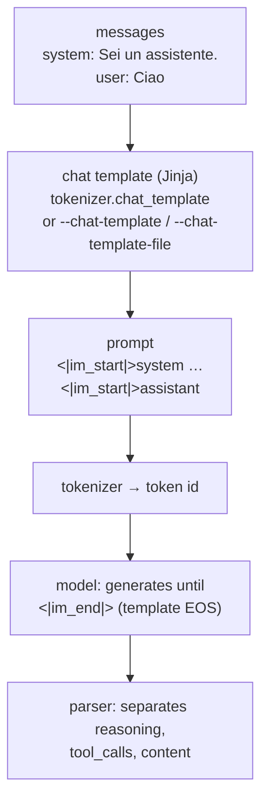

# Module 02: First steps: `llama cli`

`llama cli` (the old `llama-cli`, still present in the tarballs and Docker images) is the terminal of
llama.cpp: it downloads a model from Hugging Face, chats with it, and lets you get hands-on with everything the server
of [module 04](../04-server-api/README.md) will later do behind an API. In this module you learn to really use it:
model cache, interactive chat, system prompt, models that "think", sampling parameters,
reading the logs and chat templates.

## What you will learn

- Download a model with `-hf`, understand where the Hugging Face cache is and manage it with `-cl` and `llama download`.
- Use the interactive chat and the `/…` commands, give a system prompt with `-sys`, ask one-shot questions with `-st -p`.
- Turn off or limit the reasoning of *thinking* models (`-rea off`, `--reasoning-budget`).
- What temperature, top-k, top-p, min-p, repeat penalty and seed do, and in what order they apply.
- Size the context (`-c`), the answer length (`-n`) and the threads (`-t`).
- Read the banner and the `[ Prompt: x t/s | Generation: y t/s ]` line, and the detailed logs with `-v`.
- The difference between `llama cli` (chat with template) and `llama completion` (raw text).
- What a Jinja chat template is and how to control it (`--jinja`, `--chat-template`, `/apply-template`).

## 1. The first model: `-hf` and the Hugging Face cache

Prerequisite: `llama` installed ([module 01](../01-installazione/README.md)). On Ubuntu with the installer
binary remember `export SSL_CERT_FILE=/etc/ssl/certs/ca-certificates.crt`, otherwise `-hf` fails
with `SSL connection failed`.

```bash
llama cli -hf ggml-org/Qwen3.5-0.8B-GGUF       # (1)!
llama cli -m ~/modelli/qualcosa.gguf            # (2)!
```

1. Downloads the file (785 MiB, the first time) into the Hugging Face cache and enters the chat. It is the test model
   of the whole course: small, Apache 2.0, "thinking".
2. Same thing with a local GGUF file.

The syntax is `-hf <user>/<repo>[:QUANT]`. Without `:QUANT` llama.cpp looks for a `Q4_K_M` file; if there isn't one
it takes the **first file** in the repository (for `Qwen3.5-0.8B-GGUF` it is the `Q8_0`). With `-hff nomefile.gguf` you choose
a specific file. If the repository also contains a multimodal projector (`mmproj-*.gguf`), that is downloaded
too (`--no-mmproj` to avoid it). *Gated* repositories require `HF_TOKEN` in the environment (or `-hft`).

The download ends up in the **standard Hugging Face cache**, the same one used by the `huggingface_hub` library
and therefore shared with other tools:

```text
~/.cache/huggingface/hub/models--ggml-org--Qwen3.5-0.8B-GGUF/
├── blobs/37ae482d…                      # the real file, named by its SHA-256
├── refs/main
└── snapshots/8fea6208…/Qwen3.5-0.8B-Q8_0.gguf   # symbolic link to the blob
```

To see what you have already downloaded:

```bash
$ llama cli -cl
number of models in cache: 3
   1. ggml-org/Qwen3.5-0.8B-GGUF:Q8_0
   2. ggml-org/embeddinggemma-300M-GGUF:Q8_0
   3. ggml-org/SmolVLM-256M-Instruct-GGUF:Q8_0
```

`-cl` (`--cache-list`) works with all subcommands (`llama serve -cl` gives the same list). To download
without starting anything, for example in a provisioning script, there is `llama download`:

```bash
llama download -hf ggml-org/gemma-3-4b-it-qat-GGUF:Q4_K_M
llama download -hf ggml-org/models -hff model.gguf          # specific file
llama download -mu https://example.com/model.gguf -m model.gguf   # any URL, saved where you say
```

`--offline` forces the use of the cache without touching the network (useful on isolated machines); the
`HF_HOME` variable moves the whole cache elsewhere (for example to a bigger disk). To delete a model, just
remove its `models--…` folder.

!!! tip "Finding models"
    On Hugging Face filter by `library=gguf` or, from a model's page, by the *llama.cpp* app: the
    *Use this model* button directly shows the `llama cli -hf …` line. [Module 03](../03-modelli-gguf-quantizzazione/README.md)
    explains how to read model cards and choose the quantization; the models used in the course are in
    [Recommended models](../../risorse/modelli-consigliati.md).

## 2. The interactive chat

After loading, the banner and the `>` prompt appear:

```text
build      : b11046-60081bb2b
model      : ggml-org/Qwen3.5-0.8B-GGUF
ftype      : Q8_0
modalities : text

available commands:
  /exit or Ctrl+C     stop or exit
  /regen              regenerate the last response
  /clear              clear the chat history
  /read <file>        add a text file
  /glob <pattern>     add text files using globbing pattern

> 
```

The banner tells you four things you will check from now on every time: the **build**, the **model**, the
quantization type (**ftype**, here `Q8_0`: it is the `general.file_type` metadata seen in
[module 00](../00-introduzione/README.md)) and the **modalities** (`text`; with a vision model `vision` appears
and the command list gains `/image <file>` and `/audio <file>`, [module 07](../07-multimodale/README.md)).

Type, press ++enter++ and the answer streams in. Every answer ends with the timing line:

```text
> Spiega in una frase cos'è un token.
Un token è un'unità di valore o un'identità digitale verificata per accedere a un servizio web, una
blockchain, o una risorsa di rete, …

[ Prompt: 4.9 t/s | Generation: 3.4 t/s ]
```

(Yes, a 0.8 B model understood "token" in the cryptographic sense: that is the price of its size. With a system
prompt that says "we are talking about language models" it answers correctly: you will see it in lab 02-03.)

The built-in commands:

| Command | Effect |
|---|---|
| `/exit` or ++ctrl+c++ | exits (++ctrl+c++ during an answer just interrupts it) |
| `/regen` | regenerates the last answer (with a different seed: useful to see sampling at work) |
| `/clear` | clears the history: the context starts from zero |
| `/read file.txt` | adds the content of a text file to the next message |
| `/glob src/*.py` | like `/read` but for several files |
| `/image f.png`, `/audio f.mp3` | attachments, only with multimodal models |

To write several lines, end each line with `\` or start with `-mli` (`--multiline-input`).
The history stays in the context (`-c`): when you fill it, generation stops by default; with
`--context-shift` the context "slides", discarding the oldest messages.

### System prompt and one-shot questions

```bash
llama cli -hf ggml-org/Qwen3.5-0.8B-GGUF -sys "Rispondi sempre in italiano, in massimo due frasi."
llama cli -hf ggml-org/Qwen3.5-0.8B-GGUF -sysf istruzioni.txt                 # from a file
llama cli -hf ggml-org/Qwen3.5-0.8B-GGUF -st -p "Quanto fa 17 per 3?" -rea off  # (1)!
```

1. `-st` (`--single-turn`) does a single round and exits; with `-p` the question is already given and the command is not
   interactive: perfect in scripts (`llama cli … -st -p "…" > risposta.txt`). `-o file` saves the output.

`-sys` is the `system` role message that the chat template puts at the top of the conversation (§ 7): it is the
place for language, tone, format and "who you are". Not all templates support it (Gemma 3 merges it into the first
user message): llama.cpp does its best, but read the template if the model ignores it.

## 3. Models that think: `-rea` and `--reasoning-budget`

Qwen3.5, like DeepSeek R1, gpt-oss and many 2026 models, is a **thinking** model: before answering
it writes out its reasoning (between `<think>…</think>` tags), and llama.cpp shows it to you between `[Start thinking]` and
`[End thinking]`. With a small model and a low `-n` the risk is running out of tokens **inside** the reasoning:

```text
$ llama cli -hf ggml-org/Qwen3.5-0.8B-GGUF -st -p "Quanto fa 17 per 3?" -n 40 -t 3
> Quanto fa 17 per 3?

[Start thinking]

Here's a thinking process that leads to the suggested answer:

1.  **Analyze the Request:**
    *   Question: "Quanto fa 17 per 3?" (

[ Prompt: 5.1 t/s | Generation: 1.6 t/s ]
```

Forty tokens spent and no answer. There are three levers:

| Flag | Effect |
|---|---|
| `-rea off` (`--reasoning off`) | no reasoning: the template closes the `<think>` block right away (default `auto`: depends on the template) |
| `--reasoning-budget N` | at most N thinking tokens, then llama.cpp inserts the closing tag and the model answers (`-1` unlimited, `0` = closes immediately) |
| `--reasoning-effort low\|medium\|high` | for models whose template defines levels (gpt-oss); `--reasoning-format` decides whether the thinking stays in the text or is separated |

With `--reasoning-budget 25`, same question:

```text
[Start thinking]

Thinking Process:

1.  **Analyze the Request:**
    *   Question: "Quanto fa 
[End thinking]

17 per 3 (o 17/3) non è una semplice divisione di numeri, ma una **quoziente** (o rapporto),
```

The reasoning was cut at 25 tokens and the model answered (badly, but it answered: the budget cuts
the thinking, it doesn't improve it). In the course we will almost always use `-rea off`: shorter, more predictable answers.
In the server the per-request equivalent is `chat_template_kwargs: {"enable_thinking": false}`
([module 04](../04-server-api/README.md#3-how-a-request-travels)).

## 4. Sampling: from 248,320 logits to one token

At each step the model produces a **logit** for every token in the vocabulary (248,320 for Qwen3.5). The
*sampler* turns them into probabilities, discards most of them with a chain of filters and finally draws
one at random. The `llama cli` flags control exactly this chain:

<figure class="schema" markdown>

<figcaption>Each filter shrinks the set of candidates; temperature rescales what remains; the seed decides the draw. The order is the llama.cpp default.</figcaption>
</figure>

| Flag | Default | What it does | When you touch it |
|---|---|---|---|
| `--temp N` | 0.8 | divides the logits by N before the softmax: < 1 sharpens the likely tokens, > 1 flattens; **0 = greedy** (always the most likely) | 0-0.3 for data extraction, code, classification; 0.8-1.2 for creative writing |
| `--top-k N` | 40 | keeps only the N most likely tokens (0 = off) | rarely; 1 is equivalent to greedy |
| `--top-p N` | 0.95 | keeps the most likely tokens until their probabilities sum to N (1.0 = off) | lower it (0.7-0.9) for "safer" answers |
| `--min-p N` | 0.05 | discards tokens with probability < N × that of the best token (0 = off) | the most modern filter: 0.05-0.1 works almost always, and replaces top-p |
| `--repeat-penalty N` | 1.0 | penalizes tokens already seen in the last `--repeat-last-n` (64) tokens (1.0 = off) | 1.05-1.15 if the model loops; too high hurts the grammar |
| `--presence-penalty`, `--frequency-penalty` | 0 | the "OpenAI" penalties: one-time / proportional to frequency | alternatives to the repeat penalty |
| `--dry-multiplier N` | 0 | DRY: penalizes repeated **sequences**, not single tokens | against long repetitions in stories |
| `-s N`, `--seed N` | -1 | seed of the random generator (-1 = random) | fix it for reproducible experiments |

Some practical rules:

- The filters **stack**: the strictest one wins. With the defaults, top-k 40 rarely matters because min-p 0.05 has
  already cut more. To understand what a parameter does, turn the others off (`--top-k 0 --top-p 1 --min-p 0`).
- **Temperature** is the last step in the default order (`--samplers` shows the chain:
  `penalties;dry;top_n_sigma;top_k;typ_p;top_p;min_p;xtc;temperature`). With `--temp 0` the seed no longer matters.
- Same model, same prompt, same seed, same parameters → **same answer** (with `-s 42`
  two runs give the same text; with `-s 7` it changes). This holds on a single machine and build: on different hardware the
  floating-point numbers can differ, and with them the draw.
- Other samplers (`--mirostat`, `--typical`, `--xtc-*`, `--top-nsigma`, `--dynatemp-*`, `--adaptive-target`)
  exist for specific cases; `--logit-bias TOKEN±N` pushes or bans a token, `--grammar`/`--json-schema`
  constrain the output ([module 06](../06-output-strutturato/README.md)).

[Lab 02-02](../../laboratori/lab-02-02-campionamento/README.md) has you try all this with a repeatable
protocol.

## 5. Context, length, threads

```bash
llama cli -hf ggml-org/Qwen3.5-0.8B-GGUF -c 4096 -n 200 -t 4
```

| Flag | Default | Notes |
|---|---|---|
| `-c N`, `--ctx-size` | 0 = the model's | total tokens of **prompt + answer + history**. The test model has `n_ctx_train = 262144`: leaving it at 0 means allocating a huge KV cache, so `--fit` reduces it on its own to the free memory (or you set it). Memory formula in [module 00](../00-introduzione/README.md#5-estimating-memory-weights-kv-cache-overhead) |
| `-n N`, `--predict` | -1 = until the model stops | maximum tokens generated **per answer** (reasoning included!) |
| `-t N`, `--threads` | -1 = automatic | threads for generation; `-tb` for prompt processing. Rule: **physical cores**, not logical ones; on a laptop leave one free. Deep dive in [module 05](../05-prestazioni/README.md#3-threads-affinity-and-numa) |
| `-ngl N\|auto\|all` | auto | layers on the GPU, if there is one; `--list-devices` lists them ([module 05](../05-prestazioni/README.md)) |
| `-fa on\|off\|auto`, `-ctk/-ctv q8_0` | auto, f16 | flash attention and quantized KV cache: less memory at long contexts |
| `--load-mode mmap\|mlock\|dio` | auto | how to read the file: `mlock` locks the weights in RAM (no swap). The old `--mmap/--mlock` no longer exist in 0.4.1 |

## 6. Reading the logs

The final line `[ Prompt: 4.9 t/s | Generation: 3.4 t/s ]` is your everyday measuring tool:

- **Prompt** (or *prompt processing*, `pp`): how many prompt tokens (history included, if not already cached)
  are processed per second. It is a compute-heavy phase: on GPU it flies, on CPU it is limited by the cores.
- **Generation** (`tg`): tokens generated per second. On CPU it is limited by **memory bandwidth**: for every token
  the model rereads all the weights, so a smaller GGUF generates faster (you will measure it in lab 03-02).

On a 6-vCPU machine with no GPU the Q8_0 model does 3-5 t/s in generation; on a
modern laptop 15-25; with a GPU over 100. If the numbers look low to you, check `-t` first.

With `-v` (verbose) you see everything that happens during loading. The lines to recognize (build 11046, `-c 4096 -t 3`):

```text
system_info: n_threads = 3 (n_threads_batch = 3) / 6 | CPU : SSE3 = 1 | SSSE3 = 1 | AVX = 1 | AVX2 = 1 | F16C = 1 | FMA = 1 | …   # (1)!
print_info: file format = GGUF V3 (latest)
print_info: file type   = Q8_0
print_info: n_ctx_train           = 262144
print_info: model params          = 772.85 M
load_tensors: loading model tensors, this can take a while... (load_mode = none)
llama_context: n_ctx                 = 4096
llama_context: n_ctx_seq (4096) < n_ctx_train (262144) -- the full capacity of the model will not be utilized   # (2)!
llama_kv_cache: size =   48.00 MiB (  4096 cells,   6 layers,  1/1 seqs), K (f16):   24.00 MiB, V (f16):   24.00 MiB
llama_memory_recurrent: size =   19.27 MiB (     1 cells,  24 layers,  1 seqs  0 rs_seq), …
sched_reserve:        CPU compute buffer size =    46.16 MiB
common_memory_breakdown_print: |   - Host  |  877 =   763 +      67 +      46   |    # (3)!
init: chat template, example_format: '<|im_start|>system …
init: chat template, thinking = 0                                                    # (4)!
sampler chain: logits -> ?penalties -> ?dry -> ?top-n-sigma -> top-k -> ?typical -> top-p -> min-p -> ?xtc -> temp-ext -> dist   # (5)!
```

1. Threads used and CPU instructions detected: if `AVX2 = 1` is missing on a modern PC, you have the wrong binary.
2. It is not an error: you asked for less context than the model could handle.
3. Total memory in MiB: weights + context (KV cache and recurrent state) + compute buffers. This is the number to compare with free RAM.
4. `thinking = 0` confirms that `-rea off` took effect.
5. The sampler chain in its real order; `?` marks those inactive with the default values.

`--log-file f.log` saves everything, `--log-jsonl` produces one JSON line per message (handy to filter with `jq`),
`-lv N` sets the verbosity without going all the way to `-v`. `--no-show-timings` removes the timing line.

## 7. `llama completion`: raw text, no chat

`llama cli` is a **chat**: it takes your messages, wraps them with the chat template and shows only the answer.
`llama completion` (heir of the old `-no-cnv` mode) is a **text completer**: it sends the model
exactly the prompt you write and prints what follows, token by token, with no template and no roles:

```bash
$ llama completion -hf ggml-org/Qwen3.5-0.8B-GGUF -p "La capitale d'Italia è" -n 20 --temp 0
<think>
</think>
La capitale d'Italia è **Roma**.
Roma è la città più popol
```

Note two things. The model continued the text (it did not "answer"): the first token after the prompt is `<think>`
because an instruction-tuned model without a template still tries to open its reasoning block. And
the output stops at 20 tokens (`-n`), mid-word. This is the right behavior for: **base** models (not chat),
code completion, tokenizer experiments, `perplexity`-style work, or when you want to build the template yourself.
At the end `llama completion` prints the `common_perf_print` statistics (`prompt eval time`, `eval time`,
tokens per second). `--ignore-eos -n -1` generates forever (++ctrl+c++ to stop), `-f file.txt` reads the
prompt from a file, `--verbose-prompt` shows the prompt tokens.

In the server the same distinction is between `/v1/chat/completions` (with template) and `/v1/completions` or `/completion` (raw).

## 8. The chat template

A chat model is trained on a precise conversation format. For Qwen3.5 it is **ChatML**:

```text
<|im_start|>system
Sei un assistente.<|im_end|>
<|im_start|>user
Ciao<|im_end|>
<|im_start|>assistant
<think>
```

The **chat template** is the program, written in [Jinja](https://jinja.palletsprojects.com/), that turns the
`messages` list (`system`, `user`, `assistant`, `tool`) into that string. It lives in the GGUF, key
`tokenizer.chat_template`, and llama.cpp runs it with its own Jinja engine (`--jinja`, on by default).
Families use different formats: Llama 3 (`<|start_header_id|>user<|end_header_id|>`), Gemma
(`<start_of_turn>user`), Mistral (`[INST] … [/INST]`), Phi (`<|user|>`), and thinking models add
`<think>` and the conventions for tools.



How to check and change it:

| Tool | Use |
|---|---|
| `-v` | in the log: `init: chat template, example_format: '<|im_start|>system…'` shows how an example is rendered |
| the server's `POST /apply-template` | returns the exact prompt for a list of messages, without generating ([module 04](../04-server-api/README.md#3-how-a-request-travels)) |
| `--chat-template NOME` | one of the built-in templates (`chatml`, `llama3`, `gemma`, `mistral-v7`, `phi4`, `deepseek3`, `gpt-oss`, …: the list is in `llama cli --help`) |
| `--chat-template-file f.jinja` | your own template, for example a fixed version of the one in the GGUF (it happens with freshly released or hand-converted models) |
| `--chat-template-kwargs '{"enable_thinking": false}'` | variables passed to the template (this is what `-rea off` does) |
| `--no-jinja` | uses the old fixed-template engine: only for compatibility |

What happens with the **wrong** template? With Qwen3.5 and `--chat-template llama2`:

```text
> Ciao, chi sei?

//
//  llama2
//
//  Copyright 2016-2017
//  All rights reserved.
```

The model doesn't recognize `[INST]` and completes "at random" as if it were code. If a model answers
absurdly, repeats the turns, never stops (the right EOS is missing) or puts strange tags in the text, the first suspect
is the template. [Lab 02-03](../../laboratori/lab-02-03-chat-template/README.md) shows it live.

## Summary

| What | How |
|---|---|
| Download and chat | `llama cli -hf user/repo[:QUANT]`; cache in `~/.cache/huggingface/hub/`; `-cl` lists; `llama download` just downloads |
| System prompt, single question | `-sys "…"` / `-sysf f`; `-st -p "…"` (with `-o f` it saves) |
| Thinking | `-rea off`, `--reasoning-budget N`, `--reasoning-effort` |
| Sampling | `--temp` (0 = greedy) · `--top-k` · `--top-p` · `--min-p` · `--repeat-penalty` · `-s seed`; order: top-k → top-p → min-p → temp |
| Sizes | `-c` context (0 = the model's) · `-n` tokens per answer · `-t` threads |
| Measurements | `[ Prompt: x t/s | Generation: y t/s ]`; `-v` for loading, memory, template, sampler chain |
| Raw text | `llama completion -p "…"`: no template, no roles |
| Template | `tokenizer.chat_template` in the GGUF; `--chat-template`, `--chat-template-file`, `/apply-template` |

## Common mistakes

!!! warning "Empty or truncated answer with a thinking model"
    `-n 40` with Qwen3.5 ends inside `[Start thinking]`. Use `-rea off` or `--reasoning-budget`, or raise `-n`.
    In the server it is the same with `max_tokens`.

!!! warning "The model loops or repeats the same sentence"
    Try `--repeat-penalty 1.1` or `--dry-multiplier 0.8`; if it repeats whole turns (`user: … assistant: …`) the
    problem is the template, not the sampler.

!!! warning "`--temp 0` but the answers change"
    With `--temp 0` sampling is greedy and reproducible on the same machine. If answers change between machines
    or between builds, it is floating-point arithmetic (different threads, backends, kernels), not the sampler. In the server
    the prompt cache can also introduce tiny differences.

!!! warning "`SSL connection failed` with `-hf`"
    Installer binary on Ubuntu: `export SSL_CERT_FILE=/etc/ssl/certs/ca-certificates.crt` (put it in `~/.bashrc`).

!!! warning "Extremely slow generation"
    Check `system_info: n_threads`: if it is higher than the physical cores or equal to all the cores of a laptop, try a lower `-t`.
    Then check that the weights fit in RAM (`memory breakdown` against free memory): if the system is swapping,
    speed collapses by 10-100 times.

## Labs in this module

- [Lab 02-01: The first model](../../laboratori/lab-02-01-primo-modello/README.md): download, chat, `/…`
  commands, system prompt, banner and timings, `-v`.
- [Lab 02-02: Sampling experiments](../../laboratori/lab-02-02-campionamento/README.md): same prompt,
  fixed seed, one parameter at a time; table of results.
- [Lab 02-03: Chat template and system prompt](../../laboratori/lab-02-03-chat-template/README.md): the
  right template and the wrong one, `/apply-template`, three system prompts compared.

## Check

1. You type `llama cli -hf unsloth/Qwen3.5-4B-GGUF` without `:QUANT`. Which file is downloaded, and where does it end up?
2. You want an answer of just two sentences from a bash script, with no interaction and no reasoning. Which flags do you use?
3. With the defaults (`top-k 40, top-p 0.95, min-p 0.05`), which of the three filters usually cuts the most? How do you check?
4. `--temp 0` and `-s 42`: does the seed still matter?
5. What does `Generation: 3.4 t/s` measure, and what limits it on CPU?
6. Why does `llama completion -p "Ciao"` with Qwen3.5 produce `<think>` as the first token?
7. A Llama 3 model answers by repeating `user:` and `assistant:` in the text. What is the most likely cause and how do you check it without generating anything?
8. `-c 0` with a model that has `n_ctx_train = 262144`: what happens to memory, and what saves you?

??? success "Solutions"
    1. It looks for a `Q4_K_M` file (there is one: `Qwen3.5-4B-Q4_K_M.gguf`) plus the `mmproj` if present; it ends up in
       `~/.cache/huggingface/hub/models--unsloth--Qwen3.5-4B-GGUF/snapshots/<hash>/`.
    2. `llama cli -hf … -st -p "domanda" -rea off -sys "Rispondi in due frasi." -n 100` (optionally `-o file`).
    3. min-p 0.05: as soon as the best token goes above 0.5 probability, it discards everything below 0.025, that is
       almost always more than 40 candidates. You check it by turning off the other two (`--top-k 0 --top-p 1`) and comparing.
    4. No: with temperature 0 the most likely token is always taken, there is no random draw.
    5. Tokens generated per second. On CPU it is limited by memory bandwidth: for every token all the weights are reread.
    6. There is no template: the prompt is bare text, and the instruction-tuned model continues the way it was
       trained to start a turn, that is by opening the reasoning block.
    7. A wrong or missing chat template (the GGUF has a broken one, or you forced the wrong `--chat-template`).
       With the server: `POST /apply-template` shows the rendered prompt; with `llama cli -v` look at `example_format`.
    8. A KV cache for 262,144 tokens (gigabytes) would be allocated. `--fit on` (the default) reduces it to the free
       memory; still, it is better to set `-c` to what you actually need.

## References

- [llama.app: Using the CLI](https://llama.app/docs/cli) and [tools/cli/README.md](https://github.com/ggml-org/llama.cpp/blob/master/tools/cli/README.md) (complete flag reference)
- [tools/completion/README.md](https://github.com/ggml-org/llama.cpp/blob/master/tools/completion/README.md): `llama completion`, prompt from a file, legacy interactive mode
- [docs/models.md](https://github.com/ggml-org/llama.cpp/blob/master/docs/models.md): finding models and `-hf`
- [Hugging Face: GGUF and llama.cpp](https://huggingface.co/docs/hub/gguf-llamacpp)
- [Jinja: template documentation](https://jinja.palletsprojects.com/en/stable/templates/)
- [Course glossary](../../risorse/glossario.md) · [Recommended models](../../risorse/modelli-consigliati.md)

!!! tip "Which model now?"
    You have run the course model. To choose the right one for **your** machine (Raspberry Pi,
    laptop, PC, Mac, GPU) go to [Module 02b: Choosing the model](../02b-scegliere-modello/README.md).
