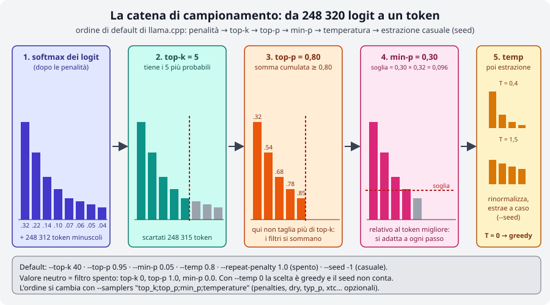
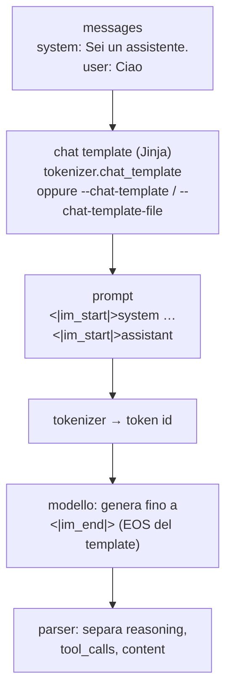

# Modulo 02: Primi passi: `llama cli`

<div class="meta" markdown>
<span class="stato stato-verificato">verificato su b11046</span>
</div>

`llama cli` (il vecchio `llama-cli`, ancora presente nei tarball e nelle immagini Docker) è il terminale di
llama.cpp: scarica un modello da Hugging Face, ci chatta, e ti lascia toccare con mano tutto ciò che il server
del [modulo 04](../04-server-api/README.md) farà poi dietro un'API. In questo modulo impari a usarlo davvero:
cache dei modelli, chat interattiva, prompt di sistema, modelli che "pensano", parametri di campionamento,
lettura dei log e chat template.

## Cosa imparerai

- Scaricare un modello con `-hf`, capire dov'è la cache Hugging Face e gestirla con `-cl` e `llama download`.
- Usare la chat interattiva e i comandi `/…`, dare un prompt di sistema con `-sys`, fare domande "usa e getta" con `-st -p`.
- Spegnere o limitare il ragionamento dei modelli *thinking* (`-rea off`, `--reasoning-budget`).
- Che cosa fanno temperatura, top-k, top-p, min-p, repeat penalty e seed, e in che ordine si applicano.
- Dimensionare contesto (`-c`), lunghezza della risposta (`-n`) e thread (`-t`).
- Leggere il banner e la riga `[ Prompt: x t/s | Generation: y t/s ]`, e i log dettagliati con `-v`.
- La differenza tra `llama cli` (chat con template) e `llama completion` (testo grezzo).
- Che cos'è un chat template Jinja e come si controlla (`--jinja`, `--chat-template`, `/apply-template`).

## 1. Il primo modello: `-hf` e la cache Hugging Face

Prerequisito: `llama` installato ([modulo 01](../01-installazione/README.md)). Su Ubuntu con il binario
dell'installer ricorda `export SSL_CERT_FILE=/etc/ssl/certs/ca-certificates.crt`, altrimenti `-hf` fallisce
con `SSL connection failed`.

```bash
llama cli -hf ggml-org/Qwen3.5-0.8B-GGUF       # (1)!
llama cli -m ~/modelli/qualcosa.gguf            # (2)!
```

1. Scarica il file (785 MiB, la prima volta) nella cache Hugging Face ed entra in chat. È il modello di prova
   di tutto il corso: piccolo, Apache 2.0, "thinking".
2. Stessa cosa con un file GGUF locale.

La sintassi è `-hf <utente>/<repo>[:QUANT]`. Senza `:QUANT` llama.cpp cerca un file `Q4_K_M`; se non c'è
prende il **primo file** del repository (per `Qwen3.5-0.8B-GGUF` è il `Q8_0`). Con `-hff nomefile.gguf` scegli
un file preciso. Se il repository contiene anche un proiettore multimodale (`mmproj-*.gguf`) viene scaricato
pure quello (`--no-mmproj` per evitarlo). I repository *gated* richiedono `HF_TOKEN` nell'ambiente (o `-hft`).

Il download finisce nella **cache standard di Hugging Face**, la stessa usata dalla libreria `huggingface_hub`
e quindi condivisa con altri strumenti:

```text
~/.cache/huggingface/hub/models--ggml-org--Qwen3.5-0.8B-GGUF/
├── blobs/37ae482d…                      # il file vero, nominato con lo SHA-256
├── refs/main
└── snapshots/8fea6208…/Qwen3.5-0.8B-Q8_0.gguf   # link simbolico al blob
```

Per vedere cosa hai già scaricato:

```bash
$ llama cli -cl
number of models in cache: 3
   1. ggml-org/Qwen3.5-0.8B-GGUF:Q8_0
   2. ggml-org/embeddinggemma-300M-GGUF:Q8_0
   3. ggml-org/SmolVLM-256M-Instruct-GGUF:Q8_0
```

`-cl` (`--cache-list`) funziona con tutti i sottocomandi (`llama serve -cl` dà lo stesso elenco). Per scaricare
senza avviare nulla, ad esempio in uno script di provisioning, c'è `llama download`:

```bash
llama download -hf ggml-org/gemma-3-4b-it-qat-GGUF:Q4_K_M
llama download -hf ggml-org/models -hff model.gguf          # file preciso
llama download -mu https://example.com/model.gguf -m model.gguf   # URL qualunque, salvato dove dici tu
```

`--offline` forza l'uso della cache senza toccare la rete (utile su macchine isolate); la variabile
`HF_HOME` sposta l'intera cache altrove (ad esempio su un disco più grande). Per cancellare un modello basta
rimuovere la sua cartella `models--…`.

!!! tip "Trovare modelli"
    Su Hugging Face filtra per `library=gguf` o, dalla scheda di un modello, per l'app *llama.cpp*: il pulsante
    *Use this model* mostra direttamente la riga `llama cli -hf …`. Il [modulo 03](../03-modelli-gguf-quantizzazione/README.md)
    spiega come leggere le schede e scegliere la quantizzazione; i modelli usati nel corso sono in
    [Modelli consigliati](../../risorse/modelli-consigliati.md).

## 2. La chat interattiva

Dopo il caricamento compare il banner e il prompt `>`:

```text
build      : b11046-60081bb2b
model      : ggml-org/Qwen3.5-0.8B-GGUF
ftype      : Q8_0
modalities : text

available commands:
  /exit or Ctrl+C     stop or exit
  /regen              regenerate the last response
  /clear              clear the chat history
  /read <file>        add a text file
  /glob <pattern>     add text files using globbing pattern

> 
```

Il banner ti dice quattro cose che d'ora in poi controllerai sempre: la **build**, il **modello**, il tipo di
quantizzazione (**ftype**, qui `Q8_0`: è il metadato `general.file_type` visto nel
[modulo 00](../00-introduzione/README.md)) e le **modalità** (`text`; con un modello visivo compare `vision`
e nell'elenco dei comandi si aggiungono `/image <file>` e `/audio <file>`, [modulo 07](../07-multimodale/README.md)).

Scrivi, premi ++enter++ e la risposta arriva in streaming. Ogni risposta si chiude con la riga di tempi:

```text
> Spiega in una frase cos'è un token.
Un token è un'unità di valore o un'identità digitale verificata per accedere a un servizio web, una
blockchain, o una risorsa di rete, …

[ Prompt: 4.9 t/s | Generation: 3.4 t/s ]
```

(Sì, un modello da 0,8 B ha capito "token" nel senso crittografico: è il prezzo della taglia. Con un prompt
di sistema che dice "parliamo di modelli linguistici" risponde correttamente: lo vedrai nel lab 02-03.)

I comandi interni:

| Comando | Effetto |
|---|---|
| `/exit` o ++ctrl+c++ | esce (++ctrl+c++ durante una risposta la interrompe e basta) |
| `/regen` | rigenera l'ultima risposta (con un seed diverso: utile per vedere il campionamento) |
| `/clear` | svuota la cronologia: il contesto riparte da zero |
| `/read file.txt` | aggiunge il contenuto di un file di testo al prossimo messaggio |
| `/glob src/*.py` | come `/read` ma per più file |
| `/image f.png`, `/audio f.mp3` | allegati, solo con modelli multimodali |

Per scrivere più righe termina ogni riga con `\` oppure avvia con `-mli` (`--multiline-input`).
La cronologia resta nel contesto (`-c`): quando lo riempi, di default la generazione si ferma; con
`--context-shift` il contesto "scorre" scartando i messaggi più vecchi.

### Prompt di sistema e domande usa e getta

```bash
llama cli -hf ggml-org/Qwen3.5-0.8B-GGUF -sys "Rispondi sempre in italiano, in massimo due frasi."
llama cli -hf ggml-org/Qwen3.5-0.8B-GGUF -sysf istruzioni.txt                 # da file
llama cli -hf ggml-org/Qwen3.5-0.8B-GGUF -st -p "Quanto fa 17 per 3?" -rea off  # (1)!
```

1. `-st` (`--single-turn`) fa un solo giro ed esce; con `-p` la domanda è già data e il comando non è
   interattivo: perfetto negli script (`llama cli … -st -p "…" > risposta.txt`). `-o file` salva l'output.

`-sys` è il messaggio di ruolo `system` che il chat template mette in testa alla conversazione (§ 7): è il
posto per lingua, tono, formato e "chi sei". Non tutti i template lo supportano (Gemma 3 lo fonde nel primo
messaggio utente): llama.cpp fa il possibile, ma leggi il template se il modello lo ignora.

## 3. Modelli che pensano: `-rea` e `--reasoning-budget`

Qwen3.5, come DeepSeek R1, gpt-oss e molti modelli del 2026, è un modello **thinking**: prima di rispondere
scrive un ragionamento (fra tag `<think>…</think>`), e llama.cpp te lo mostra fra `[Start thinking]` e
`[End thinking]`. Con un modello piccolo e `-n` basso il rischio è finire i token **dentro** il ragionamento:

```text
$ llama cli -hf ggml-org/Qwen3.5-0.8B-GGUF -st -p "Quanto fa 17 per 3?" -n 40 -t 3
> Quanto fa 17 per 3?

[Start thinking]

Here's a thinking process that leads to the suggested answer:

1.  **Analyze the Request:**
    *   Question: "Quanto fa 17 per 3?" (

[ Prompt: 5.1 t/s | Generation: 1.6 t/s ]
```

Quaranta token spesi e nessuna risposta. Le leve sono tre:

| Flag | Effetto |
|---|---|
| `-rea off` (`--reasoning off`) | niente ragionamento: il template chiude subito il blocco `<think>` (default `auto`: dipende dal template) |
| `--reasoning-budget N` | al massimo N token di pensiero, poi llama.cpp inserisce la chiusura e il modello risponde (`-1` illimitato, `0` = chiude subito) |
| `--reasoning-effort low\|medium\|high` | per i modelli che prevedono livelli nel template (gpt-oss); `--reasoning-format` decide se il pensiero resta nel testo o viene separato |

Con `--reasoning-budget 25`, stessa domanda (verificato):

```text
[Start thinking]

Thinking Process:

1.  **Analyze the Request:**
    *   Question: "Quanto fa 
[End thinking]

17 per 3 (o 17/3) non è una semplice divisione di numeri, ma una **quoziente** (o rapporto),
```

Il ragionamento è stato troncato a 25 token e il modello ha risposto (male, ma ha risposto: il budget taglia
il pensiero, non lo migliora). Nel corso useremo quasi sempre `-rea off`: risposte più brevi e prevedibili.
Nel server l'equivalente per richiesta è `chat_template_kwargs: {"enable_thinking": false}`
([modulo 04](../04-server-api/README.md#3-come-viaggia-una-richiesta)).

## 4. Il campionamento: da 248 320 logit a un token

A ogni passo il modello produce un **logit** per ogni token del vocabolario (248 320 per Qwen3.5). Il
*sampler* li trasforma in probabilità, ne scarta la maggior parte con una catena di filtri e infine ne estrae
uno a caso. I flag di `llama cli` controllano proprio questa catena:

<figure class="schema" markdown>

<figcaption>Ogni filtro riduce l'insieme dei candidati; la temperatura riscala ciò che resta; il seed decide l'estrazione. L'ordine è quello di default di llama.cpp.</figcaption>
</figure>

| Flag | Default | Che cosa fa | Quando lo tocchi |
|---|---|---|---|
| `--temp N` | 0.8 | divide i logit per N prima del softmax: < 1 accentua i token probabili, > 1 appiattisce; **0 = greedy** (sempre il più probabile) | 0-0.3 per estrazione dati, codice, classificazione; 0.8-1.2 per scrittura creativa |
| `--top-k N` | 40 | tiene solo i N token più probabili (0 = spento) | raramente; 1 equivale a greedy |
| `--top-p N` | 0.95 | tiene i token più probabili finché la somma delle probabilità arriva a N (1.0 = spento) | abbassalo (0.7-0.9) per risposte più "sicure" |
| `--min-p N` | 0.05 | scarta i token con probabilità < N × quella del token migliore (0 = spento) | il filtro più moderno: 0.05-0.1 va bene quasi sempre, e sostituisce top-p |
| `--repeat-penalty N` | 1.0 | penalizza i token già apparsi negli ultimi `--repeat-last-n` (64) token (1.0 = spento) | 1.05-1.15 se il modello va in loop; troppo alto peggiora la grammatica |
| `--presence-penalty`, `--frequency-penalty` | 0 | le penalità "OpenAI": una tantum / proporzionale alla frequenza | alternative alla repeat penalty |
| `--dry-multiplier N` | 0 | DRY: penalizza le **sequenze** ripetute, non i singoli token | contro le ripetizioni lunghe nei racconti |
| `-s N`, `--seed N` | -1 | seme del generatore casuale (-1 = casuale) | fissalo per esperimenti riproducibili |

Alcune regole pratiche:

- I filtri **si sommano**: vince il più severo. Con i default, top-k 40 raramente conta perché min-p 0.05 ha
  già tagliato di più. Per capire che cosa fa un parametro, spegni gli altri (`--top-k 0 --top-p 1 --min-p 0`).
- La **temperatura** è nell'ordine di default l'ultimo passaggio (`--samplers` mostra la catena:
  `penalties;dry;top_n_sigma;top_k;typ_p;top_p;min_p;xtc;temperature`). Con `--temp 0` il seed non conta più.
- Stesso modello, stesso prompt, stesso seed, stessi parametri → **stessa risposta** (verificato con `-s 42`
  su due esecuzioni; con `-s 7` cambia). Vale su una singola macchina e build: su hardware diverso i numeri in
  virgola mobile possono differire e con essi l'estrazione.
- Altri sampler (`--mirostat`, `--typical`, `--xtc-*`, `--top-nsigma`, `--dynatemp-*`, `--adaptive-target`)
  esistono per casi specifici; `--logit-bias TOKEN±N` spinge o vieta un token, `--grammar`/`--json-schema`
  vincolano l'output ([modulo 06](../06-output-strutturato/README.md)).

Il [lab 02-02](../../laboratori/lab-02-02-campionamento/README.md) fa provare tutto questo con un protocollo
ripetibile.

## 5. Contesto, lunghezza, thread

```bash
llama cli -hf ggml-org/Qwen3.5-0.8B-GGUF -c 4096 -n 200 -t 4
```

| Flag | Default | Note |
|---|---|---|
| `-c N`, `--ctx-size` | 0 = quello del modello | token totali di **prompt + risposta + cronologia**. Il modello di prova ha `n_ctx_train = 262144`: lasciarlo a 0 significa allocare una KV cache enorme, quindi `--fit` lo riduce da solo alla memoria libera (o tu lo fissi). Formula della memoria nel [modulo 00](../00-introduzione/README.md#5-stimare-la-memoria-pesi-kv-cache-overhead) |
| `-n N`, `--predict` | -1 = finché il modello si ferma | massimo di token generati **per risposta** (ragionamento incluso!) |
| `-t N`, `--threads` | -1 = automatico | thread per la generazione; `-tb` per il prompt processing. Regola: **core fisici**, non logici; su un portatile lasciane uno libero. Approfondimento nel [modulo 05](../05-prestazioni/README.md#3-thread-affinita-e-numa) |
| `-ngl N\|auto\|all` | auto | strati sulla GPU, se c'è; `--list-devices` li elenca ([modulo 05](../05-prestazioni/README.md)) |
| `-fa on\|off\|auto`, `-ctk/-ctv q8_0` | auto, f16 | flash attention e KV cache quantizzata: meno memoria a contesti lunghi |
| `--load-mode mmap\|mlock\|dio` | auto | come leggere il file: `mlock` blocca i pesi in RAM (niente swap). I vecchi `--mmap/--mlock` non esistono più in 0.4.1 |

## 6. Leggere i log

La riga finale `[ Prompt: 4.9 t/s | Generation: 3.4 t/s ]` è il tuo strumento di misura quotidiano:

- **Prompt** (o *prompt processing*, `pp`): quanti token del prompt (cronologia inclusa, se non è già in cache)
  vengono elaborati al secondo. È una fase di calcolo intenso: su GPU vola, su CPU è limitata dai core.
- **Generation** (`tg`): token generati al secondo. Su CPU è limitata dalla **banda di memoria**: per ogni token
  il modello rilegge tutti i pesi, quindi un GGUF più piccolo genera più in fretta (lo misurerai nel lab 03-02).

Sulla macchina di prova (6 vCPU condivise, nessuna GPU) il modello Q8_0 fa 3-5 t/s in generazione; su un
portatile moderno 15-25; con una GPU oltre 100. Se i numeri ti sembrano bassi, guarda per prima cosa `-t`.

Con `-v` (verbose) vedi tutto ciò che succede nel caricamento. Le righe da riconoscere (build 11046, `-c 4096 -t 3`):

```text
system_info: n_threads = 3 (n_threads_batch = 3) / 6 | CPU : SSE3 = 1 | SSSE3 = 1 | AVX = 1 | AVX2 = 1 | F16C = 1 | FMA = 1 | …   # (1)!
print_info: file format = GGUF V3 (latest)
print_info: file type   = Q8_0
print_info: n_ctx_train           = 262144
print_info: model params          = 772.85 M
load_tensors: loading model tensors, this can take a while... (load_mode = none)
llama_context: n_ctx                 = 4096
llama_context: n_ctx_seq (4096) < n_ctx_train (262144) -- the full capacity of the model will not be utilized   # (2)!
llama_kv_cache: size =   48.00 MiB (  4096 cells,   6 layers,  1/1 seqs), K (f16):   24.00 MiB, V (f16):   24.00 MiB
llama_memory_recurrent: size =   19.27 MiB (     1 cells,  24 layers,  1 seqs  0 rs_seq), …
sched_reserve:        CPU compute buffer size =    46.16 MiB
common_memory_breakdown_print: |   - Host  |  877 =   763 +      67 +      46   |    # (3)!
init: chat template, example_format: '<|im_start|>system …
init: chat template, thinking = 0                                                    # (4)!
sampler chain: logits -> ?penalties -> ?dry -> ?top-n-sigma -> top-k -> ?typical -> top-p -> min-p -> ?xtc -> temp-ext -> dist   # (5)!
```

1. Thread usati e istruzioni CPU rilevate: se manca `AVX2 = 1` su un PC moderno, hai il binario sbagliato.
2. Non è un errore: hai chiesto meno contesto di quello che il modello saprebbe gestire.
3. Memoria totale in MiB: pesi + contesto (KV cache e stato ricorrente) + buffer di calcolo. È il numero da confrontare con la RAM libera.
4. `thinking = 0` conferma che `-rea off` ha avuto effetto.
5. La catena dei sampler nell'ordine reale; il `?` marca quelli disattivi con i valori di default.

`--log-file f.log` salva tutto, `--log-jsonl` produce una riga JSON per messaggio (comodo da filtrare con `jq`),
`-lv N` regola la verbosità senza arrivare a `-v`. `--no-show-timings` toglie la riga dei tempi.

## 7. `llama completion`: testo grezzo, senza chat

`llama cli` è una **chat**: prende i tuoi messaggi, li impacchetta con il chat template e mostra solo la risposta.
`llama completion` (erede della vecchia modalità `-no-cnv`) è un **completatore di testo**: manda al modello
esattamente il prompt che scrivi e stampa ciò che segue, token dopo token, senza template e senza ruoli:

```bash
$ llama completion -hf ggml-org/Qwen3.5-0.8B-GGUF -p "La capitale d'Italia è" -n 20 --temp 0
<think>
</think>
La capitale d'Italia è **Roma**.
Roma è la città più popol
```

Nota due cose. Il modello ha continuato il testo (non ha "risposto"): il primo token dopo il prompt è `<think>`
perché un modello instruction-tuned senza template cerca comunque di aprire il suo blocco di ragionamento. E
l'output si ferma a 20 token (`-n`), a metà parola. È il comportamento giusto per: modelli **base** (non chat),
completamento di codice, esperimenti sul tokenizer, `perplexity`-style, o quando il template vuoi costruirlo tu.
Al termine `llama completion` stampa le statistiche `common_perf_print` (`prompt eval time`, `eval time`,
token al secondo). `--ignore-eos -n -1` genera all'infinito (++ctrl+c++ per fermare), `-f file.txt` legge il
prompt da file, `--verbose-prompt` mostra i token del prompt.

Nel server la stessa distinzione è fra `/v1/chat/completions` (con template) e `/v1/completions` o `/completion` (grezzo).

## 8. Il chat template

Un modello chat è addestrato su un formato preciso di conversazione. Per Qwen3.5 è **ChatML**:

```text
<|im_start|>system
Sei un assistente.<|im_end|>
<|im_start|>user
Ciao<|im_end|>
<|im_start|>assistant
<think>
```

Il **chat template** è il programma, scritto in [Jinja](https://jinja.palletsprojects.com/), che trasforma la
lista `messages` (`system`, `user`, `assistant`, `tool`) in quella stringa. Sta nel GGUF, chiave
`tokenizer.chat_template`, e llama.cpp lo esegue con il proprio motore Jinja (`--jinja`, attivo di default).
Le famiglie usano formati diversi: Llama 3 (`<|start_header_id|>user<|end_header_id|>`), Gemma
(`<start_of_turn>user`), Mistral (`[INST] … [/INST]`), Phi (`<|user|>`), e i modelli thinking aggiungono
`<think>` e le convenzioni per i tool.



Come controllarlo e cambiarlo:

| Strumento | Uso |
|---|---|
| `-v` | nel log: `init: chat template, example_format: '<|im_start|>system…'` mostra come viene reso un esempio |
| `POST /apply-template` del server | restituisce il prompt esatto per una lista di messaggi, senza generare ([modulo 04](../04-server-api/README.md#3-come-viaggia-una-richiesta)) |
| `--chat-template NOME` | uno dei template incorporati (`chatml`, `llama3`, `gemma`, `mistral-v7`, `phi4`, `deepseek3`, `gpt-oss`, …: l'elenco è in `llama cli --help`) |
| `--chat-template-file f.jinja` | un template tuo, ad esempio corretto rispetto a quello del GGUF (capita con modelli appena usciti o convertiti a mano) |
| `--chat-template-kwargs '{"enable_thinking": false}'` | variabili passate al template (è ciò che fa `-rea off`) |
| `--no-jinja` | usa il vecchio motore a template fissi: solo per compatibilità |

Che cosa succede con il template **sbagliato**? Verificato con Qwen3.5 e `--chat-template llama2`:

```text
> Ciao, chi sei?

//
//  llama2
//
//  Copyright 2016-2017
//  All rights reserved.
```

Il modello non riconosce `[INST]` e completa "a caso" come se fosse codice. Se un modello risponde in modo
assurdo, ripete i turni, non si ferma mai (manca l'EOS giusto) o mette tag strani nel testo, il primo sospetto
è il template. Il [lab 02-03](../../laboratori/lab-02-03-chat-template/README.md) lo mostra dal vivo.

## Riepilogo

| Cosa | Come |
|---|---|
| Scaricare e chattare | `llama cli -hf user/repo[:QUANT]`; cache in `~/.cache/huggingface/hub/`; `-cl` elenca; `llama download` scarica e basta |
| Prompt di sistema, domanda singola | `-sys "…"` / `-sysf f`; `-st -p "…"` (con `-o f` salva) |
| Thinking | `-rea off`, `--reasoning-budget N`, `--reasoning-effort` |
| Campionamento | `--temp` (0 = greedy) · `--top-k` · `--top-p` · `--min-p` · `--repeat-penalty` · `-s seed`; ordine: top-k → top-p → min-p → temp |
| Dimensioni | `-c` contesto (0 = del modello) · `-n` token per risposta · `-t` thread |
| Misure | `[ Prompt: x t/s | Generation: y t/s ]`; `-v` per caricamento, memoria, template, catena sampler |
| Testo grezzo | `llama completion -p "…"`: niente template, niente ruoli |
| Template | `tokenizer.chat_template` nel GGUF; `--chat-template`, `--chat-template-file`, `/apply-template` |

## Errori comuni

!!! warning "Risposta vuota o troncata con un modello thinking"
    `-n 40` con Qwen3.5 finisce dentro `[Start thinking]`. Usa `-rea off` o `--reasoning-budget`, oppure alza `-n`.
    Nel server è lo stesso con `max_tokens`.

!!! warning "Il modello va in loop o ripete la stessa frase"
    Prova `--repeat-penalty 1.1` o `--dry-multiplier 0.8`; se ripete interi turni (`user: … assistant: …`) il
    problema è il template, non il sampler.

!!! warning "`--temp 0` ma le risposte cambiano"
    Con `--temp 0` il campionamento è greedy e riproducibile sulla stessa macchina. Se cambiano fra macchine
    o fra build, è aritmetica in virgola mobile (thread, backend, kernel diversi), non il sampler. Nel server
    anche la prompt cache può introdurre differenze minime.

!!! warning "`SSL connection failed` con `-hf`"
    Binario dell'installer su Ubuntu: `export SSL_CERT_FILE=/etc/ssl/certs/ca-certificates.crt` (mettilo in `~/.bashrc`).

!!! warning "Generazione lentissima"
    Guarda `system_info: n_threads`: se è più alto dei core fisici o pari a tutti i core di un portatile, prova `-t` più basso.
    Poi controlla che i pesi stiano in RAM (`memory breakdown` contro la memoria libera): se il sistema usa lo swap,
    la velocità crolla di 10-100 volte.

## Laboratori di questo modulo

- [Lab 02-01: Il primo modello](../../laboratori/lab-02-01-primo-modello/README.md): download, chat, comandi
  `/…`, prompt di sistema, banner e tempi, `-v`.
- [Lab 02-02: Esperimenti di campionamento](../../laboratori/lab-02-02-campionamento/README.md): stesso prompt,
  seed fisso, un parametro alla volta; tabella dei risultati.
- [Lab 02-03: Chat template e prompt di sistema](../../laboratori/lab-02-03-chat-template/README.md): il
  template giusto e quello sbagliato, `/apply-template`, tre prompt di sistema a confronto.

## Verifica

1. Scrivi `llama cli -hf unsloth/Qwen3.5-4B-GGUF` senza `:QUANT`. Quale file viene scaricato, e dove finisce?
2. Vuoi una risposta di sole due frasi da uno script bash, senza interazione e senza ragionamento. Quali flag usi?
3. Con i default (`top-k 40, top-p 0.95, min-p 0.05`), quale dei tre filtri di solito taglia di più? Come lo verifichi?
4. `--temp 0` e `-s 42`: il seed serve ancora?
5. Cosa misura `Generation: 3.4 t/s` e da che cosa è limitato su CPU?
6. Perché `llama completion -p "Ciao"` con Qwen3.5 produce `<think>` come primo token?
7. Un modello Llama 3 risponde ripetendo `user:` e `assistant:` nel testo. Qual è la causa più probabile e come la verifichi senza generare nulla?
8. `-c 0` con un modello che ha `n_ctx_train = 262144`: cosa succede alla memoria, e chi ti salva?

??? success "Soluzioni"
    1. Cerca un file `Q4_K_M` (c'è: `Qwen3.5-4B-Q4_K_M.gguf`) più l'`mmproj` se presente; finisce in
       `~/.cache/huggingface/hub/models--unsloth--Qwen3.5-4B-GGUF/snapshots/<hash>/`.
    2. `llama cli -hf … -st -p "domanda" -rea off -sys "Rispondi in due frasi." -n 100` (eventualmente `-o file`).
    3. min-p 0.05: appena il token migliore supera 0,5 di probabilità, scarta tutto ciò che sta sotto 0,025, cioè
       quasi sempre più di 40 candidati. Si verifica spegnendo gli altri due (`--top-k 0 --top-p 1`) e confrontando.
    4. No: con temperatura 0 si prende sempre il token più probabile, non c'è estrazione casuale.
    5. Token generati al secondo. Su CPU è limitata dalla banda di memoria: a ogni token si rileggono tutti i pesi.
    6. Non c'è template: il prompt è testo nudo, e il modello instruction-tuned continua nel modo in cui è stato
       addestrato a iniziare un turno, cioè aprendo il blocco di ragionamento.
    7. Chat template sbagliato o assente (il GGUF ne ha uno errato, o hai forzato `--chat-template` sbagliato).
       Con il server: `POST /apply-template` mostra il prompt reso; con `llama cli -v` guarda `example_format`.
    8. Verrebbe allocata una KV cache per 262 144 token (gigabyte). `--fit on` (default) la riduce alla memoria
       libera; meglio comunque fissare `-c` a ciò che serve davvero.

## Riferimenti

- [llama.app: Using the CLI](https://llama.app/docs/cli) e [tools/cli/README.md](https://github.com/ggml-org/llama.cpp/blob/master/tools/cli/README.md) (riferimento completo dei flag)
- [tools/completion/README.md](https://github.com/ggml-org/llama.cpp/blob/master/tools/completion/README.md): `llama completion`, prompt da file, modalità interattiva legacy
- [docs/models.md](https://github.com/ggml-org/llama.cpp/blob/master/docs/models.md): trovare modelli e `-hf`
- [Hugging Face: GGUF e llama.cpp](https://huggingface.co/docs/hub/gguf-llamacpp)
- [Jinja: documentazione dei template](https://jinja.palletsprojects.com/en/stable/templates/)
- [Glossario del corso](../../risorse/glossario.md) · [Modelli consigliati](../../risorse/modelli-consigliati.md)

!!! tip "E adesso quale modello?"
    Hai fatto girare il modello del corso. Per scegliere quello giusto per **la tua** macchina (Raspberry Pi,
    portatile, PC, Mac, GPU) vai al [Modulo 02b: Scegliere il modello](../02b-scegliere-modello/README.md).
