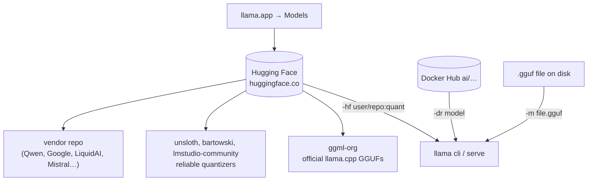
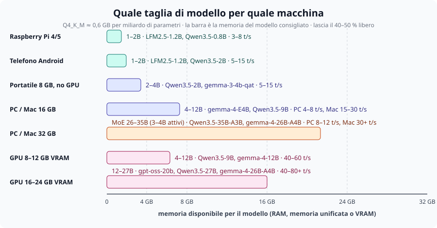

# Module 02b: Choosing the model for your machine

You have run your first model (module 02) and you are wondering: **which model do I download now?** This
module answers with a simple rule, a table per type of machine and, for each machine, the **minimum**
model that gives real satisfaction: sensible answers in Italian, at a speed that doesn't put you to sleep.

The reader of this course doesn't have a datacenter. You have a home PC, a laptop, a Mac, a Raspberry Pi or
a phone; at most 32 GB of RAM and, if you are lucky, a GPU with 8–24 GB. Everything that follows is designed for
that world.

## What you will learn

- Where to get models and how to read a model card on Hugging Face.
- The rule to tell **whether a model fits** in your memory and **how fast it will run**.
- Which family, size and quantization to choose based on what you want to do.
- The recommended (and the minimum) model for Raspberry Pi, laptop, PC, Mac, GPU and phone.

## 1. Where to get models



- **Hugging Face** is the place. Almost all open models are there; llama.cpp downloads them on its own with
  `-hf <user>/<repo>[:quant]` and puts them in the cache (`llama cli -cl` to see it).
  Filter the search with `apps=llama.cpp` to see only the repositories declared compatible:
  [chat](https://huggingface.co/models?apps=llama.cpp&sort=trending) ·
  [embedding](https://huggingface.co/models?pipeline_tag=sentence-similarity&apps=llama.cpp&sort=trending) ·
  [vision](https://huggingface.co/models?pipeline_tag=image-text-to-text&apps=llama.cpp&sort=trending).
- **Whom to trust**: `ggml-org` (the llama.cpp organization: official GGUFs, often with `mmproj` and
  draft already included), `unsloth` (curated quantizations, `UD-…` variants at higher quality), `bartowski` and
  `lmstudio-community` (they quantize almost everything the day after release). Vendor repos
  (`Qwen/…`, `google/…`) often contain the original weights in safetensors, **not** GGUF: you convert them
  (module 03) or look for a GGUF made by others.
- **[llama.app → Models](https://llama.app)**: the official showcase, with ready-to-copy commands.
- **Docker Hub** (`-dr gemma3`): Docker's "model artifacts", handy if you already use Docker.
- **Local files** (`-m`): received from colleagues, converted by you, or downloaded by hand.

!!! danger "A model is code you run"
    A GGUF contains no programs, but the **chat template** (Jinja) and the metadata do get interpreted by llama.cpp.
    Download only from known organizations, check the license, and be wary of repos with few downloads and
    names "almost identical" to famous ones.

## 2. How to read a model card

The name of a GGUF file tells you almost everything: `Qwen3.5-9B-Q4_K_M.gguf`.

| Part | Means | What to look at |
|---|---|---|
| `Qwen3.5` | family and generation | how recent it is (the 2026 families: Qwen3.5, Gemma 4, gpt-oss, LFM2.5, SmolLM3…) |
| `9B` | billions of parameters | the **size**: it decides memory and speed (§3) |
| `A3B` (e.g. `35B-A3B`) | MoE: 35B total, **3B active** per token | takes the space of a 35B, **runs like a 3B** |
| `it` / `Instruct` / `Chat` | trained to follow instructions | to chat you need this; "base" models just complete text |
| `Q4_K_M` | quantization (bits per weight) | `Q4_K_M` is the sensible default; §5 |
| `mmproj-*.gguf` in the repo | multimodal projector | the model sees images (and/or audio); `-hf` downloads it on its own |
| `mtp-*` / `eagle3-*` / `draft` | draft model for speculative decoding | free extra speed (module 05) |

On the card also check: **license** (Apache-2.0 and MIT with no strings attached; Gemma and LFM permissive with
conditions; some "research only"), maximum **context** (4k–256k tokens), **languages** (almost all
2026 models speak Italian, the tiniest ones do it worse), whether it is a **thinking** model (it reasons before
answering: slower; `-rea off` to turn it off), and the **date**: a model from 18 months ago is already old.

## 3. The rule: does it fit? how fast does it run?

Two numbers are enough to decide, and you can compute them before downloading a single byte.

<figure class="schema" markdown>

<figcaption>Every machine has a "right size" of model: the one that takes about half the memory and leaves room for context and system.</figcaption>
</figure>

**Memory.** A model quantized to 4 bits takes about **0.6 GB per billion parameters** (Q4_K_M ≈ 4.8
bits/weight), at 8 bits about 1.1 GB. Add to this the KV cache (from 0.2 to 2 GB depending on the context) and the
operating system (2–3 GB). Rule of thumb:

> **GGUF file size × 1.3 ≤ available memory** (RAM on CPU and Mac, VRAM on GPU).

**Speed.** Every generated token requires reading *all* the weights from memory, so
**tokens/s ≈ memory bandwidth (GB/s) ÷ model size (GB)** (module 05). With typical bandwidths:

| Machine | Bandwidth | 2.5 GB model (4B Q4) | 5.5 GB model (9B Q4) | 16 GB model (27B Q4) |
|---|---|---|---|---|
| Raspberry Pi 5 | ~10 GB/s | ~3 t/s | ~1.5 t/s | doesn't fit |
| DDR4/DDR5 laptop | 30–60 GB/s | 8–15 t/s | 4–8 t/s | 2–3 t/s (with 32 GB) |
| Mac M1/M2/M3 base | ~100 GB/s | 25–35 t/s | 12–18 t/s | 5–6 t/s (with 32 GB) |
| Mac M-Pro / M-Max | 200–400 GB/s | 50+ t/s | 25–50 t/s | 10–20 t/s |
| 8–16 GB GPU (RTX 3060–4070) | 300–500 GB/s | 60–100 t/s | 40–60 t/s | doesn't fit in VRAM |
| 24 GB GPU (RTX 3090/4090) | 900–1000 GB/s | 100+ t/s | 80+ t/s | 40–50 t/s |

Rounded theoretical values: in practice you get 50–80%. On a 6-vCPU virtual machine with no GPU,
Qwen3.5-0.8B Q8_0 does 4–5 t/s: that is the worst case you will see.

!!! tip "What 'satisfaction' means"
    Below **3 tokens/s** reading an answer is torture; from **5–8 t/s** you follow it well; above 15 t/s
    the model writes faster than you read. To "be satisfied" you need a model that gives
    sensible answers (from 2–4B up, for Italian better 4B+) **and** at least 5 t/s. The tables in §4 are
    built on these two constraints.

**MoE** models (`A3B`, `A4B`) break the rule in your favor: they take the space of their total size, but for each
token they read only the active experts, so they run like a small model. With 32 GB of RAM they are the
best choice on CPU.

## 4. The right model for your machine

The commands below automatically download the model from the given repository
(`SSL_CERT_FILE` if you use the installer on Linux, module 01). Legend: **recommended** = the quality choice
for that machine; **minimum** = the smallest one worth using, if the recommended one is slow or doesn't fit.

=== "Raspberry Pi (4/5, 4–8 GB)"
    ARM CPU only, low bandwidth: the size is 1–2B, and **Q4** pays off even for small models.

    | | Model | File | Memory | Expected |
    |---|---|---|---|---|
    | **recommended** (Pi 5, 8 GB) | `LiquidAI/LFM2.5-1.2B-Instruct-GGUF:Q4_K_M` | 697 MiB | ~1.5 GB | 5–8 t/s, decent Italian |
    | alternative | `ggml-org/gemma-3-1b-it-GGUF:Q4_K_M` | 769 MiB | ~1.5 GB | 4–7 t/s |
    | **minimum** (Pi 4, 4 GB) | `ggml-org/Qwen3.5-0.8B-GGUF:Q4_0` | 537 MiB | ~1 GB | 3–5 t/s, use `-rea off` |
    | curiosity | `LiquidAI/LFM2.5-230M-GGUF:Q4_K_M` | 146 MiB | ~0.5 GB | 15+ t/s, but understands little |

    ```bash
    llama cli -hf LiquidAI/LFM2.5-1.2B-Instruct-GGUF:Q4_K_M -c 4096 -t 4
    ```

=== "8 GB laptop, no GPU"
    The system and the browser eat 3–4 GB: about 4 GB remain for model and context.

    | | Model | File | Memory | Expected |
    |---|---|---|---|---|
    | **recommended** | `unsloth/Qwen3.5-2B-GGUF:Q4_K_M` | 1.2 GB | ~2 GB | 10–15 t/s, good Italian, tool calling |
    | if you have 5 GB free | `ggml-org/gemma-3-4b-it-qat-GGUF:Q4_0` | 2.4 GB (+0.8 mmproj) | ~3.5 GB | 5–8 t/s, sees images |
    | **minimum** | `LiquidAI/LFM2.5-1.2B-Instruct-GGUF:Q4_K_M` | 697 MiB | ~1.5 GB | 15–20 t/s |

    ```bash
    llama cli -hf unsloth/Qwen3.5-2B-GGUF:Q4_K_M -c 8192
    ```

=== "16 GB PC or Mac"
    The most common tier. On a Mac (unified memory, Metal) everything runs 2–4 times faster than on a PC without a GPU.

    | | Model | File | Memory | Expected (PC / Mac) |
    |---|---|---|---|---|
    | **recommended** | `ggml-org/gemma-4-E4B-it-GGUF:Q4_0` | 4.4 GB (+0.5 mmproj) | ~6 GB | 5–8 / 20–30 t/s; text, images, audio; MTP draft included |
    | more quality | `unsloth/Qwen3.5-9B-GGUF:Q4_K_M` | 5.4 GB (+0.9 mmproj) | ~7.5 GB | 4–6 / 12–18 t/s; thinking, vision |
    | reasoning | `ggml-org/gemma-4-12B-it-GGUF:Q4_0` | 6.9 GB | ~9 GB | 3–4 / 10–14 t/s |
    | **minimum** | `unsloth/Qwen3.5-4B-GGUF:Q4_K_M` | 2.6 GB (+0.6 mmproj) | ~4 GB | 8–12 / 30+ t/s |

    ```bash
    llama serve -hf ggml-org/gemma-4-E4B-it-GGUF:Q4_0 -c 16384      # then http://127.0.0.1:8080
    ```

=== "32 GB PC or Mac"
    This is where **MoE** models come in: many parameters, few active. On CPU they make the difference between "usable" and "not".

    | | Model | File | Memory | Expected (PC / Mac) |
    |---|---|---|---|---|
    | **recommended** | `unsloth/Qwen3.5-35B-A3B-GGUF:Q4_K_M` | 21 GB (+0.9 mmproj) | ~24 GB | 8–12 / 30–40 t/s: 30B quality, 3B speed |
    | alternative | `ggml-org/gemma-4-26B-A4B-it-GGUF:Q4_0` | 14 GB (+0.8 mmproj) | ~17 GB | 8–12 / 30+ t/s; multimodal, MTP draft |
    | reasoning and tools | `ggml-org/gpt-oss-20b-GGUF` (MXFP4) | 11.5 GB (+0.9 eagle3) | ~14 GB | 8–10 / 30+ t/s; `--reasoning-effort low` |
    | dense, the "smartest" | `unsloth/Qwen3.5-27B-GGUF:Q4_K_M` | 16 GB | ~19 GB | 2–3 / 6–10 t/s: slow on CPU, great on Mac |
    | **minimum** | `unsloth/Qwen3.5-9B-GGUF:Q4_K_M` | 5.4 GB | ~7.5 GB | 4–6 / 15 t/s |

    ```bash
    llama serve -hf unsloth/Qwen3.5-35B-A3B-GGUF:Q4_K_M -c 16384
    ```

=== "NVIDIA / AMD GPU"
    What counts is **VRAM**: the whole model must fit (`-ngl all`, the default) to get the speeds in the
    table; if it overflows, llama.cpp leaves the extra layers on the CPU (`--fit` is on by default) and the
    speed drops toward RAM speed. With MoE models you can keep the experts in RAM and the rest in VRAM (`-cmoe`).

    | VRAM | **recommended** | File | **minimum** / notes |
    |---|---|---|---|
    | 6 GB | `unsloth/Qwen3.5-4B-GGUF:Q4_K_M` | 2.6 GB | `gemma-4-E4B-it:Q4_0` (4.4 GB) with `-c 8192`; 40–60 t/s |
    | 8 GB | `unsloth/Qwen3.5-9B-GGUF:Q4_K_M` | 5.4 GB | context ≤ 8k; 40–60 t/s. Or `gemma-4-E4B` with the full context |
    | 12 GB | `ggml-org/gemma-4-12B-it-GGUF:Q4_0` | 6.9 GB | Qwen3.5-9B with 32k context |
    | 16 GB | `ggml-org/gpt-oss-20b-GGUF` (MXFP4) | 11.5 GB | 80+ t/s; or gemma-4-12B with long context |
    | 24 GB | `unsloth/Qwen3.5-27B-GGUF:Q4_K_M` | 16 GB | 40–50 t/s; `gemma-4-26B-A4B:Q4_0` (14 GB) even faster |
    | 16–24 GB + 32 GB RAM | `unsloth/Qwen3.5-35B-A3B-GGUF:Q4_K_M` with `-cmoe` | 21 GB | experts in RAM, attention in VRAM: 20–30 t/s |

    ```bash
    llama cli --list-devices                                       # is the GPU detected?
    llama serve -hf unsloth/Qwen3.5-9B-GGUF:Q4_K_M -c 8192 -fa on  # everything in VRAM
    ```

=== "Android phone"
    With Termux or an app based on llama.cpp; 8–12 GB of RAM shared with Android, bandwidth ~20–50 GB/s.

    | | Model | File | Expected |
    |---|---|---|---|
    | **recommended** | `LiquidAI/LFM2.5-1.2B-Instruct-GGUF:Q4_K_M` | 697 MiB | 8–15 t/s |
    | with 12 GB | `unsloth/Qwen3.5-2B-GGUF:Q4_K_M` | 1.2 GB | 5–10 t/s |
    | **minimum** | `ggml-org/gemma-3-270m-it-GGUF:Q8_0` | 278 MiB | 30+ t/s, for rephrasing and classifying |

!!! example "A 2-minute satisfaction test"
    Whatever the machine, try this and look at the numbers at the bottom (`[ Prompt: … | Generation: … ]`):
    ```bash
    llama cli -hf <repo:quant> -st -rea off -p "Spiegami in 5 righe, in italiano, perché il cielo è blu."
    ```
    Correct answer, in good Italian, above 5 t/s → you have found your model. Otherwise go down one
    row in the table.

## 5. Which quantization

| Situation | Choose | Why |
|---|---|---|
| default, almost always | **`Q4_K_M`** | best quality/memory ratio; it is what `-hf` takes if you specify nothing |
| model ≤ 2B | `Q8_0` | small models suffer from quantization and are light anyway |
| you have memory to spare | `Q6_K` or `Q8_0` | quality almost identical to F16 |
| you are short on space | `Q4_K_S`, `IQ4_XS`, `IQ3_M` | you lose a bit; below 3 bits only with `imatrix` (module 03) |
| `Q2_K` | avoid | on the course model perplexity goes from 12 to 155 (module 03) |
| `UD-Q4_K_XL` (unsloth) | excellent alternative to Q4_K_M | sensitive tensors kept at more bits, +5% space |
| `MXFP4` (gpt-oss, some MoE) | the native one | the model was trained this way: don't convert it |
| `Q4_0` from a `-qat` repo | ok | quantization-aware training: Q4_0 without the usual loss |

## 6. Which family, for what

| You want to… | Take… | With 8 GB | With 16 GB | With 32 GB / GPU |
|---|---|---|---|---|
| chat, write, summarize in Italian | Qwen3.5, Gemma 4 | Qwen3.5-2B | gemma-4-E4B, Qwen3.5-9B | Qwen3.5-35B-A3B |
| reason (math, logic, plans) | *thinking* models | Qwen3.5-2B (`-rea on`) | Qwen3.5-9B | gpt-oss-20b, Qwen3.5-27B |
| code | Qwen2.5-Coder, Qwen3-Coder | Qwen2.5-Coder-1.5B | Qwen2.5-Coder-3B | Qwen3-Coder-30B-A3B |
| read images, receipts, forms | models with `mmproj` | SmolVLM-500M | gemma-3-4b-qat, Qwen3.5-4B | gemma-4-12B, Qwen3.5-9B |
| audio | Gemma 4 E2B/E4B, ultravox | ultravox-1B | gemma-4-E4B | gemma-4-26B-A4B |
| use tools (agents) | Qwen3.5, gpt-oss, functiongemma | functiongemma-270m, Qwen3.5-2B | Qwen3.5-9B | gpt-oss-20b |
| embeddings for search | *embedding* models (not chat) | embeddinggemma-300M, bge-m3 | same | same |

Repositories, files and exact sizes for every row: [Recommended models](../../risorse/modelli-consigliati.md).

## Common mistakes

!!! warning "Downloading the biggest model that 'fits'"
    If it takes 90% of the memory there is no room left for the context: llama.cpp will reduce `-c` (with `--fit`) or
    go into swap, and you will run at 1 t/s. Aim for **50–60%** of the memory.

!!! warning "A base model instead of an instruct one"
    If the model replies by continuing your sentence instead of answering, you took a *base* model
    (without `-it`/`-Instruct`). It is meant for completion and fine-tuning, not for chatting.

!!! warning "A thinking model that never answers"
    With a low `-n` or little patience, a thinking model runs out of tokens inside its reasoning. `-rea off` or
    `--reasoning-budget 256`.

!!! warning "Trusting someone else's t/s"
    The tables in this module are estimates: the same GPU with different drivers, the same Mac with a browser
    open, give different numbers. Measure with `llama bench` (module 05) and write down your own.

## Related labs

- [Lab 02-01: The first model](../../laboratori/lab-02-01-primo-modello/README.md): use the table in §4 instead of the default model.
- [Lab 03-02: The quantization ladder](../../laboratori/lab-03-02-scala-quantizzazioni/README.md): check §5 on your hardware.
- [Lab 05-01: Reproducible benchmarks](../../laboratori/lab-05-01-benchmark/README.md): measure your real t/s.

## Check

1. A laptop has 16 GB of RAM and no GPU. How many GB of GGUF can you load without suffering?
2. Why is `Qwen3.5-35B-A3B` faster than `Qwen3.5-27B` even though it takes more space?
3. What is the difference between `gemma-4-12B-it` and a hypothetical `gemma-4-12B` without `-it`?
4. You have an 8 GB GPU: a 5.4 GB model "fits". What must you limit so you don't end up on the CPU?
5. You want an assistant on a 4 GB Raspberry Pi 4: which model, which quantization, and what speed do you expect?
6. When is `Q4_K_M` NOT the right choice?

??? success "Solutions"
    1. About 6–8 GB (half the RAM): gemma-4-E4B, Qwen3.5-9B Q4_K_M; with a 12B Q4 you are at the limit.
    2. It is a MoE: 35B total but only 3B active per token, so it reads ~1/10 of the weights from memory for each token.
    3. `-it` = instruction-tuned: it answers questions and follows the chat template. The base model completes text.
    4. The context (`-c`): the KV cache must fit in the remaining 2.6 GB; with 8k tokens it fits, with 32k it doesn't.
    5. Qwen3.5-0.8B `Q4_0` (537 MiB) or LFM2.5-1.2B `Q4_K_M`, 3–5 t/s, `-rea off`, `-c 2048`.
    6. Models ≤ 2B (better Q8_0), models with native quantization (MXFP4) or `-qat` (Q4_0), or when you have memory for Q6_K/Q8_0.

## References

- [Recommended models for the labs](../../risorse/modelli-consigliati.md) (sizes and licenses of every file)
- [llama.app → Models](https://llama.app) · [Hugging Face, llama.cpp filter](https://huggingface.co/models?apps=llama.cpp&sort=trending)
- [Module 00 §memory](../00-introduzione/README.md) and [Module 05 §memory bandwidth](../05-prestazioni/README.md)
