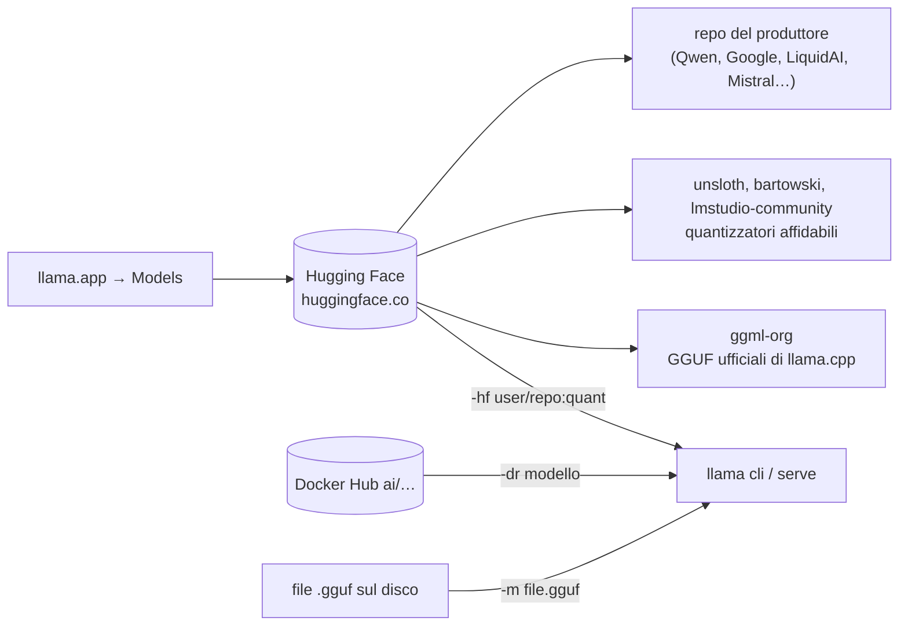

# Modulo 02b: Scegliere il modello per la tua macchina

<span class="stato stato-verificato">repository e dimensioni verificati su Hugging Face il 24/09/2026 · velocità CPU misurate sul VPS del corso</span> <span class="stato stato-bozza">velocità su GPU, Mac e Raspberry Pi: stime da esperienza e documentazione, da confermare sul tuo hardware</span>

Hai fatto girare il primo modello (modulo 02) e ti stai chiedendo: **quale modello scarico adesso?** Questo
modulo risponde con una regola semplice, una tabella per tipo di macchina e, per ogni macchina, il modello
**minimo** che dà una soddisfazione vera — risposte sensate in italiano, a una velocità che non fa addormentare.

Il lettore di questo corso non ha un datacenter. Ha un PC di casa, un portatile, un Mac, un Raspberry Pi o
un telefono; al massimo 32 GB di RAM e, se va bene, una GPU da 8–24 GB. Tutto quello che segue è pensato per
quel mondo.

## Cosa imparerai

- Dove si prendono i modelli e come si legge una scheda su Hugging Face.
- La regola per capire **se un modello ci sta** nella tua memoria e **quanto andrà veloce**.
- Quale famiglia, taglia e quantizzazione scegliere in base a ciò che vuoi fare.
- Il modello consigliato (e quello minimo) per Raspberry Pi, portatile, PC, Mac, GPU e telefono.

## 1. Dove si prendono i modelli



- **Hugging Face** è il posto. Quasi tutti i modelli aperti sono lì; llama.cpp li scarica da solo con
  `-hf <utente>/<repo>[:quant]` e li mette nella cache (`llama cli -cl` per vederla).
  Filtra la ricerca con `apps=llama.cpp` per vedere solo i repository dichiarati compatibili:
  [chat](https://huggingface.co/models?apps=llama.cpp&sort=trending) ·
  [embedding](https://huggingface.co/models?pipeline_tag=sentence-similarity&apps=llama.cpp&sort=trending) ·
  [visione](https://huggingface.co/models?pipeline_tag=image-text-to-text&apps=llama.cpp&sort=trending).
- **Da chi fidarsi**: `ggml-org` (l'organizzazione di llama.cpp: GGUF ufficiali, spesso con `mmproj` e
  draft già dentro), `unsloth` (quantizzazioni curate, varianti `UD-…` a qualità più alta), `bartowski` e
  `lmstudio-community` (quantizzano quasi tutto il giorno dopo l'uscita). I repo del produttore
  (`Qwen/…`, `google/…`) spesso contengono i pesi originali in safetensors, **non** GGUF: si convertono
  (modulo 03) oppure si cerca il GGUF fatto da altri.
- **[llama.app → Models](https://llama.app)**: la vetrina ufficiale, con i comandi già pronti da copiare.
- **Docker Hub** (`-dr gemma3`): i "model artifacts" di Docker, comodi se usi già Docker.
- **File locali** (`-m`): ricevuti da colleghi, convertiti da te, o scaricati a mano.

!!! danger "Un modello è codice che esegui"
    Un GGUF non contiene programmi, ma il **chat template** (Jinja) e i metadati sì, e llama.cpp li interpreta.
    Scarica solo da organizzazioni conosciute, controlla la licenza, e diffida dei repo con pochi download e
    nomi "quasi uguali" a quelli famosi.

## 2. Come si legge una scheda

Il nome di un file GGUF racconta quasi tutto: `Qwen3.5-9B-Q4_K_M.gguf`.

| Pezzo | Significa | Cosa guardare |
|---|---|---|
| `Qwen3.5` | famiglia e generazione | quanto è recente (le famiglie 2026: Qwen3.5, Gemma 4, gpt-oss, LFM2.5, SmolLM3…) |
| `9B` | miliardi di parametri | la **taglia**: decide memoria e velocità (§3) |
| `A3B` (es. `35B-A3B`) | MoE: 35B totali, **3B attivi** per token | occupa come 35B, **corre come 3B** |
| `it` / `Instruct` / `Chat` | addestrato a seguire istruzioni | per chattare serve questo; i modelli "base" completano testo e basta |
| `Q4_K_M` | quantizzazione (bit per peso) | `Q4_K_M` è il default sensato; §5 |
| `mmproj-*.gguf` nel repo | proiettore multimodale | il modello vede immagini (e/o audio); `-hf` lo scarica da solo |
| `mtp-*` / `eagle3-*` / `draft` | modello bozza per la decodifica speculativa | più velocità gratis (modulo 05) |

Nella scheda controlla anche: **licenza** (Apache-2.0 e MIT senza vincoli; Gemma e LFM permissive con
condizioni; alcune "research only"), **contesto** massimo (4k–256k token), **lingue** (quasi tutti i
modelli 2026 parlano italiano, i piccolissimi lo fanno peggio), se è un modello **thinking** (ragiona prima
di rispondere: più lento; `-rea off` per spegnerlo), e la **data**: un modello di 18 mesi fa è già vecchio.

## 3. La regola: ci sta? quanto va veloce?

Due numeri bastano per decidere, e li puoi calcolare prima di scaricare un solo byte.

<figure class="schema" markdown>

<figcaption>Ogni macchina ha una "taglia giusta" di modello: quella che occupa circa metà della memoria e lascia spazio a contesto e sistema.</figcaption>
</figure>

**Memoria.** Un modello quantizzato a 4 bit occupa circa **0,6 GB per miliardo di parametri** (Q4_K_M ≈ 4,8
bit/peso), a 8 bit circa 1,1 GB. A questo aggiungi la KV cache (da 0,2 a 2 GB a seconda del contesto) e il
sistema operativo (2–3 GB). Regola pratica:

> **dimensione del file GGUF × 1,3 ≤ memoria disponibile** (RAM su CPU e Mac, VRAM su GPU).

**Velocità.** Ogni token generato richiede la lettura di *tutti* i pesi dalla memoria, quindi
**token/s ≈ banda di memoria (GB/s) ÷ dimensione del modello (GB)** (modulo 05). Con le bande tipiche:

| Macchina | Banda | Modello da 2,5 GB (4B Q4) | Modello da 5,5 GB (9B Q4) | Modello da 16 GB (27B Q4) |
|---|---|---|---|---|
| Raspberry Pi 5 | ~10 GB/s | ~3 t/s | ~1,5 t/s | non ci sta |
| Portatile DDR4/DDR5 | 30–60 GB/s | 8–15 t/s | 4–8 t/s | 2–3 t/s (se 32 GB) |
| Mac M1/M2/M3 base | ~100 GB/s | 25–35 t/s | 12–18 t/s | 5–6 t/s (se 32 GB) |
| Mac M-Pro / M-Max | 200–400 GB/s | 50+ t/s | 25–50 t/s | 10–20 t/s |
| GPU 8–16 GB (RTX 3060–4070) | 300–500 GB/s | 60–100 t/s | 40–60 t/s | non ci sta in VRAM |
| GPU 24 GB (RTX 3090/4090) | 900–1000 GB/s | 100+ t/s | 80+ t/s | 40–50 t/s |

Valori teorici arrotondati: nella pratica si ottiene il 50–80 %. Sul VPS del corso (6 vCPU condivise, RAM
lenta) Qwen3.5-0.8B Q8_0 fa 4–5 t/s: è il caso peggiore che vedrai.

!!! tip "Cosa vuol dire 'soddisfazione'"
    Sotto i **3 token/s** leggere una risposta è una tortura; da **5–8 t/s** si segue bene; sopra i 15 t/s
    il modello scrive più veloce di quanto leggi. Per "avere soddisfazione" servono un modello che dia
    risposte sensate (dai 2–4B in su, per l'italiano meglio 4B+) **e** almeno 5 t/s. Le tabelle del §4 sono
    costruite su questi due vincoli.

I modelli **MoE** (`A3B`, `A4B`) rompono la regola a tuo favore: occupano come la taglia totale, ma per ogni
token leggono solo gli esperti attivi, quindi corrono come un modello piccolo. Con 32 GB di RAM sono la
scelta migliore su CPU.

## 4. Il modello giusto per la tua macchina

Tutti i repository qui sotto esistono e sono stati verificati; i comandi scaricano automaticamente
(`SSL_CERT_FILE` se usi l'installer su Linux, modulo 01). Legenda: **consigliato** = la scelta di qualità
per quella macchina; **minimo** = il più piccolo con cui vale la pena, se il consigliato è lento o non ci sta.

=== "Raspberry Pi (4/5, 4–8 GB)"
    Solo CPU ARM, banda bassa: la taglia è 1–2B, e conviene la **Q4** anche per i piccoli.

    | | Modello | File | Memoria | Attese |
    |---|---|---|---|---|
    | **consigliato** (Pi 5, 8 GB) | `LiquidAI/LFM2.5-1.2B-Instruct-GGUF:Q4_K_M` | 697 MiB | ~1,5 GB | 5–8 t/s, italiano discreto |
    | alternativa | `ggml-org/gemma-3-1b-it-GGUF:Q4_K_M` | 769 MiB | ~1,5 GB | 4–7 t/s |
    | **minimo** (Pi 4, 4 GB) | `ggml-org/Qwen3.5-0.8B-GGUF:Q4_0` | 537 MiB | ~1 GB | 3–5 t/s, usa `-rea off` |
    | curiosità | `LiquidAI/LFM2.5-230M-GGUF:Q4_K_M` | 146 MiB | ~0,5 GB | 15+ t/s, ma capisce poco |

    ```bash
    llama cli -hf LiquidAI/LFM2.5-1.2B-Instruct-GGUF:Q4_K_M -c 4096 -t 4
    ```

=== "Portatile 8 GB, senza GPU"
    Il sistema e il browser si mangiano 3–4 GB: restano ~4 GB per modello e contesto.

    | | Modello | File | Memoria | Attese |
    |---|---|---|---|---|
    | **consigliato** | `unsloth/Qwen3.5-2B-GGUF:Q4_K_M` | 1,2 GB | ~2 GB | 10–15 t/s, buon italiano, tool calling |
    | se hai 5 GB liberi | `ggml-org/gemma-3-4b-it-qat-GGUF:Q4_0` | 2,4 GB (+0,8 mmproj) | ~3,5 GB | 5–8 t/s, vede le immagini |
    | **minimo** | `LiquidAI/LFM2.5-1.2B-Instruct-GGUF:Q4_K_M` | 697 MiB | ~1,5 GB | 15–20 t/s |

    ```bash
    llama cli -hf unsloth/Qwen3.5-2B-GGUF:Q4_K_M -c 8192
    ```

=== "PC o Mac 16 GB"
    La fascia più comune. Su Mac (memoria unificata, Metal) tutto va 2–4 volte più veloce che su un PC senza GPU.

    | | Modello | File | Memoria | Attese (PC / Mac) |
    |---|---|---|---|---|
    | **consigliato** | `ggml-org/gemma-4-E4B-it-GGUF:Q4_0` | 4,4 GB (+0,5 mmproj) | ~6 GB | 5–8 / 20–30 t/s; testo, immagini, audio; draft MTP incluso |
    | qualità in più | `unsloth/Qwen3.5-9B-GGUF:Q4_K_M` | 5,4 GB (+0,9 mmproj) | ~7,5 GB | 4–6 / 12–18 t/s; thinking, visione |
    | ragionamento | `ggml-org/gemma-4-12B-it-GGUF:Q4_0` | 6,9 GB | ~9 GB | 3–4 / 10–14 t/s |
    | **minimo** | `unsloth/Qwen3.5-4B-GGUF:Q4_K_M` | 2,6 GB (+0,6 mmproj) | ~4 GB | 8–12 / 30+ t/s |

    ```bash
    llama serve -hf ggml-org/gemma-4-E4B-it-GGUF:Q4_0 -c 16384      # poi http://127.0.0.1:8080
    ```

=== "PC o Mac 32 GB"
    Qui entrano i **MoE**: tanti parametri, pochi attivi. Su CPU sono la differenza tra "usabile" e "no".

    | | Modello | File | Memoria | Attese (PC / Mac) |
    |---|---|---|---|---|
    | **consigliato** | `unsloth/Qwen3.5-35B-A3B-GGUF:Q4_K_M` | 21 GB (+0,9 mmproj) | ~24 GB | 8–12 / 30–40 t/s: qualità da 30B, velocità da 3B |
    | alternativa | `ggml-org/gemma-4-26B-A4B-it-GGUF:Q4_0` | 14 GB (+0,8 mmproj) | ~17 GB | 8–12 / 30+ t/s; multimodale, draft MTP |
    | ragionamento e strumenti | `ggml-org/gpt-oss-20b-GGUF` (MXFP4) | 11,5 GB (+0,9 eagle3) | ~14 GB | 8–10 / 30+ t/s; `--reasoning-effort low` |
    | denso, il più "intelligente" | `unsloth/Qwen3.5-27B-GGUF:Q4_K_M` | 16 GB | ~19 GB | 2–3 / 6–10 t/s: lento su CPU, ottimo su Mac |
    | **minimo** | `unsloth/Qwen3.5-9B-GGUF:Q4_K_M` | 5,4 GB | ~7,5 GB | 4–6 / 15 t/s |

    ```bash
    llama serve -hf unsloth/Qwen3.5-35B-A3B-GGUF:Q4_K_M -c 16384
    ```

=== "GPU NVIDIA / AMD"
    Conta la **VRAM**: il modello deve starci tutto (`-ngl all`, che è il default) per avere le velocità della
    tabella; se sfora, llama.cpp lascia i layer in eccesso sulla CPU (`--fit` è attivo di default) e la
    velocità crolla verso quella della RAM. Con i MoE puoi tenere gli esperti in RAM e il resto in VRAM (`-cmoe`).

    | VRAM | **consigliato** | File | **minimo** / note |
    |---|---|---|---|
    | 6 GB | `unsloth/Qwen3.5-4B-GGUF:Q4_K_M` | 2,6 GB | `gemma-4-E4B-it:Q4_0` (4,4 GB) con `-c 8192`; 40–60 t/s |
    | 8 GB | `unsloth/Qwen3.5-9B-GGUF:Q4_K_M` | 5,4 GB | contesto ≤ 8k; 40–60 t/s. Oppure `gemma-4-E4B` con tutto il contesto |
    | 12 GB | `ggml-org/gemma-4-12B-it-GGUF:Q4_0` | 6,9 GB | Qwen3.5-9B con contesto 32k |
    | 16 GB | `ggml-org/gpt-oss-20b-GGUF` (MXFP4) | 11,5 GB | 80+ t/s; oppure gemma-4-12B con contesto lungo |
    | 24 GB | `unsloth/Qwen3.5-27B-GGUF:Q4_K_M` | 16 GB | 40–50 t/s; `gemma-4-26B-A4B:Q4_0` (14 GB) ancora più veloce |
    | 16–24 GB + 32 GB RAM | `unsloth/Qwen3.5-35B-A3B-GGUF:Q4_K_M` con `-cmoe` | 21 GB | esperti in RAM, attenzione in VRAM: 20–30 t/s |

    ```bash
    llama cli --list-devices                                       # la GPU è vista?
    llama serve -hf unsloth/Qwen3.5-9B-GGUF:Q4_K_M -c 8192 -fa on  # tutto in VRAM
    ```

=== "Telefono Android"
    Con Termux o un'app basata su llama.cpp; 8–12 GB di RAM condivisi con Android, banda ~20–50 GB/s.

    | | Modello | File | Attese |
    |---|---|---|---|
    | **consigliato** | `LiquidAI/LFM2.5-1.2B-Instruct-GGUF:Q4_K_M` | 697 MiB | 8–15 t/s |
    | con 12 GB | `unsloth/Qwen3.5-2B-GGUF:Q4_K_M` | 1,2 GB | 5–10 t/s |
    | **minimo** | `ggml-org/gemma-3-270m-it-GGUF:Q8_0` | 278 MiB | 30+ t/s, per riformulare e classificare |

!!! example "Un test di soddisfazione in 2 minuti"
    Qualunque sia la macchina, prova questo e guarda i numeri in fondo (`[ Prompt: … | Generation: … ]`):
    ```bash
    llama cli -hf <repo:quant> -st -rea off -p "Spiegami in 5 righe, in italiano, perché il cielo è blu."
    ```
    Risposta corretta, in buon italiano, sopra i 5 t/s → hai trovato il tuo modello. Altrimenti scendi di una
    riga nella tabella.

## 5. Quale quantizzazione

| Situazione | Scegli | Perché |
|---|---|---|
| default, quasi sempre | **`Q4_K_M`** | miglior rapporto qualità/memoria; è ciò che `-hf` prende se non specifichi nulla |
| modello ≤ 2B | `Q8_0` | i piccoli soffrono la quantizzazione e pesano poco comunque |
| hai memoria da vendere | `Q6_K` o `Q8_0` | qualità quasi identica a F16 |
| ti manca poco spazio | `Q4_K_S`, `IQ4_XS`, `IQ3_M` | perdi un po'; sotto 3 bit solo con `imatrix` (modulo 03) |
| `Q2_K` | evita | sul modello del corso la perplexity passa da 12 a 155 (modulo 03) |
| `UD-Q4_K_XL` (unsloth) | ottima alternativa a Q4_K_M | tensori sensibili tenuti a più bit, +5 % di spazio |
| `MXFP4` (gpt-oss, alcuni MoE) | quella nativa | il modello è stato addestrato così: non convertirla |
| `Q4_0` di un repo `-qat` | ok | quantization-aware training: Q4_0 senza la perdita usuale |

## 6. Quale famiglia, per fare cosa

| Vuoi… | Prendi… | Con 8 GB | Con 16 GB | Con 32 GB / GPU |
|---|---|---|---|---|
| chattare, scrivere, riassumere in italiano | Qwen3.5, Gemma 4 | Qwen3.5-2B | gemma-4-E4B, Qwen3.5-9B | Qwen3.5-35B-A3B |
| ragionare (matematica, logica, piani) | modelli *thinking* | Qwen3.5-2B (`-rea on`) | Qwen3.5-9B | gpt-oss-20b, Qwen3.5-27B |
| codice | Qwen2.5-Coder, Qwen3-Coder | Qwen2.5-Coder-1.5B | Qwen2.5-Coder-3B | Qwen3-Coder-30B-A3B |
| leggere immagini, scontrini, moduli | modelli con `mmproj` | SmolVLM-500M | gemma-3-4b-qat, Qwen3.5-4B | gemma-4-12B, Qwen3.5-9B |
| audio | Gemma 4 E2B/E4B, ultravox | ultravox-1B | gemma-4-E4B | gemma-4-26B-A4B |
| usare strumenti (agenti) | Qwen3.5, gpt-oss, functiongemma | functiongemma-270m, Qwen3.5-2B | Qwen3.5-9B | gpt-oss-20b |
| embedding per la ricerca | modelli *embedding* (non chat) | embeddinggemma-300M, bge-m3 | idem | idem |

Repository, file e dimensioni esatte di ogni riga: [Modelli consigliati](../../risorse/modelli-consigliati.md).

## Errori comuni

!!! warning "Scaricare il modello più grande che 'ci sta'"
    Se occupa il 90 % della memoria non resta spazio per il contesto: llama.cpp ridurrà `-c` (con `--fit`) o
    andrà in swap, e andrai a 1 t/s. Punta al **50–60 %** della memoria.

!!! warning "Un modello base al posto di un instruct"
    Se il modello risponde continuando la tua frase invece di rispondere, hai preso un modello *base*
    (senza `-it`/`-Instruct`). Serve per completamento e fine-tuning, non per chattare.

!!! warning "Un thinking che non risponde mai"
    Con `-n` basso o poca pazienza, un modello thinking finisce i token dentro il ragionamento. `-rea off` o
    `--reasoning-budget 256`.

!!! warning "Fidarsi dei t/s di un altro"
    Le tabelle di questo modulo sono stime: la stessa GPU con driver diversi, lo stesso Mac con un browser
    aperto, danno numeri diversi. Misura con `llama bench` (modulo 05) e annota i tuoi.

## Laboratori collegati

- [Lab 02-01: Il primo modello](../../laboratori/lab-02-01-primo-modello/README.md) — usa la tabella del §4 al posto del modello di default.
- [Lab 03-02: La scala delle quantizzazioni](../../laboratori/lab-03-02-scala-quantizzazioni/README.md) — verifica il §5 sul tuo hardware.
- [Lab 05-01: Benchmark riproducibili](../../laboratori/lab-05-01-benchmark/README.md) — misura i tuoi t/s reali.

## Verifica

1. Un portatile ha 16 GB di RAM e nessuna GPU. Quanti GB di GGUF puoi caricare senza soffrire?
2. Perché `Qwen3.5-35B-A3B` è più veloce di `Qwen3.5-27B` pur occupando di più?
3. Che differenza c'è tra `gemma-4-12B-it` e un ipotetico `gemma-4-12B` senza `-it`?
4. Hai una GPU da 8 GB: un modello da 5,4 GB "ci sta". Cosa devi limitare per non finire sulla CPU?
5. Vuoi un assistente sul Raspberry Pi 4 da 4 GB: quale modello, quale quantizzazione, e cosa ti aspetti come velocità?
6. Quando NON conviene la `Q4_K_M`?

??? success "Soluzioni"
    1. Circa 6–8 GB (metà della RAM): gemma-4-E4B, Qwen3.5-9B Q4_K_M; con 12B Q4 sei al limite.
    2. È un MoE: 35B totali ma solo 3B attivi per token, quindi legge dalla memoria ~1/10 dei pesi a ogni token.
    3. `-it` = instruction-tuned: risponde a domande e segue il chat template. Il base completa testo.
    4. Il contesto (`-c`): la KV cache deve stare nei 2,6 GB rimasti; con 8k token ci sta, con 32k no.
    5. Qwen3.5-0.8B `Q4_0` (537 MiB) o LFM2.5-1.2B `Q4_K_M`, 3–5 t/s, `-rea off`, `-c 2048`.
    6. Modelli ≤ 2B (meglio Q8_0), modelli con quantizzazione nativa (MXFP4) o `-qat` (Q4_0), o quando hai memoria per Q6_K/Q8_0.

## Riferimenti

- [Modelli consigliati per i laboratori](../../risorse/modelli-consigliati.md) (dimensioni e licenze verificate)
- [llama.app → Models](https://llama.app) · [Hugging Face, filtro llama.cpp](https://huggingface.co/models?apps=llama.cpp&sort=trending)
- [Modulo 00 §memoria](../00-introduzione/README.md) e [Modulo 05 §banda di memoria](../05-prestazioni/README.md)
