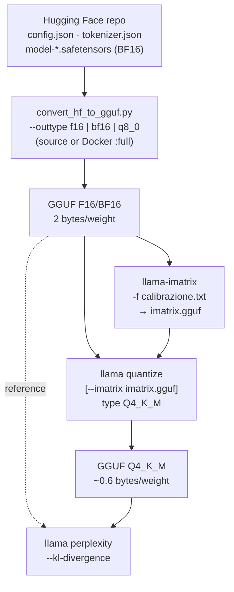

# Module 03: Models, GGUF and quantization

In [module 00](../00-introduzione/README.md) you saw what a GGUF is and what quantizing means;
in [module 02](../02-primi-passi/README.md) you downloaded a ready-made GGUF. Here you close the loop: how to
**choose** a model on Hugging Face by reading its model card, what really sets `Q4_K_M` apart from `Q4_0` and
`IQ4_XS`, and how to **produce** a GGUF from the original weights: conversion, importance matrix,
quantization, quality measurement with perplexity and KL-divergence, splitting into shards, and LoRA adapters.

## What you will learn

- Search for GGUFs on Hugging Face (filters `library=gguf`, `apps=llama.cpp`) and read a model card: quantizations, sizes, license, imatrix.
- The structure of a GGUF file in detail: header, metadata, tensor index, aligned data.
- The quantization families: legacy (`Q4_0`, `Q8_0`), K-quants (`Q2_K`…`Q6_K`, S/M/L variants), `IQ*`, ternary, `F16/BF16`.
- The pipeline `safetensors → convert_hf_to_gguf.py → GGUF F16 → llama-imatrix → llama quantize → GGUF Q4`.
- Measure the loss: `llama perplexity` and `--kl-divergence`.
- `llama-gguf-split` for models that exceed Hugging Face's size limits; `--lora` and `llama-export-lora`.

## 1. Finding and reading a model on Hugging Face

Hugging Face is the warehouse: tens of thousands of GGUF repositories. Useful searches:

| Search | URL |
|---|---|
| All GGUFs, most popular first | `huggingface.co/models?library=gguf&sort=trending` |
| Compatible with llama.cpp (from the *Apps* filter) | `huggingface.co/models?apps=llama.cpp&sort=trending` |
| From one organization | `huggingface.co/ggml-org` (official), `unsloth`, `bartowski`, `LiquidAI` |
| By task | `pipeline_tag=text-generation`, `sentence-similarity` (embedding), `text-ranking` (reranker) |

On a model card, read in this order:

1. **The base model** (`base_model` in the metadata): who trained it, how many parameters, native context, license.
   The GGUF inherits the license of the original model even if the GGUF repo's card does not repeat it.
2. **The file list** (*Files and versions*): one file per quantization (`Nome-Q4_K_M.gguf`, `…-Q8_0.gguf`),
   any `mmproj-*.gguf` (multimodal projector), `mtp-*` or `eagle3-*` (drafts for speculative decoding),
   folders with shards `-00001-of-00003.gguf`. The sizes are right there: they are the "weights" in the memory formula.
3. **How** the quantizations were made: with or without *imatrix* (§ 6), from which starting precision, with
   which llama.cpp build. The `bartowski` and `unsloth` cards include size tables and recommendations
   ("`UD-Q4_K_XL`" is an unsloth recipe that keeps sensitive tensors at more bits).
4. The **Use this model → llama.cpp** button generates the line `llama cli -hf …:QUANT` (or `llama serve`).

A serious card states the build used and the imatrix calibration file; an empty card with a single
`Q4_K_M` and no explanation is a signal to look elsewhere. When in doubt, the `ggml-org` repository with the
same name is the safe choice.

## 2. Inside the file: the GGUF structure

<figure class="schema" markdown>

<figcaption>The test model read with <code>GGUFReader</code>: 41 metadata pairs, 335 tensors, data starting at offset 10,962,464 (alignment 32).</figcaption>
</figure>

Four sections, always in the same order:

1. **Header**: `GGUF` (4 bytes), version (3), number of tensors, number of key-value pairs.
2. **Metadata**: typed `key → value` pairs (`u32`, `f32`, `str`, `arr`…). The heaviest are the tokenizer
   arrays (`tokenizer.ggml.tokens`, 248,320 strings) and the chat template: in the test model they take about
   10.5 MiB; the rest of the file is weights.
3. **Tensor index**: for each tensor, name (`blk.0.attn_qkv.weight`), dimensions, **type** (`F32`, `Q8_0`, `Q4_K`…) and
   offset from the start of the data section. The same file mixes different types: the norms stay `F32`, the
   embedding and output can have more bits than the inner blocks.
4. **Data**: the tensors one after another, each aligned to `general.alignment` (32 bytes), so the file can
   be **memory-mapped** and every tensor is directly usable by the backend.

The type of a quantized tensor is a **block** structure: `Q8_0` = 32 `int8` weights + one `F16` scale
(34 bytes per 32 weights = 8.5 bits/weight); `Q4_0` = 32 4-bit weights + `F16` scale (18 bytes = 4.5 bpw). The `K`
families use **super-blocks** of 256 weights with scales and minimums that are themselves quantized (6 bits): this is why
`Q4_K` reaches 4.5 bpw with better quality than `Q4_0`. The tools to read all of this (`gguf-dump`,
`GGUFReader`) are in [lab 00-02](../../laboratori/lab-00-02-anatomia-gguf/README.md).

## 3. The quantization families

<figure class="schema" markdown>

<figcaption>Bits per weight versus perplexity increase on Llama-3-8B (data from <code>llama quantize --help</code> and <code>tools/perplexity/README.md</code>; the IQ types use imatrix). Below 4 bits the curve shoots up.</figcaption>
</figure>

| Family | Types | Bits/weight | How it works | When |
|---|---|---|---|---|
| **Float** | `F32`, `F16`, `BF16` | 32 / 16 | no quantization; `BF16` is the most common training format, `F16` the historical llama.cpp one | starting point for quantizing; inference only on large GPUs |
| **Legacy** | `Q4_0`, `Q4_1`, `Q5_0`, `Q5_1`, `Q8_0` | 4.5 / 5 / 5.5 / 6 / 8.5 | blocks of 32, `F16` scale (`_1`: also a minimum) | `Q8_0`: almost lossless, the "practical reference"; `Q4_0`: the fastest on ARM CPUs and with *repacking*, and the format of Google's QAT models |
| **K-quants** | `Q2_K`, `Q3_K_S/M/L`, `Q4_K_S/M`, `Q5_K_S/M`, `Q6_K` | 3.2 → 6.6 | super-blocks of 256, 6-bit scales; **S/M/L** = *mix*: how many "sensitive" tensors (attention V, `ffn_down`, embedding, output) are kept at more bits | `Q4_K_M` is the standard; `Q5_K_M`/`Q6_K` if you have memory; `Q3_K_M` to fit a large model |
| **I-quants** | `IQ1_S/M`, `IQ2_XXS/XS/S/M`, `IQ3_XXS/XS/S/M`, `IQ4_XS/NL` | 1.6 → 4.7 | *codebook*: weights are indices into a table of optimal vectors; designed to be used **with the imatrix** (without it, quality collapses); a bit slower on CPU | `IQ4_XS` ≈ a smaller `Q4_K_S`; `IQ2/IQ3` for models ≥ 30 B that would not fit otherwise |
| **Ternary** | `TQ1_0`, `TQ2_0` | 1.7 / 2.1 | weights in {-1, 0, +1}: only for models **trained** as ternary (BitNet, Maple 20B-A1B) | useless on normal models |
| **MXFP4** | `MXFP4_MOE` | ~4.25 | FP4 microscaling in blocks of 32: gpt-oss's native format for the MoE experts | models distributed this way |

How to read a name: `Q4_K_M` = 4 bits, K family, *Medium* mix. The final letter is not the size of the
model but **how many tensors stay at higher precision**: the `llama quantize` log shows it line by line
(test model, `Q8_0 → Q4_K_M`):

```text
[   2/ 335] token_embd.weight      - [  1024, 248320], type = q8_0, converting to q6_K .. size = 257.66 MiB -> 198.93 MiB
[   5/ 335] blk.0.attn_qkv.weight  - [  1024,   6144], type = q8_0, converting to q6_K .. size =   6.38 MiB ->   4.92 MiB
[   6/ 335] blk.0.ffn_down.weight  - [  3584,   1024], type = q8_0, converting to q6_K .. size =   3.72 MiB ->   2.87 MiB
[   7/ 335] blk.0.ffn_gate.weight  - [  1024,   3584], type = q8_0, converting to q4_K .. size =   3.72 MiB ->   1.97 MiB
[   4/ 335] blk.0.attn_norm.weight - [  1024], type = f32, size = 0.004 MiB
llama_model_quantize_impl: model size  =   784.52 MiB (8.52 BPW)
llama_model_quantize_impl: quant size  =   506.34 MiB (5.50 BPW)
```

Embedding, `attn_qkv` and `ffn_down` at `q6_K`, the rest at `q4_K`, the norms untouched: the result is 5.50 bpw on average, not 4.5.
On a 0.8 B model the 248,320-row embedding is 40 % of the file, which is why the reduction is "only"
35 %; on an 8 B the same `Q4_K_M` reaches 4.89 bpw (4.58 GiB).

Sizes for an 8 B model according to `llama quantize --help` (Llama-3-8B, `+ppl` = perplexity increase
over F16):

| Type | Size | +ppl | Type | Size | +ppl |
|---|---|---|---|---|---|
| `Q2_K` | 2.96 GB | +3.52 | `Q4_K_M` | 4.58 GB | +0.18 |
| `Q3_K_S` | 3.41 GB | +1.63 | `Q5_K_S` | 5.21 GB | +0.10 |
| `Q3_K_M` | 3.74 GB | +0.66 | `Q5_K_M` | 5.33 GB | +0.06 |
| `Q3_K_L` | 4.03 GB | +0.56 | `Q6_K` | 6.14 GB | +0.02 |
| `Q4_0` | 4.34 GB | +0.47 | `Q8_0` | 7.96 GB | +0.003 |
| `Q4_K_S` | 4.37 GB | +0.27 | `F16` | 14.0 GB | 0 |
| `IQ4_XS` | 4.25 bpw | (with imatrix ≈ `Q4_K_S`) | `IQ2_M` | 2.7 bpw | (imatrix only) |

!!! tip "Rules of thumb"
    - Above 4 bits (`Q4_K_M` and up) the loss is small and often not measurable in real use; `Q8_0` is
      indistinguishable from `F16` and serves as the **reference** to measure the others.
    - Below 4 bits the loss grows fast, and the **smaller** the model, the faster: `Q2_K` on a 0.8 B
      is unusable (you will measure it: perplexity ×13), on a 70 B it is acceptable.
    - A larger model at fewer bits almost always beats a smaller one at more bits, for the same memory.
    - `Q4_0` is not simply "worse": on ARM CPUs (Apple, Snapdragon, Raspberry Pi) and with x86 repacking it is the
      fastest format, and **QAT** models (quantization-aware training, e.g. `gemma-3-*-qat`) are trained
      specifically to lose nothing in `Q4_0`.

## 4. The pipeline: from Hugging Face to a quantized GGUF



Three programs, three moments: **convert** (Python, once), **calibrate** (optional but recommended below
4 bits), **quantize** (C++, a few minutes, repeatable for every type). Then you **measure**.

### 4.1 Converting: `convert_hf_to_gguf.py`

The script lives **only in the llama.cpp source** (and in the `full` Docker image): it is not in the `llama` binary or in the
tarballs. It needs Python with `torch`, `transformers`, `gguf`, `safetensors`:

```bash
git clone https://github.com/ggml-org/llama.cpp && cd llama.cpp
python3 -m venv .venv && source .venv/bin/activate
python3 -m pip install -r requirements.txt          # (1)!
python3 convert_hf_to_gguf.py --outtype f16 --outfile modello-f16.gguf ./cartella-del-modello-hf   # (2)!
python3 convert_hf_to_gguf.py --outtype bf16 --outfile gemma-4-E2B-it-bf16.gguf --remote google/gemma-4-E2B-it  # (3)!
python3 convert_hf_to_gguf.py --mmproj --outtype q8_0 --outfile mmproj-gemma-4-E2B-it-Q8_0.gguf --remote google/gemma-4-E2B-it  # (4)!
```

1. Installs torch (CPU) and everything else: ~2 GB. With `uv`: `uv pip install -r requirements.txt --index-strategy unsafe-best-match`.
   The documentation warns that the requirements pin transformers 4 but the newest models (Gemma 4) want
   transformers 5: `pip install -U transformers` is safe.
2. The folder is the clone of the HF repo (`hf download org/modello --local-dir cartella`). `--outtype`: `f16`, `bf16`,
   `f32`, `q8_0`, `tq1_0`, `tq2_0`, `auto` (= the original precision, usually bf16, the recommended choice).
3. `--remote` reads the safetensors directly from Hugging Face without downloading them all (gated models need `HF_TOKEN`).
4. `--mmproj` produces the multimodal projector (vision/audio encoder + projection), to keep at `q8_0` or `bf16`:
   it is small and its quality affects everything.

The script recognizes the architecture from `config.json` (`architectures: ["Qwen3ForCausalLM"]`, …): if the model is
new and not supported, the error is `Model … is not supported` and the fix is to update the source (new
architectures are added almost every week). The output file already contains tokenizer, chat template and
metadata: it is a complete GGUF, runnable with `llama cli -m`, just large. New in 0.4.1 according to the release
notes: the `--fuse-qkv` option, which fuses the three attention tensors Q, K, V into a single `attn_qkv.weight`
(as in the test model: `blk.0.attn_qkv.weight [1024, 6144]`), for more efficient matrix multiplications.

Without installing anything: the Hugging Face space **GGUF-my-repo** converts and quantizes in the browser (it follows `master`
every 6 hours) and publishes the result in a repo of yours; the `ghcr.io/ggml-org/llama.cpp:full` image contains the
scripts (`docker run -v ./modelli:/models ghcr.io/ggml-org/llama.cpp:full --all-in-one /models/ 7B` is the example
from the documentation, [module 01](../01-installazione/README.md#5-docker)).

### 4.2 Quantizing: `llama quantize`

```bash
llama quantize [opzioni] modello-f16.gguf [modello-Q4_K_M.gguf] TIPO [nthreads]
llama quantize modello-f16.gguf modello-Q4_K_M.gguf Q4_K_M 8
llama quantize --imatrix imatrix.gguf modello-f16.gguf modello-IQ3_M.gguf IQ3_M
llama quantize --dry-run modello-f16.gguf Q4_K_M         # only the final size, in one second
```

You write the type in upper or lower case (`q4_k_m`), or as a number (`15`). The output file is optional
(default `ggml-model-TIPO.gguf`). Options you will use:

| Option | Effect |
|---|---|
| `--imatrix f.gguf` | uses the importance matrix (§ 4.3); `--include-weights`/`--exclude-weights nome` to limit it to some tensors |
| `--pure` | no mix: **all** tensors at the given type (useful for clean experiments) |
| `--leave-output-tensor` | does not quantize `output.weight`: larger file, slightly better quality |
| `--output-tensor-type T`, `--token-embedding-type T` | explicit type for output and embedding (`q8_0`, `q6_k`…) |
| `--tensor-type NOME=T` | rules for single tensors, also with regex (`"\.(\d*[13579])\.attn_k=q5_k"`): this is how the `UD-*` recipes are made |
| `--allow-requantize` | allows starting from an already quantized file (`Q4_K_M → Q2_K`): worse quality, avoid it when you have the F16 |
| `--keep-split` | keeps the shards of the input file |
| `--prune-layers 20,21,22`, `--override-kv` | surgery: removes layers, changes metadata (advanced) |
| `--max-buffer-size MiB` | limits RAM per tensor (default 8192): to quantize large models on small machines |

On the test model (785 MiB `Q8_0`, 3 threads) each quantization took 20-60 s and about 1.5 GB of peak
RAM: quantization does **not** run the model, it walks through the tensors one by one. Starting from an already
quantized file is refused by default (`llama_model_quantize: failed to quantize: requantizing from type
q8_0 is disabled`); with `--allow-requantize` it works, and starting from `Q8_0` (almost lossless) is an acceptable
shortcut for the labs. To publish a model you always start from `F16`/`BF16`.

### 4.3 The importance matrix: `llama-imatrix`

Block quantization treats all weights the same way. But not all of them matter the same: some
multiply large activations, others stay almost inert. The **imatrix** (importance matrix) runs the
F16 model on a calibration text and records, for every column of every tensor, the sum of the squares
of the activations; `llama quantize --imatrix` uses it to choose scales and codes that minimize the error
**where it hurts**. The effect is modest above 4 bits and decisive below (you will see it in lab 03-03: `Q2_K` without
imatrix perplexity 155, with imatrix 34).

`llama-imatrix` is not in the `llama` binary: it is in the release tarball (or in the built source).

```bash
~/llama-lab/rel/llama-b11046/llama-imatrix -m modello-f16.gguf -f calibrazione.txt -o imatrix.gguf -c 512 -ngl 99
```

```text
compute_imatrix: tokenizing the input ..
compute_imatrix: computing over 4 chunks, n_ctx=128, batch_size=2048, n_seq=16
[1]14.9594,[2]10.8089,[3]11.4033,[4]12.8878,
Final estimate: PPL = 12.8878 +/- 1.90874
```

(test model and a 430-word Italian text, `-c 128`: 1.1 MB of imatrix in 20 s on CPU). Useful
flags: `-o` (default `imatrix.gguf`; with the `.dat` extension the old binary format), `--chunks N` to stop
early, `--in-file a.gguf --in-file b.gguf -o c.gguf` to **merge** matrices from different corpora, `--parse-special` if
the text contains special tokens, `--show-statistics` (with `-m`) for a per-tensor table (`Σ(Act²)`,
`% Active`, entropy, cosine similarity with the previous layer). The **calibration text** matters: it must
resemble real use (language, domain, code if needed); public quantizers use mixed corpora of
a few hundred KB (bartowski's `calibration_datav3.txt`, Wikitext). With a larger `-c` and more text the
matrix is better, but the documentation notes that beyond a certain point (10 k → 10 M tokens) the gains are minimal.

## 5. Measuring quality: perplexity and KL-divergence

**Perplexity** (PPL) measures how "surprised" the model is by a text: the `exp` of the mean log-loss
per token; lower is better. It is not comparable across models with different tokenizers or across different texts; it is
instead perfect for comparing **quantizations of the same model on the same text**. The contributors' convention
is Wikitext-2 (`scripts/get-wikitext-2.sh`), split into chunks of `-c` tokens.

```bash
llama perplexity -m modello.gguf -f testo.txt -c 512 -t 4
```

Results on the test model, 384-word Italian text, `-c 128` (4 chunks):

| File | MiB | bpw | PPL | Mean KLD | Same top p |
|---|---|---|---|---|---|
| `Q8_0` (reference) | 784.5 | 8.52 | 11.50 ± 1.81 | 0 | 100 % |
| `Q4_K_M` | 506.3 | 5.50 | 12.50 ± 1.97 | 0.074 | 85.3 % |
| `Q4_0` | 478.8 | 5.20 | 14.66 ± 2.34 | – | – |
| `Q2_K` | 399.4 | 4.34 | 154.9 ± 30.4 | 2.36 | – |
| `Q2_K` + imatrix | 399.4 | 4.34 | 34.09 ± 6.08 | 0.83 | – |

(The bpw values are high because the 248,320-row embedding stays at 6-8 bits and is almost half the file.)

**KL-divergence** is finer: it compares, token by token, the whole probability distribution of the quantized
model with that of the reference, not just the loss on the correct token. Two passes:

```bash
llama perplexity -m Q8_0.gguf   -f testo.txt -c 128 --kl-divergence-base base.kld              # saves the logits (125 MB for 512 tokens × 248 320 vocab!)
llama perplexity -m Q4_K_M.gguf -f testo.txt -c 128 --kl-divergence-base base.kld --kl-divergence
```

```text
Mean PPL(Q)                   :  12.503109 ±   1.964999
Mean PPL(base)                :  11.497455 ±   1.807024
Mean PPL(Q)/PPL(base)         :   1.087468 ±   0.026184
Mean    KLD:   0.074038 ±   0.005346
Mean    Δp: -2.055 ± 0.481 %
RMS Δp    :  7.886 ± 0.816 %
Same top p: 85.317 ± 2.234 %
```

How to read it: **KLD** 0 = identical distributions (for an 8 B, `Q8_0` ≈ 0.001, `Q4_K_M` ≈ 0.03, `Q2_K` ≈ 0.4);
**Δp** is the change in probability of the correct token (negative = worse; if the percentiles are symmetric the
quantization only adds noise); **Same top p** is the percentage of tokens where the two models would choose
the same token at temperature 0: the 85 % of `Q4_K_M` on a 0.8 B tells you that one answer in seven **starts** to
diverge already at the first token. The logits file is huge (11 GiB for Llama 2 on Wikitext): use it on short texts.

## 6. Large files: `llama-gguf-split`

Hugging Face limits single files to 50 GB: large models are published as **shards**
`modello-00001-of-00004.gguf`. llama.cpp loads them when you pass **only the first one** (`-m …-00001-of-00004.gguf`, or
`-hf` with the right quant) and finds the others in the same folder. To produce or merge them there is
`llama-gguf-split` (tarball, not the `llama` binary):

```bash
~/llama-lab/rel/llama-b11046/llama-gguf-split --split --split-max-size 200M Qwen3.5-0.8B-Q4_0.gguf q4split
~/llama-lab/rel/llama-b11046/llama-gguf-split --split --split-max-tensors 128 modello.gguf out    # by number of tensors (default)
~/llama-lab/rel/llama-b11046/llama-gguf-split --merge q4split-00001-of-00004.gguf riunito.gguf
```

On the test model the 513 MB `Q4_0` becomes 4 files (11 + 209 + 199 + 94 MB: the first holds metadata and
tokenizer) and the merge rebuilds a file of identical size (335 tensors). `llama quantize
--keep-split` keeps the shards while quantizing.

## 7. LoRA adapters

A **LoRA** is a "lightweight" fine-tuning: instead of retraining the weights, you train two small matrices (A, B)
for some tensors and at runtime add `B·A × scale`. llama.cpp uses them in two ways:

```bash
llama cli -m base-Q4_K_M.gguf --lora adattatore.gguf                    # at runtime, on the quantized model
llama cli -m base.gguf --lora-scaled a.gguf:0.5,b.gguf:0.5               # several adapters with weights
llama serve -m base.gguf --lora a.gguf --lora b.gguf                     # in the server: GET/POST /lora-adapters to enable and weight them on the fly
~/llama-lab/rel/llama-b11046/llama-export-lora -m base-f16.gguf --lora adattatore.gguf -o fuso-f16.gguf   # merges and produces a new GGUF
```

The adapter must be in GGUF format: `convert_lora_to_gguf.py` (source) converts it from PEFT
(`adapter_config.json` + `adapter_model.safetensors`), or use the **GGUF-my-LoRA** space. Applying it at runtime
costs some speed and works on a quantized base too; run `export-lora` on the **F16** base and then
quantize the result, for the best quality. Options and details in
[tools/export-lora/README.md](https://github.com/ggml-org/llama.cpp/blob/master/tools/export-lora/README.md).

## Summary

| What | How |
|---|---|
| Find | `huggingface.co/models?library=gguf` / `apps=llama.cpp`; card: base model, license, files, imatrix, build |
| Structure | header → metadata (tokenizer, template) → tensor index (type per tensor) → data aligned to 32 |
| Choose the type | `Q4_K_M` standard · `Q5_K_M`/`Q6_K` if you have memory · `Q8_0` reference · `IQ*` + imatrix for large models · `Q4_0` on ARM and QAT |
| Convert | source: `pip install -r requirements.txt`; `convert_hf_to_gguf.py --outtype f16\|bf16\|q8_0 [--remote] [--mmproj] [--fuse-qkv]` |
| Quantize | `llama quantize [--imatrix i.gguf] [--pure] in.gguf out.gguf TIPO [thread]`; `--dry-run` for the size |
| Calibrate | `llama-imatrix -m f16.gguf -f testo.txt -o imatrix.gguf` (tarball) |
| Measure | `llama perplexity -m x.gguf -f testo.txt -c 512`; `--kl-divergence-base base.kld` then `--kl-divergence` |
| Shards | `llama-gguf-split --split --split-max-size 2G` / `--merge`; loading the first shard is enough |
| LoRA | `--lora`, `--lora-scaled f:0.5`; `llama-export-lora` to merge; `convert_lora_to_gguf.py` |

## Common mistakes

!!! warning "Quantizing from an already quantized file"
    `Q4_K_M → Q2_K` accumulates the error twice, and in fact `llama quantize` refuses (`requantizing from type … is
    disabled`) until you add `--allow-requantize`. If you only have a quantized GGUF and need a different type,
    download the F16/BF16 (or reconvert from HF). In lab 03-02 we start from `Q8_0` with `--allow-requantize` only because
    it is almost lossless.

!!! warning "IQ2/IQ3 (or Q2_K) without imatrix"
    Perplexity from 155 to 34 on the test model: below 4 bits the imatrix is not an optimization, it is a requirement.
    And check that the calibration text includes your language and your domain.

!!! warning "Comparing perplexity of different models"
    Different tokenizers = different tokens = numbers you cannot compare. PPL is for comparing quantizations
    of the **same** model on the **same** text with the **same** `-c`.

!!! warning "`Model … is not supported` during conversion"
    The source is older than the model: `git pull` (and `pip install -U transformers` if the card asks for it).
    If the architecture is truly new, look for an open issue/PR in the repository.

!!! warning "Passing all shards to `-m`"
    You pass **only the first one** (`-00001-of-N`): the others are found automatically. And do not rename them: the
    name contains the index.

!!! warning "`llama imatrix: command not found`"
    `imatrix`, `gguf-split`, `export-lora`, `tokenize` are not in the installer's binary: take them from the release
    tarball ([module 01](../01-installazione/README.md#4-prebuilt-binaries-from-the-release-page)) or build them.

## Labs in this module

- [Lab 03-01: From Hugging Face to GGUF](../../laboratori/lab-03-01-conversione/README.md): convert a
  135 M parameter model to GGUF F16 with `convert_hf_to_gguf.py`, check it and quantize it.
- [Lab 03-02: The quantization scale](../../laboratori/lab-03-02-scala-quantizzazioni/README.md): three
  quantizations of the test model, measured in size, speed (`llama bench`) and perplexity.
- [Lab 03-03: Quantization with imatrix](../../laboratori/lab-03-03-imatrix/README.md): compute an imatrix on an
  Italian text and compare `Q2_K` with and without it, using perplexity and KL-divergence.

## Check

1. An HF card offers `Q4_K_S`, `Q4_K_M`, `IQ4_XS` and `Q4_0` of an 8 B. Which one do you choose for an M-series MacBook, and which for an x86 PC with 8 GB to dedicate to the model?
2. Why does `Q4_K_M` on the test model reach 5.50 bpw and not ~4.9?
3. What does the imatrix record, and in which phase is it used?
4. You want to produce `IQ3_M` of a model for which you only have the `Q4_K_M`. What should you do, and what should you **not** do?
5. What is the difference between what perplexity measures and what KL-divergence measures?
6. `Same top p: 85 %` for `Q4_K_M`: what does it mean in practice for an application at `temperature 0`?
7. You have `modello-00001-of-00003.gguf` … `-00003-of-00003.gguf`: which command uses them and which one merges them?
8. Which tools in this module are **not** in the installer's `llama` binary?

??? success "Solutions"
    1. On Apple Silicon `Q4_0` (optimized ARM kernels, excellent speed) or `Q4_K_M` if quality matters more;
       on x86 with 8 GB `Q4_K_M` (4.6 GiB + KV cache) or `IQ4_XS` if you need room for more context.
    2. It is a mix: embedding (40 % of the file for a 248 k vocabulary), `attn_qkv` and `ffn_down` stay at `q6_K`; the
       norms at `F32`. On an 8 B the embedding weighs little and the mix drops to 4.9 bpw.
    3. For every tensor, the sum of the squares of the activations that pass through it on a calibration text.
       `llama quantize --imatrix` uses it to weight the quantization error column by column.
    4. Download (or reconvert) the F16/BF16, compute an imatrix, quantize to `IQ3_M --imatrix`. Do not use
       `--allow-requantize` from the `Q4_K_M`: you would add up two errors.
    5. PPL looks only at the probability of the correct token (one number per text); KLD compares the whole
       distribution over the entire vocabulary, token by token, against the reference: it also catches changes that
       do not touch the correct token.
    6. In 15 % of the steps the quantized model would choose a different token from the reference: answers
       diverge early even if the average quality is similar.
    7. `llama cli -m modello-00001-of-00003.gguf` (it finds the others by itself); `llama-gguf-split --merge modello-00001-of-00003.gguf unito.gguf`.
    8. `llama-imatrix`, `llama-gguf-split`, `llama-export-lora` (tarball/source) and `convert_hf_to_gguf.py`,
       `convert_lora_to_gguf.py` (source or Docker `full` only).

## References

- [tools/quantize/README.md](https://github.com/ggml-org/llama.cpp/blob/master/tools/quantize/README.md): full pipeline, options, tables for Llama-3.1-8B
- [tools/imatrix/README.md](https://github.com/ggml-org/llama.cpp/blob/master/tools/imatrix/README.md) and [PR #4861](https://github.com/ggml-org/llama.cpp/pull/4861), which introduced the imatrix
- [tools/perplexity/README.md](https://github.com/ggml-org/llama.cpp/blob/master/tools/perplexity/README.md): PPL, KLD and the Llama 3 8B scoreboard
- [tools/gguf-split/README.md](https://github.com/ggml-org/llama.cpp/blob/master/tools/gguf-split/README.md) · [tools/export-lora/README.md](https://github.com/ggml-org/llama.cpp/blob/master/tools/export-lora/README.md)
- [docs/models.md](https://github.com/ggml-org/llama.cpp/blob/master/docs/models.md): GGUF-my-repo, GGUF-my-LoRA, GGUF-editor
- [GGUF specification](https://github.com/ggml-org/ggml/blob/master/docs/gguf.md) · [k-quants (PR #1684)](https://github.com/ggml-org/llama.cpp/pull/1684)
- [Hugging Face: GGUF models](https://huggingface.co/models?library=gguf&sort=trending) · [Recommended models](../../risorse/modelli-consigliati.md)
