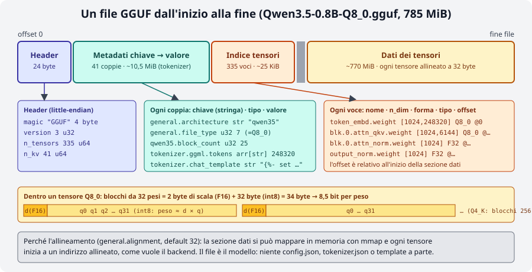
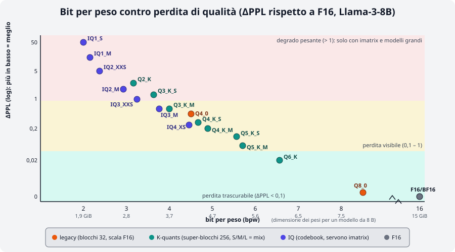
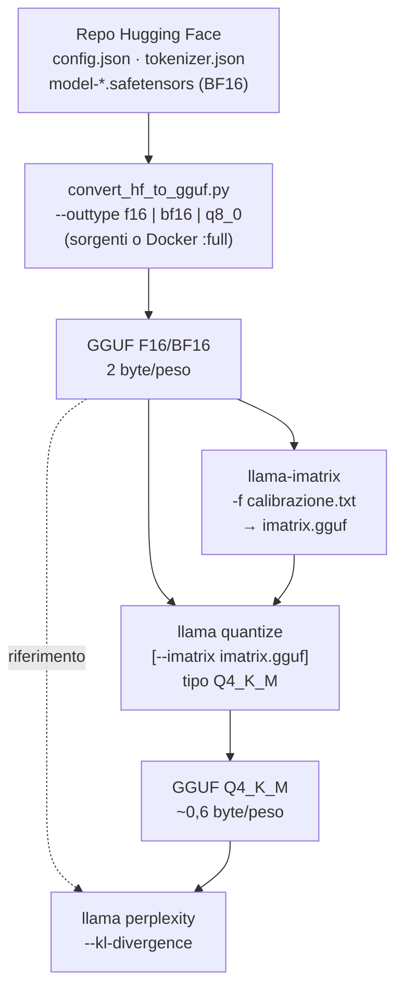

# Modulo 03: Modelli, GGUF e quantizzazione

<div class="meta" markdown>
<span class="stato stato-verificato">verificato su b11046 (conversione da sorgenti e LoRA: dalla documentazione ufficiale)</span>
</div>

Nel [modulo 00](../00-introduzione/README.md) hai visto che cos'è un GGUF e che cosa significa quantizzare;
nel [modulo 02](../02-primi-passi/README.md) hai scaricato un GGUF già pronto. Qui chiudi il cerchio: come si
**sceglie** un modello su Hugging Face leggendo la scheda, che cosa distingue davvero `Q4_K_M` da `Q4_0` da
`IQ4_XS`, e come si **produce** un GGUF partendo dai pesi originali: conversione, matrice di importanza,
quantizzazione, misura della qualità con perplexity e KL-divergence, divisione in shard e adattatori LoRA.

## Cosa imparerai

- Cercare GGUF su Hugging Face (filtri `library=gguf`, `apps=llama.cpp`) e leggere una scheda: quantizzazioni, dimensioni, licenza, imatrix.
- La struttura di un file GGUF nel dettaglio: header, metadati, indice dei tensori, dati allineati.
- Le famiglie di quantizzazione: legacy (`Q4_0`, `Q8_0`), K-quants (`Q2_K`…`Q6_K`, varianti S/M/L), `IQ*`, ternarie, `F16/BF16`.
- La pipeline `safetensors → convert_hf_to_gguf.py → GGUF F16 → llama-imatrix → llama quantize → GGUF Q4`.
- Misurare la perdita: `llama perplexity` e `--kl-divergence`.
- `llama-gguf-split` per i modelli che superano i limiti di dimensione di Hugging Face; `--lora` e `llama-export-lora`.

## 1. Trovare e leggere un modello su Hugging Face

Hugging Face è il magazzino: decine di migliaia di repository GGUF. Le ricerche utili:

| Ricerca | URL |
|---|---|
| Tutti i GGUF, i più popolari prima | `huggingface.co/models?library=gguf&sort=trending` |
| Compatibili con llama.cpp (dal filtro *Apps*) | `huggingface.co/models?apps=llama.cpp&sort=trending` |
| Di un'organizzazione | `huggingface.co/ggml-org` (ufficiali), `unsloth`, `bartowski`, `LiquidAI` |
| Per compito | `pipeline_tag=text-generation`, `sentence-similarity` (embedding), `text-ranking` (reranker) |

Da una scheda leggi, in ordine:

1. **Il modello base** (`base_model` nei metadati): chi l'ha addestrato, quanti parametri, contesto nativo, licenza.
   Il GGUF eredita la licenza del modello originale anche se la scheda del repo GGUF non la ripete.
2. **L'elenco dei file** (*Files and versions*): un file per quantizzazione (`Nome-Q4_K_M.gguf`, `…-Q8_0.gguf`),
   eventuali `mmproj-*.gguf` (proiettore multimodale), `mtp-*` o `eagle3-*` (draft per la decodifica speculativa),
   cartelle con shard `-00001-of-00003.gguf`. Le dimensioni sono lì: sono i "pesi" della formula di memoria.
3. **Come sono state fatte** le quantizzazioni: con o senza *imatrix* (§ 6), da quale precisione di partenza, con
   quale build di llama.cpp. Le schede di `bartowski` e `unsloth` riportano tabelle di dimensioni e consigli
   ("`UD-Q4_K_XL`" è una ricetta unsloth con tensori sensibili a più bit).
4. Il pulsante **Use this model → llama.cpp** genera la riga `llama cli -hf …:QUANT` (o `llama serve`).

Una scheda seria dichiara la build usata e il file di calibrazione dell'imatrix; una scheda vuota con un solo
`Q4_K_M` senza spiegazioni è un segnale per cercare altrove. In caso di dubbio, il repository `ggml-org` con lo
stesso nome è la scelta sicura.

## 2. Dentro il file: la struttura GGUF

<figure class="schema" markdown>

<figcaption>Il modello di prova letto con <code>GGUFReader</code>: 41 coppie di metadati, 335 tensori, dati che iniziano all'offset 10 962 464 (allineamento 32).</figcaption>
</figure>

Quattro sezioni, sempre nello stesso ordine:

1. **Header**: `GGUF` (4 byte), versione (3), numero di tensori, numero di coppie chiave-valore.
2. **Metadati**: coppie `chiave → valore` tipizzate (`u32`, `f32`, `str`, `arr`…). Le più pesanti sono gli array del
   tokenizer (`tokenizer.ggml.tokens`, 248 320 stringhe) e il chat template: nel modello di prova pesano circa
   10,5 MiB, tutto il resto del file sono pesi.
3. **Indice dei tensori**: per ognuno nome (`blk.0.attn_qkv.weight`), dimensioni, **tipo** (`F32`, `Q8_0`, `Q4_K`…) e
   offset dall'inizio della sezione dati. Lo stesso file mescola tipi diversi: le norm restano `F32`, gli
   embedding e l'output possono avere più bit dei blocchi interni.
4. **Dati**: i tensori uno dopo l'altro, ciascuno allineato a `general.alignment` (32 byte), così che il file si
   possa **mappare in memoria** e ogni tensore sia direttamente utilizzabile dal backend.

Il tipo di un tensore quantizzato è una struttura a **blocchi**: `Q8_0` = 32 pesi `int8` + una scala `F16`
(34 byte per 32 pesi = 8,5 bit/peso); `Q4_0` = 32 pesi a 4 bit + scala `F16` (18 byte = 4,5 bpw). Le famiglie
`K` usano **super-blocchi** da 256 pesi con scale e minimi a loro volta quantizzati (6 bit): è per questo che
`Q4_K` arriva a 4,5 bpw con qualità migliore di `Q4_0`. Gli strumenti per leggere tutto ciò (`gguf-dump`,
`GGUFReader`) sono nel [lab 00-02](../../laboratori/lab-00-02-anatomia-gguf/README.md).

## 3. Le famiglie di quantizzazione

<figure class="schema" markdown>

<figcaption>Bit per peso contro aumento di perplexity su Llama-3-8B (dati di <code>llama quantize --help</code> e di <code>tools/perplexity/README.md</code>; gli IQ sono con imatrix). Sotto i 4 bit la curva si impenna.</figcaption>
</figure>

| Famiglia | Tipi | Bit/peso | Come funziona | Quando |
|---|---|---|---|---|
| **Float** | `F32`, `F16`, `BF16` | 32 / 16 | nessuna quantizzazione; `BF16` è il formato di addestramento più comune, `F16` quello storico di llama.cpp | punto di partenza per quantizzare; inferenza solo su GPU grandi |
| **Legacy** | `Q4_0`, `Q4_1`, `Q5_0`, `Q5_1`, `Q8_0` | 4,5 / 5 / 5,5 / 6 / 8,5 | blocchi da 32, scala `F16` (`_1`: anche un minimo) | `Q8_0`: quasi lossless, il "riferimento pratico"; `Q4_0`: il più veloce su CPU ARM e con il *repacking*, e il formato dei modelli QAT di Google |
| **K-quants** | `Q2_K`, `Q3_K_S/M/L`, `Q4_K_S/M`, `Q5_K_S/M`, `Q6_K` | 3,2 → 6,6 | super-blocchi da 256, scale a 6 bit; **S/M/L** = *mix*: quanti tensori "sensibili" (attenzione V, `ffn_down`, embedding, output) vengono tenuti a più bit | `Q4_K_M` è lo standard; `Q5_K_M`/`Q6_K` se hai memoria; `Q3_K_M` per far stare un modello grande |
| **I-quants** | `IQ1_S/M`, `IQ2_XXS/XS/S/M`, `IQ3_XXS/XS/S/M`, `IQ4_XS/NL` | 1,6 → 4,7 | *codebook*: i pesi sono indici in una tabella di vettori ottimali; progettati per essere usati **con l'imatrix** (senza, la qualità crolla); un po' più lenti su CPU | `IQ4_XS` ≈ `Q4_K_S` più piccolo; `IQ2/IQ3` per modelli ≥ 30 B che altrimenti non entrano |
| **Ternari** | `TQ1_0`, `TQ2_0` | 1,7 / 2,1 | pesi in {-1, 0, +1}: solo per modelli **addestrati** ternari (BitNet, Maple 20B-A1B) | inutili su modelli normali |
| **MXFP4** | `MXFP4_MOE` | ~4,25 | microscaling FP4 a blocchi di 32: formato nativo di gpt-oss per gli esperti MoE | modelli distribuiti così |

Come si legge una sigla: `Q4_K_M` = 4 bit, famiglia K, mix *Medium*. La lettera finale non è la dimensione del
modello ma **quanti tensori restano a precisione più alta**: il log di `llama quantize` lo mostra riga per riga
(verificato sul modello di prova, `Q8_0 → Q4_K_M`):

```text
[   2/ 335] token_embd.weight      - [  1024, 248320], type = q8_0, converting to q6_K .. size = 257.66 MiB -> 198.93 MiB
[   5/ 335] blk.0.attn_qkv.weight  - [  1024,   6144], type = q8_0, converting to q6_K .. size =   6.38 MiB ->   4.92 MiB
[   6/ 335] blk.0.ffn_down.weight  - [  3584,   1024], type = q8_0, converting to q6_K .. size =   3.72 MiB ->   2.87 MiB
[   7/ 335] blk.0.ffn_gate.weight  - [  1024,   3584], type = q8_0, converting to q4_K .. size =   3.72 MiB ->   1.97 MiB
[   4/ 335] blk.0.attn_norm.weight - [  1024], type = f32, size = 0.004 MiB
llama_model_quantize_impl: model size  =   784.52 MiB (8.52 BPW)
llama_model_quantize_impl: quant size  =   506.34 MiB (5.50 BPW)
```

Embedding, `attn_qkv` e `ffn_down` a `q6_K`, il resto a `q4_K`, le norm intatte: risultato 5,50 bpw medi, non 4,5.
Su un modello da 0,8 B l'embedding da 248 320 righe pesa il 40 % del file, per questo la riduzione è "solo" del
35 %; su un 8 B lo stesso `Q4_K_M` arriva a 4,89 bpw (4,58 GiB).

Le dimensioni per un modello da 8 B secondo `llama quantize --help` (Llama-3-8B, `+ppl` = aumento di
perplexity rispetto a F16):

| Tipo | Dimensione | +ppl | Tipo | Dimensione | +ppl |
|---|---|---|---|---|---|
| `Q2_K` | 2,96 GB | +3,52 | `Q4_K_M` | 4,58 GB | +0,18 |
| `Q3_K_S` | 3,41 GB | +1,63 | `Q5_K_S` | 5,21 GB | +0,10 |
| `Q3_K_M` | 3,74 GB | +0,66 | `Q5_K_M` | 5,33 GB | +0,06 |
| `Q3_K_L` | 4,03 GB | +0,56 | `Q6_K` | 6,14 GB | +0,02 |
| `Q4_0` | 4,34 GB | +0,47 | `Q8_0` | 7,96 GB | +0,003 |
| `Q4_K_S` | 4,37 GB | +0,27 | `F16` | 14,0 GB | 0 |
| `IQ4_XS` | 4,25 bpw | (con imatrix ≈ `Q4_K_S`) | `IQ2_M` | 2,7 bpw | (solo con imatrix) |

!!! tip "Regole pratiche"
    - Sopra 4 bit (`Q4_K_M` e oltre) la perdita è piccola e spesso non misurabile in uso reale; `Q8_0` è
      indistinguibile da `F16` e serve come **riferimento** per misurare gli altri.
    - Sotto 4 bit la perdita cresce in fretta, e tanto più quanto più **piccolo** è il modello: `Q2_K` su un 0,8 B
      è inutilizzabile (lo misurerai: perplexity ×13), su un 70 B è accettabile.
    - Un modello più grande a meno bit batte quasi sempre uno più piccolo a più bit, a parità di memoria.
    - `Q4_0` non è "peggio e basta": su CPU ARM (Apple, Snapdragon, Raspberry Pi) e con il repacking x86 è il
      formato più veloce, e i modelli **QAT** (quantization-aware training, es. `gemma-3-*-qat`) sono addestrati
      apposta per non perdere nulla in `Q4_0`.

## 4. La pipeline: da Hugging Face a un GGUF quantizzato



Tre programmi, tre momenti: **convertire** (Python, una volta), **calibrare** (facoltativo ma consigliato sotto i
4 bit), **quantizzare** (C++, pochi minuti, ripetibile per ogni tipo). Poi si **misura**.

### 4.1 Convertire: `convert_hf_to_gguf.py`

Lo script vive **solo nei sorgenti** di llama.cpp (e nell'immagine Docker `full`): non è nel binario `llama` né nei
tarball. Serve Python con `torch`, `transformers`, `gguf`, `safetensors`:

```bash
git clone https://github.com/ggml-org/llama.cpp && cd llama.cpp
python3 -m venv .venv && source .venv/bin/activate
python3 -m pip install -r requirements.txt          # (1)!
python3 convert_hf_to_gguf.py --outtype f16 --outfile modello-f16.gguf ./cartella-del-modello-hf   # (2)!
python3 convert_hf_to_gguf.py --outtype bf16 --outfile gemma-4-E2B-it-bf16.gguf --remote google/gemma-4-E2B-it  # (3)!
python3 convert_hf_to_gguf.py --mmproj --outtype q8_0 --outfile mmproj-gemma-4-E2B-it-Q8_0.gguf --remote google/gemma-4-E2B-it  # (4)!
```

1. Installa torch (CPU) e tutto il resto: ~2 GB. Con `uv`: `uv pip install -r requirements.txt --index-strategy unsafe-best-match`.
   La documentazione avverte che i requisiti fissano transformers 4 ma i modelli più nuovi (Gemma 4) vogliono
   transformers 5: `pip install -U transformers` è sicuro.
2. La cartella è il clone del repo HF (`hf download org/modello --local-dir cartella`). `--outtype`: `f16`, `bf16`,
   `f32`, `q8_0`, `tq1_0`, `tq2_0`, `auto` (= la precisione originale, di solito bf16, la scelta consigliata).
3. `--remote` legge i safetensors direttamente da Hugging Face senza scaricarli tutti (serve `HF_TOKEN` per i gated).
4. `--mmproj` produce il proiettore multimodale (encoder visivo/audio + proiezione), da tenere a `q8_0` o `bf16`:
   è piccolo e la sua qualità pesa su tutto.

Lo script riconosce l'architettura da `config.json` (`architectures: ["Qwen3ForCausalLM"]`, …): se il modello è
nuovo e non supportato, l'errore è `Model … is not supported` e la soluzione è aggiornare i sorgenti (le
architetture vengono aggiunte quasi ogni settimana). Il file prodotto contiene già tokenizer, chat template e
metadati: è un GGUF completo, eseguibile con `llama cli -m`, solo grande. Novità della 0.4.1 dalle note di
rilascio: l'opzione `--fuse-qkv`, che fonde i tre tensori Q, K, V dell'attenzione in un unico `attn_qkv.weight`
(come nel modello di prova: `blk.0.attn_qkv.weight [1024, 6144]`), per moltiplicazioni di matrici più efficienti.

Senza installare nulla: lo space Hugging Face **GGUF-my-repo** converte e quantizza nel browser (segue `master`
ogni 6 ore) e pubblica il risultato in un tuo repo; l'immagine `ghcr.io/ggml-org/llama.cpp:full` contiene gli
script (`docker run -v ./modelli:/models ghcr.io/ggml-org/llama.cpp:full --all-in-one /models/ 7B` è l'esempio
della documentazione, [modulo 01](../01-installazione/README.md#5-docker)).

### 4.2 Quantizzare: `llama quantize`

```bash
llama quantize [opzioni] modello-f16.gguf [modello-Q4_K_M.gguf] TIPO [nthreads]
llama quantize modello-f16.gguf modello-Q4_K_M.gguf Q4_K_M 8
llama quantize --imatrix imatrix.gguf modello-f16.gguf modello-IQ3_M.gguf IQ3_M
llama quantize --dry-run modello-f16.gguf Q4_K_M         # solo la dimensione finale, in un secondo (verificato)
```

Il tipo si scrive in maiuscolo o minuscolo (`q4_k_m`), o come numero (`15`). Il file di uscita è facoltativo
(default `ggml-model-TIPO.gguf`). Opzioni che userai:

| Opzione | Effetto |
|---|---|
| `--imatrix f.gguf` | usa la matrice di importanza (§ 4.3); `--include-weights`/`--exclude-weights nome` per limitarla ad alcuni tensori |
| `--pure` | niente mix: **tutti** i tensori al tipo indicato (utile per esperimenti puliti) |
| `--leave-output-tensor` | non quantizza `output.weight`: file più grande, qualità un po' migliore |
| `--output-tensor-type T`, `--token-embedding-type T` | tipo esplicito per output ed embedding (`q8_0`, `q6_k`…) |
| `--tensor-type NOME=T` | regole per singoli tensori, anche con regex (`"\.(\d*[13579])\.attn_k=q5_k"`): è così che nascono le ricette `UD-*` |
| `--allow-requantize` | permette di partire da un file già quantizzato (`Q4_K_M → Q2_K`): qualità peggiore, da evitare quando hai il F16 |
| `--keep-split` | mantiene gli shard del file di ingresso |
| `--prune-layers 20,21,22`, `--override-kv` | chirurgia: rimuove strati, cambia metadati (avanzato) |
| `--max-buffer-size MiB` | limita la RAM per tensore (default 8192): per quantizzare modelli grandi su macchine piccole |

Sul modello di prova (785 MiB `Q8_0`, 3 thread) ogni quantizzazione ha richiesto 20-60 s e circa 1,5 GB di RAM di
picco: la quantizzazione **non** esegue il modello, scorre i tensori uno per uno. Partire da un file già
quantizzato è rifiutato di default (verificato: `llama_model_quantize: failed to quantize: requantizing from type
q8_0 is disabled`); con `--allow-requantize` funziona, e partire da `Q8_0` (quasi lossless) è una scorciatoia
accettabile per i laboratori. Per pubblicare un modello si parte sempre da `F16`/`BF16`.

### 4.3 La matrice di importanza: `llama-imatrix`

Quantizzare a blocchi tratta tutti i pesi allo stesso modo. Ma non tutti contano allo stesso modo: alcuni
moltiplicano attivazioni grandi, altri restano quasi inerti. La **imatrix** (importance matrix) fa girare il
modello F16 su un testo di calibrazione e registra, per ogni colonna di ogni tensore, la somma dei quadrati
delle attivazioni; `llama quantize --imatrix` la usa per scegliere scale e codici che minimizzano l'errore
**dove fa male**. L'effetto è modesto sopra i 4 bit e decisivo sotto (lo vedrai nel lab 03-03: `Q2_K` senza
imatrix perplexity 155, con imatrix 34).

`llama-imatrix` non è nel binario `llama`: è nel tarball della release (o nei sorgenti compilati).

```bash
~/llama-lab/rel/llama-b11046/llama-imatrix -m modello-f16.gguf -f calibrazione.txt -o imatrix.gguf -c 512 -ngl 99
```

```text
compute_imatrix: tokenizing the input ..
compute_imatrix: computing over 4 chunks, n_ctx=128, batch_size=2048, n_seq=16
[1]14.9594,[2]10.8089,[3]11.4033,[4]12.8878,
Final estimate: PPL = 12.8878 +/- 1.90874
```

(verificato con il modello di prova e un testo italiano di 430 parole, `-c 128`: 1,1 MB di imatrix in 20 s). Flag
utili: `-o` (default `imatrix.gguf`; con estensione `.dat` il vecchio formato binario), `--chunks N` per fermarsi
prima, `--in-file a.gguf --in-file b.gguf -o c.gguf` per **unire** matrici di corpus diversi, `--parse-special` se
il testo contiene token speciali, `--show-statistics` (con `-m`) per una tabella per tensore (`Σ(Act²)`,
`% Active`, entropia, similarità coseno con lo strato precedente). Il **testo di calibrazione** conta: deve
somigliare all'uso reale (lingua, dominio, codice se serve); i quantizzatori pubblici usano corpora misti di
qualche centinaio di KB (`calibration_datav3.txt` di bartowski, Wikitext). Con `-c` più grande e più testo la
matrice è migliore, ma la documentazione nota che oltre un certo punto (10 k → 10 M token) i guadagni sono minimi.

## 5. Misurare la qualità: perplexity e KL-divergence

La **perplexity** (PPL) misura quanto il modello è "sorpreso" da un testo: `exp` della media della log-loss
per token, più bassa è meglio. Non è confrontabile fra modelli con tokenizer diversi né fra testi diversi; è
invece perfetta per confrontare **quantizzazioni dello stesso modello sullo stesso testo**. La convenzione dei
contributori è Wikitext-2 (`scripts/get-wikitext-2.sh`), spezzato in blocchi di `-c` token.

```bash
llama perplexity -m modello.gguf -f testo.txt -c 512 -t 4
```

Risultati **verificati** sul modello di prova, testo italiano di 384 parole, `-c 128` (4 blocchi: un giocattolo
statistico, ma il segnale è chiarissimo):

| File | MiB | bpw | PPL | KLD media | Same top p |
|---|---|---|---|---|---|
| `Q8_0` (riferimento) | 784,5 | 8,52 | 11,50 ± 1,81 | 0 | 100 % |
| `Q4_K_M` | 506,3 | 5,50 | 12,50 ± 1,97 | 0,074 | 85,3 % |
| `Q4_0` | 478,8 | 5,20 | 14,66 ± 2,34 | – | – |
| `Q2_K` | 399,4 | 4,34 | 154,9 ± 30,4 | 2,36 | – |
| `Q2_K` + imatrix | 399,4 | 4,34 | 34,09 ± 6,08 | 0,83 | – |

(I bpw sono alti perché l'embedding da 248 320 righe resta a 6-8 bit e pesa quasi metà del file.)

La **KL-divergence** è più fine: confronta, token per token, l'intera distribuzione di probabilità del modello
quantizzato con quella del riferimento, non solo la loss sul token giusto. Due passaggi:

```bash
llama perplexity -m Q8_0.gguf   -f testo.txt -c 128 --kl-divergence-base base.kld              # salva i logit (125 MB per 512 token × 248 320 vocab!)
llama perplexity -m Q4_K_M.gguf -f testo.txt -c 128 --kl-divergence-base base.kld --kl-divergence
```

```text
Mean PPL(Q)                   :  12.503109 ±   1.964999
Mean PPL(base)                :  11.497455 ±   1.807024
Mean PPL(Q)/PPL(base)         :   1.087468 ±   0.026184
Mean    KLD:   0.074038 ±   0.005346
Mean    Δp: -2.055 ± 0.481 %
RMS Δp    :  7.886 ± 0.816 %
Same top p: 85.317 ± 2.234 %
```

Come leggerla: **KLD** 0 = distribuzioni identiche (per un 8 B, `Q8_0` ≈ 0,001, `Q4_K_M` ≈ 0,03, `Q2_K` ≈ 0,4);
**Δp** è la variazione di probabilità del token corretto (negativa = peggiora; se i percentili sono simmetrici la
quantizzazione aggiunge solo rumore); **Same top p** è la percentuale di token in cui i due modelli sceglierebbero
lo stesso token a temperatura 0: l'85 % di `Q4_K_M` su un 0,8 B dice che una risposta su sette **inizia** a
divergere già al primo token. Il file dei logit è enorme (11 GiB per Llama 2 su Wikitext): usalo su testi corti.

## 6. File grandi: `llama-gguf-split`

Hugging Face limita i singoli file a 50 GB: i modelli grandi sono pubblicati in **shard**
`modello-00001-of-00004.gguf`. llama.cpp li carica passando **solo il primo** (`-m …-00001-of-00004.gguf`, o
`-hf` con la quant giusta) e trova gli altri nella stessa cartella. Per produrli o riunirli c'è
`llama-gguf-split` (tarball, non binario `llama`):

```bash
~/llama-lab/rel/llama-b11046/llama-gguf-split --split --split-max-size 200M Qwen3.5-0.8B-Q4_0.gguf q4split
~/llama-lab/rel/llama-b11046/llama-gguf-split --split --split-max-tensors 128 modello.gguf out    # per numero di tensori (default)
~/llama-lab/rel/llama-b11046/llama-gguf-split --merge q4split-00001-of-00004.gguf riunito.gguf
```

Verificato: il `Q4_0` da 513 MB è diventato 4 file (11 + 209 + 199 + 94 MB: il primo contiene metadati e
tokenizer) e il merge ha ricostruito un file identico nella dimensione (335 tensori). `llama quantize
--keep-split` mantiene gli shard quantizzando.

## 7. Adattatori LoRA

Un **LoRA** è un fine-tuning "leggero": invece di riaddestrare i pesi, si addestrano due matrici piccole (A, B)
per alcuni tensori e a runtime si somma `B·A × scala`. llama.cpp li usa in due modi:

```bash
llama cli -m base-Q4_K_M.gguf --lora adattatore.gguf                    # a runtime, sul modello quantizzato
llama cli -m base.gguf --lora-scaled a.gguf:0.5,b.gguf:0.5               # più adattatori con pesi
llama serve -m base.gguf --lora a.gguf --lora b.gguf                     # nel server: GET/POST /lora-adapters per attivarli e pesarli a caldo
~/llama-lab/rel/llama-b11046/llama-export-lora -m base-f16.gguf --lora adattatore.gguf -o fuso-f16.gguf   # fonde e produce un nuovo GGUF
```

L'adattatore deve essere in formato GGUF: `convert_lora_to_gguf.py` (sorgenti) lo converte da PEFT
(`adapter_config.json` + `adapter_model.safetensors`), oppure lo space **GGUF-my-LoRA**. Applicarlo a runtime
costa un po' di velocità e funziona anche su un base quantizzato; `export-lora` va fatto sul base **F16** e poi
si quantizza il risultato, per la qualità migliore. Nessuna prova su questo VPS (nessun LoRA disponibile per il
modello di prova): comandi dalla documentazione ufficiale.

## Riepilogo

| Cosa | Come |
|---|---|
| Trovare | `huggingface.co/models?library=gguf` / `apps=llama.cpp`; scheda: base model, licenza, file, imatrix, build |
| Struttura | header → metadati (tokenizer, template) → indice tensori (tipo per tensore) → dati allineati a 32 |
| Scegliere il tipo | `Q4_K_M` standard · `Q5_K_M`/`Q6_K` se c'è memoria · `Q8_0` riferimento · `IQ*` + imatrix per i grandi · `Q4_0` su ARM e QAT |
| Convertire | sorgenti: `pip install -r requirements.txt`; `convert_hf_to_gguf.py --outtype f16\|bf16\|q8_0 [--remote] [--mmproj] [--fuse-qkv]` |
| Quantizzare | `llama quantize [--imatrix i.gguf] [--pure] in.gguf out.gguf TIPO [thread]`; `--dry-run` per la dimensione |
| Calibrare | `llama-imatrix -m f16.gguf -f testo.txt -o imatrix.gguf` (tarball) |
| Misurare | `llama perplexity -m x.gguf -f testo.txt -c 512`; `--kl-divergence-base base.kld` poi `--kl-divergence` |
| Shard | `llama-gguf-split --split --split-max-size 2G` / `--merge`; caricare il primo shard basta |
| LoRA | `--lora`, `--lora-scaled f:0.5`; `llama-export-lora` per fondere; `convert_lora_to_gguf.py` |

## Errori comuni

!!! warning "Quantizzare da un file già quantizzato"
    `Q4_K_M → Q2_K` accumula due volte l'errore, e infatti `llama quantize` rifiuta (`requantizing from type … is
    disabled`) finché non aggiungi `--allow-requantize`. Se hai solo un GGUF quantizzato e ti serve un tipo diverso,
    scarica il F16/BF16 (o riconverti da HF). Nel lab 03-02 partiamo da `Q8_0` con `--allow-requantize` solo perché
    è quasi lossless.

!!! warning "IQ2/IQ3 (o Q2_K) senza imatrix"
    Perplexity da 155 a 34 sul modello di prova: sotto i 4 bit l'imatrix non è un'ottimizzazione, è un requisito.
    E controlla che il testo di calibrazione includa la tua lingua e il tuo dominio.

!!! warning "Confrontare perplexity di modelli diversi"
    Tokenizer diversi = token diversi = numeri non confrontabili. La PPL serve per confrontare quantizzazioni
    dello **stesso** modello sullo **stesso** testo con lo **stesso** `-c`.

!!! warning "`Model … is not supported` nella conversione"
    I sorgenti sono più vecchi del modello: `git pull` (e `pip install -U transformers` se la scheda lo chiede).
    Se l'architettura è davvero nuova, cerca una issue/PR aperta nel repository.

!!! warning "Passare tutti gli shard a `-m`"
    Si passa **solo il primo** (`-00001-of-N`): gli altri vengono trovati automaticamente. E non rinominarli: il
    nome contiene l'indice.

!!! warning "`llama imatrix: command not found`"
    `imatrix`, `gguf-split`, `export-lora`, `tokenize` non sono nel binario dell'installer: prendili dal tarball
    della release ([modulo 01](../01-installazione/README.md#4-binari-precompilati-dalla-pagina-release)) o compila.

## Laboratori di questo modulo

- [Lab 03-01: Da Hugging Face a GGUF](../../laboratori/lab-03-01-conversione/README.md): convertire un modello da
  135 M di parametri in GGUF F16 con `convert_hf_to_gguf.py`, verificarlo e quantizzarlo.
- [Lab 03-02: La scala delle quantizzazioni](../../laboratori/lab-03-02-scala-quantizzazioni/README.md): tre
  quantizzazioni del modello di prova, misurate in dimensione, velocità (`llama bench`) e perplexity.
- [Lab 03-03: Quantizzazione con imatrix](../../laboratori/lab-03-03-imatrix/README.md): calcolare una imatrix su un
  testo italiano e confrontare `Q2_K` con e senza, con perplexity e KL-divergence.

## Verifica

1. Una scheda HF offre `Q4_K_S`, `Q4_K_M`, `IQ4_XS` e `Q4_0` di un 8 B. Quale scegli per un MacBook M-series, e quale per un PC x86 con 8 GB da destinare al modello?
2. Perché `Q4_K_M` sul modello di prova arriva a 5,50 bpw e non a ~4,9?
3. Cosa registra la imatrix e in quale fase viene usata?
4. Vuoi produrre `IQ3_M` di un modello di cui hai solo il `Q4_K_M`. Cosa dovresti fare, e cosa **non** dovresti fare?
5. Che differenza c'è fra ciò che misura la perplexity e ciò che misura la KL-divergence?
6. `Same top p: 85 %` per `Q4_K_M`: cosa significa in pratica per un'applicazione a `temperature 0`?
7. Hai `modello-00001-of-00003.gguf` … `-00003-of-00003.gguf`: quale comando li usa e quale li riunisce?
8. Quali strumenti di questo modulo **non** sono nel binario `llama` dell'installer?

??? success "Soluzioni"
    1. Su Apple Silicon `Q4_0` (kernel ARM ottimizzati, ottima velocità) oppure `Q4_K_M` se la qualità conta di più;
       su x86 con 8 GB `Q4_K_M` (4,6 GiB + KV cache) o `IQ4_XS` se serve spazio per più contesto.
    2. È un mix: embedding (40 % del file per un vocabolario da 248 k), `attn_qkv` e `ffn_down` restano a `q6_K`; le
       norm a `F32`. Su un 8 B l'embedding pesa poco e il mix scende a 4,9 bpw.
    3. Per ogni tensore, la somma dei quadrati delle attivazioni che lo attraversano su un testo di calibrazione.
       La usa `llama quantize --imatrix` per pesare l'errore di quantizzazione colonna per colonna.
    4. Scaricare (o riconvertire) il F16/BF16, calcolare una imatrix, quantizzare in `IQ3_M --imatrix`. Non usare
       `--allow-requantize` dal `Q4_K_M`: sommeresti due errori.
    5. La PPL guarda solo la probabilità del token corretto (un numero per testo); la KLD confronta l'intera
       distribuzione su tutto il vocabolario, token per token, rispetto al riferimento: coglie anche cambiamenti che
       non toccano il token giusto.
    6. Nel 15 % dei passi il modello quantizzato sceglierebbe un token diverso dal riferimento: le risposte
       divergono presto anche se la qualità media è simile.
    7. `llama cli -m modello-00001-of-00003.gguf` (trova gli altri da solo); `llama-gguf-split --merge modello-00001-of-00003.gguf unito.gguf`.
    8. `llama-imatrix`, `llama-gguf-split`, `llama-export-lora` (tarball/sorgenti) e `convert_hf_to_gguf.py`,
       `convert_lora_to_gguf.py` (solo sorgenti o Docker `full`).

## Riferimenti

- [tools/quantize/README.md](https://github.com/ggml-org/llama.cpp/blob/master/tools/quantize/README.md): pipeline completa, opzioni, tabelle per Llama-3.1-8B
- [tools/imatrix/README.md](https://github.com/ggml-org/llama.cpp/blob/master/tools/imatrix/README.md) e la [PR #4861](https://github.com/ggml-org/llama.cpp/pull/4861) che introduce l'imatrix
- [tools/perplexity/README.md](https://github.com/ggml-org/llama.cpp/blob/master/tools/perplexity/README.md): PPL, KLD e lo scoreboard Llama 3 8B
- [tools/gguf-split/README.md](https://github.com/ggml-org/llama.cpp/blob/master/tools/gguf-split/README.md) · [tools/export-lora/README.md](https://github.com/ggml-org/llama.cpp/blob/master/tools/export-lora/README.md)
- [docs/models.md](https://github.com/ggml-org/llama.cpp/blob/master/docs/models.md): GGUF-my-repo, GGUF-my-LoRA, GGUF-editor
- [Specifica GGUF](https://github.com/ggml-org/ggml/blob/master/docs/gguf.md) · [k-quants (PR #1684)](https://github.com/ggml-org/llama.cpp/pull/1684)
- [Hugging Face: modelli GGUF](https://huggingface.co/models?library=gguf&sort=trending) · [Modelli consigliati](../../risorse/modelli-consigliati.md)
