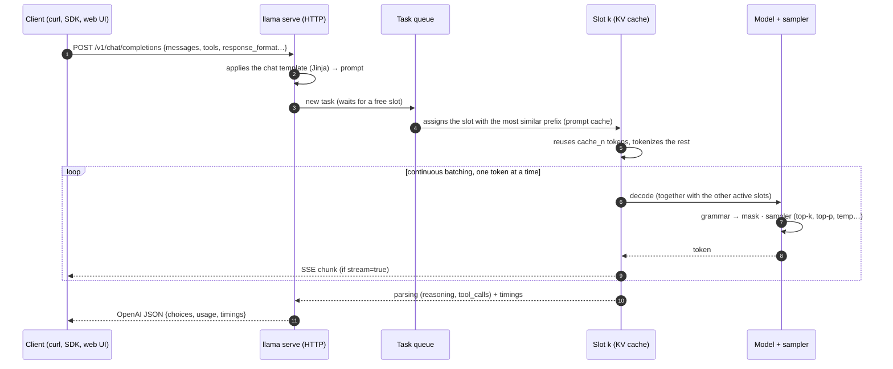
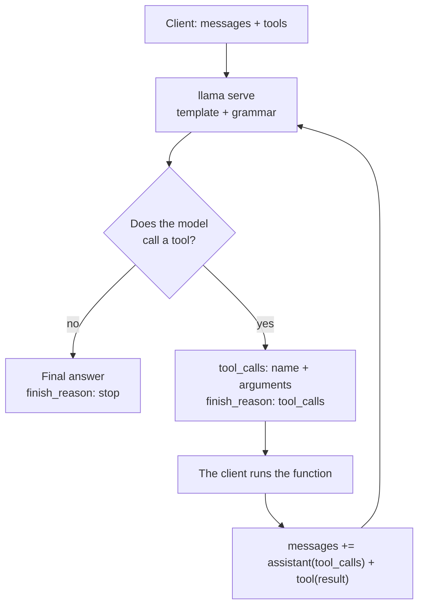

# Module 04: `llama serve`: server and API

`llama serve` (the old `llama-server`, still present in the tarballs and Docker images) turns a
GGUF model into an **HTTP service**: a web UI to chat from the browser, an OpenAI-compatible API to
point existing SDKs and applications at, an Anthropic-compatible endpoint and a set of native endpoints that
expose what the OpenAI API does not cover (tokenization, slot state, Prometheus metrics, infill).
All of it with several requests in parallel and automatic reuse of the prompt cache.

## What you will learn

- Start the server, read the startup logs and use the web UI (attachments, branching, JSON schema, `--ui-config`).
- Call `/v1/chat/completions` (also with SSE streaming), `/v1/completions`, `/v1/embeddings`, `/v1/rerank`,
  `/v1/responses`, `/v1/models` and the Anthropic endpoint `/v1/messages`.
- Use the native endpoints `/health`, `/props`, `/slots`, `/metrics`, `/tokenize`, `/detokenize`,
  `/apply-template`, `/infill`, `/completion`.
- Understand slots, `-np`, how the `-c` context is **split** among slots, `--kv-unified`, prompt cache and `cache_n`.
- Secure the server (`--api-key`, `--host`, what not to expose) and configure it with `LLAMA_ARG_*`.
- Serve several models with **router mode**, embedding and reranking, and let the model call functions (tool calling).

## 1. Starting the server

```bash
export SSL_CERT_FILE=/etc/ssl/certs/ca-certificates.crt   # installer binary on Ubuntu only (see module 01)
llama serve -hf ggml-org/Qwen3.5-0.8B-GGUF               # (1)!
llama serve -m ~/modelli/gemma-3-4b-it-Q4_K_M.gguf -c 8192 -ngl all --port 8081   # (2)!
```

1. Downloads the model (or takes it from the HF cache) and listens on `http://127.0.0.1:8080`; web UI on `/`.
2. Local file, context 8192, all layers on GPU (`-ngl` is `auto` by default), different port.

The log lines that matter, from a startup with `-c 2048 -np 2`:

```
srv    load_model: initializing, n_slots = 2, n_ctx_slot = 1024, kv_unified = 'false'
srv  llama_server: model loaded
srv  llama_server: listening on http://127.0.0.1:18103
```

Until `model loaded` the `/health` endpoint answers `503 {"error":{"code":503,"message":"Loading model",…}}`,
then `200 {"status":"ok"}`: this is the check to use in scripts and containers.

| Flag | What it does |
|---|---|
| `-hf user/repo[:quant]`, `-m file.gguf` | model from Hugging Face (cache `~/.cache/huggingface/hub`) or local |
| `-c N` | total context in tokens (`0` = the model's native one); **split among the slots** |
| `-np N` | number of slots (parallel requests); `-1` = auto (default) |
| `-ngl N|auto|all`, `-t N`, `-fa` | GPU offload, CPU threads, flash attention (as in `llama cli`) |
| `--host`, `--port` | address and port (default `127.0.0.1:8080`); `--host` can also be a `.sock` socket |
| `-a, --alias NOME` | model name reported by `/v1/models` and in responses (default: file path) |
| `--api-key K1,K2` / `--api-key-file` | requires `Authorization: Bearer K` on all endpoints except `/health` |
| `--no-webui` | API only, no interface |
| `--metrics`, `--props`, `--no-slots` | enables `/metrics`, enables `POST /props`, disables `/slots` |
| `-rea off`, `--reasoning-format`, `--chat-template-kwargs` | control of "thinking" in reasoning models |
| `--embedding`, `--rerank --pooling rank` | embedding / reranking mode |
| `--ui-config JSON`, `--ui-config-file` | default settings of the web UI |
| `--ssl-key-file`, `--ssl-cert-file` | native HTTPS (in production prefer a reverse proxy) |

!!! tip "Every flag has an environment variable"
    `llama serve --help` prints for every option the corresponding `LLAMA_ARG_*` name (`LLAMA_ARG_MODEL`,
    `LLAMA_ARG_CTX_SIZE`, `LLAMA_ARG_N_PARALLEL`, `LLAMA_ARG_PORT`, `LLAMA_ARG_HOST`, `LLAMA_ARG_ALIAS`,
    `LLAMA_ARG_ENDPOINT_METRICS`…; the API key is `LLAMA_API_KEY`). If both are present, the flag wins.
    Booleans accept `1/0`, `true/false`, `on/off`. This is the convenient way to configure Docker Compose (module 09).

## 2. The web UI

Open `http://127.0.0.1:8080` in the browser. The interface (folder `tools/ui`, Svelte framework) offers:

- **Markdown**, tables, highlighted code, **KaTeX** formulas, and an **HTML/JS preview** of generated code.
- **Reasoning**: for "thinking" models the reasoning sits in a collapsible block, separate from the answer.
- **Attachments** ("media" menu or drag and drop): images and PDFs for vision models (JPEG, PNG, GIF, WebP, SVG, PDF),
  MP3/WAV for audio models. The UI knows the model's modalities (it reads them from `/props`) and prevents attaching
  an image to a text-only model.
- **Branching**: edit an earlier message or regenerate an answer and the conversation forks; you can
  move between branches without losing anything. Search by title/content, **import/export** in JSON.
- **Structured output**: `Settings → Developer → Custom JSON` accepts an object with the `json_schema` key
  (see [module 06](../06-output-strutturato/README.md)) and every answer will follow the schema.
- **Model selector** when the server is in router mode (§ 8), with model switching even mid-conversation.
- You change sampling parameters per conversation from the settings panel.

You set the UI defaults at startup:

```bash
llama serve -hf ggml-org/Qwen3.5-0.8B-GGUF \
  --ui-config '{"theme": "dark", "pasteLongTextToFileLen": 0, "renderUserContentAsMarkdown": true}'
```

The available keys are in `tools/ui/src/lib/constants/settings-keys.ts` in the repository.

## 3. How a request travels



The chat template turns the `messages` into the prompt the model expects; you can see it without generating anything
with `/apply-template`:

```bash
curl -s http://127.0.0.1:8080/apply-template -H "Content-Type: application/json" \
  -d '{"messages":[{"role":"system","content":"Sei un assistente."},{"role":"user","content":"Ciao"}]}'
```
```json
{"prompt":"<|im_start|>system\nSei un assistente.<|im_end|>\n<|im_start|>user\nCiao<|im_end|>\n<|im_start|>assistant\n<think>\n"}
```

Notice the final `<think>`: Qwen3.5 reasons by default. To turn it off per request put
`"chat_template_kwargs": {"enable_thinking": false}` in the body; for the whole server use `-rea off`.

## 4. OpenAI-compatible API

### `/v1/chat/completions`

```bash
curl -s http://127.0.0.1:8080/v1/chat/completions -H "Content-Type: application/json" -d '{
  "messages": [{"role": "user", "content": "Qual è la capitale d'\''Italia? Rispondi in una frase."}],
  "max_tokens": 40, "temperature": 0,
  "chat_template_kwargs": {"enable_thinking": false}
}'
```

Response (b11046, `-a qwen-0.8b`):

```json
{
  "choices": [{"finish_reason": "stop", "index": 0,
               "message": {"role": "assistant", "content": "Roma è la capitale d'Italia."}}],
  "created": 1790114339, "model": "qwen-0.8b", "system_fingerprint": "b11046-60081bb2b",
  "object": "chat.completion",
  "usage": {"completion_tokens": 9, "prompt_tokens": 27, "total_tokens": 36,
            "prompt_tokens_details": {"cached_tokens": 0}},
  "id": "chatcmpl-jshj5y50FU3IjoA4PjHnsr2rxnKlXLgc",
  "timings": {"cache_n": 0, "prompt_n": 27, "prompt_ms": 2769.0, "prompt_per_second": 9.75,
              "predicted_n": 9, "predicted_ms": 1146.8, "predicted_per_second": 6.98, "…": "…"}
}
```

Besides the OpenAI fields there are `system_fingerprint` (build) and **`timings`**, specific to llama.cpp:
`prompt_per_second` and `predicted_per_second` are the prompt processing and generation speeds, `cache_n` the
prompt tokens **reused from the cache** (not reprocessed), `prompt_n` the ones actually processed. The context
occupied after the answer is `cache_n + prompt_n + predicted_n`.

In the body you can put any native `/completion` parameter (§ 5): `min_p`, `repeat_penalty`, `grammar`,
`json_schema`, `n_probs`, `id_slot`, `cache_prompt`… as well as `chat_template_kwargs`, `reasoning_effort`,
`reasoning_format`, `parallel_tool_calls`.

**Streaming**: with `"stream": true` the response is a Server-Sent Events stream, one `data: {…}` line per chunk,
closed by `data: [DONE]`. Example lines (shortened):

```
data: {"choices":[{"finish_reason":null,"index":0,"delta":{"role":"assistant","content":null}}],"created":1790114342,"id":"chatcmpl-kHR8…","model":"qwen-0.8b","object":"chat.completion.chunk"}

data: {"choices":[{"finish_reason":null,"index":0,"delta":{"content":"Roma"}}],…}

data: {"choices":[{"finish_reason":"stop","index":0,"delta":{}}],…,"timings":{"cache_n":16,"prompt_n":4,…,"predicted_n":20,"predicted_per_second":3.96}}

data: [DONE]
```

The last chunk carries `timings` (and `usage` if you ask for `"stream_options": {"include_usage": true}`); after every 30 s
of silence the server sends a `: ping` comment (`--sse-ping-interval`). "Thinking" models return the
reasoning in `message.reasoning_content` (or `delta.reasoning_content`), separate from `content`.

With the official SDK only `base_url` changes:

```python
from openai import OpenAI
client = OpenAI(base_url="http://127.0.0.1:8080/v1", api_key="no-key-required")
r = client.chat.completions.create(model="local", messages=[{"role": "user", "content": "Ciao!"}],
                                   extra_body={"chat_template_kwargs": {"enable_thinking": False}})
print(r.choices[0].message.content)
```

The `model` field is ignored in single-model mode (the alias applies), **required** in router mode.

### The other `/v1/*` endpoints

| Endpoint | Notes |
|---|---|
| `POST /v1/completions` | completion of a raw `prompt`, without chat template; `object: "text_completion"`, field `text` |
| `POST /v1/responses` | OpenAI Responses API, translated internally into chat completions (`instructions` + `input`, answer in `output[]`) |
| `POST /v1/embeddings` | requires a model with pooling and `--embedding`; otherwise `501 "This server does not support embeddings. Start it with --embeddings"` |
| `POST /v1/rerank` (aliases `/rerank`, `/reranking`) | requires a reranker started with `--rerank --pooling rank`; body `query`, `documents[]`, `top_n` |
| `GET /v1/models` | one item (the alias) with `meta` (`n_ctx_train`, `n_params`, `size`…); in router mode all models |
| `POST /v1/chat/completions/input_tokens`, `/v1/responses/input_tokens` | token count without generating |

Embedding and reranking example (from the official server documentation):

```bash
llama serve -hf unsloth/embeddinggemma-300m-GGUF --embedding --port 8080
curl http://127.0.0.1:8080/v1/embeddings -H 'Content-Type: application/json' \
  -d '{"input": ["The cat sat on the mat", "A feline rested on a rug"]}'

llama serve -hf ggml-org/Qwen3-reranker-0.6B-Q8_0-GGUF:Q8_0 --embedding --rerank --pooling rank --port 8080
curl http://127.0.0.1:8080/v1/rerank -H 'Content-Type: application/json' \
  -d '{"query": "What is panda?", "top_n": 3, "documents": ["hi", "it is a bear", "The giant panda is a bear species endemic to China."]}'
# → "results":[{"index":2,"relevance_score":0.1496},{"index":1,"relevance_score":0.0059},{"index":0,"relevance_score":0.0003}]
```

On Hugging Face you find suitable models with the filters `pipeline_tag=sentence-similarity` (embedding) and
`text-ranking` (reranker) plus `apps=llama.cpp`. Module 08 uses them for a minimal RAG.

### Anthropic endpoint: `/v1/messages`

The same server also speaks Anthropic's Messages format (`system`, required `max_tokens`, `stop_sequences`,
streaming, tool use), so SDKs and apps written for Claude can point at a local model. Key in the
`x-api-key` header (or Bearer). Response with thinking off:

```bash
curl -s http://127.0.0.1:8080/v1/messages -H "Content-Type: application/json" -H "x-api-key: nokey" -d '{
  "model": "local", "max_tokens": 30, "system": "Rispondi in italiano, in una frase.",
  "messages": [{"role": "user", "content": "Cos'\''è llama.cpp?"}],
  "chat_template_kwargs": {"enable_thinking": false}}'
```
```json
{"id":"chatcmpl-n2Wr…","type":"message","role":"assistant",
 "content":[{"type":"text","text":"llama.cpp è un framework … progettato per essere leggero e scalabile."}],
 "model":"qwen-0.8b","stop_reason":"end_turn","stop_sequence":null,
 "usage":{"cache_read_input_tokens":26,"input_tokens":6,"output_tokens":27}}
```

With thinking on, the first block is `{"type":"thinking","thinking":"…"}`. `POST /v1/messages/count_tokens`
returns `{"input_tokens": 13}` without generating.

## 5. Native endpoints

| Endpoint | What it is for |
|---|---|
| `GET /health` | `200 {"status":"ok"}` or `503` while loading; **public** even with `--api-key` |
| `GET /props` | server properties: `default_generation_settings` (slot n_ctx, default sampler), `total_slots`, `model_path`, `model_alias`, `modalities` (`vision`, `video`, `audio`), `chat_template`, `chat_template_caps` (`supports_tools`, `supports_parallel_tool_calls`…), `bos_token`/`eos_token`, `build_info`, `is_sleeping`. With `--props` it accepts `POST` |
| `GET /slots` | state of every slot (`id`, `n_ctx`, `is_processing`, and the parameters of the running task); `?fail_on_no_slot=1` → 503 if all are busy (useful to a load balancer) |
| `GET /metrics` | Prometheus metrics, only with `--metrics` (otherwise `501 not_supported_error`) |
| `POST /tokenize` / `/detokenize` | text ↔ tokens; `"with_pieces": true` shows the pieces; `add_special` for the BOS |
| `POST /apply-template` | applies the chat template and returns the `prompt`, without inference |
| `POST /completion` | native completion with all llama.cpp options: `prompt` also as a token array, `n_predict`, `n_probs`, `grammar`, `json_schema`, `id_slot`, `cache_prompt`, `lora`, `return_tokens`, `timings_per_token`, `t_max_predict_ms`; response with `content`, `stop_type` (`eos`/`limit`/`word`), `tokens_evaluated`, `tokens_cached`, `truncated`, `generation_settings`, `timings` |
| `POST /infill` | fill-in-the-middle completion for code: `input_prefix`, `input_suffix`, `input_extra` (other files), requires FIM tokens in the model |
| `POST /embedding`, `POST /embeddings` | non-OpenAI versions (also `--pooling none`, one vector per token) |
| `POST /slots/{id}?action=save|restore|erase` | saves/restores a slot's KV cache to a file (`--slot-save-path`) |
| `GET/POST /lora-adapters` | list and scales of LoRA adapters, on the fly |

Examples:

```bash
curl -s http://127.0.0.1:8080/tokenize -H "Content-Type: application/json" -d '{"content":"Ciao mondo!","with_pieces":true}'
# {"tokens":[{"id":34,"piece":"C"},{"id":21817,"piece":"iao"},{"id":67348,"piece":" mondo"},{"id":0,"piece":"!"}]}
curl -s http://127.0.0.1:8080/detokenize -H "Content-Type: application/json" -d '{"tokens":[34,21817,67348,0]}'
# {"content":"Ciao mondo!"}
curl -s http://127.0.0.1:8080/completion -H "Content-Type: application/json" \
  -d '{"prompt":"La ricetta della carbonara richiede","n_predict":16,"temperature":0}'
# {"content":" l'uso di un'olio di oliva.…","stop_type":"limit","tokens_evaluated":6,"tokens_cached":21,"truncated":false,"timings":{…}}
curl -s http://127.0.0.1:8080/metrics | grep -E "^llamacpp:(prompt_tokens_total|tokens_predicted_total|requests_processing)"
# llamacpp:prompt_tokens_total 51
# llamacpp:tokens_predicted_total 37
# llamacpp:requests_processing 0
```

The metrics also include `llamacpp:requests_deferred` (queued requests without a slot), `n_busy_slots_per_decode`
and, with speculative decoding, the counters of accepted drafts.

## 6. Slots, parallelism, context and cache

Each **slot** is an independent sequence with its own portion of KV cache: a request occupies a slot for
its whole duration. With `-np N` the server has N slots and **continuous batching** (`-cb`, on by default) advances
all active sequences together, at every `llama_decode`: aggregate throughput goes up, while the latency of the
single request rises less than you would expect (on GPU almost not at all, on CPU more because the cores
are already saturated).

<figure class="schema" markdown>

<figcaption>The <code>-c</code> context is the total: each slot gets <code>-c / -np</code>. With <code>--kv-unified</code> the slots share a single buffer.</figcaption>
</figure>

!!! warning "The context is split among the slots"
    `-c 4096 -np 2` → `n_ctx_slot = 2048`; `-c 2048 -np 2` → `n_ctx_slot = 1024`; `-c 2048 -np 4` → 512.
    A request that exceeds `n_ctx_slot` is truncated or rejected (`"truncated": true`, or the error
    *"the request exceeds the available context size"*). If you want 4 requests of 8k tokens you need `-c 32768`,
    and the KV cache costs RAM/VRAM in proportion (module 05). Alternatively `--kv-unified` (`-kvu`) uses a single
    shared buffer: the active slots share the 4096 tokens dynamically, and a long request can use
    more than its "share" as long as the total fits in the context. It is the default when `-np` is `auto`;
    `--kv-unified-per-slot N` sizes the buffer as `n_parallel × N`.

**Prompt cache** (`cache_prompt`, on by default): for every new request the server picks the slot whose
previous prompt is most similar to the new one (`--slot-prompt-similarity`, default 0.10) and reuses the common
prefix already in the KV cache: that is the `cache_n` in `timings`. In a chat the common prefix is the whole previous
conversation, so only the last message gets processed. When you repeat an identical request
`cache_n` goes from 0 to (almost) the whole prompt and `prompt_ms` collapses. Idle slots are saved to RAM
(`--cache-ram`, default 8192 MiB) so the cache survives even when the slot serves another user.

`--cache-reuse N` goes beyond the prefix: when the new prompt contains pieces already seen but shifted (typical
of code completion, where text is inserted mid-file) it reuses chunks of at least N tokens by shifting
the KV cache (*KV shifting*) instead of recomputing them. Per request: `n_cache_reuse`. Keep in mind: cache reuse
can make results not bit-for-bit identical between one call and the next (the prompt processing and
generation logits do not match exactly); for deterministic experiments use `"cache_prompt": false`.

Other slot-related flags: `--threads-http N` (HTTP threads, automatic by default), `-to` (timeout, 3600 s),
`--context-shift` (context shifting for endless generation, off by default),
`--sleep-idle-seconds N` (unloads the model after N seconds of inactivity and reloads it on the first request).

## 7. Security: keys, host and what NOT to expose

By default the server listens only on `127.0.0.1`. To reach it from another machine you need `--host 0.0.0.0`
(or the interface's IP): from then on anyone on the network can use it. Minimum rules:

- **`--api-key`**: without a key `GET /v1/models` answers `401 {"error":{"code":401,"message":"Invalid API Key","type":"authentication_error"}}`;
  `/health` stays public. Several keys separated by commas, or `--api-key-file` (one per line, `#` comments).
- On the internet always put a **reverse proxy** with TLS in front (Caddy, nginx: module 09) with rate
  limits; `--ssl-key-file/--ssl-cert-file` exist but do not replace the proxy.
- **Never expose** with `--host 0.0.0.0`: `--tools` / `--agent` (they give the model file read/write and
  shell access on the server machine), `--mcp-servers-config`/`--mcp-servers-json`, `--ui-mcp-proxy`, `--props`
  (changing properties via POST), `--slot-save-path` (writes files). The documentation marks them
  "do not enable in untrusted environments" and, when they are on, restricts CORS to `localhost`.
- `/slots` shows the prompts other users are processing: on a shared server consider `--no-slots`.
- **CORS**: by default the server reflects any `Origin` with credentials; with a web frontend on another
  domain set `--cors-origins https://tuo-frontend`, locally `--cors-origins localhost`.
- `--no-webui` if you only need the API; `--api-prefix /llm` to mount it under a path; `--path DIR` serves
  your own static files in place of the UI.

## 8. Several models with one server: router mode

Started **without a model**, `llama serve` becomes a *router* that launches a child process for every requested
model and forwards requests based on the `"model"` field (in POSTs) or `?model=` (in GETs):

```bash
llama serve                              # models from the HF cache (the ones from `llama serve -cl`)
llama serve --models-dir ./modelli       # all the .gguf files in a folder (subfolders for mmproj or shards)
llama serve --models-preset modelli.ini  # preset with per-model options
llama serve --models-max 2 --no-models-autoload -c 8192 -np 2   # (1)!
```

1. At most 2 models loaded together (default 4, `0` unlimited); no automatic loading on the first
   request; generic flags (`-c`, `-np`, `-ngl`…) are inherited by every instance.

```bash
curl -s http://127.0.0.1:8080/v1/models | jq '.data[].id'     # available names
curl -s http://127.0.0.1:8080/models | jq '.data[] | {id, status}'   # with status: unloaded/loading/loaded/sleeping
curl -s -X POST http://127.0.0.1:8080/models/load -d '{"model":"ggml-org/Qwen3.5-0.8B-GGUF"}'   # {"success":true}
curl -s -X POST http://127.0.0.1:8080/models/unload -d '{"model":"…"}'
curl -s http://127.0.0.1:8080/v1/chat/completions -H "Content-Type: application/json" \
  -d '{"model":"ggml-org/Qwen3.5-0.8B-GGUF","messages":[{"role":"user","content":"Ciao"}]}'
```

`GET /models?reload=1` rereads the sources; `GET /models/sse` sends real-time events on status changes;
`POST /models` downloads a new model and `DELETE /models` removes it from the cache. An INI preset has a
`[*]` section with the defaults and one section per model (keys = flag names without dashes, e.g. `c = 4096`,
`n-gpu-layers = 99`, `chat-template = chatml`, `load-on-startup = true`; for a file not in the cache `model = /percorso.gguf`
or `hf-repo = user/repo:Q4_K_M`). Precedence: command-line flags > model section > `[*]`. The model selector
appears in the web UI.

## 9. Tool calling

With `tools` in the body (OpenAI format: `type: "function"`, `name`, `description`, `parameters` in JSON Schema) the
server inserts the tool descriptions into the prompt through the chat template, constrains the output to the model's
call format and **parses** the answer, returning `tool_calls` instead of text. The model **does not
execute** anything: you run the function and send the result back with `role: "tool"`.



Request and response (Qwen3.5-0.8B, native Qwen/Hermes format):

```bash
curl -s http://127.0.0.1:8080/v1/chat/completions -H "Content-Type: application/json" -d '{
  "messages": [{"role":"system","content":"Usa gli strumenti quando servono."},
               {"role":"user","content":"Che tempo fa a Bologna?"}],
  "tools": [{"type":"function","function":{"name":"get_weather","description":"Restituisce il meteo attuale di una città",
             "parameters":{"type":"object","properties":{"city":{"type":"string"}},"required":["city"]}}}],
  "temperature": 0, "chat_template_kwargs": {"enable_thinking": false}}'
```
```json
{"choices":[{"finish_reason":"tool_calls","index":0,
  "message":{"role":"assistant","content":"",
   "tool_calls":[{"type":"function","function":{"name":"get_weather","arguments":"{\"city\":\"Bologna\"}"},
                  "id":"KS6PVNBorsLmJXoEUVZC1q13g2jiYdDi"}]}}], "usage":{"prompt_tokens":297,…}}
```

Note `prompt_tokens: 297` versus 27 for the same question without tools: the tool descriptions cost
tokens on every call. Second round, with the result:

```json
{"messages":[…,
  {"role":"assistant","content":"","tool_calls":[{"id":"KS6P…","type":"function","function":{"name":"get_weather","arguments":"{\"city\":\"Bologna\"}"}}]},
  {"role":"tool","tool_call_id":"KS6P…","content":"{\"city\":\"Bologna\",\"temperatura_c\":24.5,\"condizioni\":\"sereno\"}"}], "tools":[…]}
```
→ `"finish_reason":"stop"`, `"content":"A Bologna il tempo è sereno con una temperatura di 24,5°C."`.

- `tool_choice`: `"auto"` (default), `"none"`, `"required"`, or `{"type":"function","function":{"name":"…"}}`.
  With a small model like Qwen3.5-0.8B `"required"` may not force the call and `"none"` may make the raw
  `<tool_call>…` text appear in `content`: how well `tool_choice` is respected depends on the model and its template.
- `"parallel_tool_calls": true` enables several calls in the same answer (only if the template supports it:
  `chat_template_caps.supports_parallel_tool_calls` in `/props`).
- Recognized **native formats** (docs/function-calling.md): Llama 3.1/3.2/3.3, Functionary v3.1/v3.2, Hermes 2/3 and
  Qwen 2.5 (Coder too), Mistral Nemo, Firefunction v2, Command R7B, DeepSeek R1 (with the correct template), plus
  recent models (Qwen3, gpt-oss, GLM, Granite…). For the others there is the **Generic** format (in the log:
  `Chat format: Generic`), more expensive in tokens and less reliable. If the GGUF template is not "tool-aware",
  `--chat-template-file` with the right one (or `--chat-template chatml`) fixes it; check `chat_template_caps.supports_tools`.
- Avoid aggressively quantized KV caches (`-ctk q4_0`): they greatly degrade the accuracy of the calls.
- `/v1/messages` also supports `tools` and `tool_choice` (`{"type":"auto"}`, `{"type":"any"}`, `{"type":"tool","name":"…"}`).

## Summary

| Concept | Where |
|---|---|
| Startup, port, alias, key | `llama serve -hf … --port --host -a --api-key`, `LLAMA_ARG_*` variables |
| Ready? | `GET /health` → 200/503 |
| OpenAI chat | `POST /v1/chat/completions` (+`stream`, `tools`, `response_format`, `chat_template_kwargs`) |
| Speed and cache | `timings.prompt_per_second`, `predicted_per_second`, `cache_n`; `--cache-reuse` |
| Parallelism | `-np N` → N slots, context `-c/N` each; `--kv-unified`; `/slots`; `--metrics` |
| Alternative formats | `/v1/messages` (Anthropic), `/v1/responses`, native `/completion` |
| Embedding / rerank | `--embedding` + `/v1/embeddings`; `--rerank --pooling rank` + `/v1/rerank` |
| Several models | `llama serve` without a model, `--models-dir`, `--models-preset`, `--models-max`, `/models/load` |

## Common mistakes

!!! warning "The per-request context is smaller than expected"
    You set `-np 4` and long answers get truncated: each slot has `-c/4`. Raise `-c`, reduce `-np`,
    or use `--kv-unified`. The real value is in the log (`n_ctx_slot`) and in `/props` → `default_generation_settings.n_ctx`.

!!! warning "The model 'thinks' and uses up all the tokens"
    With thinking models (Qwen3.5, DeepSeek R1…) a small `max_tokens` ends up in the reasoning and `content` stays
    empty (`finish_reason: length`). Turn thinking off (`chat_template_kwargs.enable_thinking=false`, `-rea off`,
    `--reasoning-budget N`) or raise `max_tokens`.

!!! warning "`/v1/embeddings` answers 501"
    You need to start with `--embedding` and an embedding model (with pooling). The same goes for `/v1/rerank` with `--rerank --pooling rank`
    and `/metrics` with `--metrics`.

!!! warning "The `model` field is ignored… until it is not"
    With a single model you can write `model: "gpt-4"` and it works. In router mode the name must match an
    id from `/v1/models`, otherwise you get an error. Use `-a` to give stable names.

!!! warning "Server reachable by everyone"
    `--host 0.0.0.0` without `--api-key` or a proxy exposes the model (and, with `--tools`, the filesystem) to the network.

!!! warning "SSL error with `-hf` on the installer binary (Ubuntu)"
    `E get_repo_commit: error: HTTPLIB failed: SSL connection failed` → `export SSL_CERT_FILE=/etc/ssl/certs/ca-certificates.crt`.

## Labs in this module

- [Lab 04-01: Server and web UI](../../laboratori/lab-04-01-server-e-webui/README.md): startup, UI, curl on the endpoints.
- [Lab 04-02: OpenAI-compatible clients](../../laboratori/lab-04-02-client-openai/README.md): the `openai` SDK in Python and `fetch` in Node, streaming included.
- [Lab 04-03: Load and parallelism](../../laboratori/lab-04-03-parallelismo/README.md): measure latency and throughput with `-np 1/2/4`.
- [Lab 04-04: Tool calling](../../laboratori/lab-04-04-tool-calling/README.md): a weather agent with a fake function and then a real one.

## Check

1. You start with `-c 8192 -np 4`: how many context tokens does each request get? And with `--kv-unified`?
2. What does `timings.cache_n` indicate, and why is it high in the second request of a chat?
3. Which endpoint do you use in a startup script to know whether the model is loaded, and what code does it return meanwhile?
4. How do you turn off Qwen3.5's "thinking" for a single request without restarting the server?
5. Which flags must never be combined with `--host 0.0.0.0` on an untrusted network?
6. What changes in the request body when the server is in router mode?
7. In tool calling, who runs the `get_weather` function? With which `role` do you send the result back?
8. How do you get Prometheus metrics, and what is the name of the counter of generated tokens?

??? success "Solutions"
    1. 2048 tokens per slot (`n_ctx_slot = 8192/4`). With `--kv-unified` the slots share a single 8192 buffer:
       a request can use more if the other slots are free.
    2. It is the number of prompt tokens reused from the KV cache without reprocessing them. In a chat the new prompt starts
       with the whole previous conversation, already in the cache: only the last message is processed.
    3. `GET /health`: `503` with `"Loading model"` while loading, `200 {"status":"ok"}` when ready.
    4. In the body: `"chat_template_kwargs": {"enable_thinking": false}` (for the whole server: `-rea off`).
    5. `--tools`/`--agent`, `--mcp-servers-*`, `--ui-mcp-proxy`, `--props`; and in any case never without `--api-key` or a proxy.
    6. The `"model"` field becomes required and must match an id from `/v1/models` (in GETs: `?model=`).
    7. The client (your code). The result goes back in a `{"role":"tool","tool_call_id":…,"content":…}` message
       after the `assistant` message that contains the `tool_calls`.
    8. Start with `--metrics` and read `GET /metrics`; the counter is `llamacpp:tokens_predicted_total`.

## References

- [llama.app: Running a server](https://llama.app/docs/serve), [API server](https://llama.app/docs/api), [Web UI](https://llama.app/docs/webui)
- [tools/server/README.md](https://github.com/ggml-org/llama.cpp/blob/master/tools/server/README.md): complete reference of flags and endpoints
- [docs/function-calling.md](https://github.com/ggml-org/llama.cpp/blob/master/docs/function-calling.md): tool calling and supported formats
- [tools/ui/README.md](https://github.com/ggml-org/llama.cpp/blob/master/tools/ui/README.md) and the [web UI discussion](https://github.com/ggml-org/llama.cpp/discussions/16938)
- [OpenAI Chat Completions API](https://platform.openai.com/docs/api-reference/chat), [Anthropic Messages API](https://docs.anthropic.com/en/api/messages)
