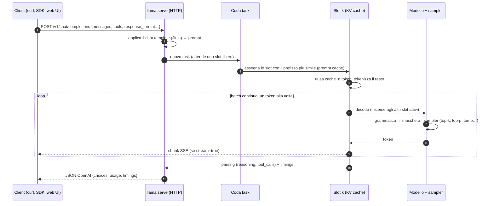
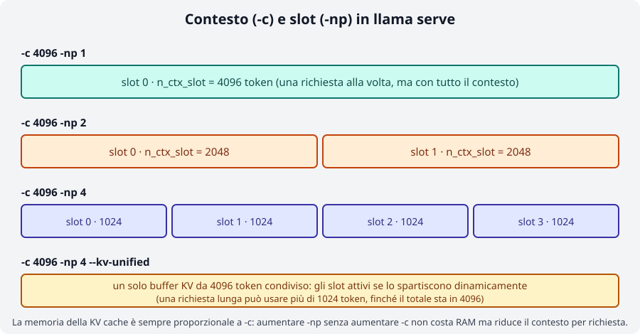
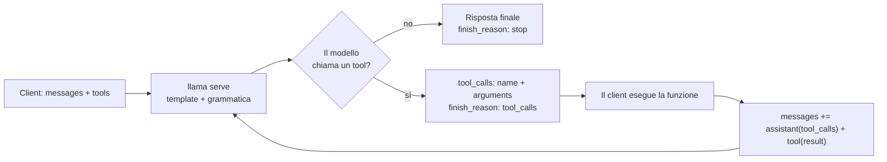

# Modulo 04: `llama serve`: server e API

<div class="meta" markdown>
<span class="stato stato-verificato">verificato su b11046</span>
</div>

`llama serve` (il vecchio `llama-server`, ancora presente nei tarball e nelle immagini Docker) trasforma un
modello GGUF in un **servizio HTTP**: una web UI per chattare dal browser, un'API compatibile OpenAI a cui
puntare SDK e applicazioni esistenti, un endpoint compatibile Anthropic e una serie di endpoint nativi che
espongono ciò che l'API OpenAI non prevede (tokenizzazione, stato degli slot, metriche Prometheus, infill).
Il tutto con più richieste in parallelo e riuso automatico della cache del prompt.

## Cosa imparerai

- Avviare il server, leggere i log di avvio e usare la web UI (allegati, branching, schema JSON, `--ui-config`).
- Chiamare `/v1/chat/completions` (anche in streaming SSE), `/v1/completions`, `/v1/embeddings`, `/v1/rerank`,
  `/v1/responses`, `/v1/models` e l'endpoint Anthropic `/v1/messages`.
- Usare gli endpoint nativi `/health`, `/props`, `/slots`, `/metrics`, `/tokenize`, `/detokenize`,
  `/apply-template`, `/infill`, `/completion`.
- Capire slot, `-np`, come il contesto `-c` si **divide** fra gli slot, `--kv-unified`, prompt cache e `cache_n`.
- Proteggere il server (`--api-key`, `--host`, cosa non esporre) e configurarlo con `LLAMA_ARG_*`.
- Servire più modelli con il **router mode**, embedding e reranking, e far chiamare funzioni al modello (tool calling).

## 1. Avviare il server

```bash
export SSL_CERT_FILE=/etc/ssl/certs/ca-certificates.crt   # solo binario installer su Ubuntu (vedi modulo 01)
llama serve -hf ggml-org/Qwen3.5-0.8B-GGUF               # (1)!
llama serve -m ~/modelli/gemma-3-4b-it-Q4_K_M.gguf -c 8192 -ngl all --port 8081   # (2)!
```

1. Scarica (o prende dalla cache HF) il modello e ascolta su `http://127.0.0.1:8080`; web UI su `/`.
2. File locale, contesto 8192, tutti i layer su GPU (`-ngl` è `auto` di default), porta diversa.

Le righe di log che contano, prese da un avvio reale con `-c 2048 -np 2`:

```
srv    load_model: initializing, n_slots = 2, n_ctx_slot = 1024, kv_unified = 'false'
srv  llama_server: model loaded
srv  llama_server: listening on http://127.0.0.1:18103
```

Fino a `model loaded` l'endpoint `/health` risponde `503 {"error":{"code":503,"message":"Loading model",…}}`,
poi `200 {"status":"ok"}`: è il controllo da usare negli script e nei container.

| Flag | Cosa fa |
|---|---|
| `-hf user/repo[:quant]`, `-m file.gguf` | modello da Hugging Face (cache `~/.cache/huggingface/hub`) o locale |
| `-c N` | contesto totale in token (`0` = quello nativo del modello); **si divide fra gli slot** |
| `-np N` | numero di slot (richieste in parallelo); `-1` = auto (default) |
| `-ngl N|auto|all`, `-t N`, `-fa` | offload su GPU, thread CPU, flash attention (come in `llama cli`) |
| `--host`, `--port` | indirizzo e porta (default `127.0.0.1:8080`); `--host` può essere anche un socket `.sock` |
| `-a, --alias NOME` | nome del modello riportato da `/v1/models` e nelle risposte (default: percorso del file) |
| `--api-key K1,K2` / `--api-key-file` | richiede `Authorization: Bearer K` su tutti gli endpoint tranne `/health` |
| `--no-webui` | solo API, niente interfaccia |
| `--metrics`, `--props`, `--no-slots` | abilita `/metrics`, abilita `POST /props`, disabilita `/slots` |
| `-rea off`, `--reasoning-format`, `--chat-template-kwargs` | controllo del "thinking" dei modelli che ragionano |
| `--embedding`, `--rerank --pooling rank` | modalità embedding / reranking |
| `--ui-config JSON`, `--ui-config-file` | impostazioni di default della web UI |
| `--ssl-key-file`, `--ssl-cert-file` | HTTPS nativo (in produzione preferisci un reverse proxy) |

!!! tip "Ogni flag ha una variabile d'ambiente"
    `llama serve --help` stampa per ogni opzione il nome `LLAMA_ARG_*` corrispondente (`LLAMA_ARG_MODEL`,
    `LLAMA_ARG_CTX_SIZE`, `LLAMA_ARG_N_PARALLEL`, `LLAMA_ARG_PORT`, `LLAMA_ARG_HOST`, `LLAMA_ARG_ALIAS`,
    `LLAMA_ARG_ENDPOINT_METRICS`…; la chiave API è `LLAMA_API_KEY`). Se sono presenti entrambi, vince il flag.
    Per i booleani valgono `1/0`, `true/false`, `on/off`. È il modo comodo di configurare Docker Compose (modulo 09).

## 2. La web UI

Apri `http://127.0.0.1:8080` nel browser. L'interfaccia (cartella `tools/ui`, framework Svelte) offre:

- **Markdown**, tabelle, codice evidenziato, formule **KaTeX**, e un'**anteprima HTML/JS** del codice generato.
- **Reasoning**: per i modelli "thinking" il ragionamento sta in un blocco ripiegabile, separato dalla risposta.
- **Allegati** (menu "media" o trascinamento): immagini e PDF per i modelli visivi (JPEG, PNG, GIF, WebP, SVG, PDF),
  MP3/WAV per quelli audio. La UI conosce le modalità del modello (le legge da `/props`) e impedisce di allegare
  un'immagine a un modello solo testo.
- **Branching**: modifica un messaggio precedente o rigenera una risposta e la conversazione si biforca; puoi
  navigare fra i rami senza perdere nulla. Ricerca per titolo/contenuto, **import/export** in JSON.
- **Output strutturato**: `Settings → Developer → Custom JSON` accetta un oggetto con la chiave `json_schema`
  (vedi [modulo 06](../06-output-strutturato/README.md)) e ogni risposta rispetterà lo schema.
- **Selettore di modelli** quando il server è in router mode (§ 8), con cambio modello anche a metà conversazione.
- I parametri di campionamento si cambiano per conversazione dal pannello impostazioni.

I default della UI si fissano all'avvio:

```bash
llama serve -hf ggml-org/Qwen3.5-0.8B-GGUF \
  --ui-config '{"theme": "dark", "pasteLongTextToFileLen": 0, "renderUserContentAsMarkdown": true}'
```

Le chiavi disponibili sono in `tools/ui/src/lib/constants/settings-keys.ts` del repository.

## 3. Come viaggia una richiesta



Il chat template trasforma i `messages` nel prompt che il modello si aspetta; puoi vederlo senza generare nulla
con `/apply-template`:

```bash
curl -s http://127.0.0.1:8080/apply-template -H "Content-Type: application/json" \
  -d '{"messages":[{"role":"system","content":"Sei un assistente."},{"role":"user","content":"Ciao"}]}'
```
```json
{"prompt":"<|im_start|>system\nSei un assistente.<|im_end|>\n<|im_start|>user\nCiao<|im_end|>\n<|im_start|>assistant\n<think>\n"}
```

Nota il `<think>` finale: Qwen3.5 ragiona di default. Per spegnerlo per richiesta metti nel body
`"chat_template_kwargs": {"enable_thinking": false}`; per tutto il server usa `-rea off`.

## 4. API compatibile OpenAI

### `/v1/chat/completions`

```bash
curl -s http://127.0.0.1:8080/v1/chat/completions -H "Content-Type: application/json" -d '{
  "messages": [{"role": "user", "content": "Qual è la capitale d'\''Italia? Rispondi in una frase."}],
  "max_tokens": 40, "temperature": 0,
  "chat_template_kwargs": {"enable_thinking": false}
}'
```

Risposta reale (b11046, `-a qwen-0.8b`):

```json
{
  "choices": [{"finish_reason": "stop", "index": 0,
               "message": {"role": "assistant", "content": "Roma è la capitale d'Italia."}}],
  "created": 1790114339, "model": "qwen-0.8b", "system_fingerprint": "b11046-60081bb2b",
  "object": "chat.completion",
  "usage": {"completion_tokens": 9, "prompt_tokens": 27, "total_tokens": 36,
            "prompt_tokens_details": {"cached_tokens": 0}},
  "id": "chatcmpl-jshj5y50FU3IjoA4PjHnsr2rxnKlXLgc",
  "timings": {"cache_n": 0, "prompt_n": 27, "prompt_ms": 2769.0, "prompt_per_second": 9.75,
              "predicted_n": 9, "predicted_ms": 1146.8, "predicted_per_second": 6.98, "…": "…"}
}
```

Oltre ai campi OpenAI ci sono `system_fingerprint` (build) e **`timings`**, specifico di llama.cpp:
`prompt_per_second` e `predicted_per_second` sono le velocità di prompt processing e generazione, `cache_n` i
token del prompt **riusati dalla cache** (non rielaborati), `prompt_n` quelli elaborati davvero. Il contesto
occupato dopo la risposta è `cache_n + prompt_n + predicted_n`.

Nel body puoi mettere qualunque parametro nativo di `/completion` (§ 5): `min_p`, `repeat_penalty`, `grammar`,
`json_schema`, `n_probs`, `id_slot`, `cache_prompt`… oltre a `chat_template_kwargs`, `reasoning_effort`,
`reasoning_format`, `parallel_tool_calls`.

**Streaming**: con `"stream": true` la risposta è un flusso Server-Sent Events, una riga `data: {…}` per chunk,
chiusa da `data: [DONE]`. Righe reali (accorciate):

```
data: {"choices":[{"finish_reason":null,"index":0,"delta":{"role":"assistant","content":null}}],"created":1790114342,"id":"chatcmpl-kHR8…","model":"qwen-0.8b","object":"chat.completion.chunk"}

data: {"choices":[{"finish_reason":null,"index":0,"delta":{"content":"Roma"}}],…}

data: {"choices":[{"finish_reason":"stop","index":0,"delta":{}}],…,"timings":{"cache_n":16,"prompt_n":4,…,"predicted_n":20,"predicted_per_second":3.96}}

data: [DONE]
```

L'ultimo chunk porta `timings` (e `usage` se chiedi `"stream_options": {"include_usage": true}`); ogni 30 s
di silenzio il server manda un commento `: ping` (`--sse-ping-interval`). I modelli "thinking" restituiscono il
ragionamento in `message.reasoning_content` (o `delta.reasoning_content`), separato da `content`.

Con l'SDK ufficiale cambia solo `base_url`:

```python
from openai import OpenAI
client = OpenAI(base_url="http://127.0.0.1:8080/v1", api_key="no-key-required")
r = client.chat.completions.create(model="local", messages=[{"role": "user", "content": "Ciao!"}],
                                   extra_body={"chat_template_kwargs": {"enable_thinking": False}})
print(r.choices[0].message.content)
```

Il campo `model` è ignorato in modalità singolo modello (vale l'alias), **obbligatorio** in router mode.

### Gli altri endpoint `/v1/*`

| Endpoint | Note |
|---|---|
| `POST /v1/completions` | completamento di un `prompt` grezzo, senza chat template; `object: "text_completion"`, campo `text` |
| `POST /v1/responses` | Responses API di OpenAI, tradotta internamente in chat completions (`instructions` + `input`, risposta in `output[]`) |
| `POST /v1/embeddings` | richiede un modello con pooling e `--embedding`; altrimenti `501 "This server does not support embeddings. Start it with --embeddings"` (verificato) |
| `POST /v1/rerank` (alias `/rerank`, `/reranking`) | richiede un reranker avviato con `--rerank --pooling rank`; body `query`, `documents[]`, `top_n` |
| `GET /v1/models` | un elemento (l'alias) con `meta` (`n_ctx_train`, `n_params`, `size`…); in router mode tutti i modelli |
| `POST /v1/chat/completions/input_tokens`, `/v1/responses/input_tokens` | conteggio dei token senza generare |

Esempio di embedding e reranking (dalla documentazione ufficiale, non provato su questo VPS per la RAM):

```bash
llama serve -hf unsloth/embeddinggemma-300m-GGUF --embedding --port 8080
curl http://127.0.0.1:8080/v1/embeddings -H 'Content-Type: application/json' \
  -d '{"input": ["The cat sat on the mat", "A feline rested on a rug"]}'

llama serve -hf ggml-org/Qwen3-reranker-0.6B-Q8_0-GGUF:Q8_0 --embedding --rerank --pooling rank --port 8080
curl http://127.0.0.1:8080/v1/rerank -H 'Content-Type: application/json' \
  -d '{"query": "What is panda?", "top_n": 3, "documents": ["hi", "it is a bear", "The giant panda is a bear species endemic to China."]}'
# → "results":[{"index":2,"relevance_score":0.1496},{"index":1,"relevance_score":0.0059},{"index":0,"relevance_score":0.0003}]
```

Su Hugging Face i modelli adatti si trovano con i filtri `pipeline_tag=sentence-similarity` (embedding) e
`text-ranking` (reranker) più `apps=llama.cpp`. Il modulo 08 li usa per un RAG minimo.

### Endpoint Anthropic: `/v1/messages`

Lo stesso server parla anche il formato Messages di Anthropic (`system`, `max_tokens` obbligatorio, `stop_sequences`,
streaming, tool use), così gli SDK e le app scritte per Claude possono puntare a un modello locale. Chiave nell'header
`x-api-key` (o Bearer). Risposta reale, thinking spento:

```bash
curl -s http://127.0.0.1:8080/v1/messages -H "Content-Type: application/json" -H "x-api-key: nokey" -d '{
  "model": "local", "max_tokens": 30, "system": "Rispondi in italiano, in una frase.",
  "messages": [{"role": "user", "content": "Cos'\''è llama.cpp?"}],
  "chat_template_kwargs": {"enable_thinking": false}}'
```
```json
{"id":"chatcmpl-n2Wr…","type":"message","role":"assistant",
 "content":[{"type":"text","text":"llama.cpp è un framework … progettato per essere leggero e scalabile."}],
 "model":"qwen-0.8b","stop_reason":"end_turn","stop_sequence":null,
 "usage":{"cache_read_input_tokens":26,"input_tokens":6,"output_tokens":27}}
```

Con il thinking acceso il primo blocco è `{"type":"thinking","thinking":"…"}`. `POST /v1/messages/count_tokens`
restituisce `{"input_tokens": 13}` senza generare.

## 5. Endpoint nativi

| Endpoint | A cosa serve |
|---|---|
| `GET /health` | `200 {"status":"ok"}` o `503` durante il caricamento; **pubblico** anche con `--api-key` |
| `GET /props` | proprietà del server: `default_generation_settings` (n_ctx dello slot, sampler di default), `total_slots`, `model_path`, `model_alias`, `modalities` (`vision`, `video`, `audio`), `chat_template`, `chat_template_caps` (`supports_tools`, `supports_parallel_tool_calls`…), `bos_token`/`eos_token`, `build_info`, `is_sleeping`. Con `--props` accetta `POST` |
| `GET /slots` | stato di ogni slot (`id`, `n_ctx`, `is_processing`, e i parametri del task in corso); `?fail_on_no_slot=1` → 503 se tutti occupati (utile a un load balancer) |
| `GET /metrics` | metriche Prometheus, solo con `--metrics` (altrimenti `501 not_supported_error`) |
| `POST /tokenize` / `/detokenize` | testo ↔ token; `"with_pieces": true` mostra i pezzi; `add_special` per il BOS |
| `POST /apply-template` | applica il chat template e restituisce il `prompt`, senza inferenza |
| `POST /completion` | completamento nativo con tutte le opzioni di llama.cpp: `prompt` anche come array di token, `n_predict`, `n_probs`, `grammar`, `json_schema`, `id_slot`, `cache_prompt`, `lora`, `return_tokens`, `timings_per_token`, `t_max_predict_ms`; risposta con `content`, `stop_type` (`eos`/`limit`/`word`), `tokens_evaluated`, `tokens_cached`, `truncated`, `generation_settings`, `timings` |
| `POST /infill` | completamento fill-in-the-middle per il codice: `input_prefix`, `input_suffix`, `input_extra` (altri file), richiede token FIM nel modello |
| `POST /embedding`, `POST /embeddings` | versioni non-OpenAI (anche `--pooling none`, un vettore per token) |
| `POST /slots/{id}?action=save|restore|erase` | salva/ripristina la KV cache di uno slot su file (`--slot-save-path`) |
| `GET/POST /lora-adapters` | elenco e scale degli adattatori LoRA a caldo |

Prove reali:

```bash
curl -s http://127.0.0.1:8080/tokenize -H "Content-Type: application/json" -d '{"content":"Ciao mondo!","with_pieces":true}'
# {"tokens":[{"id":34,"piece":"C"},{"id":21817,"piece":"iao"},{"id":67348,"piece":" mondo"},{"id":0,"piece":"!"}]}
curl -s http://127.0.0.1:8080/detokenize -H "Content-Type: application/json" -d '{"tokens":[34,21817,67348,0]}'
# {"content":"Ciao mondo!"}
curl -s http://127.0.0.1:8080/completion -H "Content-Type: application/json" \
  -d '{"prompt":"La ricetta della carbonara richiede","n_predict":16,"temperature":0}'
# {"content":" l'uso di un'olio di oliva.…","stop_type":"limit","tokens_evaluated":6,"tokens_cached":21,"truncated":false,"timings":{…}}
curl -s http://127.0.0.1:8080/metrics | grep -E "^llamacpp:(prompt_tokens_total|tokens_predicted_total|requests_processing)"
# llamacpp:prompt_tokens_total 51
# llamacpp:tokens_predicted_total 37
# llamacpp:requests_processing 0
```

Tra le metriche ci sono anche `llamacpp:requests_deferred` (richieste in coda senza slot), `n_busy_slots_per_decode`
e, con la decodifica speculativa, i contatori dei draft accettati.

## 6. Slot, parallelismo, contesto e cache

Ogni **slot** è una sequenza indipendente con la propria porzione di KV cache: una richiesta occupa uno slot per
tutta la sua durata. Con `-np N` il server ha N slot e il **batching continuo** (`-cb`, attivo di default) fa avanzare
insieme, a ogni `llama_decode`, tutte le sequenze attive: il throughput aggregato sale, mentre la latenza della
singola richiesta sale meno di quanto ci si aspetterebbe (su GPU quasi per niente, su CPU di più perché i core
sono già saturi).

<figure class="schema" markdown>

<figcaption>Il contesto <code>-c</code> è il totale: ogni slot ne riceve <code>-c / -np</code>. Con <code>--kv-unified</code> gli slot condividono un solo buffer.</figcaption>
</figure>

!!! warning "Il contesto si divide fra gli slot"
    Verificato: `-c 4096 -np 2` → `n_ctx_slot = 2048`; `-c 2048 -np 2` → `n_ctx_slot = 1024`; `-c 2048 -np 4` → 512.
    Una richiesta che supera `n_ctx_slot` viene troncata o rifiutata (`"truncated": true`, oppure errore
    *"the request exceeds the available context size"*). Se vuoi 4 richieste da 8k token ti serve `-c 32768`,
    e la KV cache costa RAM/VRAM in proporzione (modulo 05). In alternativa `--kv-unified` (`-kvu`) usa un solo
    buffer condiviso: gli slot attivi si spartiscono dinamicamente i 4096 token, e una richiesta lunga può usare
    più della sua "quota" finché il totale sta nel contesto. È il default quando `-np` è `auto`;
    `--kv-unified-per-slot N` dimensiona il buffer come `n_parallel × N`.

**Prompt cache** (`cache_prompt`, attiva di default): a ogni nuova richiesta il server sceglie lo slot il cui
prompt precedente somiglia di più a quello nuovo (`--slot-prompt-similarity`, default 0.10) e riusa il prefisso
comune già nella KV cache: è il `cache_n` nei `timings`. In una chat il prefisso comune è tutta la conversazione
precedente, quindi solo l'ultimo messaggio viene elaborato. Verificato: ripetendo una richiesta identica
`cache_n` passa da 0 a (quasi) tutto il prompt e `prompt_ms` crolla. Gli slot inattivi vengono salvati in RAM
(`--cache-ram`, default 8192 MiB) così la cache sopravvive anche quando lo slot serve un altro utente.

`--cache-reuse N` va oltre il prefisso: quando il nuovo prompt contiene pezzi già visti ma spostati (tipico
del completamento di codice, dove si inserisce testo a metà file) riusa i blocchi di almeno N token traslando
la KV cache (*KV shifting*) invece di ricalcolarli. Per richiesta: `n_cache_reuse`. Attenzione: il riuso della
cache può rendere i risultati non identici bit per bit fra una chiamata e l'altra (i logit di prompt processing
e generazione non coincidono esattamente); per esperimenti deterministici usa `"cache_prompt": false`.

Altri flag legati agli slot: `--threads-http N` (thread HTTP, default automatico), `-to` (timeout, 3600 s),
`--context-shift` (scorrimento del contesto per generazioni infinite, disattivo di default),
`--sleep-idle-seconds N` (scarica il modello dopo N secondi di inattività e lo ricarica alla prima richiesta).

## 7. Sicurezza: chiavi, host e cosa NON esporre

Di default il server ascolta solo su `127.0.0.1`. Per raggiungerlo da un'altra macchina serve `--host 0.0.0.0`
(o l'IP dell'interfaccia): da quel momento chiunque nella rete può usarlo. Regole minime:

- **`--api-key`**: verificato, senza chiave `GET /v1/models` risponde `401 {"error":{"code":401,"message":"Invalid API Key","type":"authentication_error"}}`;
  `/health` resta pubblico. Più chiavi separate da virgola o `--api-key-file` (una per riga, `#` commenti).
- Su internet metti sempre davanti un **reverse proxy** con TLS (Caddy, nginx: modulo 09) e limiti di
  velocità; `--ssl-key-file/--ssl-cert-file` esistono ma non sostituiscono il proxy.
- **Non esporre mai** con `--host 0.0.0.0`: `--tools` / `--agent` (danno al modello lettura/scrittura di file e
  shell sulla macchina del server), `--mcp-servers-config`/`--mcp-servers-json`, `--ui-mcp-proxy`, `--props`
  (modifica delle proprietà via POST), `--slot-save-path` (scrive file). La documentazione li marca
  "do not enable in untrusted environments" e, quando sono attivi, restringe CORS a `localhost`.
- `/slots` mostra i prompt in elaborazione degli altri utenti: su un server condiviso valuta `--no-slots`.
- **CORS**: di default il server riflette qualsiasi `Origin` con credenziali; con un frontend web su un altro
  dominio imposta `--cors-origins https://tuo-frontend`, in locale `--cors-origins localhost`.
- `--no-webui` se serve solo l'API; `--api-prefix /llm` per montarlo sotto un percorso; `--path DIR` serve
  file statici tuoi al posto della UI.

## 8. Più modelli con un solo server: router mode

Lanciato **senza modello**, `llama serve` diventa un *router* che avvia un processo figlio per ogni modello
richiesto e inoltra le richieste in base al campo `"model"` (nei POST) o `?model=` (nei GET):

```bash
llama serve                              # modelli dalla cache HF (quelli di `llama serve -cl`)
llama serve --models-dir ./modelli       # tutti i .gguf di una cartella (sottocartelle per mmproj o shard)
llama serve --models-preset modelli.ini  # preset con opzioni per modello
llama serve --models-max 2 --no-models-autoload -c 8192 -np 2   # (1)!
```

1. Al massimo 2 modelli caricati insieme (default 4, `0` illimitati); nessun caricamento automatico alla prima
   richiesta; i flag generici (`-c`, `-np`, `-ngl`…) sono ereditati da ogni istanza.

```bash
curl -s http://127.0.0.1:8080/v1/models | jq '.data[].id'     # nomi disponibili
curl -s http://127.0.0.1:8080/models | jq '.data[] | {id, status}'   # con stato: unloaded/loading/loaded/sleeping
curl -s -X POST http://127.0.0.1:8080/models/load -d '{"model":"ggml-org/Qwen3.5-0.8B-GGUF"}'   # {"success":true}
curl -s -X POST http://127.0.0.1:8080/models/unload -d '{"model":"…"}'
curl -s http://127.0.0.1:8080/v1/chat/completions -H "Content-Type: application/json" \
  -d '{"model":"ggml-org/Qwen3.5-0.8B-GGUF","messages":[{"role":"user","content":"Ciao"}]}'
```

`GET /models?reload=1` rilegge le sorgenti; `GET /models/sse` manda eventi in tempo reale sui cambi di stato;
`POST /models` scarica un nuovo modello e `DELETE /models` lo rimuove dalla cache. Un preset INI ha una sezione
`[*]` con i default e una sezione per modello (chiavi = nomi dei flag senza trattini, es. `c = 4096`,
`n-gpu-layers = 99`, `chat-template = chatml`, `load-on-startup = true`; per un file non in cache `model = /percorso.gguf`
o `hf-repo = user/repo:Q4_K_M`). Precedenza: flag da riga di comando > sezione del modello > `[*]`. Nella web UI
compare il selettore dei modelli.

## 9. Tool calling

Con `tools` nel body (formato OpenAI: `type: "function"`, `name`, `description`, `parameters` in JSON Schema) il
server inserisce la descrizione degli strumenti nel prompt tramite il chat template, vincola l'output al formato
di chiamata del modello e **analizza** la risposta restituendo `tool_calls` invece di testo. Il modello **non
esegue** nulla: sei tu a eseguire la funzione e a rimandare il risultato con `role: "tool"`.



Richiesta e risposta reali (Qwen3.5-0.8B, formato nativo Qwen/Hermes):

```bash
curl -s http://127.0.0.1:8080/v1/chat/completions -H "Content-Type: application/json" -d '{
  "messages": [{"role":"system","content":"Usa gli strumenti quando servono."},
               {"role":"user","content":"Che tempo fa a Bologna?"}],
  "tools": [{"type":"function","function":{"name":"get_weather","description":"Restituisce il meteo attuale di una città",
             "parameters":{"type":"object","properties":{"city":{"type":"string"}},"required":["city"]}}}],
  "temperature": 0, "chat_template_kwargs": {"enable_thinking": false}}'
```
```json
{"choices":[{"finish_reason":"tool_calls","index":0,
  "message":{"role":"assistant","content":"",
   "tool_calls":[{"type":"function","function":{"name":"get_weather","arguments":"{\"city\":\"Bologna\"}"},
                  "id":"KS6PVNBorsLmJXoEUVZC1q13g2jiYdDi"}]}}], "usage":{"prompt_tokens":297,…}}
```

Nota `prompt_tokens: 297` contro i 27 della stessa domanda senza tool: la descrizione degli strumenti costa
token a ogni chiamata. Secondo giro, con il risultato:

```json
{"messages":[…,
  {"role":"assistant","content":"","tool_calls":[{"id":"KS6P…","type":"function","function":{"name":"get_weather","arguments":"{\"city\":\"Bologna\"}"}}]},
  {"role":"tool","tool_call_id":"KS6P…","content":"{\"city\":\"Bologna\",\"temperatura_c\":24.5,\"condizioni\":\"sereno\"}"}], "tools":[…]}
```
→ `"finish_reason":"stop"`, `"content":"A Bologna il tempo è sereno con una temperatura di 24,5°C."` (verificato).

- `tool_choice`: `"auto"` (default), `"none"`, `"required"`, o `{"type":"function","function":{"name":"…"}}`.
  Con il modello da 0,8B usato qui `"required"` non ha forzato la chiamata e `"none"` ha fatto comparire il
  testo `<tool_call>…` grezzo in `content`: comportamenti da verificare con il tuo modello.
- `"parallel_tool_calls": true` abilita più chiamate nella stessa risposta (solo se il template lo supporta:
  `chat_template_caps.supports_parallel_tool_calls` in `/props`).
- **Formati nativi** riconosciuti (docs/function-calling.md): Llama 3.1/3.2/3.3, Functionary v3.1/v3.2, Hermes 2/3 e
  Qwen 2.5 (anche Coder), Mistral Nemo, Firefunction v2, Command R7B, DeepSeek R1 (con template corretto), più
  i modelli recenti (Qwen3, gpt-oss, GLM, Granite…). Per gli altri c'è il formato **Generic** (nel log:
  `Chat format: Generic`), più costoso in token e meno affidabile. Se il template del GGUF non è "tool-aware",
  `--chat-template-file` con quello giusto (o `--chat-template chatml`) risolve; controlla `chat_template_caps.supports_tools`.
- Evita KV cache quantizzate aggressive (`-ctk q4_0`): degradano molto la precisione delle chiamate.
- Anche `/v1/messages` supporta `tools` e `tool_choice` (`{"type":"auto"}`, `{"type":"any"}`, `{"type":"tool","name":"…"}`).

## Riepilogo

| Concetto | Dove |
|---|---|
| Avvio, porta, alias, chiave | `llama serve -hf … --port --host -a --api-key`, variabili `LLAMA_ARG_*` |
| Pronto? | `GET /health` → 200/503 |
| Chat OpenAI | `POST /v1/chat/completions` (+`stream`, `tools`, `response_format`, `chat_template_kwargs`) |
| Velocità e cache | `timings.prompt_per_second`, `predicted_per_second`, `cache_n`; `--cache-reuse` |
| Parallelismo | `-np N` → N slot, contesto `-c/N` ciascuno; `--kv-unified`; `/slots`; `--metrics` |
| Formati alternativi | `/v1/messages` (Anthropic), `/v1/responses`, `/completion` nativo |
| Embedding / rerank | `--embedding` + `/v1/embeddings`; `--rerank --pooling rank` + `/v1/rerank` |
| Più modelli | `llama serve` senza modello, `--models-dir`, `--models-preset`, `--models-max`, `/models/load` |

## Errori comuni

!!! warning "Il contesto per richiesta è più piccolo del previsto"
    Hai messo `-np 4` e le risposte lunghe vengono troncate: ogni slot ha `-c/4`. Alza `-c`, riduci `-np`,
    oppure usa `--kv-unified`. Il valore reale è nel log (`n_ctx_slot`) e in `/props` → `default_generation_settings.n_ctx`.

!!! warning "Il modello 'pensa' e consuma tutti i token"
    Con i modelli thinking (Qwen3.5, DeepSeek R1…) `max_tokens` piccolo finisce nel ragionamento e `content` resta
    vuoto (`finish_reason: length`). Spegni il thinking (`chat_template_kwargs.enable_thinking=false`, `-rea off`,
    `--reasoning-budget N`) o alza `max_tokens`.

!!! warning "`/v1/embeddings` risponde 501"
    Serve avviare con `--embedding` e un modello di embedding (con pooling). Idem `/v1/rerank` con `--rerank --pooling rank`
    e `/metrics` con `--metrics`.

!!! warning "Il campo `model` è ignorato… finché non lo è più"
    Con un solo modello puoi scrivere `model: "gpt-4"` e funziona. In router mode il nome deve corrispondere a un
    id di `/v1/models`, altrimenti errore. Usa `-a` per dare nomi stabili.

!!! warning "Server raggiungibile da tutti"
    `--host 0.0.0.0` senza `--api-key` né proxy espone il modello (e, con `--tools`, il filesystem) alla rete.

!!! warning "Errore SSL con `-hf` sul binario dell'installer (Ubuntu)"
    `E get_repo_commit: error: HTTPLIB failed: SSL connection failed` → `export SSL_CERT_FILE=/etc/ssl/certs/ca-certificates.crt`.

## Laboratori di questo modulo

- [Lab 04-01: Server e web UI](../../laboratori/lab-04-01-server-e-webui/README.md): avvio, UI, curl sugli endpoint.
- [Lab 04-02: Client compatibili OpenAI](../../laboratori/lab-04-02-client-openai/README.md): SDK `openai` in Python e `fetch` in Node, streaming incluso.
- [Lab 04-03: Carico e parallelismo](../../laboratori/lab-04-03-parallelismo/README.md): misurare latenza e throughput con `-np 1/2/4`.
- [Lab 04-04: Tool calling](../../laboratori/lab-04-04-tool-calling/README.md): un agente meteo con funzione finta e poi reale.

## Verifica

1. Avvii con `-c 8192 -np 4`: quanti token di contesto ha ogni richiesta? E con `--kv-unified`?
2. Che cosa indica `timings.cache_n` e perché nella seconda richiesta di una chat è alto?
3. Quale endpoint usi in uno script di avvio per sapere se il modello è caricato, e che codice restituisce nel frattempo?
4. Come spegni il "thinking" di Qwen3.5 per una sola richiesta senza riavviare il server?
5. Quali flag non vanno mai combinati con `--host 0.0.0.0` su una rete non fidata?
6. Cosa cambia nel body delle richieste quando il server è in router mode?
7. Nel tool calling, chi esegue la funzione `get_weather`? Con quale `role` rimandi il risultato?
8. Come ottieni metriche Prometheus e come si chiama il contatore dei token generati?

??? success "Soluzioni"
    1. 2048 token per slot (`n_ctx_slot = 8192/4`). Con `--kv-unified` gli slot condividono un unico buffer da 8192:
       una richiesta può usarne di più se gli altri slot sono liberi.
    2. È il numero di token del prompt riusati dalla KV cache senza rielaborarli. In una chat il nuovo prompt inizia
       con tutta la conversazione precedente, già in cache: viene elaborato solo l'ultimo messaggio.
    3. `GET /health`: `503` con `"Loading model"` durante il caricamento, `200 {"status":"ok"}` quando è pronto.
    4. Nel body: `"chat_template_kwargs": {"enable_thinking": false}` (per tutto il server: `-rea off`).
    5. `--tools`/`--agent`, `--mcp-servers-*`, `--ui-mcp-proxy`, `--props`; e comunque mai senza `--api-key` o un proxy.
    6. Il campo `"model"` diventa obbligatorio e deve corrispondere a un id di `/v1/models` (nei GET: `?model=`).
    7. Il client (il tuo codice). Il risultato torna in un messaggio `{"role":"tool","tool_call_id":…,"content":…}`
       dopo il messaggio `assistant` che contiene le `tool_calls`.
    8. Avvia con `--metrics` e leggi `GET /metrics`; il contatore è `llamacpp:tokens_predicted_total`.

## Riferimenti

- [llama.app: Running a server](https://llama.app/docs/serve), [API server](https://llama.app/docs/api), [Web UI](https://llama.app/docs/webui)
- [tools/server/README.md](https://github.com/ggml-org/llama.cpp/blob/master/tools/server/README.md): riferimento completo di flag ed endpoint
- [docs/function-calling.md](https://github.com/ggml-org/llama.cpp/blob/master/docs/function-calling.md): tool calling e formati supportati
- [tools/ui/README.md](https://github.com/ggml-org/llama.cpp/blob/master/tools/ui/README.md) e la [discussione sulla web UI](https://github.com/ggml-org/llama.cpp/discussions/16938)
- [OpenAI Chat Completions API](https://platform.openai.com/docs/api-reference/chat), [Anthropic Messages API](https://docs.anthropic.com/en/api/messages)
