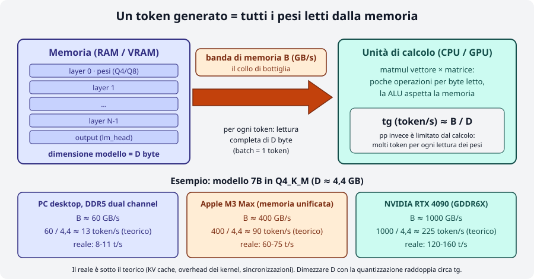
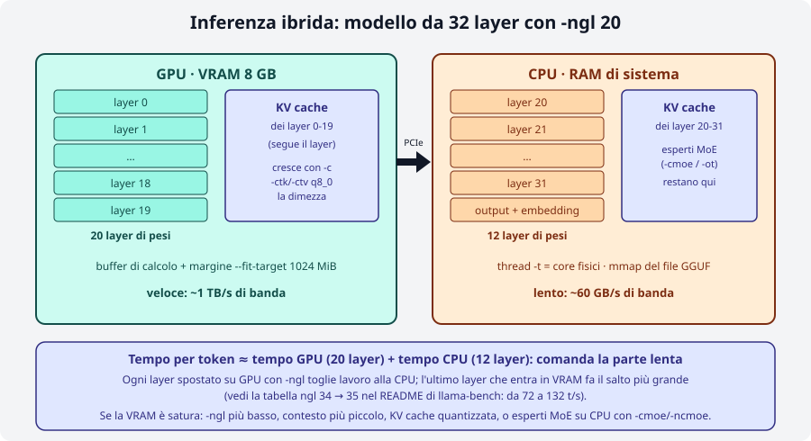
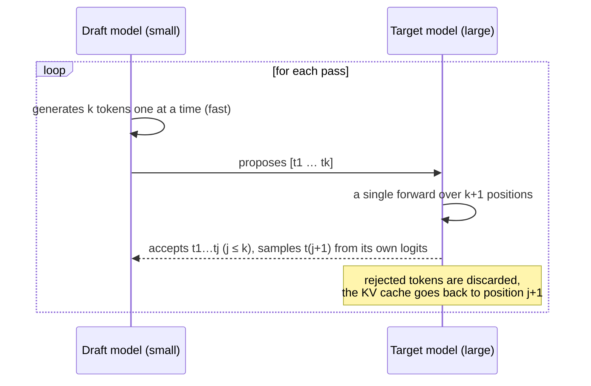
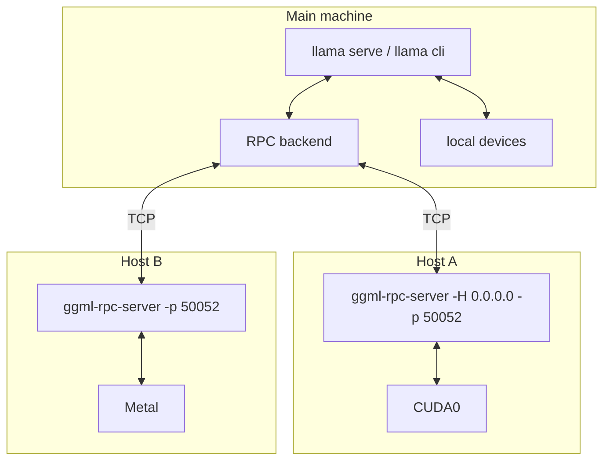

# Module 05: Performance and optimization

A model that "runs" is not enough: it has to run **fast enough** for what you use it for. In this module you learn to
measure performance reproducibly, to find **which resource is the bottleneck** (compute, memory bandwidth, VRAM,
network) and to use the levers llama.cpp gives you: threads, GPU offload, compact KV cache, speculative decoding,
multiple GPUs, multiple machines.

!!! note "Command names"
    In this course we use the single `llama` binary with subcommands (`llama bench`, `llama cli`, `llama serve`,
    `llama fit-params`). The old names `llama-bench`, `llama-cli`, `llama-server`, `llama-fit-params` still exist in the
    release tarballs and accept the same options. The RPC server is called `ggml-rpc-server` and is **not** included
    in the installer binary: it ships in the release tarball or you build it with `-DGGML_RPC=ON`.

## What you will learn

- Tell **prompt processing (pp)** from **token generation (tg)** and understand why tg is limited by memory bandwidth.
- Use `llama bench` for repeatable measurements (`-p`, `-n`, `-pg`, `-r`, `-o json|csv|md|sql`, `--progress`) and `llama batched-bench` for throughput with multiple sequences.
- Choose threads and affinity (`-t`, `-C`, `--numa`) without saturating the CPU.
- Control hybrid CPU+GPU inference: `-ngl`, `-ot`, `-cmoe`/`-ncmoe`, flash attention and quantized KV cache.
- Speed up generation with speculative decoding (`-md`, `--spec-type`).
- Spread a model across multiple GPUs (`-ts`, `-sm`, `-dev`) and multiple machines (RPC).
- Let the machine pick the parameters with `--fit` and `llama fit-params`.

## 1. pp and tg: two measurements, two bottlenecks

Every LLM response has two phases:

| Phase | What happens | Metric | Typical limit |
|---|---|---|---|
| **Prompt processing (pp)**, also called *prefill* | All prompt tokens go through the model in a single batch; the KV cache fills up | prompt tokens/s, time to first token | **compute** (FLOPS): many multiplications for each read of the weights |
| **Token generation (tg)**, also called *decode* | One token at a time: each step reads **all the weights** to produce a single token | generation tokens/s | **memory bandwidth** (GB/s) |

The second point is the key one: during generation the batch is 1 token, so for every token the processor must
read the whole model from memory, and it does very few operations with each byte it reads. The time per token is therefore
about `model size / memory bandwidth`, and the theoretical maximum speed is:

$$
\text{tg}_{\max} \approx \frac{\text{memory bandwidth (GB/s)}}{\text{model size (GB)}}
$$

<figure class="schema" markdown>

<figcaption>For every generated token all the weights are read: memory bandwidth sets the speed. With the same 4.4 GB model, a PC's DDR5 (~60 GB/s), an M3 Max's unified memory (~400 GB/s) and an RTX 4090's GDDR6X (~1 TB/s) give theoretical speeds of 13, 90 and 225 tokens/s.</figcaption>
</figure>

Three practical consequences:

1. **Quantizing speeds up generation** almost proportionally: a Q4 weighs half as much as a Q8 and is read in half the time.
2. **More cores do not help tg** beyond a certain point: once bandwidth is saturated, the extra threads just wait (you will see it in the benchmark below).
3. **The GPU wins on bandwidth**, not just on FLOPS: a card with 1 TB/s generates 10-15 times faster than a CPU with 60 GB/s, even with a small model.

For pp the opposite holds: the batch is large, there are many multiplications for each byte read, and FLOPS matter
(tensor cores, AVX-512, optimized kernels). That is why a Mac with unified memory has excellent tg but much lower
pp than a discrete GPU.

## 2. Measuring: `llama bench`

`llama bench` loads the model, runs pp and tg tests **without tokenization and sampling** (it measures only the model) and
prints a table. Each test is repeated `-r` times (default 5) and reports mean ± standard deviation.

```bash
llama bench -m Qwen3.5-0.8B-Q8_0.gguf -p 64 -n 32 -t 6 -r 2
```

Output on a 6 vCPU machine (AMD EPYC) without a GPU:

```
| model             |       size |   params | backend | threads | test |          t/s |
| qwen35 0.8B Q8_0  | 784.52 MiB | 772.85 M | CPU     |       6 | pp64 | 56.90 ± 15.86 |
| qwen35 0.8B Q8_0  | 784.52 MiB | 772.85 M | CPU     |       6 | tg32 |  4.29 ± 0.80 |
```

The essential options:

| Option | Meaning | Notes |
|---|---|---|
| `-m file.gguf` / `-hf repo[:quant]` | model (repeatable to compare several models) | |
| `-p N` | prompt processing test with N tokens (default 512) | `-p 0` to skip it |
| `-n N` | generation test of N tokens (default 128) | `-n 0` to skip it |
| `-pg PP,TG` | combined test: a PP-token prompt, then TG generated tokens | closer to real use |
| `-d N` | runs the tests with the KV cache already holding N tokens (context depth) | shows the slowdown at long context |
| `-r N` | repetitions (default 5) | `-r 1` only for quick tries |
| `-t N` | threads | |
| `-b N` / `-ub N` | logical (2048) and physical (512) batch | affect pp |
| `-ngl N`, `-fa`, `-ctk`, `-ctv`, `-sm`, `-ts`, `-dev`, `-ot`, `-ncmoe` | same options as `llama cli` | see the following sections |
| `-o md\|csv\|json\|jsonl\|sql` | output format on stdout | `-oe` does the same on stderr |
| `--progress` | prints progress on stderr | useful with large models |
| `--no-warmup`, `--delay S`, `--prio N` | skip warmup, pause between tests, process priority | |
| `--list-devices` | lists the devices seen by the backend | |

**Every parameter accepts multiple values** separated by commas (or by repeating the option), and llama bench runs all
combinations. Ranges are written `start-end`, `start-end+step` or `start-end*multiplier`:

```bash
llama bench -m m.gguf -p 0 -n 32 -t 1,2,4,8            # four thread values
llama bench -m m.gguf -n 0 -p 1024 -b 128-1024*2        # batch 128, 256, 512, 1024
llama bench -m m.gguf -ngl 0-48+8                       # ngl 0, 8, 16 … 48
```

### Output formats

`-o md` (default) produces the Markdown table, handy to paste into a report. `-o csv` and `-o json` include **all**
the test conditions (`build_commit`, `cpu_info`, `gpu_info`, `n_threads`, `type_k`, `n_gpu_layers`, `flash_attn`…) and,
in JSON, also the samples of the individual repetitions (`samples_ts`): these are the formats to use for charts. `-o sql`
generates `CREATE TABLE` + `INSERT` to feed into `sqlite3` and collect measurements over time.

```bash
llama bench -m m.gguf -t 1,2,4,6 -o json > bench.json
llama bench -m m.gguf -o sql | sqlite3 misure.db
```

In [lab 05-01](../../laboratori/lab-05-01-benchmark/README.md) the `grafico_bench.py` script reads the JSON and plots
t/s against threads.

### Throughput with multiple sequences: `llama batched-bench`

`llama bench` measures one sequence at a time. A server with several clients in parallel behaves differently:
generating B sequences together costs almost as much as one (the weights are read once for all of them), so the
total throughput grows. `llama batched-bench` measures exactly this:

```bash
llama batched-bench -m m.gguf -c 4096 -b 2048 -ub 512 -npp 128,256 -ntg 128 -npl 1,2,4,8 -ngl 99
```

The columns: `PP` and `TG` tokens per sequence, `B` parallel sequences, `N_KV` KV cache needed, `S_PP` and `S_TG`
aggregate speeds, `S` total speed. With `-pps` the prompt is shared across sequences (`N_KV = PP + B·TG`
instead of `B·(PP+TG)`). Use `--output-format jsonl` for machine-readable output. In the example table of the official README
(7B on GPU) `S_TG` goes from 41 t/s with 1 sequence to 465 t/s with 32: this is why the server uses continuous
batching (module 04).

## 3. Threads, affinity and NUMA

On the CPU the most important parameter is `-t` (generation threads; `-tb` for prompt processing, same default).
The rule from the official documentation: **number of physical cores, not logical threads**, and if generation is
extremely slow try `-t 1` and double it until it stops improving. More threads than needed **hurt** performance, because
the work is bandwidth-bound and the threads compete for the cache; when the cores are already busy with other processes
the effect is dramatic. Measurement on a 6 vCPU machine with other processes running (load average ~15):

```
llama bench -m Qwen3.5-0.8B-Q8_0.gguf -p 32 -n 16 -r 1 -t 1,2,4,6 --progress
| threads | test |   t/s |
|       1 | pp32 |  9.55 |
|       1 | tg16 |  2.82 |
|       2 | pp32 | 10.21 |
|       2 | tg16 |  3.10 |
|       4 | pp32 | 12.23 |
|       4 | tg16 |  1.20 |
|       6 | pp32 |  4.00 |
|       6 | tg16 |  0.13 |
```

With 6 threads on 6 already busy vCPUs, generation collapses to 0.13 t/s: the CPU is "oversaturated". The fix is `-t 2` or
`-t 3`, not `-t 6`. On an idle machine with free physical cores, instead, the curve rises up to the physical cores and then flattens
(see the table in the llama-bench README: from 4 t/s with 1 thread to 16.7 with 8 and no gain with 16 or 32).

Affinity options help when the operating system moves threads between cores or when you want to reserve specific cores:

| Option | Effect |
|---|---|
| `-C / --cpu-mask 0xFF` | hexadecimal mask of the cores to use (`-Cb` for the batch) |
| `-Cr / --cpu-range 0-5` | core range, alternative to the mask |
| `--cpu-strict 1` | enforces thread placement (pinning) |
| `--prio 0..3` | process priority (3 = realtime, needs root) |
| `--poll 0..100` | how long threads busy-wait: 0 reduces idle CPU usage, 100 reduces latency |

On servers with **multiple sockets** (NUMA) RAM is split into nodes, and reading the other socket's memory costs twice as much.
`--numa distribute` spreads threads across all nodes, `--numa isolate` keeps them on the starting node, `--numa numactl`
follows the map given by `numactl`. The guide recommends dropping the page cache before changing mode
(`echo 3 | sudo tee /proc/sys/vm/drop_caches`), because the memory-mapped model stays in the node where it was first
read. If `lscpu` shows `NUMA node(s): 1` the machine has a single node and the option has no effect.

## 4. GPU offload and hybrid inference

`-ngl N` (`--n-gpu-layers`) is the number of model **layers** whose weights go into VRAM and run on the GPU;
the rest stays on the CPU. Special values: `all` (or a huge number such as `999`) for the whole model, `auto` (default)
to let the *fit* function decide (section 8). Each layer's KV cache lives where the layer lives; with
`-nkvo` (`--no-kv-offload`) you keep it in RAM anyway.

<figure class="schema" markdown>

<figcaption>With `-ngl 20` on a 32-layer model, 20 layers and their KV cache sit in VRAM; 12 layers, embeddings and output stay in RAM. The time per token is the sum of the two parts: the CPU part dominates.</figcaption>
</figure>

The llama-bench README table (7B Q4_0 with 35 layers) tells the whole story: from `-ngl 10` (13 t/s) to `-ngl 30` (40 t/s) the
gain is gradual, but between `-ngl 34` (72 t/s) and `-ngl 35` (132 t/s) there is a jump: when the **whole** model is in VRAM
the CPU step disappears and the GPU works at its full bandwidth. Lesson: if you are close, it pays to free VRAM
(shorter context, quantized KV cache) to reach `all`.

How to check that the GPU is really working:

```bash
llama cli --list-devices            # lists CUDA0, Vulkan0, Metal, RPC0…; without a GPU: "(none)"
llama cli -m m.gguf -ngl all -v     # in the log: load_tensors: offloaded N/N layers to GPU and the CUDA0 buffers
```

With `-dev CUDA1` you choose the device (names from `--list-devices`); `-dev none` disables offload. For CUDA you can also use
`CUDA_VISIBLE_DEVICES`; `GGML_CUDA_ENABLE_UNIFIED_MEMORY=1` on Linux lets you exceed VRAM by using RAM (slow, but it
does not crash). `--load-mode mmap|mlock|dio` controls how the file is read (mmap is the default; `mlock` prevents swapping).

### Single tensors on CPU: `-ot`, `-cmoe`, `-ncmoe`

With **Mixture of Experts** models (Qwen3-30B-A3B, GLM-4.7-Flash, gpt-oss…) most of the weights are the FFN
*experts*, but only a few of them work on each token. Keeping the experts in RAM and everything else (attention,
norm, router) in VRAM is an excellent trade-off: the required VRAM drops sharply and speed stays good because the "hot"
tensors are on the GPU.

| Option | Effect |
|---|---|
| `-cmoe` / `--cpu-moe` | all expert weights stay on the CPU |
| `-ncmoe N` / `--n-cpu-moe N` | only the experts of the first N layers stay on the CPU (the others in VRAM) |
| `-ncffn N` / `--n-cpu-ffn N` | the same for the dense FFNs of non-MoE models |
| `-ot "regex=CPU"` / `--override-tensor` | general rule: tensors whose name matches the regex go into the given buffer |

`-ot` is the fine-grained tool: the pattern is a regex on the GGUF tensor name (module 03), the value is a buffer type
(`CPU`, `CUDA0`…). For example, experts of layers 20-47 on the CPU:

```bash
llama serve -m Qwen3-30B-A3B-Q4_K_M.gguf -ngl all -ot "blk\.(2[0-9]|3[0-9]|4[0-7])\.ffn_.*_exps=CPU"
```

This is exactly what `llama fit-params` prints when a MoE does not fit in VRAM (section 8).

## 5. Flash attention and quantized KV cache

The **KV cache** stores the attention keys and values for every token in the context; it grows linearly with `-c` and
with the number of parallel sequences (`-np`). In f16 it takes `2 × n_layer × n_kv_head × head_dim × 2 bytes` per token:
for a 32-layer model with 8 KV heads of 128 that is 128 KiB per token, that is **1 GiB every 8,192 tokens** of context.

Two levers:

- **Flash attention** (`-fa on|off|auto`, default `auto`): computes attention in blocks without materializing the score
  matrix. Less compute memory and more speed with long contexts; it is supported on almost all backends and
  `auto` turns it on when it can. It is **required** for a quantized V cache and for `-sm tensor`.
- **Quantized KV cache** (`-ctk`, `-ctv`): allowed types `f32, f16, bf16, q8_0, q4_0, q4_1, iq4_nl, q5_0, q5_1`.
  `q8_0` halves the cache with an imperceptible quality loss; `q4_0` cuts it to a quarter but can degrade
  answers with long contexts. The speculative draft model has its own options `-ctkd`/`-ctvd`.

```bash
llama serve -m m.gguf -c 32768 -fa on -ctk q8_0 -ctv q8_0
```

!!! tip "When it pays off"
    If `-ngl all` just barely does not fit, `-ctk q8_0 -ctv q8_0` is the first thing to try: it frees VRAM without touching the weights.
    If VRAM is enough, keep `f16`: the quantized cache costs a bit of extra compute.

## 6. Speculative decoding

Generation is serial and bandwidth-bound: the GPU reads 4 GB of weights to produce one token and stays mostly
idle. **Speculative decoding** exploits this headroom: a small, fast **draft** model
proposes `k` tokens in sequence; the **target** model verifies them **all together in a single pass** (a batch of
k+1 tokens costs almost as much as a single token). The tokens the target would have chosen anyway are accepted; at the
first rejection the rest is discarded and the process restarts. The result is **identical** to the target alone (the
sampled distribution does not change), but with 2-3 tokens accepted per pass the speed doubles or triples.



The options (identical for `llama cli` and `llama serve`):

| Option | Meaning |
|---|---|
| `-md file.gguf` / `--hf-repo-draft repo[:quant]` (`-hfd`) | local or Hugging Face draft model |
| `--spec-type TIPO[,TIPO]` | algorithm: `none` (default), `draft-simple`, `draft-mtp`, `draft-eagle3`, `draft-dflash`, `draft-dspark`, or without a draft model `ngram-simple`, `ngram-map-k`, `ngram-map-k4v`, `ngram-mod`, `ngram-cache` |
| `--spec-draft-n-max N` | how many tokens the draft proposes per pass (default 3) |
| `--spec-draft-n-min N` | below this number no speculation is attempted (default 0) |
| `--spec-draft-p-min P` | minimum draft probability to propose a token (default 0) |
| `-ngld`, `-devd`, `-td`, `-ctkd/-ctvd` | offload, device, threads and KV cache **of the draft** |
| `--spec-default` | the model's default speculative configuration, if it has one |

!!! warning "Removed flags"
    `--draft-max`, `--draft-min` and `--draft` **no longer exist** in 0.4.1: the help prints "the argument has been removed".
    Use `--spec-draft-n-max` / `--spec-draft-n-min` (or `--spec-ngram-mod-n-max/min` for the n-gram methods).

The main types:

- **`draft-simple`**: a second GGUF with the **same vocabulary** as the target (same family). The classic pair is
  Qwen2.5-Coder 7B + 0.5B, so popular that the server has the shortcut `--fim-qwen-7b-spec`:
  ```bash
  llama cli -hf ggml-org/Qwen2.5-Coder-7B-Q8_0-GGUF -hfd ggml-org/Qwen2.5-Coder-0.5B-Q8_0-GGUF --spec-type draft-simple -ngl all
  ```
- **`draft-mtp`** (*multi-token prediction*): the draft is an extra head trained together with the model and shipped
  as a small GGUF in the same repository (for Gemma 4 E4B the file `mtp-gemma-4-E4B-it-Q4_0.gguf` weighs 57 MB). It is
  the official llama.app example:
  ```bash
  llama serve -hf ggml-org/gemma-4-e4b-it-GGUF:Q4_0 --hf-repo-draft ggml-org/gemma-4-e4b-it-GGUF:Q4_0 --spec-type draft-mtp
  ```
- **`draft-eagle3`**, **`draft-dflash`**: specialized drafts (EAGLE-3, DFlash) provided for some models; same syntax.
- **`ngram-*`**: no draft model; the proposal comes from tokens already seen in the context. It costs nothing and helps when
  the text repeats (code rewriting, summaries with quotes), and does nothing otherwise. You enable it with
  `llama cli … --spec-type ngram-simple` and it works without extra files, even on the CPU.

!!! note "When it really pays off"
    Speculative decoding pays off when the target is **much** slower than the draft (ratio 10-20×) and the text is predictable
    (code, JSON, technical text). With a small target or on the CPU, where the target already uses all the bandwidth, the gain
    is small or negative: the draft steals bandwidth. With high temperature or creative text, acceptance drops. Always measure
    before and after, as in [lab 05-03](../../laboratori/lab-05-03-speculativa/README.md).

## 7. Multiple GPUs and distributed inference

### Multi-GPU (same machine)

When a model does not fit in one GPU, or you want more throughput, llama.cpp spreads the layers across all visible GPUs.
The modes (`-sm`, `--split-mode`) from the official guide `docs/multi-gpu.md`:

| Mode | What it does | When |
|---|---|---|
| `layer` (**default**) | *pipeline parallel*: each GPU holds a contiguous slice of layers with their KV cache | most compatible choice; tolerates slow interconnects; great for prefill |
| `tensor` (**experimental**) | *tensor parallel*: each layer is split across GPUs, with reductions between GPUs at every layer | faster generation with NVLink/fast PCIe and the CUDA backend; requires `-fa on` and a non-quantized KV cache; `--fit` not supported |
| `row` | old row-wise tensor parallel | deprecated, avoid |
| `none` | a single GPU, chosen with `-mg` | isolate the model on one card |

```bash
llama serve -m grande.gguf                    # pipeline across all GPUs, split proportional to memory
llama serve -m grande.gguf -ts 3,1            # 75% on GPU 0, 25% on GPU 1 (order of --device)
llama serve -m grande.gguf -dev CUDA1         # only the second card
llama serve -m grande.gguf -sm tensor -fa on -ctk f16 -ctv f16 -c 8192
```

Useful environment variables with CUDA (`docs/build.md`): `CUDA_VISIBLE_DEVICES` to hide cards, `GGML_CUDA_P2P=1`
for direct GPU-to-GPU transfer (needs suitable drivers, can crash with IOMMU enabled),
`CUDA_SCALE_LAUNCH_QUEUES=4x` to queue more work in pipeline parallel, `GGML_CUDA_CUBLAS_COMPUTE_TYPE=f16|f32`.
In `tensor` mode llama.cpp uses NCCL if built with `-DGGML_CUDA_NCCL=ON` (default): if it is missing, the log warns
"NCCL is unavailable, multi GPU performance will be suboptimal".

### RPC: multiple machines

The **RPC** backend exposes another machine's devices as if they were local: each remote host runs
`ggml-rpc-server`, and the main process (`llama cli`/`llama serve`) reaches it with `--rpc host:port`.
Weights and KV cache are distributed between local and remote devices in proportion to free memory
(adjustable with `-ts`).



```bash
# on the remote host (from the release tarball or from a build with -DGGML_RPC=ON)
ggml-rpc-server -H 0.0.0.0 -p 50052            # -t N threads for the CPU device, -d CUDA0 to choose devices, -c local cache
# on the main machine
llama-cli -m m.gguf -ngl all --rpc 192.168.1.10:50052,192.168.1.11:50052
```

A local example, with server and client on the same machine and the CPU backend:

```
$ ggml-rpc-server -H 127.0.0.1 -p 50052 -t 3
Starting RPC server v7.0.0
  endpoint       : 127.0.0.1:50052
Devices:
  CPU: AMD EPYC Processor (with IBPB) (11960 MiB, 11960 MiB free)
$ llama-cli --rpc 127.0.0.1:50052 --list-devices
Available devices:
  RPC0: 127.0.0.1:50052 (11960 MiB, 11960 MiB free)
```

!!! danger "Security: no authentication"
    The official README is explicit: the RPC backend is a *proof of concept*, **fragile and insecure**. Anyone who reaches
    the port can load tensors and run computations on your GPU. Use it **only on a trusted network** (isolated LAN,
    a VPN such as WireGuard, an SSH tunnel), never exposed to the Internet, and shut it down when you do not need it.

Useful details: `-c` on the server enables a local cache of large tensors in `~/.cache/llama.cpp/rpc` (or `LLAMA_CACHE`)
so the model is not transferred again at every start; `GGML_RPC_DEBUG=1` prints debug messages; on RoCE NICs or
Thunderbolt 5 (macOS 26.2+) the transport negotiates RDMA automatically (`GGML_RPC_NO_RDMA=1` to force TCP).
The `llama` installer binary does **not** include the RPC backend (`--rpc` does not appear in its `--help`): you need the
tarball binaries or a build with `-DGGML_RPC=ON`. Performance depends on the network: at 1 Gbit/s generation
over RPC is much slower than locally; it only makes sense when the model would not fit anywhere otherwise.

## 8. Let the machine decide: `--fit` and `llama fit-params`

Since 2026 all binaries have `--fit on` by default: before loading, `llama_params_fit` estimates the memory needed
(weights, KV cache, compute buffers) and **adjusts the parameters you have not set** (`-ngl`, `-c`, `-ot` for MoE
experts) so as to leave free headroom on every device (`--fit-target`, default 1024 MiB;
`--fit-ctx` is the minimum acceptable context, default 4096). If you pass a parameter yourself, it is left untouched.

`llama fit-params` does the same calculation and **prints the arguments** instead of starting the model, so you can save and
reuse them:

```bash
llama fit-params -m modello.gguf | tee args.txt
cat args.txt | xargs llama serve -m modello.gguf
```

The official README example (Qwen3-30B-A3B f16, 62 GB, on a 24 GB RTX 4090) produces
`-c 4096 -ngl 48 -ot blk\.14\.ffn_(up|down|gate)_(ch|)exps=CPU,…`: reduced context, all layers in VRAM but the experts
of layers 14-47 on the CPU. On a machine without a GPU the output is simply `-c 262144 -ngl -1` (the model's full
context, no offload). The log of the fit phase is readable at every start:

```
llama_params_fit_impl: projected to use 61807 MiB of device memory vs. 24077 MiB of free device memory
llama_params_fit_impl: context size reduced from 40960 to 4096 -> need 3456 MiB less memory in total
llama_params_fit: successfully fit params to free device memory
```

`-fitp on` (`--fit-print`) prints the memory estimate; `--fit off` disables everything (required with `-sm tensor`).
On exit, `llama_memory_breakdown_print` summarizes per device the total and free memory, weights, context and compute:
it is the table to look at when something does not fit.

## Options summary

| Lever | Options | Main effect |
|---|---|---|
| Measurement | `llama bench -p -n -pg -d -r -o`, `llama batched-bench -npp -ntg -npl` | reproducible pp/tg, multi-sequence throughput |
| CPU | `-t`, `-tb`, `-C`, `-Cr`, `--cpu-strict`, `--prio`, `--poll`, `--numa` | threads = physical cores, affinity, NUMA |
| GPU | `-ngl N\|auto\|all`, `-dev`, `--list-devices`, `-nkvo`, `--load-mode` | which layers go in VRAM |
| MoE / tensors | `-cmoe`, `-ncmoe N`, `-ncffn N`, `-ot regex=CPU` | experts in RAM, the rest in VRAM |
| Attention memory | `-fa on\|off\|auto`, `-ctk`, `-ctv`, `-c`, `-np` | smaller KV cache |
| Speculative | `-md`, `-hfd`, `--spec-type`, `--spec-draft-n-max/min`, `-ngld`, `-devd` | 1.5-3× in generation |
| Multi-GPU | `-sm layer\|tensor\|none`, `-ts`, `-mg`, `CUDA_VISIBLE_DEVICES`, `GGML_CUDA_P2P` | model split across cards |
| Distributed | `ggml-rpc-server -H -p -t -d -c`, `--rpc host:port` | devices on other machines |
| Automatic | `--fit`, `--fit-target`, `--fit-ctx`, `llama fit-params` | parameters adapted to memory |

## Common mistakes

!!! warning "Benchmarking on a busy machine"
    A browser, an IDE, other loaded models or other processes on the same CPU make measurements useless (huge standard
    deviations, like the ±15 t/s seen above). Close everything, use `-r 5` or more, repeat at different times and report the deviation.

!!! warning "Too many threads"
    `-t` equal to the logical threads (SMT) or higher than the free cores makes generation collapse. Start from the physical cores; if
    the computer is doing other things, subtract one or two. With a GPU, `-t` only matters for the layers left on the CPU.

!!! warning "\"GPU not used\""
    `--list-devices` printing `(none)` means the binary lacks the right backend (installer without CUDA, CPU
    tarball) or that `CUDA_VISIBLE_DEVICES` hides the cards. `-ngl 0` disables offload. Check the loading log.

!!! warning "Out of memory after a few minutes"
    The KV cache grows with the context and with `-np`: a server with `-c 32768 -np 4` allocates 4 slots of 8,192 tokens *or*,
    with `--kv-unified`, a single shared cache. Reduce `-c`, quantize the cache or lower `-ngl` (in that order).

!!! warning "`-sm tensor` that does not start"
    Messages such as "SPLIT_MODE_TENSOR requires flash_attn to be enabled" or "simultaneous use of SPLIT_MODE_TENSOR and KV
    cache quantization not implemented" call for `-fa on -ctk f16 -ctv f16`; "not implemented for architecture" means
    that the model (many MoE and Mamba hybrids) is not supported: go back to `-sm layer`.

!!! warning "Speculative decoding slower than the model alone"
    Different vocabularies between draft and target (error at startup or acceptance ~0), a draft that is too large, a target on the CPU, creative
    text with high temperature. Check the acceptance rate in the log and compare t/s with and without `-md`.

## Labs in this module

- [Lab 05-01 · Reproducible benchmarks](../../laboratori/lab-05-01-benchmark/README.md): pp/tg with `llama bench` across threads and quantizations; chart with `grafico_bench.py`.
- [Lab 05-02 · Hybrid CPU+GPU offload](../../laboratori/lab-05-02-offload-ibrido/README.md): find the optimal `-ngl` for a model larger than VRAM; quantized KV cache; MoE with `-ncmoe`.
- [Lab 05-03 · Speculative decoding](../../laboratori/lab-05-03-speculativa/README.md): measure the speedup with a draft model on text and on code.
- [Lab 05-04 · RPC cluster](../../laboratori/lab-05-04-rpc/README.md): spread a model across two machines (or two containers) with `ggml-rpc-server`.

## Review questions

1. Why does doubling the CPU cores (roughly) double pp but not tg?
2. A 4.4 GB Q4_K_M model on a machine with 80 GB/s of bandwidth: what is the theoretical limit in tokens/s for generation?
3. What does `-pg 512,128` measure that `-p 512 -n 128` does not?
4. Which `llama bench` option prepares the KV cache with 4096 tokens before measuring, and what is it for?
5. You have an 8 GB GPU and an 18 GB MoE model. Which two options do you try, in order, before lowering `-ngl`?
6. Why does `-ctv q8_0` require flash attention?
7. With speculative decoding, does the generated text change compared with the target model alone?
8. Why must you never start `ggml-rpc-server -H 0.0.0.0` on a machine reachable from the Internet?

??? success "Solutions"
    1. pp processes many tokens for each read of the weights and is compute-bound, which scales with cores; tg reads all the
       weights for every single token and is bound by memory bandwidth, which does not change when you add cores.
    2. 80 / 4.4 ≈ 18 tokens/s; in practice 12-15.
    3. Real behavior: generation **with the KV cache already filled** by the prompt (and with the prompt just processed),
       instead of two separate tests with an empty cache.
    4. `-d 4096` (`--n-depth`): it shows how much pp and tg slow down at long context, when attention has to read a large KV
       cache.
    5. `-cmoe` (or `-ncmoe N` / `-ot` on the experts) to keep the experts in RAM, then `-ctk q8_0 -ctv q8_0` (with `-fa on`)
       to shrink the KV cache; a lower `-ngl` only as a last resort. `llama fit-params` suggests the combination.
    6. Only the flash attention kernel can read quantized V values; classic attention works on V in f16/f32.
    7. No: proposed tokens are accepted only if they match the target's choice, otherwise the target samples its
       own; the distribution is the same, only the speed changes.
    8. There is no authentication or encryption: anyone can send compute graphs and occupy (or attack) the machine.
       Trusted network, VPN or tunnel only.

## References

- [tools/llama-bench/README.md](https://github.com/ggml-org/llama.cpp/blob/master/tools/llama-bench/README.md) and [tools/batched-bench/README.md](https://github.com/ggml-org/llama.cpp/blob/master/tools/batched-bench/README.md)
- [docs/multi-gpu.md](https://github.com/ggml-org/llama.cpp/blob/master/docs/multi-gpu.md): split modes, NCCL, P2P, troubleshooting
- [docs/development/token_generation_performance_tips.md](https://github.com/ggml-org/llama.cpp/blob/master/docs/development/token_generation_performance_tips.md): threads and offload
- [tools/rpc/README.md](https://github.com/ggml-org/llama.cpp/blob/master/tools/rpc/README.md): `ggml-rpc-server`, cache, RDMA
- [tools/fit-params/README.md](https://github.com/ggml-org/llama.cpp/blob/master/tools/fit-params/README.md)
- [docs/build.md](https://github.com/ggml-org/llama.cpp/blob/master/docs/build.md#cuda): CUDA runtime environment variables
- [llama.app/docs/cli](https://llama.app/docs/cli) and [llama.app/docs/serve](https://llama.app/docs/serve): speculative decoding
- Course glossary: [pp/tg, KV cache, offload](../../risorse/glossario.md)
