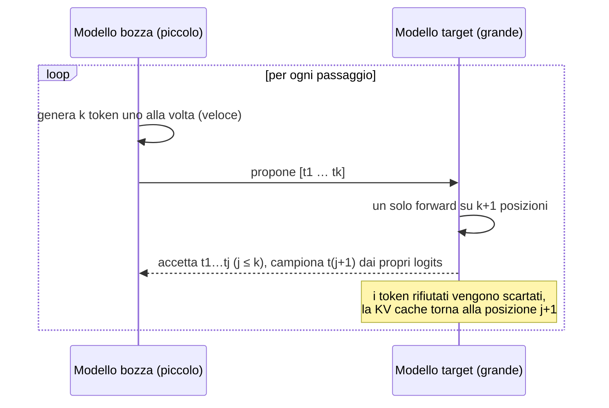
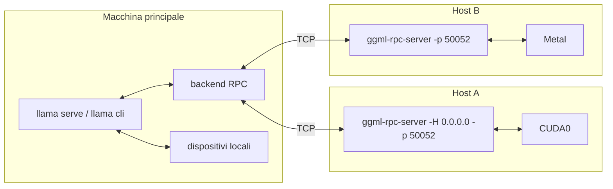

# Modulo 05: Prestazioni e ottimizzazione

<div class="meta" markdown>
<span class="stato stato-verificato">verificato su b11046 (CPU)</span> <span class="stato stato-bozza">parti GPU, multi-GPU e NUMA: dalla documentazione ufficiale, non verificate su questa macchina</span>
</div>

Un modello che "gira" non basta: deve girare **abbastanza in fretta** per l'uso che ne fai. In questo modulo impari a
misurare le prestazioni in modo riproducibile, a capire **quale risorsa fa da collo di bottiglia** (calcolo, banda di
memoria, VRAM, rete) e a usare le leve che llama.cpp ti dà: thread, offload su GPU, KV cache compatta, decodifica
speculativa, più GPU, più macchine.

!!! note "Nomi dei comandi"
    Nel corso usiamo il binario unico `llama` con i sottocomandi (`llama bench`, `llama cli`, `llama serve`,
    `llama fit-params`). I vecchi nomi `llama-bench`, `llama-cli`, `llama-server`, `llama-fit-params` esistono ancora nei
    tarball delle release e accettano le stesse opzioni. Il server RPC si chiama `ggml-rpc-server` e **non** è incluso
    nel binario dell'installer: sta nel tarball della release o si compila con `-DGGML_RPC=ON`.

## Cosa imparerai

- Distinguere **prompt processing (pp)** e **token generation (tg)** e capire perché tg è limitata dalla banda di memoria.
- Usare `llama bench` per misure ripetibili (`-p`, `-n`, `-pg`, `-r`, `-o json|csv|md|sql`, `--progress`) e `llama batched-bench` per il throughput con più sequenze.
- Scegliere thread e affinità (`-t`, `-C`, `--numa`) senza saturare la CPU.
- Governare l'inferenza ibrida CPU+GPU: `-ngl`, `-ot`, `-cmoe`/`-ncmoe`, flash attention e KV cache quantizzata.
- Accelerare la generazione con la decodifica speculativa (`-md`, `--spec-type`).
- Distribuire un modello su più GPU (`-ts`, `-sm`, `-dev`) e su più macchine (RPC).
- Far scegliere i parametri alla macchina con `--fit` e `llama fit-params`.

## 1. pp e tg: due misure, due colli di bottiglia

Ogni risposta di un LLM ha due fasi:

| Fase | Cosa succede | Metrica | Limite tipico |
|---|---|---|---|
| **Prompt processing (pp)**, detto anche *prefill* | Tutti i token del prompt passano nel modello in un solo batch; si riempie la KV cache | token/s di prompt, tempo al primo token | **calcolo** (FLOPS): molte moltiplicazioni per ogni lettura dei pesi |
| **Token generation (tg)**, detto anche *decode* | Un token alla volta: ogni passo legge **tutti i pesi** per produrre un solo token | token/s di generazione | **banda di memoria** (GB/s) |

Il punto chiave è il secondo: in generazione il batch è di 1 token, quindi per ogni token il processore deve
leggere l'intero modello dalla memoria e con ogni byte letto fa pochissime operazioni. Il tempo per token è quindi
circa `dimensione del modello / banda di memoria`, e la velocità massima teorica è:

$$
\text{tg}_{\max} \approx \frac{\text{banda di memoria (GB/s)}}{\text{dimensione del modello (GB)}}
$$

<figure class="schema" markdown>

<figcaption>Per ogni token generato si leggono tutti i pesi: la banda di memoria decide la velocità. Con lo stesso modello da 4,4 GB, la DDR5 di un PC (~60 GB/s), la memoria unificata di un M3 Max (~400 GB/s) e la GDDR6X di una RTX 4090 (~1 TB/s) danno velocità teoriche di 13, 90 e 225 token/s.</figcaption>
</figure>

Tre conseguenze pratiche:

1. **Quantizzare accelera la generazione** quasi in proporzione: un Q4 pesa la metà di un Q8 e si legge in metà tempo.
2. **Più core non aiutano tg** oltre un certo punto: se la banda è satura, i thread in più aspettano e basta (lo vedrai nel benchmark qui sotto).
3. **La GPU vince per la banda**, non solo per i FLOPS: una scheda con 1 TB/s genera 10-15 volte più in fretta di una CPU con 60 GB/s, anche con un modello piccolo.

Per pp vale il contrario: il batch è grande, le moltiplicazioni sono tante per ogni byte letto, e contano i FLOPS
(tensor core, AVX-512, kernel ottimizzati). Per questo un Mac con memoria unificata ha una tg ottima ma un pp molto
inferiore a una GPU discreta.

## 2. Misurare: `llama bench`

`llama bench` carica il modello, esegue test di pp e tg **senza tokenizzazione e sampling** (misura solo il modello) e
stampa una tabella. Ogni test è ripetuto `-r` volte (default 5) e riporta media ± deviazione standard.

```bash
llama bench -m Qwen3.5-0.8B-Q8_0.gguf -p 64 -n 32 -t 6 -r 2
```

Output verificato su questo VPS (CPU AMD EPYC, 6 vCPU, macchina condivisa):

```
| model             |       size |   params | backend | threads | test |          t/s |
| qwen35 0.8B Q8_0  | 784.52 MiB | 772.85 M | CPU     |       6 | pp64 | 56.90 ± 15.86 |
| qwen35 0.8B Q8_0  | 784.52 MiB | 772.85 M | CPU     |       6 | tg32 |  4.29 ± 0.80 |
```

Le opzioni essenziali:

| Opzione | Significato | Note |
|---|---|---|
| `-m file.gguf` / `-hf repo[:quant]` | modello (ripetibile per confrontare più modelli) | |
| `-p N` | test di prompt processing con N token (default 512) | `-p 0` per saltarlo |
| `-n N` | test di generazione di N token (default 128) | `-n 0` per saltarlo |
| `-pg PP,TG` | test combinato: prompt di PP token poi TG token generati | più vicino all'uso reale |
| `-d N` | esegue i test con la KV cache già piena di N token (profondità di contesto) | mostra il rallentamento a contesto lungo |
| `-r N` | ripetizioni (default 5) | `-r 1` solo per prove rapide |
| `-t N` | thread | |
| `-b N` / `-ub N` | batch logico (2048) e fisico (512) | incidono su pp |
| `-ngl N`, `-fa`, `-ctk`, `-ctv`, `-sm`, `-ts`, `-dev`, `-ot`, `-ncmoe` | stesse opzioni di `llama cli` | vedi le sezioni seguenti |
| `-o md\|csv\|json\|jsonl\|sql` | formato di uscita su stdout | `-oe` lo stesso su stderr |
| `--progress` | stampa l'avanzamento su stderr | utile con modelli grandi |
| `--no-warmup`, `--delay S`, `--prio N` | salta il riscaldamento, pausa tra i test, priorità del processo | |
| `--list-devices` | elenca i dispositivi visti dal backend | |

**Ogni parametro accetta più valori** separati da virgola (o ripetendo l'opzione) e llama bench esegue tutte le
combinazioni. Gli intervalli si scrivono `inizio-fine`, `inizio-fine+passo` o `inizio-fine*moltiplicatore`:

```bash
llama bench -m m.gguf -p 0 -n 32 -t 1,2,4,8            # quattro valori di thread
llama bench -m m.gguf -n 0 -p 1024 -b 128-1024*2        # batch 128, 256, 512, 1024
llama bench -m m.gguf -ngl 0-48+8                       # ngl 0, 8, 16 … 48
```

### Formati di uscita

`-o md` (default) produce la tabella Markdown, comoda da incollare in un report. `-o csv` e `-o json` includono **tutte**
le condizioni del test (`build_commit`, `cpu_info`, `gpu_info`, `n_threads`, `type_k`, `n_gpu_layers`, `flash_attn`…) e,
in JSON, anche i campioni delle singole ripetizioni (`samples_ts`): sono i formati da usare per i grafici. `-o sql`
genera `CREATE TABLE` + `INSERT` da dare in pasto a `sqlite3` per collezionare misure nel tempo.

```bash
llama bench -m m.gguf -t 1,2,4,6 -o json > bench.json
llama bench -m m.gguf -o sql | sqlite3 misure.db
```

Nel [lab 05-01](../../laboratori/lab-05-01-benchmark/README.md) lo script `grafico_bench.py` legge il JSON e disegna
t/s in funzione dei thread.

### Throughput con più sequenze: `llama batched-bench`

`llama bench` misura una sequenza alla volta. Un server con più client in parallelo si comporta diversamente: la
generazione di B sequenze insieme costa quasi come una sola (i pesi si leggono una volta per tutte), quindi il
throughput totale cresce. `llama batched-bench` misura proprio questo:

```bash
llama batched-bench -m m.gguf -c 4096 -b 2048 -ub 512 -npp 128,256 -ntg 128 -npl 1,2,4,8 -ngl 99
```

Le colonne: `PP` e `TG` token per sequenza, `B` sequenze in parallelo, `N_KV` KV cache necessaria, `S_PP` e `S_TG`
velocità aggregate, `S` velocità totale. Con `-pps` il prompt è condiviso tra le sequenze (`N_KV = PP + B·TG`
invece di `B·(PP+TG)`). `--output-format jsonl` per l'uscita macchina. Nella tabella d'esempio del README ufficiale
(7B su GPU) `S_TG` passa da 41 t/s con 1 sequenza a 465 t/s con 32: è la ragione per cui il server usa il continuous
batching (modulo 04).

## 3. Thread, affinità e NUMA

Sulla CPU il parametro più importante è `-t` (thread di generazione; `-tb` per il prompt processing, default uguale).
La regola della documentazione ufficiale: **numero di core fisici, non di thread logici**, e se la generazione è
lentissima prova `-t 1` e raddoppia finché non migliora più. Più thread del dovuto **peggiorano** le prestazioni, perché
il lavoro è limitato dalla banda e i thread si contendono la cache; su una macchina condivisa l'effetto è drammatico.
Misurato su questo VPS con 6 vCPU mentre altri processi lo usavano (carico medio ~15):

```
llama bench -m Qwen3.5-0.8B-Q8_0.gguf -p 32 -n 16 -r 1 -t 1,2,4,6 --progress
| threads | test |   t/s |
|       1 | pp32 |  9.55 |
|       1 | tg16 |  2.82 |
|       2 | pp32 | 10.21 |
|       2 | tg16 |  3.10 |
|       4 | pp32 | 12.23 |
|       4 | tg16 |  1.20 |
|       6 | pp32 |  4.00 |
|       6 | tg16 |  0.13 |
```

Con 6 thread su 6 vCPU già occupate la generazione crolla a 0,13 t/s: la CPU è "oversaturata". La cura è `-t 2` o
`-t 3`, non `-t 6`. Su una macchina scarica con core fisici liberi, invece, la curva sale fino ai core fisici e poi si appiattisce
(vedi la tabella nel README di llama-bench: da 4 t/s con 1 thread a 16,7 con 8 e nessun guadagno con 16 o 32).

Le opzioni di affinità servono quando il sistema operativo sposta i thread tra i core o quando vuoi riservare core precisi:

| Opzione | Effetto |
|---|---|
| `-C / --cpu-mask 0xFF` | maschera esadecimale dei core da usare (`-Cb` per il batch) |
| `-Cr / --cpu-range 0-5` | intervallo di core, alternativa alla maschera |
| `--cpu-strict 1` | forza il posizionamento (pinning) dei thread |
| `--prio 0..3` | priorità del processo (3 = realtime, serve root) |
| `--poll 0..100` | quanto i thread restano in attesa attiva: 0 riduce l'uso di CPU a riposo, 100 riduce la latenza |

Su server con **più socket** (NUMA) la RAM è divisa in nodi, e leggere la memoria dell'altro socket costa il doppio.
`--numa distribute` spalma i thread su tutti i nodi, `--numa isolate` li tiene sul nodo di partenza, `--numa numactl`
rispetta la mappa data da `numactl`. La guida raccomanda di svuotare la page cache prima di cambiare modalità
(`echo 3 | sudo tee /proc/sys/vm/drop_caches`), perché il modello mappato in memoria resta nel nodo in cui è stato letto
la prima volta. Su questo VPS `lscpu` mostra `NUMA node(s): 1`, quindi l'opzione non ha effetto.

## 4. Offload su GPU e inferenza ibrida

`-ngl N` (`--n-gpu-layers`) è il numero di **layer** del modello i cui pesi vengono messi in VRAM ed eseguiti dalla GPU;
il resto resta su CPU. I valori speciali: `all` (o un numero enorme come `999`) per tutto il modello, `auto` (default)
per lasciar decidere alla funzione di *fit* (sezione 8). La KV cache di ogni layer sta dove sta il layer; con
`-nkvo` (`--no-kv-offload`) la tieni comunque in RAM.

<figure class="schema" markdown>

<figcaption>Con `-ngl 20` su un modello da 32 layer, 20 layer e la loro KV cache stanno in VRAM; 12 layer, embedding e output restano in RAM. Il tempo per token è la somma delle due parti: la parte su CPU comanda.</figcaption>
</figure>

La tabella del README di llama-bench (7B Q4_0 da 35 layer) racconta tutto: da `-ngl 10` (13 t/s) a `-ngl 30` (40 t/s) il
guadagno è graduale, ma tra `-ngl 34` (72 t/s) e `-ngl 35` (132 t/s) c'è un salto: quando **tutto** il modello è in VRAM
sparisce il passaggio dalla CPU e la GPU lavora alla sua banda piena. Morale: se manca poco, vale la pena liberare VRAM
(contesto più corto, KV cache quantizzata) per arrivare a `all`.

Come verificare che la GPU lavori davvero:

```bash
llama cli --list-devices            # elenca CUDA0, Vulkan0, Metal, RPC0…; su questo VPS: "(none)"
llama cli -m m.gguf -ngl all -v     # nel log: load_tensors: offloaded N/N layers to GPU e i buffer CUDA0
```

Con `-dev CUDA1` scegli il dispositivo (nomi da `--list-devices`); `-dev none` disattiva l'offload. Per CUDA vale anche
`CUDA_VISIBLE_DEVICES`; `GGML_CUDA_ENABLE_UNIFIED_MEMORY=1` su Linux permette di sforare la VRAM usando la RAM (lento ma
non va in crash). `--load-mode mmap|mlock|dio` governa come il file viene letto (mmap è il default; `mlock` impedisce lo swap).

### Tensori singoli su CPU: `-ot`, `-cmoe`, `-ncmoe`

Con i modelli **Mixture of Experts** (Qwen3-30B-A3B, GLM-4.7-Flash, gpt-oss…) la maggior parte dei pesi sono gli
*esperti* delle FFN, ma per ogni token ne lavorano pochi. Tenere gli esperti in RAM e tutto il resto (attention,
norm, router) in VRAM è un compromesso eccellente: la VRAM richiesta crolla e la velocità resta buona perché i tensori
"caldi" sono sulla GPU.

| Opzione | Effetto |
|---|---|
| `-cmoe` / `--cpu-moe` | tutti i pesi degli esperti restano su CPU |
| `-ncmoe N` / `--n-cpu-moe N` | solo gli esperti dei primi N layer restano su CPU (gli altri in VRAM) |
| `-ncffn N` / `--n-cpu-ffn N` | lo stesso per le FFN dense dei modelli non MoE |
| `-ot "regex=CPU"` / `--override-tensor` | regola generale: i tensori il cui nome corrisponde alla regex vanno nel buffer indicato |

`-ot` è lo strumento fine: il pattern è una regex sul nome del tensore GGUF (modulo 03), il valore è un tipo di buffer
(`CPU`, `CUDA0`…). Per esempio, esperti dei layer 20-47 su CPU:

```bash
llama serve -m Qwen3-30B-A3B-Q4_K_M.gguf -ngl all -ot "blk\.(2[0-9]|3[0-9]|4[0-7])\.ffn_.*_exps=CPU"
```

È esattamente ciò che `llama fit-params` stampa quando un MoE non entra in VRAM (sezione 8).

## 5. Flash attention e KV cache quantizzata

La **KV cache** conserva chiavi e valori dell'attention per ogni token nel contesto; cresce linearmente con `-c` e
con il numero di sequenze parallele (`-np`). In f16 occupa per ogni token `2 × n_layer × n_kv_head × head_dim × 2 byte`:
per un modello da 32 layer con 8 teste KV da 128 sono 128 KiB per token, cioè **1 GiB ogni 8192 token** di contesto.

Due leve:

- **Flash attention** (`-fa on|off|auto`, default `auto`): calcola l'attention a blocchi senza materializzare la matrice
  dei punteggi. Meno memoria di calcolo e più velocità con contesti lunghi; è supportata su quasi tutti i backend e
  `auto` la accende quando può. È **obbligatoria** per la KV cache V quantizzata e per `-sm tensor`.
- **KV cache quantizzata** (`-ctk`, `-ctv`): tipi ammessi `f32, f16, bf16, q8_0, q4_0, q4_1, iq4_nl, q5_0, q5_1`.
  `q8_0` dimezza la cache con perdita di qualità impercettibile; `q4_0` la riduce a un quarto ma può degradare le
  risposte con contesti lunghi. Il modello bozza della speculativa ha le sue opzioni `-ctkd`/`-ctvd`.

```bash
llama serve -m m.gguf -c 32768 -fa on -ctk q8_0 -ctv q8_0
```

!!! tip "Quando conviene"
    Se `-ngl all` non entra per poco, `-ctk q8_0 -ctv q8_0` è la prima cosa da provare: libera VRAM senza toccare i pesi.
    Se invece la VRAM basta, lascia `f16`: la cache quantizzata costa un po' di calcolo in più.

## 6. Decodifica speculativa

La generazione è seriale e limitata dalla banda: la GPU legge 4 GB di pesi per produrre un token e resta in gran
parte inattiva. La **decodifica speculativa** sfrutta questo margine: un modello **bozza** (*draft*) piccolo e veloce
propone `k` token in sequenza; il modello **target** li verifica **tutti insieme in un solo passaggio** (un batch di
k+1 token costa quasi quanto un token solo). I token che il target avrebbe scelto ugualmente vengono accettati; al
primo rifiuto si scarta il resto e si riparte. Il risultato è **identico** a quello del target da solo (la
distribuzione campionata non cambia), ma con 2-3 token accettati per passaggio la velocità raddoppia o triplica.



Le opzioni (identiche per `llama cli` e `llama serve`):

| Opzione | Significato |
|---|---|
| `-md file.gguf` / `--hf-repo-draft repo[:quant]` (`-hfd`) | modello bozza locale o da Hugging Face |
| `--spec-type TIPO[,TIPO]` | algoritmo: `none` (default), `draft-simple`, `draft-mtp`, `draft-eagle3`, `draft-dflash`, `draft-dspark`, oppure senza modello bozza `ngram-simple`, `ngram-map-k`, `ngram-map-k4v`, `ngram-mod`, `ngram-cache` |
| `--spec-draft-n-max N` | quanti token propone la bozza per passaggio (default 3) |
| `--spec-draft-n-min N` | sotto questo numero non si tenta la speculazione (default 0) |
| `--spec-draft-p-min P` | probabilità minima della bozza per proporre un token (default 0) |
| `-ngld`, `-devd`, `-td`, `-ctkd/-ctvd` | offload, dispositivo, thread e KV cache **della bozza** |
| `--spec-default` | configurazione speculativa predefinita del modello, se ce l'ha |

!!! warning "Flag rimossi"
    `--draft-max`, `--draft-min` e `--draft` **non esistono più** in 0.4.1: l'aiuto stampa "the argument has been removed".
    Usa `--spec-draft-n-max` / `--spec-draft-n-min` (o `--spec-ngram-mod-n-max/min` per i metodi n-gram).

I tipi principali:

- **`draft-simple`**: un secondo GGUF con lo **stesso vocabolario** del target (stessa famiglia). La coppia classica è
  Qwen2.5-Coder 7B + 0.5B, tanto usata che il server ha la scorciatoia `--fim-qwen-7b-spec`:
  ```bash
  llama cli -hf ggml-org/Qwen2.5-Coder-7B-Q8_0-GGUF -hfd ggml-org/Qwen2.5-Coder-0.5B-Q8_0-GGUF --spec-type draft-simple -ngl all
  ```
- **`draft-mtp`** (*multi-token prediction*): la bozza è una testa aggiuntiva addestrata insieme al modello e distribuita
  come piccolo GGUF nello stesso repository (per Gemma 4 E4B il file `mtp-gemma-4-E4B-it-Q4_0.gguf` pesa 57 MB). È
  l'esempio ufficiale di llama.app:
  ```bash
  llama serve -hf ggml-org/gemma-4-e4b-it-GGUF:Q4_0 --hf-repo-draft ggml-org/gemma-4-e4b-it-GGUF:Q4_0 --spec-type draft-mtp
  ```
- **`draft-eagle3`**, **`draft-dflash`**: bozze specializzate (EAGLE-3, DFlash) fornite per alcuni modelli; stessa sintassi.
- **`ngram-*`**: nessun modello bozza; la proposta viene dai token già visti nel contesto. Costa niente e aiuta quando
  il testo si ripete (riscrittura di codice, riassunti con citazioni), nulla altrimenti. Verificato su questo VPS con
  `llama cli … --spec-type ngram-simple`: funziona senza file aggiuntivi.

!!! note "Quando conviene davvero"
    La speculativa paga quando il target è **molto** più lento della bozza (rapporto 10-20×) e il testo è prevedibile
    (codice, JSON, testo tecnico). Con un target piccolo o su CPU, dove la banda è già tutta usata dal target, il guadagno
    è piccolo o negativo: la bozza ruba banda. Con temperatura alta o testo creativo l'accettazione cala. Misura sempre
    prima e dopo, come nel [lab 05-03](../../laboratori/lab-05-03-speculativa/README.md).

## 7. Più GPU e inferenza distribuita

### Multi-GPU (stessa macchina)

Quando un modello non entra in una GPU, o vuoi più throughput, llama.cpp distribuisce i layer su tutte le GPU visibili.
Le modalità (`-sm`, `--split-mode`) dalla guida ufficiale `docs/multi-gpu.md`:

| Modalità | Cosa fa | Quando |
|---|---|---|
| `layer` (**default**) | *pipeline parallel*: ogni GPU tiene una fetta contigua di layer con la loro KV cache | scelta più compatibile; tollera interconnessioni lente; ottima per il prefill |
| `tensor` (**sperimentale**) | *tensor parallel*: ogni layer è diviso tra le GPU, con riduzioni tra GPU a ogni layer | generazione più veloce con NVLink/PCIe veloce e backend CUDA; richiede `-fa on` e KV cache non quantizzata; `--fit` non supportato |
| `row` | vecchio tensor parallel per righe | deprecato, evitare |
| `none` | una sola GPU, scelta con `-mg` | isolare il modello su una scheda |

```bash
llama serve -m grande.gguf                    # pipeline su tutte le GPU, split proporzionale alla memoria
llama serve -m grande.gguf -ts 3,1            # 75 % su GPU 0, 25 % su GPU 1 (ordine di --device)
llama serve -m grande.gguf -dev CUDA1         # solo la seconda scheda
llama serve -m grande.gguf -sm tensor -fa on -ctk f16 -ctv f16 -c 8192
```

Variabili di ambiente utili con CUDA (`docs/build.md`): `CUDA_VISIBLE_DEVICES` per nascondere schede, `GGML_CUDA_P2P=1`
per il trasferimento diretto tra GPU (richiede driver adatti, può causare crash con IOMMU attivo),
`CUDA_SCALE_LAUNCH_QUEUES=4x` per accodare più lavoro in pipeline parallel, `GGML_CUDA_CUBLAS_COMPUTE_TYPE=f16|f32`.
In `tensor` mode llama.cpp usa NCCL se compilato con `-DGGML_CUDA_NCCL=ON` (default): se manca, il log avvisa
"NCCL is unavailable, multi GPU performance will be suboptimal".

### RPC: più macchine

Il backend **RPC** espone i dispositivi di un'altra macchina come se fossero locali: su ogni host remoto gira
`ggml-rpc-server`, e il processo principale (`llama cli`/`llama serve`) lo raggiunge con `--rpc host:porta`.
I pesi e la KV cache vengono distribuiti tra dispositivi locali e remoti in proporzione alla memoria libera
(modificabile con `-ts`).



```bash
# sull'host remoto (dal tarball della release o da una build con -DGGML_RPC=ON)
ggml-rpc-server -H 0.0.0.0 -p 50052            # -t N thread per il device CPU, -d CUDA0 per scegliere i device, -c cache locale
# sulla macchina principale
llama-cli -m m.gguf -ngl all --rpc 192.168.1.10:50052,192.168.1.11:50052
```

Verificato in locale su questo VPS (server e client sulla stessa macchina, backend CPU):

```
$ ggml-rpc-server -H 127.0.0.1 -p 50052 -t 3
Starting RPC server v7.0.0
  endpoint       : 127.0.0.1:50052
Devices:
  CPU: AMD EPYC Processor (with IBPB) (11960 MiB, 11960 MiB free)
$ llama-cli --rpc 127.0.0.1:50052 --list-devices
Available devices:
  RPC0: 127.0.0.1:50052 (11960 MiB, 11960 MiB free)
```

!!! danger "Sicurezza: nessuna autenticazione"
    Il README ufficiale è esplicito: il backend RPC è un *proof of concept*, **fragile e insicuro**. Chiunque raggiunga
    la porta può caricare tensori ed eseguire calcoli sulla tua GPU. Usalo **solo su una rete fidata** (LAN isolata,
    VPN come WireGuard, tunnel SSH), mai esposto su Internet, e spegnilo quando non serve.

Dettagli utili: `-c` sul server attiva una cache locale dei tensori grandi in `~/.cache/llama.cpp/rpc` (o `LLAMA_CACHE`)
per non ritrasferire il modello a ogni avvio; `GGML_RPC_DEBUG=1` stampa i messaggi di debug; su NIC RoCE o
Thunderbolt 5 (macOS 26.2+) il trasporto negozia RDMA automaticamente (`GGML_RPC_NO_RDMA=1` per forzare TCP).
Il binario dell'installer `llama` **non** include il backend RPC (`--rpc` non compare nel suo `--help`): servono i binari
del tarball o una build con `-DGGML_RPC=ON`. Le prestazioni sono legate alla rete: con 1 Gbit/s la generazione
attraverso RPC è molto più lenta che in locale; ha senso solo quando il modello altrimenti non entra da nessuna parte.

## 8. Far decidere alla macchina: `--fit` e `llama fit-params`

Dal 2026 tutti i binari hanno `--fit on` per default: prima di caricare, `llama_params_fit` stima la memoria necessaria
(pesi, KV cache, buffer di calcolo) e **aggiusta i parametri che non hai fissato** (`-ngl`, `-c`, `-ot` per gli
esperti MoE) in modo da lasciare un margine libero su ogni dispositivo (`--fit-target`, default 1024 MiB;
`--fit-ctx` è il contesto minimo accettabile, default 4096). Se un parametro lo passi tu, non viene toccato.

`llama fit-params` fa lo stesso calcolo e **stampa gli argomenti** invece di avviare il modello, così puoi salvarli e
riusarli:

```bash
llama fit-params -m modello.gguf | tee args.txt
cat args.txt | xargs llama serve -m modello.gguf
```

L'esempio del README ufficiale (Qwen3-30B-A3B f16 da 62 GB su una RTX 4090 da 24 GB) produce
`-c 4096 -ngl 48 -ot blk\.14\.ffn_(up|down|gate)_(ch|)exps=CPU,…`: contesto ridotto, tutti i layer in VRAM ma esperti
dei layer 14-47 su CPU. Su questo VPS senza GPU l'uscita è semplicemente `-c 262144 -ngl -1` (il contesto pieno del
modello, nessun offload). Il log della fase di fit è leggibile in ogni avvio:

```
llama_params_fit_impl: projected to use 61807 MiB of device memory vs. 24077 MiB of free device memory
llama_params_fit_impl: context size reduced from 40960 to 4096 -> need 3456 MiB less memory in total
llama_params_fit: successfully fit params to free device memory
```

`-fitp on` (`--fit-print`) stampa la stima di memoria; `--fit off` disattiva tutto (obbligatorio con `-sm tensor`).
Alla chiusura, `llama_memory_breakdown_print` riepiloga per dispositivo memoria totale, libera, pesi, contesto e calcolo:
è la tabella da guardare quando qualcosa non entra.

## Riepilogo delle opzioni

| Leva | Opzioni | Effetto principale |
|---|---|---|
| Misura | `llama bench -p -n -pg -d -r -o`, `llama batched-bench -npp -ntg -npl` | pp/tg riproducibili, throughput a più sequenze |
| CPU | `-t`, `-tb`, `-C`, `-Cr`, `--cpu-strict`, `--prio`, `--poll`, `--numa` | thread = core fisici, affinità, NUMA |
| GPU | `-ngl N\|auto\|all`, `-dev`, `--list-devices`, `-nkvo`, `--load-mode` | quali layer in VRAM |
| MoE / tensori | `-cmoe`, `-ncmoe N`, `-ncffn N`, `-ot regex=CPU` | esperti in RAM, resto in VRAM |
| Memoria attention | `-fa on\|off\|auto`, `-ctk`, `-ctv`, `-c`, `-np` | KV cache più piccola |
| Speculativa | `-md`, `-hfd`, `--spec-type`, `--spec-draft-n-max/min`, `-ngld`, `-devd` | 1,5-3× in generazione |
| Multi-GPU | `-sm layer\|tensor\|none`, `-ts`, `-mg`, `CUDA_VISIBLE_DEVICES`, `GGML_CUDA_P2P` | modello diviso tra schede |
| Distribuito | `ggml-rpc-server -H -p -t -d -c`, `--rpc host:porta` | dispositivi di altre macchine |
| Automatico | `--fit`, `--fit-target`, `--fit-ctx`, `llama fit-params` | parametri adattati alla memoria |

## Errori comuni

!!! warning "Benchmark su macchina occupata"
    Browser, IDE, altri modelli caricati, o un VPS condiviso rendono le misure inutili (deviazioni standard enormi,
    come i ±15 t/s visti sopra). Chiudi tutto, usa `-r 5` o più, ripeti in momenti diversi e riporta la deviazione.

!!! warning "Troppi thread"
    `-t` uguale ai thread logici (SMT) o superiore ai core liberi fa crollare la generazione. Parti dai core fisici; se
    il computer fa altro, togline uno o due. Con la GPU, `-t` conta solo per i layer rimasti su CPU.

!!! warning "\"GPU non usata\""
    `--list-devices` che stampa `(none)` significa che il binario non ha il backend giusto (installer senza CUDA, tarball
    CPU) o che `CUDA_VISIBLE_DEVICES` nasconde le schede. `-ngl 0` disattiva l'offload. Controlla il log di caricamento.

!!! warning "Out of memory dopo pochi minuti"
    La KV cache cresce con il contesto e con `-np`: un server con `-c 32768 -np 4` alloca 4 slot da 8192 token *oppure*,
    con `--kv-unified`, un'unica cache condivisa. Riduci `-c`, quantizza la cache o abbassa `-ngl` (in quest'ordine).

!!! warning "`-sm tensor` che non parte"
    Messaggi come "SPLIT_MODE_TENSOR requires flash_attn to be enabled" o "simultaneous use of SPLIT_MODE_TENSOR and KV
    cache quantization not implemented" vogliono `-fa on -ctk f16 -ctv f16`; "not implemented for architecture" significa
    che il modello (molti MoE e ibridi Mamba) non è supportato: torna a `-sm layer`.

!!! warning "Speculativa più lenta del modello da solo"
    Vocabolari diversi tra bozza e target (errore all'avvio o accettazione ~0), bozza troppo grande, target su CPU, testo
    creativo con temperatura alta. Controlla nel log il tasso di accettazione e confronta i t/s con e senza `-md`.

## Laboratori di questo modulo

- [Lab 05-01 · Benchmark riproducibili](../../laboratori/lab-05-01-benchmark/README.md): pp/tg con `llama bench` al variare di thread e quantizzazione; grafico con `grafico_bench.py`.
- [Lab 05-02 · Offload ibrido CPU+GPU](../../laboratori/lab-05-02-offload-ibrido/README.md): trovare il `-ngl` ottimale per un modello più grande della VRAM; KV cache quantizzata; MoE con `-ncmoe`.
- [Lab 05-03 · Decodifica speculativa](../../laboratori/lab-05-03-speculativa/README.md): misurare l'accelerazione con un modello bozza su testo e su codice.
- [Lab 05-04 · Cluster RPC](../../laboratori/lab-05-04-rpc/README.md): distribuire un modello su due macchine (o due container) con `ggml-rpc-server`.

## Verifica

1. Perché raddoppiare i core della CPU raddoppia (circa) pp ma non tg?
2. Un modello Q4_K_M da 4,4 GB su una macchina con 80 GB/s di banda: qual è il limite teorico di token/s in generazione?
3. Cosa misura `-pg 512,128` che `-p 512 -n 128` non misura?
4. Quale opzione di `llama bench` prepara la KV cache con 4096 token prima di misurare, e a cosa serve?
5. Hai una GPU da 8 GB e un modello MoE da 18 GB. Quali due opzioni provi, nell'ordine, prima di abbassare `-ngl`?
6. Perché `-ctv q8_0` richiede flash attention?
7. Con la decodifica speculativa il testo generato cambia rispetto al modello target da solo?
8. Perché non devi mai avviare `ggml-rpc-server -H 0.0.0.0` su una macchina raggiungibile da Internet?

??? success "Soluzioni"
    1. pp elabora molti token per ogni lettura dei pesi ed è limitato dal calcolo, che scala con i core; tg legge tutti i
       pesi per ogni singolo token ed è limitato dalla banda di memoria, che non cambia aggiungendo core.
    2. 80 / 4,4 ≈ 18 token/s; nella pratica 12-15.
    3. Il comportamento reale: generazione **con la KV cache già riempita** dal prompt (e con il prompt appena elaborato),
       invece di due test separati con cache vuota.
    4. `-d 4096` (`--n-depth`): mostra quanto rallentano pp e tg a contesto lungo, quando l'attention deve leggere una KV
       cache grande.
    5. `-cmoe` (o `-ncmoe N` / `-ot` sugli esperti) per tenere gli esperti in RAM, poi `-ctk q8_0 -ctv q8_0` (con `-fa on`)
       per ridurre la KV cache; `-ngl` più basso solo come ultima risorsa. `llama fit-params` suggerisce la combinazione.
    6. Solo il kernel di flash attention sa leggere i valori V quantizzati; l'attention classica lavora su V in f16/f32.
    7. No: i token proposti vengono accettati solo se coincidono con la scelta del target, altrimenti il target campiona il
       proprio; la distribuzione è la stessa, cambia solo la velocità.
    8. Non c'è autenticazione né cifratura: chiunque può inviare grafi di calcolo e occupare (o attaccare) la macchina.
       Solo rete fidata, VPN o tunnel.

## Riferimenti

- [tools/llama-bench/README.md](https://github.com/ggml-org/llama.cpp/blob/master/tools/llama-bench/README.md) e [tools/batched-bench/README.md](https://github.com/ggml-org/llama.cpp/blob/master/tools/batched-bench/README.md)
- [docs/multi-gpu.md](https://github.com/ggml-org/llama.cpp/blob/master/docs/multi-gpu.md): modalità di split, NCCL, P2P, risoluzione dei problemi
- [docs/development/token_generation_performance_tips.md](https://github.com/ggml-org/llama.cpp/blob/master/docs/development/token_generation_performance_tips.md): thread e offload
- [tools/rpc/README.md](https://github.com/ggml-org/llama.cpp/blob/master/tools/rpc/README.md): `ggml-rpc-server`, cache, RDMA
- [tools/fit-params/README.md](https://github.com/ggml-org/llama.cpp/blob/master/tools/fit-params/README.md)
- [docs/build.md](https://github.com/ggml-org/llama.cpp/blob/master/docs/build.md#cuda): variabili di ambiente CUDA a runtime
- [llama.app/docs/cli](https://llama.app/docs/cli) e [llama.app/docs/serve](https://llama.app/docs/serve): decodifica speculativa
- Glossario del corso: [pp/tg, KV cache, offload](../../risorse/glossario.md)
