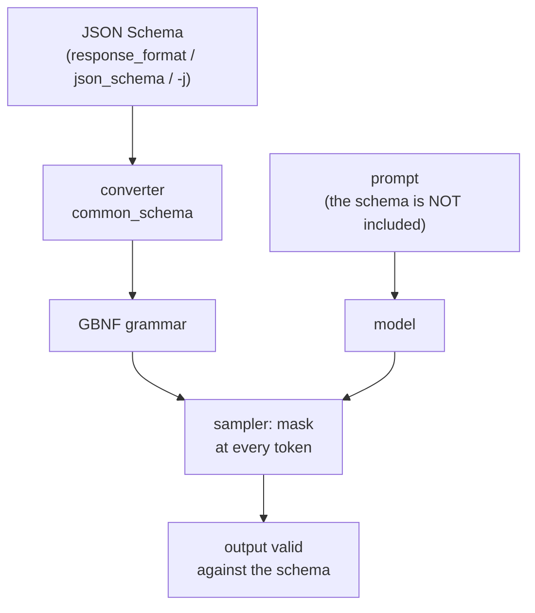

# Module 06: Structured output: GBNF grammars and JSON Schema

A language model produces free text. When that text has to be read by a program (a JSON to
decode, a command to run, a "yes/no" to compare), free text is a problem: one ` ```json ` too
many, a missing comma, a `"2"` instead of `2`, and the parser fails. llama.cpp solves the problem
at the root, in **sampling**: at every token a formal grammar decides which tokens are allowed and
sets the probability of all the others to zero. The model *physically* cannot leave the format. In this
module you learn to write those grammars (GBNF), to generate them from a JSON Schema, to use them via the CLI and via the
API (`response_format`) and, above all, to understand what they guarantee and what they do not.

## What you will learn

- How constrained sampling works and why it is more reliable than "please answer in JSON".
- GBNF syntax: rules, terminals, alternations, repetitions, character ranges, special tokens.
- How llama.cpp converts a JSON Schema into a grammar, and which parts of the schema it ignores.
- How to use it: `--grammar`, `--grammar-file`, `-j/--json-schema` in the CLI; `grammar`, `json_schema` and
  `response_format` in the server; `Custom JSON` in the web UI.
- The limits: sampling cost, slow grammars, "made-up" values in a perfect shape, and when
  tool calling is a better fit than a grammar.

## 1. Why constrain the output

Try asking Qwen3.5-0.8B to extract data "in JSON" without constraints (temperature 0, thinking off):

```bash
curl -s http://127.0.0.1:8080/v1/chat/completions -H "Content-Type: application/json" -d '{
  "messages": [{"role":"system","content":"Estrai i dati in JSON con i campi nome, eta (intero), citta."},
               {"role":"user","content":"Mi chiamo Giulia Ferri, ho trentaquattro anni e vivo a Ferrara."}],
  "temperature": 0, "max_tokens": 80, "chat_template_kwargs": {"enable_thinking": false}}'
```

Response content: `` ```json\n[\n  {\n    "nome": "Giulia Ferri",\n    "eta": 24,\n    "citta": "Ferrara"\n  }\n]\n``` ``.
Three problems in one line: the Markdown block around it, an **array** instead of an object, and `eta: 24` instead
of 34. With `response_format` and a schema (§ 4) the same request returns exactly
`{"nome": "Giulia Ferri", "eta": 24, "citta": "Ferrara"}`: the fence is gone, the array is gone, but **24
stays 24**. Keep this in mind for the whole module: the grammar controls the shape, not the truth.

The mechanism lives in the sampler. At each step the model produces a logit for each of the ~150k tokens in the
vocabulary; before top-k, top-p and temperature choose, the grammar looks at the state it is in
(what has already been generated) and sets to `-∞` every token that cannot continue a valid string. The rest is
normal sampling, renormalized over the surviving tokens.

<figure class="schema" markdown>

<figcaption>After <code>{"eta":</code> the grammar allows only digits: "trentaquattro" and "null" are zeroed out, but between "3" and "34" the model still chooses.</figcaption>
</figure>

Constrained sampling is the basis of three features you have already met or will meet: **tool calling**
in module 04 (the server generates a grammar for the model's call format), the JSON schema in the
web UI and, in module 08, reliable extraction for RAG.

## 2. GBNF syntax

GBNF (*GGML BNF*) is a BNF notation with a few additions borrowed from regular expressions. A grammar is a
list of **rules** `name ::= sequence`; the `root` rule is the starting point and describes the whole output.

| Construct | Example | Meaning |
|---|---|---|
| Rule | `root ::= "sì" \| "no"` | the name (lowercase, with hyphens: `check-mate`) stands for what is on the right |
| Terminal | `"1. "`, `"O-O"` | literal characters (Unicode; escapes `\n`, `\"`, `\xXX`, `\uXXXX`, `\UXXXXXXXX`) |
| Range | `[1-9]`, `[NBKQR]`, `[ぁ-ゟ]` | one character among those listed |
| Negation | `[^\n]+` | any character except those listed |
| Sequence | `"1. " move " " move "\n"` | order matters |
| Alternation | `pawn \| nonpawn \| castle` | one of the options |
| Group | `("accendi" \| "spegni") " " stanza` | groups items to apply alternations or repetitions |
| Repetitions | `x*` (0+), `x+` (1+), `x?` (0-1), `x{3}`, `x{2,}`, `x{0,5}` | as in regex |
| Token | `<think>`, `<[151667]>`, `!</think>` | a vocabulary token (by text or by id); `!` = any other |
| Comment | `# text` | up to the end of the line |

Rules can break across lines **only inside parentheses** or right after a `|`: a rule broken elsewhere gives
`error parsing grammar: expecting ::= at …` (you run into it while writing `domotica-json.gbnf` in lab 06-01).

### Three example grammars

=== "Bulleted list"

    ```
    # from the official README: a list, one item per line
    root ::= ("- " item)+
    item ::= [^\n]+ "\n"
    ```

=== "Chess (excerpt from grammars/chess.gbnf)"

    ```
    root ::= (
        "1. " move " " move "\n"                    # first numbered move
        ([1-9] [0-9]? ". " move " " move "\n")+     # the following ones, with a 1-2 digit number
    )
    move ::= (pawn | nonpawn | castle) [+#]?         # [+#]? = optional check or mate
    pawn ::= ([a-h] "x")? [a-h] [1-8] ("=" [QRBN])?
    nonpawn ::= [NBKQR] [a-h]? [1-8]? "x"? [a-h] [1-8]
    castle ::= "O-O" ("-O")?
    ```

=== "Generic JSON (grammars/json.gbnf)"

    ```
    root   ::= object
    value  ::= object | array | string | number | ("true" | "false" | "null") ws
    object ::= "{" ws ( string ":" ws value ("," ws string ":" ws value)* )? "}" ws
    array  ::= "[" ws ( value ("," ws value)* )? "]" ws
    string ::= "\"" ( [^"\\\x7F\x00-\x1F] | "\\" (["\\bfnrt] | "u" [0-9a-fA-F]{4}) )* "\"" ws
    number ::= ("-"? ([0-9] | [1-9] [0-9]{0,15})) ("." [0-9]+)? ([eE] [-+]? [0-9] [1-9]{0,15})? ws
    ws     ::= | " " | "\n" [ \t]{0,20}
    ```

    Note `ws ::= | " " | …`: the first alternative is **empty** (no whitespace). And note `{0,15}` / `{0,20}` instead
    of `*`: bounding repetitions keeps the grammar fast (§ 5).

Token grammars are for "thinking" models: `root ::= <think> thinking </think> .*` with
`thinking ::= !</think>*` accepts a reasoning block and then free text; it works only if `<think>` is
a single token in the vocabulary, otherwise the grammar does not compile.

### Using it from the CLI

```bash
llama cli -hf ggml-org/Qwen3.5-0.8B-GGUF -st -rea off --temp 0 -n 20 \
  --grammar 'root ::= ("sì" | "no")' -p "Bologna è in Italia? Rispondi sì o no."
# → sì

llama cli -hf ggml-org/Qwen3.5-0.8B-GGUF -st -rea off --temp 0 -n 40 --grammar-file json.gbnf \
  -sys "Estrai citta e gradi in JSON." -p "A Trento oggi ci sono 17 gradi."
```
```json
{
  "city": "Trento",
  "temperature": 17,
  "unit": "gradi"
```

The second example shows two things: the JSON is syntactically perfect but **the model chose the
field names** (`city`, not `citta`: the generic JSON grammar does not know them), and `-n 40` cut
the output before the final `}`. The constraint does not stop `max_tokens` from truncating: always size the
token budget and check `finish_reason`. For a command format of your own, with a closed vocabulary, see lab 06-01.

## 3. From JSON Schema to grammar

Writing a grammar by hand for a JSON with ten fields is tedious and fragile. llama.cpp contains a converter
(`common/json-schema-to-grammar`, rewritten in 0.4.1 as `common_schema`) that turns a **subset** of
JSON Schema into GBNF, on every request. For the schema

```json
{"type": "array", "minItems": 10, "maxItems": 100,
 "items": {"type": "object", "additionalProperties": false, "required": ["name", "age"],
           "properties": {"name": {"type": "string", "minLength": 1, "maxLength": 100},
                          "age":  {"type": "integer", "minimum": 0, "maximum": 150}}}}
```

the generated grammar (from the official README) is:

```
char ::= [^"\\\x7F\x00-\x1F] | [\\] (["\\bfnrt] | "u" [0-9a-fA-F]{4})
item ::= "{" space item-name-kv "," space item-age-kv "}" space
item-age ::= ([0-9] | ([1-8] [0-9] | [9] [0-9]) | "1" ([0-4] [0-9] | [5] "0")) space
item-age-kv ::= "\"age\"" space ":" space item-age
item-name ::= "\"" char{1,100} "\"" space
item-name-kv ::= "\"name\"" space ":" space item-name
root ::= "[" space item ("," space item){9,99} "]" space
space ::= | " " | "\n" [ \t]{0,20}
```

Read it with the table in § 2: each property becomes a `name-kv` rule with the **literal** key (the model
cannot invent keys), `required` properties appear in schema order, an integer's `minimum/maximum`
become an alternation of digits (`item-age`: from 0 to 150), `minLength/maxLength` become `char{1,100}`,
`minItems/maxItems` become `{9,99}` repetitions after the first item.



!!! warning "The schema is not shown to the model"
    The schema only constrains sampling, **it is not injected into the prompt**. The model "discovers" the structure
    token by token, while the grammar closes off paths. If you want it to understand what to write in each
    field (what `locali` means, that `prezzo_euro` is an integer without separators), describe it yourself in the prompt.
    Tool calling is different: there the parameter schema ends up in the prompt through the chat template.

What the converter supports and what it does not (`grammars/` README, current build):

| Supported | Not supported or limited |
|---|---|
| `type` (`object`, `array`, `string`, `integer`, `number`, `boolean`, `null`), `enum`, `const` | `additionalProperties` is **`false` by default** (contrary to the spec: faster, fewer hallucinations); `true` can produce keys with unescaped newlines |
| `properties`, `required`, `items`, `minItems`/`maxItems` | `prefixItems` broken; `uniqueItems`, `contains`/`minContains` never |
| `minLength`/`maxLength`, `pattern` (must start with `^` and end with `$`) | no `patternProperties`; `format` without `uri` and `email` (`date`, `time`, `date-time`, `uuid` yes) |
| `minimum`, `maximum`, `exclusiveMinimum/Maximum` **only for `integer`** | for `number` the bounds are ignored |
| `anyOf`, `oneOf`, `allOf`, local `$ref`, `$defs` | you cannot mix `properties` with `anyOf`/`oneOf` in the same type; nested `$ref` broken; no remote `$ref` (only the Python/JS versions) |
| | `not`, `if`/`then`/`else`, `dependentSchemas`, `$anchor` |

Unsupported features are **silently ignored**: the schema is accepted, the grammar simply does not
enforce them. If you need them, validate the result in the client (a `jsonschema.validate` in Python) on top of the grammar.

## 4. In the API and in the CLI

| Where | How |
|---|---|
| `llama cli` / `llama completion` | `--grammar 'root ::= …'`, `--grammar-file f.gbnf`, `-j '{"type":"object"}'`, `-jf schema.json` |
| `POST /completion` (native) | `grammar` field (GBNF string) or `json_schema` (object) |
| `POST /v1/chat/completions` | `response_format` (below) or the same `grammar` / `json_schema` as `/completion` |
| Web UI | `Settings → Developer → Custom JSON` → `{"json_schema": {…}}` (lab 04-01) |
| Tool calling | automatic: the server generates the grammar from the model's format and the tools' `parameters` |

`response_format` accepts the two OpenAI forms, plus a variant:

```json
{"type": "json_object"}                                         // any JSON (generic json grammar)
{"type": "json_object", "schema": {…}}                          // llama.cpp variant: json_object + schema
{"type": "json_schema", "schema": {…}}                          // form from the llama.app docs
{"type": "json_schema", "json_schema": {"name": "x", "schema": {…}}}   // OpenAI form (the one the SDK produces)
```

Request with a schema (same prompt as § 1):

```bash
curl -s http://127.0.0.1:8080/v1/chat/completions -H "Content-Type: application/json" -d '{
  "messages": [{"role":"system","content":"Estrai i dati in JSON con i campi nome, eta (intero), citta."},
               {"role":"user","content":"Mi chiamo Giulia Ferri, ho trentaquattro anni e vivo a Ferrara."}],
  "temperature": 0, "max_tokens": 80, "chat_template_kwargs": {"enable_thinking": false},
  "response_format": {"type": "json_schema", "schema": {"type": "object",
     "properties": {"nome": {"type": "string"}, "eta": {"type": "integer", "minimum": 0, "maximum": 120},
                    "citta": {"type": "string"}}, "required": ["nome", "eta", "citta"]}}}'
```
```json
{"choices":[{"finish_reason":"stop","message":{"role":"assistant","content":"{\n  \"nome\": \"Giulia Ferri\",\n  \"eta\": 24,\n  \"citta\": \"Ferrara\"\n}"}}],
 "usage":{"prompt_tokens":53,"completion_tokens":34}, "timings":{"predicted_per_second":8.5,"…":"…"}}
```

With `{"type": "json_object"}` and the question «Dammi nome, eta e citta di un personaggio inventato, in JSON» (give me the name, age and city of a made-up character) the model
answered `{"nome": "Elio", "citta": "Milano"}`: valid JSON, but **without `eta`**. `json_object` only guarantees
"a JSON": for required fields you need the schema.

With the Python SDK (lab 06-02 uses the standard library, but the principle is the same):

```python
r = client.chat.completions.create(model="local", messages=msgs,
    response_format={"type": "json_schema", "json_schema": {"name": "persona", "schema": SCHEMA}},
    extra_body={"chat_template_kwargs": {"enable_thinking": False}})
dati = json.loads(r.choices[0].message.content)
```

On the CLI, `-j` and `-jf` are documented for `llama cli`, but **on build b11046 they fail** with
`Error: Failed to initialize samplers: std::exception` with any schema, even `{"type":"object"}`,
both with the installer binary and with `llama-cli` from the tarball. `llama completion -j …` works instead
(answer: `{"citta": "Trento", "gradi": 17}`), and in chat you still have `--grammar-file` with a JSON grammar.
If you want the schema in an interactive session, use the server.

A malformed grammar is a request error, not a generation error:

```json
{"error":{"code":400,"message":"Failed to initialize samplers: failed to parse grammar","type":"invalid_request_error"}}
```

## 5. Limits and costs

**Shape is not truth.** In lab 06-02, with a strict schema, three real estate listings out of three produce valid
JSON: but a "trilocale" (three-room flat) becomes `locali: 2`, a villa becomes `tipo: "appartamento"` and `ascensore: true` shows up
where the text does not mention it. The grammar closed off the *syntactic* paths; inside the field, the model chooses among
the allowed values with its own (limited) competence. An `enum` with four values forces it to pick one even when
none is right: always provide a way out (`"altro"`, `null`) and check the values downstream.

**The model can be forced into a dead end.** A grammar that starts with `{` forbids the model from
starting with `Ecco il JSON:` (good) but also with the `<think>` block of "thinking" models, which then reason
"inside" the JSON or produce worse results. In this module's examples thinking is off
(`enable_thinking: false`, `-rea off`); if you need reasoning, use a token grammar that allows it
(§ 2) and check the behavior with your model: each family uses different reasoning tokens.

**Cost.** At every token the sampler has to determine which of the ~150k vocabulary tokens are compatible with the
grammar state; with ambiguous grammars (many possible paths open at once) the set of states
explodes. The golden rules from the official README:

- **Bounded** repetitions: `x{0,N}` and not `x? x? x? …` nor `x*` on whitespace (the `ws` in `json.gbnf` uses
  `[ \t]{0,20}`; lab 06-01 uses `[ \n]{0,4}`).
- As few open alternations as possible; `additionalProperties: false` (the default) keeps the grammar small.
- With thinking off and temperature 0, on a three-field schema the constraint does not slow generation down
  measurably: on a 6 vCPU machine without a GPU, 8.5 t/s with the schema and 4.9 without, a difference that
  falls within the variability of CPU measurements, not the sampler cost. It becomes a cost with schemas of dozens of nested fields and long strings.

**Diagnostics.** The server rejects grammars that do not compile with a 400; unsupported schema features
instead pass without warning. To see what was really generated you can convert the schema with the
`examples/json_schema_to_grammar.py` script from the sources (it prints the GBNF) and test the grammar with
`tests/test-gbnf-validator` built from source (it is not in the release tarballs).

### Grammar or tool calling?

| You want… | Use |
|---|---|
| output in a format of your own, not JSON (commands, CSV, moves, "yes/no") | GBNF `grammar` |
| a JSON that follows a schema, with no program logic in between | `response_format` / `json_schema` |
| the model to **decide whether and which** function to call, with valid arguments, and then continue with the result | tool calling (module 04): the parameter schema ends up in the prompt, the call format is the model's native one |
| the model to answer in text *or* in JSON, depending on the case | tool calling (`tool_choice: auto`): a JSON grammar would always force JSON |
| guarantees on the content (correct numbers, right categories) | neither: downstream validation, larger models, examples in the prompt |

## Summary

| Concept | Where |
|---|---|
| GBNF grammar | rules `name ::= …`, `root` required; terminals, `[a-z]`, `\|`, `()`, `* + ? {m,n}`, `<token>` |
| In the CLI | `--grammar`, `--grammar-file`; `-j`/`-jf` (on b11046 only in `llama completion`) |
| In the server | `grammar`, `json_schema` (native); `response_format: json_object \| json_schema` (OpenAI) |
| Schema → grammar | subset of JSON Schema; `additionalProperties: false` by default; schema not in the prompt |
| Limits | shape yes, truth no; features silently ignored; unbounded repetitions are slow; thinking vs `{` |
| Alternative | tool calling when the choice of action belongs to the model |

## Common mistakes

!!! warning "`expecting ::= at …`"
    You broke a rule across several lines outside parentheses. Put the right-hand side inside `( … )` or break
    the line right after a `|`.

!!! warning "The JSON is valid but the fields have different names"
    You used `json_object` or a generic JSON grammar: the model picks the keys. Pass a schema with
    `properties` + `required`, and describe the fields in the prompt (the model does not see the schema).

!!! warning "Output cut off halfway"
    `finish_reason: length`. The grammar cannot close the brackets for the model if the tokens run out.
    Raise `max_tokens` and limit `maxLength`/`maxItems` in the schema.

!!! warning "With the grammar the 'thinking' model produces garbage or gets stuck"
    The grammar forbids `<think>` as the first token. Turn thinking off or write a token grammar that allows it.

!!! warning "`minimum`/`maximum` ignored"
    They apply only to `integer`. For `number` (and for all the features in the "not supported" table) validate in the client.

!!! warning "`llama cli -j` → `Failed to initialize samplers`"
    A bug in build b11046: use `llama completion -j`, `--grammar-file`, or the server with `json_schema`.

## Labs in this module

- [Lab 06-01: Writing a grammar](../../laboratori/lab-06-01-gbnf/README.md): a GBNF grammar for home automation
  commands, in text form and in JSON form, tested with `llama cli --grammar-file` and via the API.
- [Lab 06-02: Extracting data to JSON](../../laboratori/lab-06-02-estrazione-json/README.md): `response_format`
  with a schema on real estate listings, comparison with/without the constraint, and hunting for errors *in the values*.

## Review questions

1. Where exactly does a GBNF grammar act in the generation process? What does it do to disallowed tokens?
2. Write a GBNF rule that accepts a time `HH:MM` with hours 00-23 and minutes 00-59.
3. Why is `ws ::= [ \t\n]*` discouraged and what should you use instead?
4. Does the model receive the JSON schema passed in `response_format`? And a tool's `parameters`?
5. What is the default of `additionalProperties` in llama.cpp and why does it differ from the spec?
6. Can a schema with `"type": "number", "minimum": 0` produce `-3.5`? Why?
7. You extract `eta` from «ho trentaquattro anni» ("I am thirty-four") with an `integer` schema: is the result guaranteed to be 34?
8. You need the model to choose between searching the database and answering right away: grammar or tool calling?

??? success "Solutions"
    1. In the sampler, before top-k/top-p/temperature: at each step it masks (logit `-∞`) the tokens that cannot
       continue a valid string from the current state; the chosen token advances the state.
    2. `root ::= ([01] [0-9] | "2" [0-3]) ":" [0-5] [0-9]`
    3. Unbounded repetitions over "open" alternatives multiply the states to evaluate at every token. A
       bounded repetition is better: `ws ::= [ \t\n]{0,20}` (or the forms in `json.gbnf`: `| " " | "\n" [ \t]{0,20}`).
    4. No: `response_format`/`json_schema` only constrain sampling, the prompt does not change. Yes for tools:
       the chat template inserts the name, description and parameter schema into the prompt.
    5. `false`: a smaller, faster grammar, fewer hallucinated keys. The JSON Schema spec says `true`.
    6. Yes: `minimum`/`maximum` are applied only to `integer`; for `number` they are silently ignored.
    7. No. The grammar guarantees that it is an integer (within the range, if given); the model chooses the value and can get it wrong (in the example in § 1: 24). You need downstream validation or a better model.
    8. Tool calling with `tool_choice: auto`: the model can answer in text or emit a `tool_call` with
       already valid arguments. A JSON grammar would always force it into JSON.

## References

- [grammars/README.md](https://github.com/ggml-org/llama.cpp/blob/master/grammars/README.md): GBNF guide, JSON Schema conversion, limits
- [grammars/](https://github.com/ggml-org/llama.cpp/tree/master/grammars): examples `json.gbnf`, `json_arr.gbnf`, `chess.gbnf`, `list.gbnf`, `arithmetic.gbnf`, `c.gbnf`
- [tools/server/README.md](https://github.com/ggml-org/llama.cpp/blob/master/tools/server/README.md): `grammar`, `json_schema`, `response_format` fields
- [llama.app: API server](https://llama.app/docs/api): `response_format` example
- [tests/test-json-schema-to-grammar.cpp](https://github.com/ggml-org/llama.cpp/blob/master/tests/test-json-schema-to-grammar.cpp): the most up-to-date list of supported schema features
- [Issue 4218](https://github.com/ggml-org/llama.cpp/issues/4218): grammar performance
- [JSON Schema](https://json-schema.org/understanding-json-schema/): spec reference
