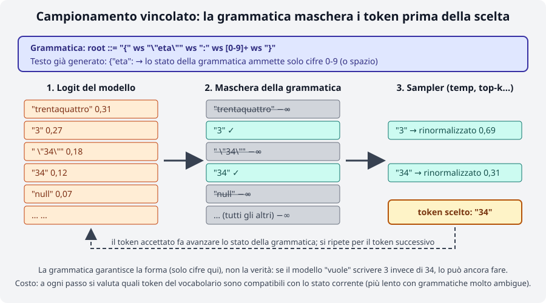
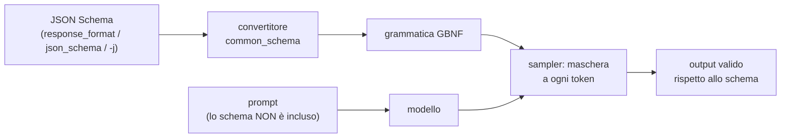

# Modulo 06: Output strutturato: grammatiche GBNF e JSON Schema

<span class="stato stato-verificato">verificato su b11046</span>

Un modello di linguaggio produce testo libero. Quando quel testo deve essere letto da un programma (un JSON da
decodificare, un comando da eseguire, un "sì/no" da confrontare) il testo libero è un problema: un ` ```json `
di troppo, una virgola mancante, un `"2"` al posto di `2` e il parser fallisce. llama.cpp risolve il problema
alla radice, nel **campionamento**: a ogni token una grammatica formale decide quali token sono ammessi e
azzera la probabilità di tutti gli altri. Il modello non può *fisicamente* uscire dal formato. In questo
modulo impari a scrivere quelle grammatiche (GBNF), a farle generare da un JSON Schema, a usarle via CLI e via
API (`response_format`) e, soprattutto, a capire che cosa garantiscono e che cosa no.

## Cosa imparerai

- Come funziona il campionamento vincolato e perché è più affidabile di "per favore rispondi in JSON".
- La sintassi GBNF: regole, terminali, alternanze, ripetizioni, intervalli di caratteri, token speciali.
- Come llama.cpp converte un JSON Schema in grammatica, e quali parti dello schema ignora.
- Come usarlo: `--grammar`, `--grammar-file`, `-j/--json-schema` nel CLI; `grammar`, `json_schema` e
  `response_format` nel server; `Custom JSON` nella web UI.
- I limiti: costo del campionamento, grammatiche lente, valori "inventati" in una forma perfetta, e quando
  conviene il tool calling al posto della grammatica.

## 1. Perché vincolare l'output

Prova a chiedere a Qwen3.5-0.8B di estrarre dei dati "in JSON" senza vincoli (temperatura 0, thinking spento):

```bash
curl -s http://127.0.0.1:8080/v1/chat/completions -H "Content-Type: application/json" -d '{
  "messages": [{"role":"system","content":"Estrai i dati in JSON con i campi nome, eta (intero), citta."},
               {"role":"user","content":"Mi chiamo Giulia Ferri, ho trentaquattro anni e vivo a Ferrara."}],
  "temperature": 0, "max_tokens": 80, "chat_template_kwargs": {"enable_thinking": false}}'
```

Contenuto reale della risposta: `` ```json\n[\n  {\n    "nome": "Giulia Ferri",\n    "eta": 24,\n    "citta": "Ferrara"\n  }\n]\n``` ``.
Tre problemi in una riga: il blocco Markdown attorno, un **array** invece di un oggetto, e `eta: 24` invece
di 34. Con `response_format` e uno schema (§ 4) la stessa richiesta restituisce esattamente
`{"nome": "Giulia Ferri", "eta": 24, "citta": "Ferrara"}`: sparisce la recinzione, sparisce l'array, ma **24
resta 24**. Tienilo a mente per tutto il modulo: la grammatica governa la forma, non la verità.

Il meccanismo è nel sampler. A ogni passo il modello produce un logit per ognuno dei ~150k token del
vocabolario; prima che top-k, top-p e temperatura scelgano, la grammatica guarda lo stato in cui si trova
(cosa è già stato generato) e mette a `-∞` ogni token che non può proseguire una stringa valida. Il resto è
campionamento normale, rinormalizzato sui token sopravvissuti.

<figure class="schema" markdown>

<figcaption>Dopo <code>{"eta":</code> la grammatica ammette solo cifre: "trentaquattro" e "null" vengono azzerati, ma fra "3" e "34" sceglie ancora il modello.</figcaption>
</figure>

Il campionamento vincolato è la base di tre funzioni che hai già incontrato o incontrerai: il **tool calling**
del modulo 04 (il server genera una grammatica per il formato di chiamata del modello), lo schema JSON nella
web UI e, nel modulo 08, l'estrazione affidabile per un RAG.

## 2. La sintassi GBNF

GBNF (*GGML BNF*) è una notazione BNF con qualche aggiunta presa dalle espressioni regolari. Una grammatica è un
elenco di **regole** `nome ::= sequenza`; la regola `root` è il punto di partenza e descrive l'intero output.

| Costrutto | Esempio | Significato |
|---|---|---|
| Regola | `root ::= "sì" \| "no"` | il nome (minuscolo, con trattini: `check-mate`) sta per ciò che c'è a destra |
| Terminale | `"1. "`, `"O-O"` | caratteri letterali (Unicode; escape `\n`, `\"`, `\xXX`, `\uXXXX`, `\UXXXXXXXX`) |
| Intervallo | `[1-9]`, `[NBKQR]`, `[ぁ-ゟ]` | un carattere fra quelli elencati |
| Negazione | `[^\n]+` | qualunque carattere tranne quelli elencati |
| Sequenza | `"1. " move " " move "\n"` | l'ordine conta |
| Alternanza | `pawn \| nonpawn \| castle` | una delle opzioni |
| Gruppo | `("accendi" \| "spegni") " " stanza` | raggruppa per applicare alternanze o ripetizioni |
| Ripetizioni | `x*` (0+), `x+` (1+), `x?` (0-1), `x{3}`, `x{2,}`, `x{0,5}` | come nelle regex |
| Token | `<think>`, `<[151667]>`, `!</think>` | un token del vocabolario (per testo o per id); `!` = qualunque altro |
| Commento | `# testo` | fino a fine riga |

Le regole possono andare a capo **solo dentro parentesi** o subito dopo un `|`: una regola spezzata altrove dà
`error parsing grammar: expecting ::= at …` (verificato scrivendo `domotica-json.gbnf` nel lab 06-01).

### Tre grammatiche di esempio

=== "Lista puntata"

    ```
    # dal README ufficiale: una lista, un elemento per riga
    root ::= ("- " item)+
    item ::= [^\n]+ "\n"
    ```

=== "Scacchi (estratto di grammars/chess.gbnf)"

    ```
    root ::= (
        "1. " move " " move "\n"                    # prima mossa numerata
        ([1-9] [0-9]? ". " move " " move "\n")+     # le successive, con numero a 1-2 cifre
    )
    move ::= (pawn | nonpawn | castle) [+#]?         # [+#]? = scacco o matto opzionale
    pawn ::= ([a-h] "x")? [a-h] [1-8] ("=" [QRBN])?
    nonpawn ::= [NBKQR] [a-h]? [1-8]? "x"? [a-h] [1-8]
    castle ::= "O-O" ("-O")?
    ```

=== "JSON generico (grammars/json.gbnf)"

    ```
    root   ::= object
    value  ::= object | array | string | number | ("true" | "false" | "null") ws
    object ::= "{" ws ( string ":" ws value ("," ws string ":" ws value)* )? "}" ws
    array  ::= "[" ws ( value ("," ws value)* )? "]" ws
    string ::= "\"" ( [^"\\\x7F\x00-\x1F] | "\\" (["\\bfnrt] | "u" [0-9a-fA-F]{4}) )* "\"" ws
    number ::= ("-"? ([0-9] | [1-9] [0-9]{0,15})) ("." [0-9]+)? ([eE] [-+]? [0-9] [1-9]{0,15})? ws
    ws     ::= | " " | "\n" [ \t]{0,20}
    ```

    Nota `ws ::= | " " | …`: la prima alternativa è **vuota** (spazio assente). E nota `{0,15}` / `{0,20}` al posto
    di `*`: limitare le ripetizioni tiene la grammatica veloce (§ 5).

Le grammatiche a token servono per i modelli "thinking": `root ::= <think> thinking </think> .*` con
`thinking ::= !</think>*` accetta un blocco di ragionamento e poi testo libero; funziona solo se `<think>` è
un token unico nel vocabolario, altrimenti la grammatica non compila.

### Usarla dal CLI

```bash
llama cli -hf ggml-org/Qwen3.5-0.8B-GGUF -st -rea off --temp 0 -n 20 \
  --grammar 'root ::= ("sì" | "no")' -p "Bologna è in Italia? Rispondi sì o no."
# → sì

llama cli -hf ggml-org/Qwen3.5-0.8B-GGUF -st -rea off --temp 0 -n 40 --grammar-file json.gbnf \
  -sys "Estrai citta e gradi in JSON." -p "A Trento oggi ci sono 17 gradi."
```
```json
{
  "city": "Trento",
  "temperature": 17,
  "unit": "gradi"
```

Entrambi verificati. Il secondo mostra due cose: il JSON è sintatticamente perfetto ma i **nomi dei campi li ha
scelti il modello** (`city`, non `citta`: la grammatica JSON generica non li conosce), e `-n 40` ha tagliato
l'output prima della `}` finale. Il vincolo non impedisce a `max_tokens` di troncare: dimensiona sempre il
budget di token e controlla `finish_reason`. Per un formato di comandi tuo, con vocabolario chiuso, vedi il lab 06-01.

## 3. Da JSON Schema a grammatica

Scrivere a mano una grammatica per un JSON con dieci campi è noioso e fragile. llama.cpp contiene un convertitore
(`common/json-schema-to-grammar`, riscritto nella 0.4.1 come `common_schema`) che trasforma un **sottoinsieme** di
JSON Schema in GBNF, a ogni richiesta. Per lo schema

```json
{"type": "array", "minItems": 10, "maxItems": 100,
 "items": {"type": "object", "additionalProperties": false, "required": ["name", "age"],
           "properties": {"name": {"type": "string", "minLength": 1, "maxLength": 100},
                          "age":  {"type": "integer", "minimum": 0, "maximum": 150}}}}
```

la grammatica generata (dal README ufficiale) è:

```
char ::= [^"\\\x7F\x00-\x1F] | [\\] (["\\bfnrt] | "u" [0-9a-fA-F]{4})
item ::= "{" space item-name-kv "," space item-age-kv "}" space
item-age ::= ([0-9] | ([1-8] [0-9] | [9] [0-9]) | "1" ([0-4] [0-9] | [5] "0")) space
item-age-kv ::= "\"age\"" space ":" space item-age
item-name ::= "\"" char{1,100} "\"" space
item-name-kv ::= "\"name\"" space ":" space item-name
root ::= "[" space item ("," space item){9,99} "]" space
space ::= | " " | "\n" [ \t]{0,20}
```

Leggila con la tabella del § 2: ogni proprietà diventa una regola `nome-kv` con la chiave **letterale** (il modello
non può inventare chiavi), le proprietà `required` compaiono nell'ordine dello schema, `minimum/maximum` di un
intero diventano un'alternanza di cifre (`item-age`: da 0 a 150), `minLength/maxLength` diventano `char{1,100}`,
`minItems/maxItems` diventano `{9,99}` ripetizioni dopo il primo elemento.



!!! warning "Lo schema non viene mostrato al modello"
    Lo schema vincola soltanto il campionamento, **non è iniettato nel prompt**. Il modello "scopre" la struttura
    token per token, mentre la grammatica gli chiude le strade. Se vuoi che capisca cosa deve scrivere in ogni
    campo (cosa vuol dire `locali`, che `prezzo_euro` è un intero senza separatori) descrivilo tu nel prompt.
    Con il tool calling è diverso: lì lo schema dei parametri finisce nel prompt tramite il chat template.

Cosa il convertitore supporta e cosa no (README `grammars/`, build corrente):

| Supportato | Non supportato o limitato |
|---|---|
| `type` (`object`, `array`, `string`, `integer`, `number`, `boolean`, `null`), `enum`, `const` | `additionalProperties` è **`false` di default** (contrario alla specifica: più veloce, meno allucinazioni); `true` può produrre chiavi con newline non escapate |
| `properties`, `required`, `items`, `minItems`/`maxItems` | `prefixItems` rotto; `uniqueItems`, `contains`/`minContains` mai |
| `minLength`/`maxLength`, `pattern` (deve iniziare con `^` e finire con `$`) | `patternProperties` no; `format` senza `uri` ed `email` (`date`, `time`, `date-time`, `uuid` sì) |
| `minimum`, `maximum`, `exclusiveMinimum/Maximum` **solo per `integer`** | per `number` gli estremi sono ignorati |
| `anyOf`, `oneOf`, `allOf`, `$ref` locali, `$defs` | non si può mescolare `properties` con `anyOf`/`oneOf` nello stesso tipo; `$ref` annidati rotti; `$ref` remoti no (solo le versioni Python/JS) |
| | `not`, `if`/`then`/`else`, `dependentSchemas`, `$anchor` |

Le feature non supportate sono **ignorate in silenzio**: lo schema viene accettato, la grammatica semplicemente non
le fa rispettare. Se ti servono, valida il risultato nel client (un `jsonschema.validate` in Python) oltre alla grammatica.

## 4. Nell'API e nel CLI

| Dove | Come |
|---|---|
| `llama cli` / `llama completion` | `--grammar 'root ::= …'`, `--grammar-file f.gbnf`, `-j '{"type":"object"}'`, `-jf schema.json` |
| `POST /completion` (nativo) | campo `grammar` (stringa GBNF) oppure `json_schema` (oggetto) |
| `POST /v1/chat/completions` | `response_format` (sotto) oppure gli stessi `grammar` / `json_schema` di `/completion` |
| Web UI | `Settings → Developer → Custom JSON` → `{"json_schema": {…}}` (lab 04-01) |
| Tool calling | automatico: il server genera la grammatica dal formato del modello e dai `parameters` dei tool |

`response_format` accetta le due forme OpenAI, più una variante:

```json
{"type": "json_object"}                                         // JSON qualsiasi (grammatica json generica)
{"type": "json_object", "schema": {…}}                          // variante llama.cpp: json_object + schema
{"type": "json_schema", "schema": {…}}                          // forma della doc llama.app
{"type": "json_schema", "json_schema": {"name": "x", "schema": {…}}}   // forma OpenAI (quella che l'SDK produce)
```

Richiesta reale con schema (stesso prompt del § 1):

```bash
curl -s http://127.0.0.1:8080/v1/chat/completions -H "Content-Type: application/json" -d '{
  "messages": [{"role":"system","content":"Estrai i dati in JSON con i campi nome, eta (intero), citta."},
               {"role":"user","content":"Mi chiamo Giulia Ferri, ho trentaquattro anni e vivo a Ferrara."}],
  "temperature": 0, "max_tokens": 80, "chat_template_kwargs": {"enable_thinking": false},
  "response_format": {"type": "json_schema", "schema": {"type": "object",
     "properties": {"nome": {"type": "string"}, "eta": {"type": "integer", "minimum": 0, "maximum": 120},
                    "citta": {"type": "string"}}, "required": ["nome", "eta", "citta"]}}}'
```
```json
{"choices":[{"finish_reason":"stop","message":{"role":"assistant","content":"{\n  \"nome\": \"Giulia Ferri\",\n  \"eta\": 24,\n  \"citta\": \"Ferrara\"\n}"}}],
 "usage":{"prompt_tokens":53,"completion_tokens":34}, "timings":{"predicted_per_second":8.5,"…":"…"}}
```

Con `{"type": "json_object"}` e la domanda «Dammi nome, eta e citta di un personaggio inventato, in JSON» il modello
ha risposto `{"nome": "Elio", "citta": "Milano"}`: JSON valido, ma **senza `eta`**. `json_object` garantisce solo
"un JSON": per i campi obbligatori serve lo schema.

Con l'SDK Python (lab 06-02 usa la libreria standard, ma il principio è lo stesso):

```python
r = client.chat.completions.create(model="local", messages=msgs,
    response_format={"type": "json_schema", "json_schema": {"name": "persona", "schema": SCHEMA}},
    extra_body={"chat_template_kwargs": {"enable_thinking": False}})
dati = json.loads(r.choices[0].message.content)
```

Sul CLI, `-j` e `-jf` sono documentati per `llama cli`, ma **sulla build b11046 falliscono** con
`Error: Failed to initialize samplers: std::exception` (verificato con qualunque schema, anche `{"type":"object"}`,
sia con il binario dell'installer sia con `llama-cli` del tarball). Funziona invece `llama completion -j …`
(verificato: `{"citta": "Trento", "gradi": 17}`), e in chat resta `--grammar-file` con una grammatica JSON.
Se vuoi lo schema in una sessione interattiva usa il server.

Una grammatica malformata è un errore di richiesta, non di generazione:

```json
{"error":{"code":400,"message":"Failed to initialize samplers: failed to parse grammar","type":"invalid_request_error"}}
```

## 5. Limiti e costi

**La forma non è la verità.** Nel lab 06-02, con uno schema rigoroso, tre annunci immobiliari su tre producono JSON
validi: ma un "trilocale" diventa `locali: 2`, una villa diventa `tipo: "appartamento"` e `ascensore: true` compare
dove il testo non lo cita. La grammatica ha chiuso le strade *sintattiche*; dentro il campo, il modello sceglie fra
i valori ammessi con la sua (poca) competenza. Un `enum` con quattro valori obbliga a sceglierne uno anche quando
nessuno è giusto: prevedi sempre un'uscita (`"altro"`, `null`) e controlla i valori a valle.

**Il modello può essere costretto in un vicolo cieco.** Una grammatica che parte con `{` vieta al modello di
iniziare con `Ecco il JSON:` (bene) ma anche con il blocco `<think>` dei modelli "thinking", che così ragionano
"dentro" il JSON o producono risultati peggiori. In tutte le prove di questo modulo il thinking è spento
(`enable_thinking: false`, `-rea off`); se ti serve il ragionamento, usa una grammatica a token che lo ammetta
(§ 2) e verifica il comportamento con il tuo modello (non provato in questo corso).

**Costo.** A ogni token il sampler deve stabilire quali dei ~150k token del vocabolario sono compatibili con lo
stato della grammatica; con grammatiche ambigue (molti percorsi possibili aperti insieme) l'insieme degli stati
esplode. Le regole d'oro del README ufficiale:

- Ripetizioni **limitate**: `x{0,N}` e non `x? x? x? …` né `x*` su spazi bianchi (lo `ws` di `json.gbnf` usa
  `[ \t]{0,20}`; il lab 06-01 usa `[ \n]{0,4}`).
- Meno alternanze aperte possibile; `additionalProperties: false` (il default) tiene la grammatica piccola.
- Con il thinking spento e temperatura 0, nelle prove di questo modulo il vincolo non ha rallentato la
  generazione in modo misurabile (8,5 t/s con schema contro 4,9 senza, sul VPS rumoroso: differenza dovuta al
  carico, non al sampler). Diventa un costo con schemi di decine di campi annidati e stringhe lunghe.

**Diagnostica.** Il server rifiuta con 400 le grammatiche che non compilano; le feature dello schema non supportate
invece passano senza avviso. Per capire cosa è stato generato davvero puoi convertire lo schema con lo script
`examples/json_schema_to_grammar.py` dei sorgenti (stampa la GBNF) e provare la grammatica con
`tests/test-gbnf-validator` compilato dai sorgenti (non è nei tarball delle release).

### Grammatica o tool calling?

| Vuoi… | Usa |
|---|---|
| un output in un formato tuo, non JSON (comandi, CSV, mosse, "sì/no") | `grammar` GBNF |
| un JSON che rispetti uno schema, senza logica di programma nel mezzo | `response_format` / `json_schema` |
| che il modello **decida se e quale** funzione chiamare, con argomenti validi, e poi continui con il risultato | tool calling (modulo 04): lo schema dei parametri finisce nel prompt, il formato di chiamata è quello nativo del modello |
| che il modello risponda a testo *oppure* in JSON, a seconda del caso | tool calling (`tool_choice: auto`): una grammatica JSON obbligherebbe sempre il JSON |
| garanzie sul contenuto (numeri corretti, categorie giuste) | nessuno dei due: validazione a valle, modelli più grandi, esempi nel prompt |

## Riepilogo

| Concetto | Dove |
|---|---|
| Grammatica GBNF | regole `nome ::= …`, `root` obbligatoria; terminali, `[a-z]`, `\|`, `()`, `* + ? {m,n}`, `<token>` |
| Nel CLI | `--grammar`, `--grammar-file`; `-j`/`-jf` (su b11046 solo in `llama completion`) |
| Nel server | `grammar`, `json_schema` (nativi); `response_format: json_object \| json_schema` (OpenAI) |
| Schema → grammatica | sottoinsieme di JSON Schema; `additionalProperties: false` di default; schema non nel prompt |
| Limiti | forma sì, verità no; feature ignorate in silenzio; ripetizioni illimitate lente; thinking vs `{` |
| Alternativa | tool calling quando la scelta dell'azione spetta al modello |

## Errori comuni

!!! warning "`expecting ::= at …`"
    Hai spezzato una regola su più righe fuori dalle parentesi. Metti la parte destra fra `( … )` oppure vai a
    capo subito dopo un `|`.

!!! warning "Il JSON è valido ma i campi si chiamano in un altro modo"
    Hai usato `json_object` o una grammatica JSON generica: le chiavi le sceglie il modello. Passa uno schema con
    `properties` + `required`, e descrivi i campi nel prompt (lo schema non lo vede).

!!! warning "Output tagliato a metà"
    `finish_reason: length`. La grammatica non può chiudere le parentesi al posto del modello se i token finiscono.
    Alza `max_tokens` e limita `maxLength`/`maxItems` nello schema.

!!! warning "Con la grammatica il modello 'thinking' produce spazzatura o si blocca"
    La grammatica vieta `<think>` come primo token. Spegni il thinking o scrivi una grammatica a token che lo ammetta.

!!! warning "`minimum`/`maximum` ignorati"
    Valgono solo per `integer`. Per i `number` (e per tutte le feature della tabella "non supportato") valida nel client.

!!! warning "`llama cli -j` → `Failed to initialize samplers`"
    Bug della build b11046: usa `llama completion -j`, `--grammar-file`, o il server con `json_schema`.

## Laboratori di questo modulo

- [Lab 06-01: Scrivere una grammatica](../../laboratori/lab-06-01-gbnf/README.md): una grammatica GBNF per comandi
  domotici, in forma testuale e in forma JSON, provata con `llama cli --grammar-file` e via API.
- [Lab 06-02: Estrazione dati in JSON](../../laboratori/lab-06-02-estrazione-json/README.md): `response_format`
  con schema su annunci immobiliari, confronto con/senza vincolo, e caccia agli errori *nei valori*.

## Verifica

1. Dove agisce esattamente una grammatica GBNF nel processo di generazione? Cosa fa ai token non ammessi?
2. Scrivi una regola GBNF che accetti un orario `HH:MM` con ore 00-23 e minuti 00-59.
3. Perché `ws ::= [ \t\n]*` è sconsigliato e cosa usare al suo posto?
4. Il modello riceve lo schema JSON passato in `response_format`? E i `parameters` di un tool?
5. Qual è il default di `additionalProperties` in llama.cpp e perché è diverso dalla specifica?
6. Uno schema con `"type": "number", "minimum": 0` può produrre `-3.5`? Perché?
7. Estrai `eta` da «ho trentaquattro anni» con uno schema `integer`: il risultato è garantito 34?
8. Devi far scegliere al modello se cercare nel database o rispondere subito: grammatica o tool calling?

??? success "Soluzioni"
    1. Nel sampler, prima di top-k/top-p/temperatura: a ogni passo maschera (logit `-∞`) i token che non possono
       continuare una stringa valida dallo stato corrente; il token scelto fa avanzare lo stato.
    2. `root ::= ([01] [0-9] | "2" [0-3]) ":" [0-5] [0-9]`
    3. Le ripetizioni illimitate su alternative "aperte" moltiplicano gli stati da valutare a ogni token. Meglio
       una ripetizione limitata: `ws ::= [ \t\n]{0,20}` (o le forme di `json.gbnf`: `| " " | "\n" [ \t]{0,20}`).
    4. No: `response_format`/`json_schema` vincolano solo il campionamento, il prompt non cambia. Sì per i tool:
       il chat template inserisce nome, descrizione e schema dei parametri nel prompt.
    5. `false`: grammatica più piccola e veloce, meno chiavi allucinate. La specifica JSON Schema dice `true`.
    6. Sì: `minimum`/`maximum` sono applicati solo a `integer`; per `number` vengono ignorati in silenzio.
    7. No. La grammatica garantisce che sia un intero (nell'intervallo, se indicato); il valore lo sceglie il
       modello, che può sbagliare (nelle prove: 24). Serve validazione a valle o un modello migliore.
    8. Tool calling con `tool_choice: auto`: il modello può rispondere a testo o emettere una `tool_call` con
       argomenti già validi. Una grammatica JSON lo obbligherebbe sempre al JSON.

## Riferimenti

- [grammars/README.md](https://github.com/ggml-org/llama.cpp/blob/master/grammars/README.md): guida GBNF, conversione da JSON Schema, limiti
- [grammars/](https://github.com/ggml-org/llama.cpp/tree/master/grammars): esempi `json.gbnf`, `json_arr.gbnf`, `chess.gbnf`, `list.gbnf`, `arithmetic.gbnf`, `c.gbnf`
- [tools/server/README.md](https://github.com/ggml-org/llama.cpp/blob/master/tools/server/README.md): campi `grammar`, `json_schema`, `response_format`
- [llama.app: API server](https://llama.app/docs/api): esempio di `response_format`
- [tests/test-json-schema-to-grammar.cpp](https://github.com/ggml-org/llama.cpp/blob/master/tests/test-json-schema-to-grammar.cpp): l'elenco più aggiornato delle feature di schema supportate
- [Issue 4218](https://github.com/ggml-org/llama.cpp/issues/4218): prestazioni delle grammatiche
- [JSON Schema](https://json-schema.org/understanding-json-schema/): riferimento della specifica
