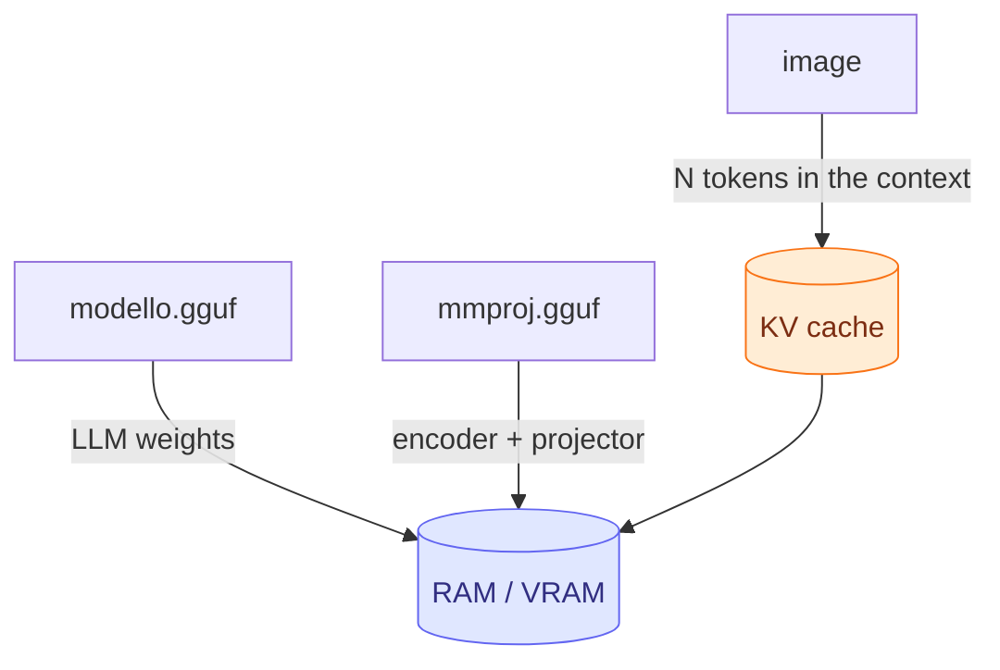

# Module 07: Multimodality: vision, audio, voice

So far, models have read and written only text. In this module you open the model up to images, audio and video
with llama.cpp's **mtmd** subsystem, and you make it speak with `llama-tts`. The vision examples run on a
regular CPU with a 280 MB model; for audio and speech synthesis you use the same tools with dedicated models.

## What you will learn

- What `libmtmd` is, why a multimodal model is made of **two GGUF files**, and what the `mmproj` projector contains.
- Which pre-quantized models `ggml-org` offers for vision, audio and mixed modalities, and how big they are.
- Using images and audio from `llama cli` (`--image`, `--audio`, `/image`, `/audio`) and through the API (`image_url`, `input_audio`, base64 data URIs).
- Attaching images, PDFs and audio in the web UI.
- Generating voice with `llama-tts` (Qwen3-TTS, Pocket TTS).
- Estimating memory: how many tokens an image "costs", where the projector goes, how to keep the context in check.

## 1. The mtmd subsystem and the `mmproj` projector

llama.cpp added vision in 2023 with LLaVA (`llava.cpp`, `clip.cpp`, the `llava-cli` binary). Each new model family
brought its own binary (`qwen2vl-cli`, `minicpmv-cli`, `gemma3-cli`…), until PR
[#12849](https://github.com/ggml-org/llama.cpp/pull/12849) introduced **`libmtmd`** (*multimodal*), a single
library that handles images, audio and video with an interface inspired by the `Processor` class in `transformers`.
Today it is used by `llama cli`, `llama serve` and the development tool `llama-mtmd-cli`. The official README states that it is
a sub-project "under very heavy development, with breaking changes expected".

The idea is simple: a separate component **encodes the image into embeddings**, and these embeddings are
**inserted into the context** of the language model in place of a placeholder. The language model (`libllama`)
stays untouched; everything specific to the modality lives in a second file.

<figure class="schema" markdown>

<figcaption>The <code>mmproj</code> file contains the encoder and the projector; the language model receives the embeddings as if they were tokens.</figcaption>
</figure>

To run a multimodal model you therefore need **two GGUFs**:

| File | Contains | Used by |
|---|---|---|
| `modello.gguf` | the language model (weights, vocabulary, chat template) | `libllama` |
| `mmproj-*.gguf` | vision/audio encoder (ViT, Whisper-like) + **projector** to the LLM's `n_embd` size | `libmtmd` |

The projector is specific to each architecture: the Gemma 3 `mmproj` does not work with Qwen2-VL. For supported
models (Gemma 3, SmolVLM/SmolVLM2, Pixtral, Qwen 2/2.5 VL, Mistral Small 3.1, InternVL, MiniCPM-V 4.6…) you create it
with `convert_hf_to_gguf.py --mmproj`; for older models (LLaVA, MobileVLM, MiniCPM-V 2.x, Granite Vision) there are
dedicated guides in `docs/multimodal/`.

### The flags to know

From `llama cli --help` and `llama serve --help` (b11046):

| Flag | Effect |
|---|---|
| `-hf user/repo[:quant]` | downloads the model **and, if present, the `mmproj` too** |
| `-mm, --mmproj FILE` | projector from a local file (`-m modello.gguf --mmproj mmproj.gguf`) |
| `-mmu, --mmproj-url URL` | projector from a URL |
| `--mmproj-auto` / `--no-mmproj` | use (default) or ignore the projector: with `--no-mmproj` the model goes back to text only |
| `--mmproj-offload` / `--no-mmproj-offload` | projector on the GPU (default) or in RAM |
| `-mmdev, --mmproj-device DEV` | device for the projector (`none` = no offload; default: follows `--device`) |
| `--image FILE`, `--audio FILE`, `--video FILE` | media for a single prompt; multiple files separated by commas |
| `--image-min-tokens N`, `--image-max-tokens N` | token limits per image for dynamic-resolution models |
| `--video-fps N` | frames per second extracted from the video (default 4.0) |
| `--mtmd-batch-max-tokens N` (server) | image tokens per batch during encoding (default 1024) |
| `--media-path DIR` (server) | folder from which the API can read local files with `file://` |

!!! note "Single binary and old names"
    In this course we use `llama cli` and `llama serve`. In the release tarballs and in the repo documentation you
    still find `llama-cli`, `llama-server`, `llama-mtmd-cli` and `llama-tts`: they are the same programs. `llama-mtmd-cli`
    and `llama-tts` are **not** in the installer binary: you need the release tarball or a build from source.

## 2. Ready-made models

The official list is in `docs/multimodal.md` and in the `ggml-org`
[Multimodal GGUFs](https://huggingface.co/collections/ggml-org/multimodal-ggufs-68244e01ff1f39e5bebeeedc) collection;
almost all of them use the `Q4_K_M` quant by default. Sizes as of 09/23/2026.

| Modality | `-hf` repository | Model + mmproj | Notes |
|---|---|---|---|
| vision | `ggml-org/SmolVLM-256M-Instruct-GGUF` | 175 MB (Q8_0) + 104 MB | **used in this module**: runs anywhere, limited quality |
| vision | `ggml-org/SmolVLM-500M-Instruct-GGUF` | 437 MB (Q8_0) + 109 MB | the next step up for a laptop |
| vision | `ggml-org/gemma-3-4b-it-GGUF` | 2.5 GB (Q4_K_M) + 851 MB | excellent on 8 GB of RAM; the official README example |
| vision | `ggml-org/Qwen2.5-VL-3B-Instruct-GGUF`, `-7B-`, `-32B-`, `-72B-` | from ~2 GB | strong on documents and OCR |
| vision | `ggml-org/InternVL3-1B-Instruct-GGUF` … `-14B-` | from ~1 GB | |
| vision | `ggml-org/pixtral-12b-GGUF`, `Mistral-Small-3.1-24B-Instruct-2503-GGUF`, `Llama-4-Scout-17B-16E-Instruct-GGUF`, `moondream2-20250414-GGUF` | large | for those with a GPU |
| audio | `ggml-org/Qwen3-ASR-0.6B-GGUF`, `-1.7B-` | 805 MB (Q8_0) + 214 MB | transcription (ASR) |
| audio | `ggml-org/ultravox-v0_5-llama-3_2-1b-GGUF`, `…-3_1-8b-` | 808 MB + 1.37 GB | audio understanding |
| audio | `ggml-org/Voxtral-Mini-3B-2507-GGUF` | 2.5 GB + 716 MB | Mistral |
| text+image+audio | `ggml-org/gemma-4-E2B-it-GGUF`, `ggml-org/gemma-4-E4B-it-GGUF` | E4B: 4.6 GB (Q4_0) + 560 MB | the llama.app example: ~6 GB with 16k of context |
| text+image+audio | `ggml-org/Qwen2.5-Omni-3B-GGUF`, `-7B-`, `Qwen3-Omni-30B-A3B-…` | from ~2 GB | |

To find more: search Hugging Face with `pipeline_tag=image-text-to-text` and "gguf". Dedicated **OCR** models
(PaddleOCR-VL, GLM-OCR, DeepSeek-OCR, Dots.OCR, HunyuanOCR) are supported but require specific prompts and input
structure, documented in their respective PRs.

## 3. Images from `llama cli`

With `-hf` the projector comes along by itself. The banner shows the `modalities` line, which tells you what the model accepts:

```bash
llama cli -hf ggml-org/SmolVLM-256M-Instruct-GGUF:Q8_0
```

```text
build      : b11046-60081bb2b
model      : ggml-org/SmolVLM-256M-Instruct-GGUF:Q8_0
ftype      : Q8_0
modalities : text, vision, video

available commands:
  /image <file>       add an image file
  /video <file>       add a video file
  …
```

In chat you attach the media **first**, **then** you write the question about it:

```text
> /image forme.png

Loaded media from 'forme.png'

> Describe this image.
```

For a one-shot question without entering chat, use `--image` with `-p` (and `-st` to exit at the end). Output on a
6-vCPU machine without a GPU (a 320×240 test image with a red square and a blue rectangle, generated with ffmpeg in lab 07-01):

```bash
llama cli -hf ggml-org/SmolVLM-256M-Instruct-GGUF:Q8_0 --image forme.png -p "Describe this image." -st -n 60 -t 3
```

```text
Loaded media from 'forme.png'

> Describe this image.
 The image features two rectangular shapes: a red rectangle and a blue rectangle. …

[ Prompt: 5.1 t/s | Generation: 5.6 t/s ]
```

The same pattern applies to audio: `/audio file.mp3` in chat or `--audio file.mp3` on the command line, with a model
that lists `audio` among its modalities. Multiple files: `--image a.png,b.png`.

!!! tip "`llama-mtmd-cli`, the development tool"
    The tarball contains `llama-mtmd-cli`, the minimal front end of `libmtmd`:
    `llama-mtmd-cli -m modello.gguf --mmproj mmproj.gguf --image foto.jpg -p "Describe"`. Without `--image`/`-p` it enters
    chat. It is useful for isolating a projector problem from the rest of the chain.

## 4. Images and audio through the API

`llama serve` accepts the OpenAI API **content parts** on the `/v1/chat/completions` endpoint:

```json
{
  "messages": [{
    "role": "user",
    "content": [
      { "type": "text", "text": "What is in this image?" },
      { "type": "image_url", "image_url": { "url": "https://example.com/photo.jpg" } }
    ]
  }]
}
```

Rules (from the server README):

- `image_url.url` can be a **remote URL**, **base64** (raw or a data URI `data:image/png;base64,…`) or a local
  file `file://path` (only with `--media-path DIR`, paths relative to that folder). Formats: those supported by
  `stb_image` (JPEG, PNG, BMP, GIF, TGA…).
- `input_audio`: `input_audio.data` (base64) or `input_audio.url`; `miniaudio` formats (MP3, WAV, FLAC);
  `input_audio.format` is ignored, the type is derived from the file.
- `input_video`: `data` or `url`; requires `ffmpeg` (`--video-ffmpeg-dir` if it is not in the PATH).
- The native `/completion` endpoint accepts `{"prompt_string": "… <__media__> …", "multimodal_data": ["<base64>"]}`:
  one `<__media__>` marker per item. A client must first check in `/models` or `/v1/models` that the model
  is multimodal.

Request with a data URI (server started with `llama serve -hf ggml-org/SmolVLM-256M-Instruct-GGUF:Q8_0 --port 18105 -c 4096 -t 3`):

```bash
B64=$(base64 -w0 forme.png)
curl -s http://127.0.0.1:18105/v1/chat/completions -H "Content-Type: application/json" -d @- <<EOF
{"messages":[{"role":"user","content":[
  {"type":"text","text":"Describe this image."},
  {"type":"image_url","image_url":{"url":"data:image/png;base64,$B64"}}]}],
 "max_tokens":60}
EOF
```

In the response, look at `usage`: with the image the prompt is **146 tokens**, without the image the same question is 12.
The server log confirms that the projector is loaded: `srv load_model: loaded multimodal model, '…/mmproj-SmolVLM-256M-Instruct-Q8_0.gguf'`.

With the `openai` Python SDK (seen in module 04) it is identical: `client.chat.completions.create(model="…", messages=[…content parts…])`.
You encode the local file yourself:

```python
import base64
uri = "data:image/png;base64," + base64.b64encode(open("forme.png", "rb").read()).decode()
```

## 5. The web UI: images, PDFs, audio

The `llama serve` web UI (module 04) adds files from the "media" menu or when you drag them into the conversation:

- **images and PDFs** for models with vision (JPEG, PNG, GIF, WebP, SVG, PDF);
- **audio** MP3/WAV for models that accept audio.

The UI knows the model's modalities and **prevents** you from sending an image to a text-only model. PDF is handy for
invoices, receipts and forms: the UI turns it into content the model can read (pages as images for models with vision, extracted text otherwise). Demo videos at [llama.app/docs/webui](https://llama.app/docs/webui).

## 6. Audio input

With an `audio` model (Qwen3-ASR for transcription, Ultravox/Voxtral/Gemma 4 for understanding and answering) the flow is the same
as for images: `--audio file.wav`, `/audio` in chat, `input_audio` through the API. Example from llama.app:

```text
> /audio esempio.mp3

Loaded media from 'esempio.mp3'

> transcribe this audio
```

The audio is resampled and encoded by the `mmproj` encoder (Whisper-type for many models); the token cost
depends on the duration. In lab 07-02 you generate a test WAV file with `ffmpeg` and try all three paths.

## 7. Speech synthesis with `llama-tts`

`llama-tts` (in the tarball, not in the installer) generates audio through `libmtmd`: an LLM "backbone" produces acoustic tokens and
an `mmproj` turns them into a waveform. The tool is model-independent (Qwen3-TTS, Pocket TTS). It used to be the OuteTTS demo with the WavTokenizer vocoder: that flow and the vocoder flag no longer exist.

```bash
# Qwen3-TTS: model + mmproj downloaded via -hf, output to out.wav
llama-tts -hf ggml-org/Qwen3-TTS-12Hz-1.7B-Base-GGUF -p "Hello world" --output out.wav

# language and reference voice
llama-tts -hf ggml-org/Qwen3-TTS-12Hz-1.7B-Base-GGUF -p "Buongiorno a tutti" \
    --tts-lang it --tts-speaker-file voce.mp3 --output out.wav

# Pocket TTS (kyutai): local files, the reference voice is required
llama-tts -m pocket-tts.gguf -mm mmproj-pocket-tts.gguf -p "Hello world" \
    --tts-speaker-file speaker.mp3 --output out.wav
```

| Flag | Meaning |
|---|---|
| `-o, --output FILE` | WAV file (default `output.wav`) |
| `--tts-lang` | ISO 639-1 language for Qwen3-TTS: `zh en de it pt es ja ko fr ru` (default `en`); ignored by Pocket TTS |
| `--tts-speaker-file` | reference audio (wav/mp3) to clone the voice; required with Pocket TTS |
| `-n N` | limit in audio **frames** (how many ms a frame lasts depends on the model) |
| `--temp`, `--top-k`, `--top-p`, `-ngl`, `-b`, `-ub` | same as for text |

Qwen3-TTS-1.7B is 1.0 GB (Q4_K_M) + 446 MB of `mmproj`.
To convert Pocket TTS from HF: `convert_hf_to_gguf.py path/languages/english --outfile pocket-tts.gguf` and
`… --mmproj --outfile mmproj-pocket-tts.gguf` (a `languages/<language>` folder, not the root).

## 8. Memory and performance



- **Weights**: LLM + `mmproj` (from 100 MB to over 1 GB). With `--no-mmproj-offload` the projector stays in RAM and frees VRAM;
  it costs encoding time, not generation time.
- **Context**: each image takes tens to thousands of tokens. With SmolVLM-256M a 320×240 image is ~134 tokens; with
  dynamic-resolution models (Qwen2.5-VL, Gemma 4) a large photo can exceed 1000 and the docs recommend `-c 8192`.
  `--image-max-tokens` sets a cap; resizing images before sending them is the most effective lever.
- **Prompt processing**: the encoder runs once per image (on a 6-vCPU CPU: 150 prompt tokens at 3.7 t/s, ~40 s).
  On a GPU it is almost instant. Images already seen stay in the prompt cache like text tokens.
- **Server with multiple slots**: each slot has its own context (module 04); with large images raise `-c` accordingly.

## Summary

| Concept | Remember |
|---|---|
| `libmtmd` | multimodal library: images, audio, video; used by cli, server, `llama-mtmd-cli`, `llama-tts` |
| `mmproj` | second GGUF: encoder + projector, architecture-specific |
| `-hf` | also downloads the `mmproj`; `--no-mmproj` to exclude it; `--mmproj FILE` for a local one |
| cli | `--image/--audio/--video FILE` (multiple files with commas); in chat `/image`, `/audio`, `/video` |
| API | content parts `image_url` (URL, base64, data URI, `file://` with `--media-path`), `input_audio`, `input_video` |
| web UI | image/PDF/audio attachments; blocks media the model does not support |
| `llama-tts` | `-hf` or `-m … -mm …`, `-p`, `--output`, `--tts-lang`, `--tts-speaker-file`, `-n` frames |
| memory | LLM weights + mmproj + image tokens in KV; `--no-mmproj-offload`, `--image-max-tokens`, `-c` |

## Common mistakes

!!! warning "The model \"does not see\" the image"
    The banner says `modalities : text`: the `mmproj` was not loaded. Typical causes: you used `-m` without `--mmproj`,
    you passed `--no-mmproj`, or the HF repository does not contain an `mmproj-*` file. With a local `-m` the two files
    must belong to the same family and have a compatible quant.

!!! warning "Media after the question"
    In chat the media must be attached **before** the text about it (`/image`, then the question). Through the API the order
    of the content parts is the order of the prompt: put the text that refers to the image in the same message.

!!! warning "`file://` rejected by the server"
    Local paths work only with `--media-path DIR` and are relative to that folder. In production prefer
    base64: you do not expose the filesystem.

!!! warning "Context full"
    A 4000×3000 image on a dynamic-resolution model can fill `-c 4096` on its own. Resize, use
    `--image-max-tokens`, raise `-c`. The server responds with a context error, the cli truncates.

!!! warning "Poor answers from the small model"
    SmolVLM-256M is a demo model: through the API with `temperature 0` it answered "Blue" to the same image it had
    described well in chat. For real work use at least a 2-4B (Gemma 3 4B, Qwen2.5-VL 3B).

!!! warning "`llama-tts: command not found`"
    It is not in the installer: get it from the release tarball (module 01) or build with `LLAMA_BUILD_TOOLS=ON`.

## Labs in this module

- [Lab 07-01: Describing and querying images](../../laboratori/lab-07-01-visione/README.md): SmolVLM-256M from the cli, in chat and through the API with base64; reading a document.
- [Lab 07-02: Audio and voice](../../laboratori/lab-07-02-audio/README.md): a test WAV, an audio model, speech synthesis with `llama-tts`.

## Check

1. Why is a multimodal model in llama.cpp made of two GGUF files?
2. What happens if you start `llama cli -hf ggml-org/gemma-3-4b-it-GGUF --no-mmproj`?
3. In chat you want to describe `foto.jpg`: which two lines do you type, and in what order?
4. In the OpenAI-compatible API, which three forms can `image_url.url` take?
5. A client wants to send `file:///tmp/a.png` to the server: which flag is needed and why is it discouraged in production?
6. With `-np 2 -c 8192`, how many tokens does each slot have, and what does that mean for images?
7. What does `--no-mmproj-offload` do and when would you use it?
8. With `llama-tts`, what is `--tts-speaker-file` for and with which model is it required?

??? success "Solutions"
    1. The language model (`libllama`) and the `mmproj` projector (`libmtmd`, encoder + projector) are kept separate so
       the multimodal part can evolve without touching the main library.
    2. The model is loaded as text only: the `mmproj` is neither downloaded nor used; `modalities : text`.
    3. `/image foto.jpg` and then the question, e.g. `Describe the photo`: media first, then text.
    4. Remote URL, base64 (raw or a data URI `data:image/…;base64,`), local file `file://` (with `--media-path`).
    5. `--media-path DIR`, with paths relative to DIR; discouraged because it exposes server files to anyone calling the API.
    6. 4096 tokens per slot (the context is split among the slots): a large image can fill it; raise `-c` or limit
       `--image-max-tokens`.
    7. It keeps the projector in RAM instead of on the GPU: it frees VRAM for the LLM at the cost of slower encoding.
    8. It provides reference audio to clone the voice; it is required with Pocket TTS, which produces almost nothing without it.

## References

- `tools/mtmd/README.md`: https://github.com/ggml-org/llama.cpp/blob/master/tools/mtmd/README.md
- `docs/multimodal.md` (list of models): https://github.com/ggml-org/llama.cpp/blob/master/docs/multimodal.md
- `tools/tts/README.md`: https://github.com/ggml-org/llama.cpp/blob/master/tools/tts/README.md
- Server, multimodal and content parts section: https://github.com/ggml-org/llama.cpp/blob/master/tools/server/README.md
- llama.app: [CLI](https://llama.app/docs/cli), [API](https://llama.app/docs/api), [Web UI](https://llama.app/docs/webui)
- HF collection: https://huggingface.co/collections/ggml-org/multimodal-ggufs-68244e01ff1f39e5bebeeedc
