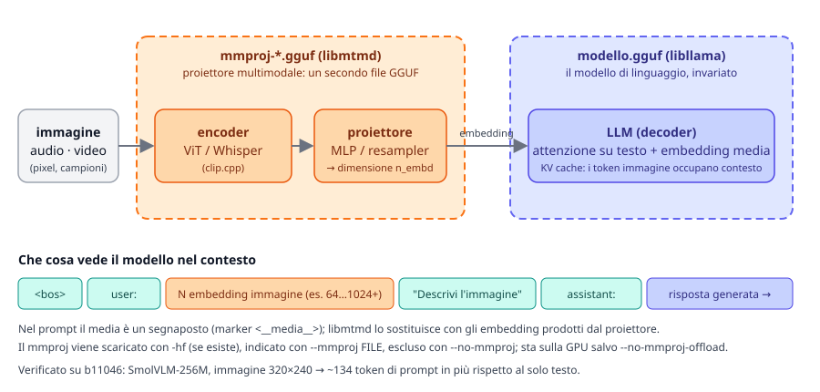
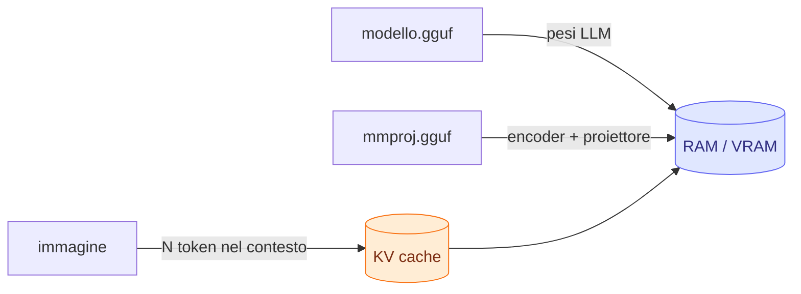

# Modulo 07: Multimodalità: visione, audio, voce

<span class="stato stato-verificato">verificato su b11046 (visione, CPU)</span> <span class="stato stato-bozza">audio e TTS: da verificare</span>

Fino a qui i modelli hanno letto e scritto solo testo. In questo modulo apri il modello anche a immagini, audio e video
con il sottosistema **mtmd** di llama.cpp, e lo fai parlare con `llama-tts`. La parte "visione" è stata provata sul
VPS del corso (CPU, senza GPU) con un modello da 280 MB; audio in ingresso e sintesi vocale sono scritti dalla
documentazione ufficiale e segnalati come da verificare.

## Cosa imparerai

- Che cos'è `libmtmd`, perché un modello multimodale è fatto di **due file GGUF** e che cosa contiene il proiettore `mmproj`.
- Quali modelli pre-quantizzati offre `ggml-org` per visione, audio e modalità miste, e quanto pesano.
- Usare immagini e audio da `llama cli` (`--image`, `--audio`, `/image`, `/audio`) e via API (`image_url`, `input_audio`, data URI base64).
- Allegare immagini, PDF e audio nella web UI.
- Generare voce con `llama-tts` (Qwen3-TTS, Pocket TTS).
- Stimare la memoria: quanti token "costa" un'immagine, dove va il proiettore, come contenere il contesto.

## 1. Il sottosistema mtmd e il proiettore `mmproj`

llama.cpp ha aggiunto la visione nel 2023 con LLaVA (`llava.cpp`, `clip.cpp`, binario `llava-cli`). Ogni nuova famiglia
di modelli portava un binario dedicato (`qwen2vl-cli`, `minicpmv-cli`, `gemma3-cli`…), finché la PR
[#12849](https://github.com/ggml-org/llama.cpp/pull/12849) ha introdotto **`libmtmd`** (*multimodal*), una libreria
unica che gestisce immagini, audio e video con un'interfaccia ispirata alla classe `Processor` di `transformers`.
Oggi la usano `llama cli`, `llama serve` e lo strumento di sviluppo `llama-mtmd-cli`. Il README ufficiale avverte che è
un sotto-progetto "in sviluppo molto intenso, con cambiamenti incompatibili attesi".

L'idea è semplice: l'immagine viene **codificata in embedding** da un componente separato e questi embedding vengono
**inseriti nel contesto** del modello di linguaggio al posto di un segnaposto. Il modello di linguaggio (`libllama`)
resta intatto; tutto ciò che è specifico della modalità sta in un secondo file.

<figure class="schema" markdown>

<figcaption>Il file <code>mmproj</code> contiene encoder e proiettore; il modello di linguaggio riceve gli embedding come se fossero token.</figcaption>
</figure>

Per far girare un modello multimodale servono quindi **due GGUF**:

| File | Contiene | Chi lo usa |
|---|---|---|
| `modello.gguf` | il modello di linguaggio (pesi, vocabolario, chat template) | `libllama` |
| `mmproj-*.gguf` | encoder visivo/audio (ViT, Whisper-like) + **proiettore** verso la dimensione `n_embd` del LLM | `libmtmd` |

Il proiettore è specifico di ogni architettura: il `mmproj` di Gemma 3 non funziona con Qwen2-VL. Per i modelli
supportati (Gemma 3, SmolVLM/SmolVLM2, Pixtral, Qwen 2/2.5 VL, Mistral Small 3.1, InternVL, MiniCPM-V 4.6…) si ottiene
con `convert_hf_to_gguf.py --mmproj`; per i modelli più vecchi (LLaVA, MobileVLM, MiniCPM-V 2.x, Granite Vision) ci sono
guide dedicate in `docs/multimodal/`.

### I flag da conoscere

Verificati in `llama cli --help` e `llama serve --help` (b11046):

| Flag | Effetto |
|---|---|
| `-hf user/repo[:quant]` | scarica il modello **e, se esiste, anche il `mmproj`** |
| `-mm, --mmproj FILE` | proiettore da file locale (`-m modello.gguf --mmproj mmproj.gguf`) |
| `-mmu, --mmproj-url URL` | proiettore da URL |
| `--mmproj-auto` / `--no-mmproj` | usa (default) o ignora il proiettore: con `--no-mmproj` il modello torna solo testo |
| `--mmproj-offload` / `--no-mmproj-offload` | proiettore sulla GPU (default) o in RAM |
| `-mmdev, --mmproj-device DEV` | dispositivo per il proiettore (`none` = niente offload; default: segue `--device`) |
| `--image FILE`, `--audio FILE`, `--video FILE` | media per un prompt singolo; più file separati da virgola |
| `--image-min-tokens N`, `--image-max-tokens N` | limiti di token per immagine nei modelli a risoluzione dinamica |
| `--video-fps N` | fotogrammi al secondo estratti dal video (default 4.0) |
| `--mtmd-batch-max-tokens N` (server) | token immagine per batch durante l'encoding (default 1024) |
| `--media-path DIR` (server) | cartella da cui l'API può leggere file locali con `file://` |

!!! note "Binario unico e nomi vecchi"
    Nel corso usiamo `llama cli` e `llama serve`. Nei tarball delle release e nella documentazione del repo trovi
    ancora `llama-cli`, `llama-server`, `llama-mtmd-cli` e `llama-tts`: sono gli stessi programmi. `llama-mtmd-cli`
    e `llama-tts` **non** sono nel binario dell'installer: servono il tarball della release o la compilazione.

## 2. Modelli pronti

La lista ufficiale è in `docs/multimodal.md` e nella collezione
[Multimodal GGUFs](https://huggingface.co/collections/ggml-org/multimodal-ggufs-68244e01ff1f39e5bebeeedc) di `ggml-org`;
quasi tutti hanno la quant `Q4_K_M` di default. Dimensioni lette dall'API di Hugging Face il 23/09/2026.

| Modalità | Repository `-hf` | Modello + mmproj | Note |
|---|---|---|---|
| visione | `ggml-org/SmolVLM-256M-Instruct-GGUF` | 175 MB (Q8_0) + 104 MB | **usato in questo modulo**: gira ovunque, qualità limitata |
| visione | `ggml-org/SmolVLM-500M-Instruct-GGUF` | 437 MB (Q8_0) + 109 MB | il gradino successivo per un portatile |
| visione | `ggml-org/gemma-3-4b-it-GGUF` | 2,5 GB (Q4_K_M) + 851 MB | ottimo su 8 GB di RAM; l'esempio del README ufficiale |
| visione | `ggml-org/Qwen2.5-VL-3B-Instruct-GGUF`, `-7B-`, `-32B-`, `-72B-` | da ~2 GB | forte su documenti e OCR |
| visione | `ggml-org/InternVL3-1B-Instruct-GGUF` … `-14B-` | da ~1 GB | |
| visione | `ggml-org/pixtral-12b-GGUF`, `Mistral-Small-3.1-24B-Instruct-2503-GGUF`, `Llama-4-Scout-17B-16E-Instruct-GGUF`, `moondream2-20250414-GGUF` | grandi | per chi ha una GPU |
| audio | `ggml-org/Qwen3-ASR-0.6B-GGUF`, `-1.7B-` | 805 MB (Q8_0) + 214 MB | trascrizione (ASR) |
| audio | `ggml-org/ultravox-v0_5-llama-3_2-1b-GGUF`, `…-3_1-8b-` | 808 MB + 1,37 GB | comprensione dell'audio |
| audio | `ggml-org/Voxtral-Mini-3B-2507-GGUF` | 2,5 GB + 716 MB | Mistral |
| testo+immagine+audio | `ggml-org/gemma-4-E2B-it-GGUF`, `ggml-org/gemma-4-E4B-it-GGUF` | E4B: 4,6 GB (Q4_0) + 560 MB | l'esempio di llama.app: ~6 GB con 16k di contesto |
| testo+immagine+audio | `ggml-org/Qwen2.5-Omni-3B-GGUF`, `-7B-`, `Qwen3-Omni-30B-A3B-…` | da ~2 GB | |

Per trovarne altri: cerca su Hugging Face con `pipeline_tag=image-text-to-text` e "gguf". I modelli **OCR** dedicati
(PaddleOCR-VL, GLM-OCR, DeepSeek-OCR, Dots.OCR, HunyuanOCR) sono supportati ma richiedono prompt e struttura di input
specifici, documentati nelle rispettive PR.

## 3. Immagini da `llama cli`

Con `-hf` il proiettore arriva da solo. Nel banner compare la riga `modalities`, che ti dice cosa il modello accetta:

```bash
llama cli -hf ggml-org/SmolVLM-256M-Instruct-GGUF:Q8_0
```

```text
build      : b11046-60081bb2b
model      : ggml-org/SmolVLM-256M-Instruct-GGUF:Q8_0
ftype      : Q8_0
modalities : text, vision, video

available commands:
  /image <file>       add an image file
  /video <file>       add a video file
  …
```

In chat **prima** alleghi il media, **poi** scrivi la domanda che lo riguarda:

```text
> /image forme.png

Loaded media from 'forme.png'

> Describe this image.
```

Per una domanda secca senza entrare in chat usa `--image` con `-p` (e `-st` per uscire alla fine). Output reale sul VPS
(immagine di prova 320×240 con un quadrato rosso e un rettangolo blu, generata con ffmpeg nel lab 07-01):

```bash
llama cli -hf ggml-org/SmolVLM-256M-Instruct-GGUF:Q8_0 --image forme.png -p "Describe this image." -st -n 60 -t 3
```

```text
Loaded media from 'forme.png'

> Describe this image.
 The image features two rectangular shapes: a red rectangle and a blue rectangle. …

[ Prompt: 5.1 t/s | Generation: 5.6 t/s ]
```

Lo stesso schema vale per l'audio: `/audio file.mp3` in chat o `--audio file.mp3` sulla riga di comando, con un modello
che abbia `audio` fra le modalità. Più file: `--image a.png,b.png`.

!!! tip "`llama-mtmd-cli`, lo strumento di sviluppo"
    Nel tarball c'è `llama-mtmd-cli`, il front-end minimale di `libmtmd`:
    `llama-mtmd-cli -m modello.gguf --mmproj mmproj.gguf --image foto.jpg -p "Describe"`. Senza `--image`/`-p` entra in
    chat. È utile per isolare un problema del proiettore dal resto della catena.

## 4. Immagini e audio via API

`llama serve` accetta i **content parts** dell'API OpenAI nell'endpoint `/v1/chat/completions`:

```json
{
  "messages": [{
    "role": "user",
    "content": [
      { "type": "text", "text": "What is in this image?" },
      { "type": "image_url", "image_url": { "url": "https://example.com/photo.jpg" } }
    ]
  }]
}
```

Regole (dal README del server):

- `image_url.url` può essere un **URL remoto**, un **base64** (grezzo o data URI `data:image/png;base64,…`) o un file
  locale `file://percorso` (solo con `--media-path DIR`, percorsi relativi a quella cartella). Formati: quelli di
  `stb_image` (JPEG, PNG, BMP, GIF, TGA…).
- `input_audio`: `input_audio.data` (base64) oppure `input_audio.url`; formati di `miniaudio` (MP3, WAV, FLAC);
  `input_audio.format` viene ignorato, il tipo si ricava dal file.
- `input_video`: `data` o `url`; richiede `ffmpeg` (`--video-ffmpeg-dir` se non è nel PATH).
- L'endpoint nativo `/completion` accetta `{"prompt_string": "… <__media__> …", "multimodal_data": ["<base64>"]}`:
  un marker `<__media__>` per ogni elemento. Un client deve prima verificare in `/models` o `/v1/models` che il modello
  sia multimodale.

Richiesta reale con data URI (sul VPS, server avviato con `llama serve -hf ggml-org/SmolVLM-256M-Instruct-GGUF:Q8_0 --port 18105 -c 4096 -t 3`):

```bash
B64=$(base64 -w0 forme.png)
curl -s http://127.0.0.1:18105/v1/chat/completions -H "Content-Type: application/json" -d @- <<EOF
{"messages":[{"role":"user","content":[
  {"type":"text","text":"Describe this image."},
  {"type":"image_url","image_url":{"url":"data:image/png;base64,$B64"}}]}],
 "max_tokens":60}
EOF
```

Nella risposta guarda `usage`: con l'immagine il prompt è di **146 token**, senza immagine la stessa domanda vale 12.
Il log del server conferma il caricamento del proiettore: `srv load_model: loaded multimodal model, '…/mmproj-SmolVLM-256M-Instruct-Q8_0.gguf'`.

Con l'SDK Python `openai` (già visto nel modulo 04) è identico: `client.chat.completions.create(model="…", messages=[…content parts…])`.
Il file locale va codificato tu stesso:

```python
import base64
uri = "data:image/png;base64," + base64.b64encode(open("forme.png", "rb").read()).decode()
```

## 5. La web UI: immagini, PDF, audio

La web UI di `llama serve` (modulo 04) aggiunge i file dal menu "media" o trascinandoli nella conversazione:

- **immagini e PDF** per i modelli con visione (JPEG, PNG, GIF, WebP, SVG, PDF);
- **audio** MP3/WAV per i modelli che accettano audio.

La UI conosce le modalità del modello e **impedisce** di mandare un'immagine a un modello solo testo. Il PDF è comodo per
fatture, scontrini e moduli: la UI lo trasforma in contenuto che il modello può leggere (pagine come immagini per i
modelli con visione, testo estratto altrimenti; il comportamento esatto dipende dalla versione della UI, da verificare
sulla tua). Video dimostrativi in [llama.app/docs/webui](https://llama.app/docs/webui).

## 6. Audio in ingresso

Con un modello `audio` (Qwen3-ASR per trascrivere, Ultravox/Voxtral/Gemma 4 per capire e rispondere) il flusso è lo stesso
delle immagini: `--audio file.wav`, `/audio` in chat, `input_audio` via API. Esempio di llama.app:

```text
> /audio esempio.mp3

Loaded media from 'esempio.mp3'

> transcribe this audio
```

L'audio viene ricampionato e codificato dall'encoder del `mmproj` (di tipo Whisper per molti modelli); il costo in token
dipende dalla durata. Nel lab 07-02 generi un file WAV di prova con `ffmpeg` e provi i tre percorsi.

<span class="stato stato-bozza">non verificato sul VPS: il modello audio più piccolo (Qwen3-ASR-0.6B) supera 1 GB</span>

## 7. Sintesi vocale con `llama-tts`

`llama-tts` (nel tarball, non nell'installer) genera audio tramite `libmtmd`: un "backbone" LLM produce token acustici e
un `mmproj` li trasforma in forma d'onda. Il README ufficiale (`tools/tts/README.md`) è oggi **indipendente dal modello**;
in passato lo strumento era la demo di OuteTTS con vocoder WavTokenizer, combinazione non più descritta nella documentazione
corrente e senza il vecchio flag del vocoder nell'`--help` di b11046.

```bash
# Qwen3-TTS: modello + mmproj scaricati da -hf, output in out.wav
llama-tts -hf ggml-org/Qwen3-TTS-12Hz-1.7B-Base-GGUF -p "Hello world" --output out.wav

# lingua e voce di riferimento
llama-tts -hf ggml-org/Qwen3-TTS-12Hz-1.7B-Base-GGUF -p "Buongiorno a tutti" \
    --tts-lang it --tts-speaker-file voce.mp3 --output out.wav

# Pocket TTS (kyutai): file locali, la voce di riferimento è obbligatoria
llama-tts -m pocket-tts.gguf -mm mmproj-pocket-tts.gguf -p "Hello world" \
    --tts-speaker-file speaker.mp3 --output out.wav
```

| Flag | Significato |
|---|---|
| `-o, --output FILE` | file WAV (default `output.wav`) |
| `--tts-lang` | lingua ISO 639-1 per Qwen3-TTS: `zh en de it pt es ja ko fr ru` (default `en`); ignorata da Pocket TTS |
| `--tts-speaker-file` | audio di riferimento (wav/mp3) per clonare la voce; obbligatorio con Pocket TTS |
| `-n N` | limite in **frame** audio (quanti ms vale un frame dipende dal modello) |
| `--temp`, `--top-k`, `--top-p`, `-ngl`, `-b`, `-ub` | come per il testo |

Qwen3-TTS-1.7B pesa 1,0 GB (Q4_K_M) + 446 MB di `mmproj`: non è stato provato sul VPS.
Per convertire Pocket TTS da HF: `convert_hf_to_gguf.py path/languages/english --outfile pocket-tts.gguf` e
`… --mmproj --outfile mmproj-pocket-tts.gguf` (una cartella `languages/<lingua>`, non la radice).

<span class="stato stato-bozza">TTS: scritto dalla documentazione, da verificare</span>

## 8. Memoria e prestazioni



- **Pesi**: LLM + `mmproj` (da 100 MB a oltre 1 GB). Con `--no-mmproj-offload` il proiettore resta in RAM e libera VRAM;
  costa tempo di encoding, non di generazione.
- **Contesto**: ogni immagine occupa decine o migliaia di token. Con SmolVLM-256M un'immagine 320×240 sono ~134 token; con i
  modelli a risoluzione dinamica (Qwen2.5-VL, Gemma 4) una foto grande può superare i 1000 e la doc consiglia `-c 8192`.
  `--image-max-tokens` mette un tetto; ridimensionare le immagini prima di inviarle è la leva più efficace.
- **Prompt processing**: l'encoder gira una volta per immagine (sul VPS a 6 vCPU: 150 token di prompt a 3,7 t/s, ~40 s).
  Su GPU è quasi istantaneo. Le immagini già viste restano in cache del prompt come i token di testo.
- **Server con più slot**: ogni slot ha il suo contesto (modulo 04); con immagini grandi alza `-c` di conseguenza.

## Riepilogo

| Concetto | Da ricordare |
|---|---|
| `libmtmd` | libreria multimodale: immagini, audio, video; usata da cli, server, `llama-mtmd-cli`, `llama-tts` |
| `mmproj` | secondo GGUF: encoder + proiettore, specifico per architettura |
| `-hf` | scarica anche il `mmproj`; `--no-mmproj` per escluderlo; `--mmproj FILE` per uno locale |
| cli | `--image/--audio/--video FILE` (più file con virgola); in chat `/image`, `/audio`, `/video` |
| API | content parts `image_url` (URL, base64, data URI, `file://` con `--media-path`), `input_audio`, `input_video` |
| web UI | allegati immagini/PDF/audio; blocca i media non supportati dal modello |
| `llama-tts` | `-hf` o `-m … -mm …`, `-p`, `--output`, `--tts-lang`, `--tts-speaker-file`, `-n` frame |
| memoria | pesi LLM + mmproj + token immagine in KV; `--no-mmproj-offload`, `--image-max-tokens`, `-c` |

## Errori comuni

!!! warning "Il modello \"non vede\" l'immagine"
    Il banner dice `modalities : text`: il `mmproj` non è stato caricato. Cause tipiche: hai usato `-m` senza `--mmproj`,
    hai passato `--no-mmproj`, oppure il repository HF non contiene un file `mmproj-*`. Con `-m` locale i due file
    devono essere della stessa famiglia e quant compatibile.

!!! warning "Media dopo la domanda"
    In chat il media va allegato **prima** del testo che lo riguarda (`/image` e poi la domanda). Via API l'ordine
    delle content parts è quello del prompt: metti il testo che si riferisce all'immagine nello stesso messaggio.

!!! warning "`file://` rifiutato dal server"
    I percorsi locali funzionano solo con `--media-path DIR` e sono relativi a quella cartella. In produzione preferisci
    base64: non esponi il filesystem.

!!! warning "Contesto pieno"
    Un'immagine da 4000×3000 su un modello a risoluzione dinamica può da sola riempire `-c 4096`. Ridimensiona, usa
    `--image-max-tokens`, alza `-c`. Il server risponde con un errore di contesto, la cli tronca.

!!! warning "Risposte scadenti dal modello piccolo"
    SmolVLM-256M è un modello dimostrativo: via API con `temperature 0` ha risposto "Blue" alla stessa immagine che in
    chat aveva descritto bene. Per lavoro reale usa almeno un 2-4B (Gemma 3 4B, Qwen2.5-VL 3B).

!!! warning "`llama-tts: command not found`"
    Non è nell'installer: prendilo dal tarball della release (modulo 01) o compila con `LLAMA_BUILD_TOOLS=ON`.

## Laboratori di questo modulo

- [Lab 07-01: Descrivere e interrogare immagini](../../laboratori/lab-07-01-visione/README.md): SmolVLM-256M da cli, in chat e via API con base64; lettura di un documento.
- [Lab 07-02: Audio e voce](../../laboratori/lab-07-02-audio/README.md): un WAV di prova, un modello audio, la sintesi vocale con `llama-tts`.

## Verifica

1. Perché un modello multimodale in llama.cpp è composto da due file GGUF?
2. Cosa succede se avvii `llama cli -hf ggml-org/gemma-3-4b-it-GGUF --no-mmproj`?
3. In chat vuoi descrivere `foto.jpg`: quali due righe scrivi, in che ordine?
4. Nell'API OpenAI-compatibile, quali tre forme può prendere `image_url.url`?
5. Un client vuole mandare `file:///tmp/a.png` al server: quale flag serve e perché è sconsigliato in produzione?
6. Con `-np 2 -c 8192` quanti token ha ogni slot, e che conseguenza ha per le immagini?
7. Cosa fa `--no-mmproj-offload` e quando lo useresti?
8. Con `llama-tts`, a che cosa serve `--tts-speaker-file` e con quale modello è obbligatorio?

??? success "Soluzioni"
    1. Il modello di linguaggio (`libllama`) e il proiettore `mmproj` (`libmtmd`, encoder + proiettore) sono separati per
       far evolvere la parte multimodale senza toccare la libreria principale.
    2. Il modello viene caricato come solo testo: il `mmproj` non è scaricato né usato; `modalities : text`.
    3. `/image foto.jpg` e poi la domanda, es. `Descrivi la foto`: prima il media, poi il testo.
    4. URL remoto, base64 (grezzo o data URI `data:image/…;base64,`), file locale `file://` (con `--media-path`).
    5. `--media-path DIR`, con percorsi relativi a DIR; sconsigliato perché espone file del server a chi chiama l'API.
    6. 4096 token per slot (il contesto si divide tra gli slot): un'immagine grande può riempirlo; alza `-c` o limita
       `--image-max-tokens`.
    7. Tiene il proiettore in RAM invece che sulla GPU: libera VRAM per il LLM al prezzo di un encoding più lento.
    8. Fornisce un audio di riferimento per clonare la voce; obbligatorio con Pocket TTS, che senza produce quasi nulla.

## Riferimenti

- `tools/mtmd/README.md`: https://github.com/ggml-org/llama.cpp/blob/master/tools/mtmd/README.md
- `docs/multimodal.md` (lista dei modelli): https://github.com/ggml-org/llama.cpp/blob/master/docs/multimodal.md
- `tools/tts/README.md`: https://github.com/ggml-org/llama.cpp/blob/master/tools/tts/README.md
- Server, sezione multimodal e content parts: https://github.com/ggml-org/llama.cpp/blob/master/tools/server/README.md
- llama.app: [CLI](https://llama.app/docs/cli), [API](https://llama.app/docs/api), [Web UI](https://llama.app/docs/webui)
- Collezione HF: https://huggingface.co/collections/ggml-org/multimodal-ggufs-68244e01ff1f39e5bebeeedc
