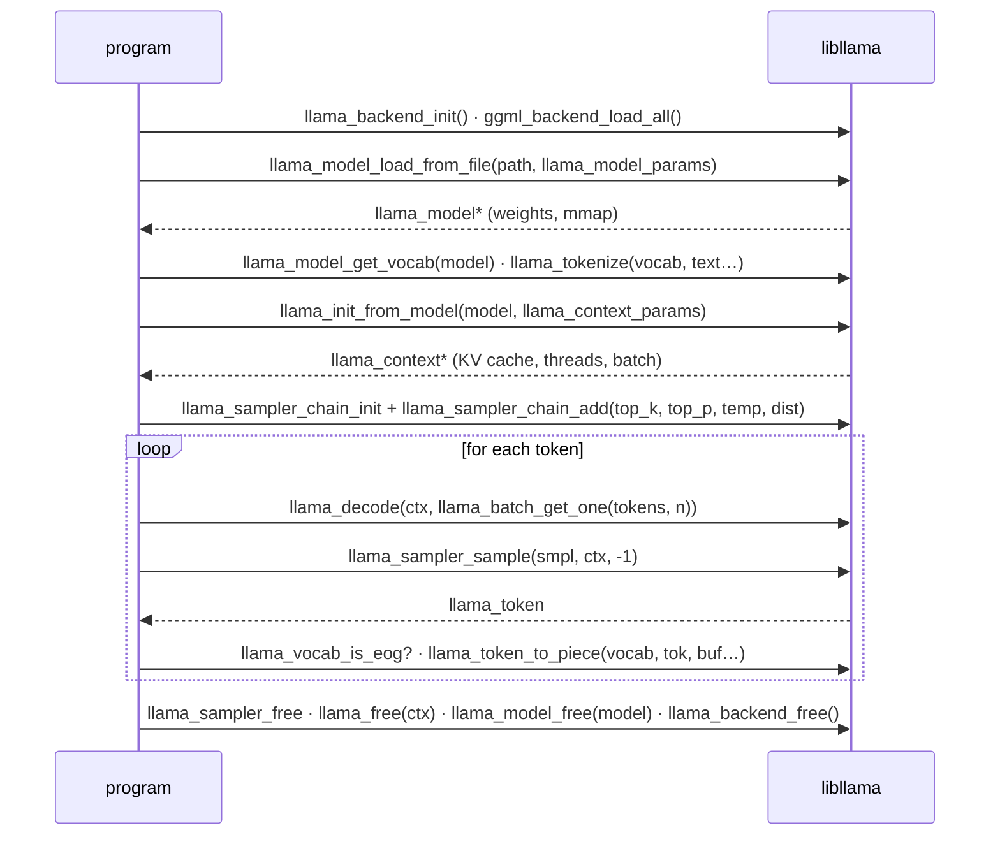
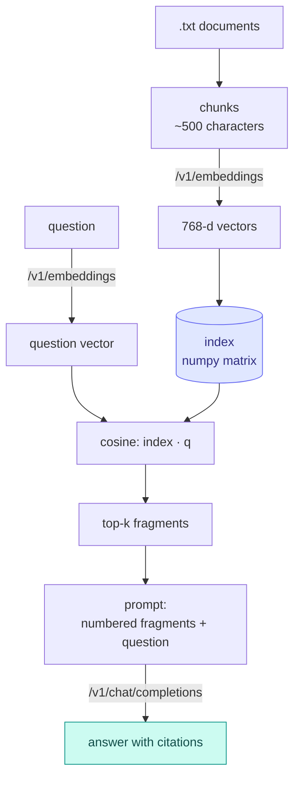

# Module 08: Integrating llama.cpp into applications

So far you have used llama.cpp "from the outside": cli, server, curl. This module brings it **inside** your application. There are
two paths, the HTTP server and the embedded library, plus a set of ready-made bridges: Python bindings, frameworks such as
LangChain and LlamaIndex, bindings for Node, Swift, .NET, Go, Rust, and packages for iOS and Android. You finish with the most
requested use case, RAG, built only with `/v1/embeddings` and `/v1/chat/completions`.

## What you will learn

- Choosing between `llama serve` and `libllama` based on the product you need to build.
- Using the OpenAI SDK (see module 04) and `llama-cpp-python`, both in-process and as a server.
- Connecting LangChain and LlamaIndex to a local server.
- Reading `include/llama.h` and writing a **correct** C++ generator in 100 lines: model, context, batch, sampler, vocabulary.
- Finding your way among bindings for other languages and the mobile options (XCFramework, Android).
- Building a minimal RAG: chunks, embeddings, cosine similarity, top-k, prompt with citations.

## 1. HTTP server or embedded library?

<figure class="schema" markdown>

<figcaption>Two ways to integrate llama.cpp. In practice many projects use the server in development and in production on the backend, and the library on the client (desktop, mobile).</figcaption>
</figure>

Rule of thumb: **start with the server**. A `llama serve` process takes advantage of continuous batching, slots and prompt cache
(module 04), updates with `llama update` without touching the app, and works from any language with an HTTP client.
Switch to the library when an external process is not acceptable (a mobile or desktop app shipped to end users,
environments without network ports) or when you need things the API does not expose: raw logits, batch control,
KV cache manipulation, custom samplers.

## 2. Python

### OpenAI SDK against the server

This is the path already covered in [lab 04-02](../../laboratori/lab-04-02-client-openai/README.md):
`openai.OpenAI(base_url="http://localhost:8080/v1", api_key="no-key-required")` and then `chat.completions.create`,
`embeddings.create`, streaming. It works for any framework that speaks OpenAI.

### `llama-cpp-python`: the in-process library

[`llama-cpp-python`](https://github.com/abetlen/llama-cpp-python) is the Python binding of `libllama` (ctypes) with
a high-level API. It ships **its own copy of llama.cpp**, which `pip` builds: the version can be
older than your `llama` (brand-new models may fail to load).

```bash
pip install llama-cpp-python                                         # builds llama.cpp (needs cmake + a compiler)
pip install llama-cpp-python --extra-index-url https://abetlen.github.io/llama-cpp-python/whl/cpu   # prebuilt CPU wheel
CMAKE_ARGS="-DGGML_CUDA=on"   pip install llama-cpp-python           # backend: CUDA
CMAKE_ARGS="-DGGML_METAL=on"  pip install llama-cpp-python           # Metal (macOS)
CMAKE_ARGS="-DGGML_VULKAN=on" pip install llama-cpp-python           # Vulkan
CMAKE_ARGS="-DGGML_HIP=on"    pip install llama-cpp-python           # ROCm
```

`CMAKE_ARGS` accepts all of llama.cpp's build options (module 01); alternatively `pip install -C cmake.args="…"`.
Prebuilt wheels also exist for CUDA (`whl/cu121`…`cu132`), Metal, Vulkan and ROCm. To rebuild:
`--upgrade --force-reinstall --no-cache-dir`.

```python
from llama_cpp import Llama

llm = Llama(
    model_path="./Qwen3.5-0.8B-Q8_0.gguf",
    n_ctx=4096,          # context (default 512!)
    n_gpu_layers=-1,     # -1 = all layers on the GPU; 0 = CPU
    verbose=False,
)

# raw completion, response in OpenAI format (dict)
out = llm("Q: Name the planets in the solar system? A: ", max_tokens=32, stop=["Q:", "\n"])
print(out["choices"][0]["text"])

# chat: uses the chat template included in the GGUF (or chat_format="chatml", "llama-2", "gemma"...)
r = llm.create_chat_completion(messages=[
    {"role": "system", "content": "Rispondi in italiano, in una frase."},
    {"role": "user", "content": "Cos'è un file GGUF?"},
])
print(r["choices"][0]["message"]["content"])
```

Other useful functions: `Llama.from_pretrained(repo_id="…", filename="*Q8_0.gguf")` downloads from Hugging Face
(requires `huggingface-hub`); `response_format={"type": "json_object"}` or `json_schema` for constrained JSON
(module 06); `embedding=True` + `llm.embed(...)` for embeddings; for vision a *chat handler*
(`MTMDChatHandler` for GGUFs with `mmproj` and an embedded chat template, or dedicated ones such as `Gemma4ChatHandler`)
with a raised `n_ctx` to make room for the image. The package also includes an OpenAI-compatible server:
`pip install 'llama-cpp-python[server]'` and `python3 -m llama_cpp.server --model modello.gguf` (port 8000, docs at
`/docs`), but for serving prefer `llama serve`: it is more up to date and faster with many clients.

## 3. Frameworks: LangChain, LlamaIndex

The most robust approach is always the same: **point the framework at the server** as if it were OpenAI.

=== "LangChain (server)"
    ```python
    # pip install langchain-openai
    from langchain_openai import ChatOpenAI

    llm = ChatOpenAI(base_url="http://127.0.0.1:8080/v1", api_key="no-key",
                     model="ggml-org/Qwen3.5-0.8B-GGUF:Q8_0", temperature=0.2)
    print(llm.invoke("Spiega in una frase cos'è la KV cache.").content)
    ```

=== "LangChain (in-process)"
    ```python
    # pip install langchain-community llama-cpp-python
    from langchain_community.llms import LlamaCpp

    llm = LlamaCpp(model_path="./Qwen3.5-0.8B-Q8_0.gguf", n_ctx=4096, n_gpu_layers=-1)
    print(llm.invoke("Q: Cos'è un token? A:"))
    ```

=== "LlamaIndex (server)"
    ```python
    # pip install llama-index-llms-openai-like
    from llama_index.llms.openai_like import OpenAILike

    llm = OpenAILike(api_base="http://127.0.0.1:8080/v1", api_key="no-key",
                     model="ggml-org/Qwen3.5-0.8B-GGUF:Q8_0", is_chat_model=True)
    print(llm.complete("Cos'è un file GGUF?"))
    ```

For embeddings, both frameworks have an "OpenAI embeddings" class to point at `/v1/embeddings`
(`OpenAIEmbeddings(base_url=…)` in LangChain, `OpenAIEmbedding(api_base=…)` in LlamaIndex) with a server started with
`--embedding`. The `model` field is required by the frameworks, but the server ignores it unless it is in router mode.

## 4. The `libllama` C API

Everything goes through a single header, [`include/llama.h`](https://github.com/ggml-org/llama.cpp/blob/master/include/llama.h)
(1646 lines in the current build), which includes `ggml.h`. Objects are opaque and a program's life is always
this sequence:



### The functions, with their real signatures

| Phase | Function (b11046) | Notes |
|---|---|---|
| init | `void llama_backend_init(void)`; `ggml_backend_load_all()` | the second loads the dynamic backends (`libggml-cpu-*.so`, CUDA…) by looking next to the executable |
| model | `llama_model * llama_model_load_from_file(const char * path, llama_model_params)` | `llama_model_default_params()`; fields: `n_gpu_layers`, `load_mode`, `main_gpu`, `tensor_split`, `progress_callback` |
| vocabulary | `const llama_vocab * llama_model_get_vocab(const llama_model *)` | then `llama_vocab_n_tokens`, `llama_vocab_bos/eos`, `llama_vocab_is_eog` |
| tokenize | `int32_t llama_tokenize(vocab, text, text_len, tokens, n_tokens_max, add_special, parse_special)` | with a NULL buffer it returns **-N** (how many tokens are needed) |
| context | `llama_context * llama_init_from_model(model, llama_context_params)` | `n_ctx` (0 = from the model), `n_batch`, `n_ubatch`, `n_threads`, `n_threads_batch`, `type_k/type_v`, `embeddings`, `pooling_type`, `flash_attn_type` |
| batch | `llama_batch llama_batch_get_one(llama_token * tokens, int32_t n)` | a single sequence (seq 0), automatic positions; for multiple sequences `llama_batch_init(n_tokens, embd, n_seq_max)` + `llama_batch_free` |
| decode | `int32_t llama_decode(ctx, batch)` | 0 ok; 1 = no room in the KV cache; 2 = aborted; -1 invalid batch; < -1 fatal error. `llama_encode` for encoder-decoder models |
| sampler | `llama_sampler_chain_init(params)`, `llama_sampler_chain_add(chain, s)`, `llama_sampler_init_top_k(k)`, `_top_p(p, min_keep)`, `_min_p`, `_temp(t)`, `_dist(seed)`, `_greedy()` | the chain **takes ownership** of the added samplers: do not free them individually |
| sample | `llama_token llama_sampler_sample(smpl, ctx, idx)` | `idx = -1` = logits of the last token in the batch |
| text | `int32_t llama_token_to_piece(vocab, token, buf, length, lstrip, special)` | does not add the `\0` terminator; `llama_detokenize` for a whole sequence |
| chat | `llama_model_chat_template(model, name)`, `llama_chat_apply_template(tmpl, msgs, n, add_ass, buf, len)` | it is **not** a Jinja engine: it supports only a list of known templates. The cli/server use the Jinja engine in `libcommon` |
| embedding | `cparams.embeddings = true`, `llama_get_embeddings_seq(ctx, seq_id)` | with the model's `pooling_type` |
| memory | `llama_get_memory(ctx)`, `llama_memory_clear(mem, data)`, `llama_memory_seq_rm/cp/…` | the KV cache is called "memory" in the API |
| statistics | `llama_perf_context_print(ctx)`, `llama_perf_sampler_print(smpl)` | they go through the logger (`llama_log_set`) at INFO level |

Names you find in old tutorials that are now `DEPRECATED` in the header: `llama_load_model_from_file` →
`llama_model_load_from_file`, `llama_free_model` → `llama_model_free`, `llama_new_context_with_model` →
`llama_init_from_model`, `llama_token_eos/bos/is_eog` → `llama_vocab_*`, `llama_n_vocab` → `llama_vocab_n_tokens`,
`llama_n_ctx_train` → `llama_model_n_ctx_train`.

### The minimal program

[Lab 08-01](../../laboratori/lab-08-01-c-api/README.md) contains `main.cpp`, derived from the repository's `examples/simple/simple.cpp`,
built against the `.so` files of the b11046 tarball. This is its core:

```cpp
llama_backend_init();
ggml_backend_load_all();

llama_model_params mparams = llama_model_default_params();
mparams.n_gpu_layers = 0;
llama_model * model = llama_model_load_from_file("modello.gguf", mparams);
const llama_vocab * vocab = llama_model_get_vocab(model);

const int n_prompt = -llama_tokenize(vocab, prompt.c_str(), prompt.size(), nullptr, 0, true, true);
std::vector<llama_token> tok(n_prompt);
llama_tokenize(vocab, prompt.c_str(), prompt.size(), tok.data(), tok.size(), true, true);

llama_context_params cparams = llama_context_default_params();
cparams.n_ctx = n_prompt + n_predict;  cparams.n_batch = n_prompt;
llama_context * ctx = llama_init_from_model(model, cparams);

llama_sampler * smpl = llama_sampler_chain_init(llama_sampler_chain_default_params());
llama_sampler_chain_add(smpl, llama_sampler_init_top_k(40));
llama_sampler_chain_add(smpl, llama_sampler_init_top_p(0.95f, 1));
llama_sampler_chain_add(smpl, llama_sampler_init_temp(0.8f));
llama_sampler_chain_add(smpl, llama_sampler_init_dist(LLAMA_DEFAULT_SEED));

llama_batch batch = llama_batch_get_one(tok.data(), tok.size());
llama_token nuovo;
for (int n_pos = 0; n_pos + batch.n_tokens < n_prompt + n_predict; ) {
    if (llama_decode(ctx, batch) != 0) break;
    n_pos += batch.n_tokens;
    nuovo = llama_sampler_sample(smpl, ctx, -1);
    if (llama_vocab_is_eog(vocab, nuovo)) break;
    char buf[256];
    int n = llama_token_to_piece(vocab, nuovo, buf, sizeof(buf), 0, true);
    fwrite(buf, 1, n, stdout);
    batch = llama_batch_get_one(&nuovo, 1);
}
llama_sampler_free(smpl); llama_free(ctx); llama_model_free(model); llama_backend_free();
```

Output on a 6-vCPU machine without a GPU with `Qwen3.5-0.8B-Q8_0.gguf` (3 threads): `Il linguaggio C è uno dei linguaggi di programmazione più
popolari nel mondo…` at 5.7 tokens/s, with `llama_perf_context_print` reporting `prompt eval time`, `eval time` and
`graphs reused = 22`. Note that this is a **raw completion**: without a chat template the model continues the sentence, it does not
"answer". For a chat you must format the messages with the GGUF's template (through `libcommon`/Jinja, or by hand).

### Building and linking

Three ways, in order of robustness:

1. **`add_subdirectory(llama.cpp)`** in your `CMakeLists.txt`: you build the library together with your project, with the same backend
   options (`-DGGML_CUDA=ON`…); disable tools and examples with `LLAMA_BUILD_TOOLS/EXAMPLES/TESTS=OFF`.
2. **`find_package(llama)`**: after `cmake --install build --prefix …` of llama.cpp (or `brew`/`conda`), the
   `llama-config.cmake` file imports the `llama` target with includes and libraries.
3. **Headers + tarball `.so` files**: `g++ -std=c++17 -I include main.cpp -L tarball -lllama -lggml -lggml-base`. It works
   (it is the method used in lab 08-01), but the headers must come from the **same build** as the libraries: the parameter
   structs change between versions and a mismatch is a silent crash.

In case 3 (and with `-DGGML_BACKEND_DL=ON`) the backends are separate `.so` files that `ggml_backend_load_all()` looks for in the
executable's folder: if the model "does not load" with `no backends are loaded`, copy or link the `libggml-*.so` files next to the binary,
or use `ggml_backend_load_all_from_path(dir)`.

## 5. Other languages and mobile

| Language | Binding | Notes |
|---|---|---|
| Python | [llama-cpp-python](https://github.com/abetlen/llama-cpp-python) | section 2 |
| Node.js | [node-llama-cpp](https://github.com/withcatai/node-llama-cpp) | prebuilt binaries, CLI `npx node-llama-cpp chat` |
| React Native | [llama.rn](https://github.com/mybigday/llama.rn) | iOS and Android |
| .NET | [LLamaSharp](https://github.com/SciSharp/LLamaSharp) | backends as NuGet packages (CPU, CUDA, Vulkan) |
| Go | [go-llama.cpp](https://github.com/go-skynet/go-llama.cpp) | cgo |
| Rust | [llama-cpp-rs](https://github.com/utilityai/llama-cpp-rs) | crate `llama-cpp-2` |

The full list (Java, Ruby, Swift, Scala, Dart, PHP, Zig…) is in the repository README, *Bindings* section.
Every binding chases `llama.h`: check which build it is aligned with before choosing a new model.

**iOS / macOS / visionOS / tvOS**: every release publishes `llama-bNNNNN-xcframework.zip`, a prebuilt library you use
in Swift Package Manager without building anything (`docs/xcframework.md`):

```swift
// Package.swift
.binaryTarget(
    name: "LlamaFramework",
    url: "https://github.com/ggml-org/llama.cpp/releases/download/b5046/llama-b5046-xcframework.zip",
    checksum: "c19be78b5f00d8d29a25da41042cb7afa094cbf6280a225abe614b03b20029ab"
)
```

Replace the build and checksum with those of the release you choose (the checksum is the SHA-256 of the zip:
`swift package compute-checksum llama-bNNNNN-xcframework.zip`). The example app is `examples/llama.swiftui`.

**Android** (`docs/android.md`): you import the `examples/llama.android` example into Android Studio (Gradle sync and build);
the JNI binding detects the CPU instructions (up to SME2 on Arm) and loads the compatible kernels. Alternatively,
you cross-compile the CLI with the NDK:

```bash
cmake -DCMAKE_TOOLCHAIN_FILE=$ANDROID_NDK/build/cmake/android.toolchain.cmake \
      -DANDROID_ABI=arm64-v8a -DANDROID_PLATFORM=android-28 \
      -DGGML_NATIVE=OFF -DGGML_OPENMP=OFF -DGGML_LLAMAFILE=OFF -DLLAMA_OPENSSL=OFF -B build-android
cmake --build build-android --config Release -j8
```

and run it through `adb` with `LD_LIBRARY_PATH=lib ./bin/llama-simple -m modello.gguf -c 4096 -p "…"`. On Termux,
`pkg install cmake clang git` and the normal build are enough (module 01).

## 6. Embeddings, vector search, RAG

An **embedding** is a vector of numbers that represents the meaning of a text: similar texts have nearby vectors.
The server produces them with a dedicated model started with `--embedding` (options `--pooling {none,mean,cls,last,rank}`
if the GGUF does not declare it, `--embd-normalize` default 2 = Euclidean norm):

```bash
llama serve -hf ggml-org/embeddinggemma-300M-GGUF:Q8_0 --embedding --port 8080 -c 2048
curl -s http://127.0.0.1:8080/v1/embeddings -H "Content-Type: application/json" \
     -d '{"input":["ciao mondo","hello world"]}'
```

`embeddinggemma-300M-Q8_0.gguf` (334 MB) responds with already-normalized **768**-dimensional vectors
(`usage.prompt_tokens: 9` for the two sentences). With unit-norm vectors, cosine similarity is a dot product.
For **reranking** there is `/v1/rerank` with a reranker model and `--rerank` (e.g. `ggml-org/Qwen3-reranker-0.6B-Q8_0-GGUF`).



[Lab 08-02](../../laboratori/lab-08-02-rag-minimo/README.md) implements exactly this flow in
`rag_minimo.py` (numpy + requests, 130 lines) and runs it with **a single server in router mode**: an INI preset
tells the router to start the embedding model with `embedding = true` and the chat model with `reasoning = off`, and with
`--models-max 1` the two models take turns in memory. Result:

```text
RISPOSTA:
Q4_K_M usa circa 4,8 bit per peso.

FONTI:
  [1] quantizzazione.txt (sim 0.600): La quantizzazione riduce la precisione dei pesi…
```

From a "minimal" RAG to a real one: a vector database (sqlite-vec, Chroma, Qdrant, pgvector) instead of the numpy
matrix, overlapping chunks, reranking of the top-k, and evaluation of answer quality.

## Summary

| Choice / tool | When |
|---|---|
| `llama serve` + OpenAI SDK | default: services, web apps, multiple clients, RAG |
| `llama-cpp-python` | Python scripts and apps without an external process; watch the bundled llama.cpp version |
| LangChain / LlamaIndex | `ChatOpenAI(base_url=…)`, `OpenAILike(api_base=…)`; `LlamaCpp` for in-process |
| C API (`llama.h`) | full control: model → vocab → context → batch → decode → sampler → piece |
| `add_subdirectory` / `find_package(llama)` | the two CMake ways to link `libllama` |
| Bindings | node-llama-cpp, llama.rn, LLamaSharp, go-llama.cpp, llama-cpp-rs… |
| Mobile | XCFramework (SwiftPM `binaryTarget`), `examples/llama.android`, NDK cross-compile |
| RAG | `--embedding` + `/v1/embeddings` (768-d with EmbeddingGemma), cosine, top-k, prompt with citations; `/v1/rerank` |

## Common mistakes

!!! warning "`no backends are loaded`"
    You linked against libraries with dynamic backends and `ggml_backend_load_all()` cannot find them: the `libggml-cpu-*.so`
    (or `libggml-cuda.so`) files must be in the executable's folder, or use `ggml_backend_load_all_from_path()`.
    The `GGML_BACKEND_PATH` variable takes the path of **a single** `.so` **file**, not a folder.

!!! warning "Header and library from different builds"
    `llama_context_params` and `llama_model_params` change between versions. Compiling with the `master` header against the
    `.so` of an old release makes parameters get read at the wrong offsets: crashes or absurd behavior. Download the
    headers from the build's **tag** (`https://raw.githubusercontent.com/ggml-org/llama.cpp/bNNNNN/include/llama.h`).

!!! warning "The router does not load the embedding model"
    In router mode, `/v1/embeddings` on EmbeddingGemma fails with `failed to load` (instance exited with status 1) if
    the instance is not started with `--embedding`. You need the INI preset with `embedding = true` (lab 08-02) or a dedicated server.

!!! warning "Default `n_ctx` in llama-cpp-python"
    `Llama(model_path=…)` uses `n_ctx=512` if you do not set it: long chats and images do not fit. Always pass `n_ctx`.

!!! warning "`llama_chat_apply_template` is not Jinja"
    It supports only the templates known in `llama_chat_builtin_templates`. For the Jinja templates of recent models use `libcommon`
    (`common_chat_templates_*`) as the cli and server do, or format by hand.

!!! warning "Double free of the sampler"
    `llama_sampler_chain_add` transfers ownership: free only the chain with `llama_sampler_free(chain)`.

## Labs in this module

- [Lab 08-01: A C++ program with libllama](../../laboratori/lab-08-01-c-api/README.md): `main.cpp` + `CMakeLists.txt`, three ways to build, sample output.
- [Lab 08-02: Minimal RAG](../../laboratori/lab-08-02-rag-minimo/README.md): `rag_minimo.py` with `/v1/embeddings`, numpy and citations; router with presets.

## Check

1. List two cases where the embedded library is mandatory and two where the server is the better choice.
2. Why is `llama_tokenize` called twice in the minimal program?
3. What does `llama_decode` return when the KV cache is full, and how would you handle it?
4. What is the difference between `llama_batch_get_one` and `llama_batch_init`?
5. Why must you not call `llama_sampler_free` on samplers added to a chain?
6. Which environment variable do you use to build `llama-cpp-python` with CUDA? And how do you avoid building altogether?
7. What do you need to use llama.cpp in an iOS app without building from source?
8. In the minimal RAG, why does cosine similarity reduce to a dot product?

??? success "Solutions"
    1. Library: mobile apps (iOS/Android), desktop software shipped without external processes, access to logits/KV cache.
       Server: web backends with multiple clients, updates independent of the app, RAG and tools in different languages.
    2. The first call, with a NULL buffer, returns `-N`, that is, how many tokens are needed; the second fills a vector of that size.
    3. It returns `1` ("could not find a KV slot"): reduce the batch, raise `n_ctx` or free space with `llama_memory_seq_rm`.
    4. `get_one` builds a batch for a single sequence (seq 0) with automatic positions, without allocating; `init` allocates
       a batch you fill by hand (token, pos, seq_id, logits) for multiple sequences, to be freed with `llama_batch_free`.
    5. The chain takes ownership of them and frees them when you free the chain: a double free corrupts memory.
    6. `CMAKE_ARGS="-DGGML_CUDA=on" pip install llama-cpp-python`; to skip building, a prebuilt wheel with
       `--extra-index-url https://abetlen.github.io/llama-cpp-python/whl/cu121` (or `whl/cpu`).
    7. The release XCFramework (`llama-bNNNNN-xcframework.zip`) as a `binaryTarget` in Swift Package Manager, with URL and checksum.
    8. The server normalizes the vectors (Euclidean norm, `--embd-normalize 2`): with norms equal to 1, cos(a,b) = a·b.

## References

- `include/llama.h`: https://github.com/ggml-org/llama.cpp/blob/master/include/llama.h
- `examples/simple/simple.cpp`: https://github.com/ggml-org/llama.cpp/blob/master/examples/simple/simple.cpp
- `docs/xcframework.md`, `docs/android.md`: https://github.com/ggml-org/llama.cpp/tree/master/docs
- llama-cpp-python: https://github.com/abetlen/llama-cpp-python · docs https://llama-cpp-python.readthedocs.io
- LangChain OpenAI: https://python.langchain.com/docs/integrations/chat/openai/ · LlamaCpp: https://python.langchain.com/docs/integrations/llms/llamacpp/
- LlamaIndex OpenAILike: https://docs.llamaindex.ai/en/stable/api_reference/llms/openai_like/
- Server README (embeddings, rerank, router and presets): https://github.com/ggml-org/llama.cpp/blob/master/tools/server/README.md
