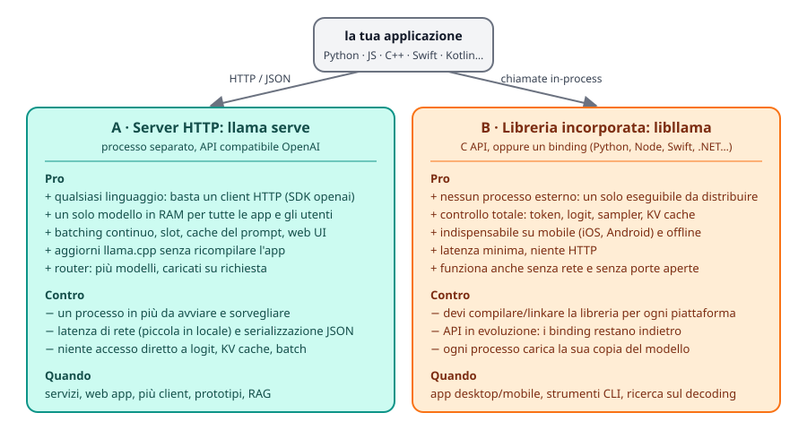
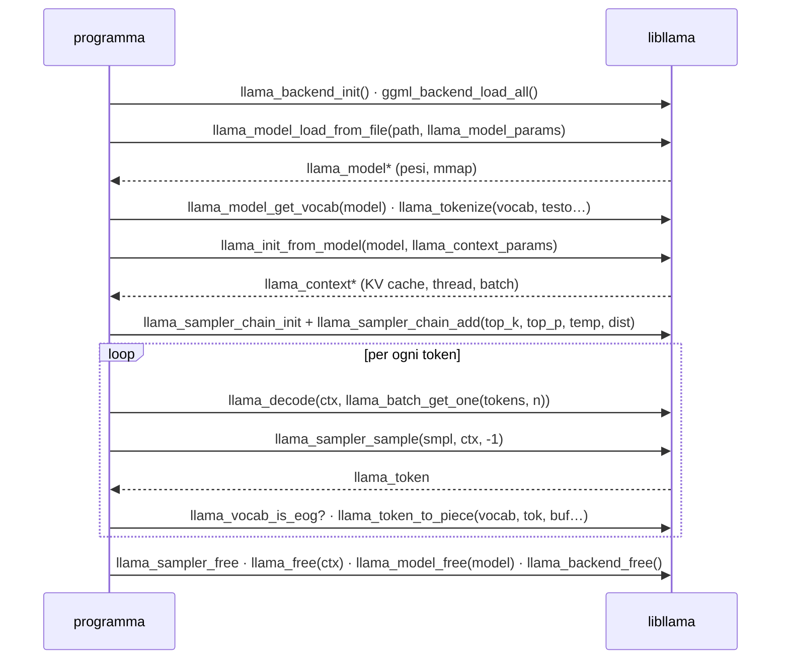
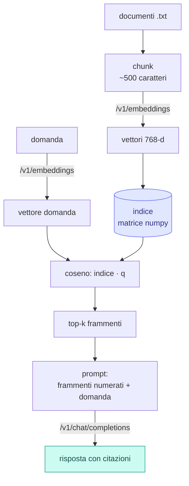

# Modulo 08: Integrare llama.cpp nelle applicazioni

<div class="meta" markdown>
<span class="stato stato-verificato">verificato su b11046: C API (Linux, CPU) e RAG con /v1/embeddings</span> <span class="stato stato-bozza">binding, framework e mobile: dalla documentazione ufficiale</span>
</div>

Finora hai usato llama.cpp "da fuori": cli, server, curl. Questo modulo lo porta **dentro** la tua applicazione. Ci sono
due strade, il server HTTP e la libreria incorporata, e una serie di ponti già pronti: binding Python, framework come
LangChain e LlamaIndex, binding per Node, Swift, .NET, Go, Rust, e i pacchetti per iOS e Android. Chiudi con il caso
d'uso più richiesto, il RAG, costruito solo con `/v1/embeddings` e `/v1/chat/completions`.

## Cosa imparerai

- Scegliere tra `llama serve` e `libllama` in base al prodotto che devi costruire.
- Usare l'SDK OpenAI (rimando al modulo 04) e `llama-cpp-python`, sia in-process sia come server.
- Collegare LangChain e LlamaIndex a un server locale.
- Leggere `include/llama.h` e scrivere un generatore C++ **corretto** in 100 righe: modello, contesto, batch, sampler, vocabolario.
- Orientarti tra i binding per altri linguaggi e le opzioni mobile (XCFramework, Android).
- Costruire un RAG minimo: chunk, embedding, similarità coseno, top-k, prompt con citazioni.

## 1. Server HTTP o libreria incorporata?

<figure class="schema" markdown>

<figcaption>Due modi di integrare llama.cpp. Nella pratica molti progetti usano il server in sviluppo e in produzione lato backend, la libreria sul client (desktop, mobile).</figcaption>
</figure>

Regola pratica: **parti dal server**. Un processo `llama serve` sfrutta batching continuo, slot e cache del prompt
(modulo 04), si aggiorna con `llama update` senza toccare l'app e si usa da qualsiasi linguaggio con un client HTTP.
Passa alla libreria quando il processo esterno non è accettabile (app mobile o desktop distribuita a utenti finali,
ambienti senza porte di rete) o quando ti servono cose che l'API non espone: logit grezzi, controllo del batch,
manipolazione della KV cache, sampler personalizzati.

## 2. Python

### SDK OpenAI verso il server

È il percorso già coperto nel [lab 04-02](../../laboratori/lab-04-02-client-openai/README.md):
`openai.OpenAI(base_url="http://localhost:8080/v1", api_key="no-key-required")` e poi `chat.completions.create`,
`embeddings.create`, streaming. Vale per qualsiasi framework che parli OpenAI.

### `llama-cpp-python`: la libreria in-process

[`llama-cpp-python`](https://github.com/abetlen/llama-cpp-python) è il binding Python di `libllama` (ctypes) con
un'API di alto livello. Porta con sé **una copia di llama.cpp** che viene compilata da `pip`: la versione può essere
più vecchia di quella del tuo `llama` (i modelli nuovissimi potrebbero non caricarsi).

```bash
pip install llama-cpp-python                                         # compila llama.cpp (serve cmake + compilatore)
pip install llama-cpp-python --extra-index-url https://abetlen.github.io/llama-cpp-python/whl/cpu   # wheel CPU precompilata
CMAKE_ARGS="-DGGML_CUDA=on"   pip install llama-cpp-python           # backend: CUDA
CMAKE_ARGS="-DGGML_METAL=on"  pip install llama-cpp-python           # Metal (macOS)
CMAKE_ARGS="-DGGML_VULKAN=on" pip install llama-cpp-python           # Vulkan
CMAKE_ARGS="-DGGML_HIP=on"    pip install llama-cpp-python           # ROCm
```

`CMAKE_ARGS` accetta tutte le opzioni di build di llama.cpp (modulo 01); in alternativa `pip install -C cmake.args="…"`.
Esistono wheel precompilate anche per CUDA (`whl/cu121`…`cu132`), Metal, Vulkan e ROCm. Per ricompilare:
`--upgrade --force-reinstall --no-cache-dir`.

```python
from llama_cpp import Llama

llm = Llama(
    model_path="./Qwen3.5-0.8B-Q8_0.gguf",
    n_ctx=4096,          # contesto (default 512!)
    n_gpu_layers=-1,     # -1 = tutti i layer sulla GPU; 0 = CPU
    verbose=False,
)

# completamento grezzo, risposta in formato OpenAI (dict)
out = llm("Q: Name the planets in the solar system? A: ", max_tokens=32, stop=["Q:", "\n"])
print(out["choices"][0]["text"])

# chat: usa il chat template incluso nel GGUF (o chat_format="chatml", "llama-2", "gemma"...)
r = llm.create_chat_completion(messages=[
    {"role": "system", "content": "Rispondi in italiano, in una frase."},
    {"role": "user", "content": "Cos'è un file GGUF?"},
])
print(r["choices"][0]["message"]["content"])
```

Altre funzioni utili: `Llama.from_pretrained(repo_id="…", filename="*Q8_0.gguf")` scarica da Hugging Face
(richiede `huggingface-hub`); `response_format={"type": "json_object"}` o `json_schema` per JSON vincolato
(modulo 06); `embedding=True` + `llm.embed(...)` per gli embedding; per la visione un *chat handler*
(`MTMDChatHandler` per i GGUF con `mmproj` e chat template incorporato, oppure quelli dedicati come `Gemma4ChatHandler`)
con `n_ctx` alzato per far posto all'immagine. Il pacchetto include anche un server OpenAI-compatibile:
`pip install 'llama-cpp-python[server]'` e `python3 -m llama_cpp.server --model modello.gguf` (porta 8000, docs su
`/docs`), ma per servire preferisci `llama serve`: è più aggiornato e più veloce con molti client.

## 3. Framework: LangChain, LlamaIndex

Il modo più robusto è sempre lo stesso: **puntare il framework al server** come se fosse OpenAI.

=== "LangChain (server)"
    ```python
    # pip install langchain-openai
    from langchain_openai import ChatOpenAI

    llm = ChatOpenAI(base_url="http://127.0.0.1:8080/v1", api_key="no-key",
                     model="ggml-org/Qwen3.5-0.8B-GGUF:Q8_0", temperature=0.2)
    print(llm.invoke("Spiega in una frase cos'è la KV cache.").content)
    ```

=== "LangChain (in-process)"
    ```python
    # pip install langchain-community llama-cpp-python
    from langchain_community.llms import LlamaCpp

    llm = LlamaCpp(model_path="./Qwen3.5-0.8B-Q8_0.gguf", n_ctx=4096, n_gpu_layers=-1)
    print(llm.invoke("Q: Cos'è un token? A:"))
    ```

=== "LlamaIndex (server)"
    ```python
    # pip install llama-index-llms-openai-like
    from llama_index.llms.openai_like import OpenAILike

    llm = OpenAILike(api_base="http://127.0.0.1:8080/v1", api_key="no-key",
                     model="ggml-org/Qwen3.5-0.8B-GGUF:Q8_0", is_chat_model=True)
    print(llm.complete("Cos'è un file GGUF?"))
    ```

Per gli embedding, entrambi i framework hanno la classe "OpenAI embeddings" da puntare a `/v1/embeddings`
(`OpenAIEmbeddings(base_url=…)` in LangChain, `OpenAIEmbedding(api_base=…)` in LlamaIndex) con un server avviato con
`--embedding`. Il campo `model` è obbligatorio per i framework ma il server, se non è in modalità router, lo ignora.

<span class="stato stato-bozza">snippet dei framework non eseguiti sul VPS: verifica i nomi dei pacchetti sulla versione che installi</span>

## 4. La C API di `libllama`

Tutto passa da un solo header, [`include/llama.h`](https://github.com/ggml-org/llama.cpp/blob/master/include/llama.h)
(1646 righe nella build corrente), che include `ggml.h`. Gli oggetti sono opachi e la vita di un programma è sempre
questa sequenza:



### Le funzioni, con le firme reali

| Fase | Funzione (b11046) | Note |
|---|---|---|
| init | `void llama_backend_init(void)`; `ggml_backend_load_all()` | la seconda carica i backend dinamici (`libggml-cpu-*.so`, CUDA…) cercandoli accanto all'eseguibile |
| modello | `llama_model * llama_model_load_from_file(const char * path, llama_model_params)` | `llama_model_default_params()`; campi: `n_gpu_layers`, `load_mode`, `main_gpu`, `tensor_split`, `progress_callback` |
| vocabolario | `const llama_vocab * llama_model_get_vocab(const llama_model *)` | poi `llama_vocab_n_tokens`, `llama_vocab_bos/eos`, `llama_vocab_is_eog` |
| tokenizzare | `int32_t llama_tokenize(vocab, text, text_len, tokens, n_tokens_max, add_special, parse_special)` | con buffer NULL restituisce **-N** (quanti token servono) |
| contesto | `llama_context * llama_init_from_model(model, llama_context_params)` | `n_ctx` (0 = dal modello), `n_batch`, `n_ubatch`, `n_threads`, `n_threads_batch`, `type_k/type_v`, `embeddings`, `pooling_type`, `flash_attn_type` |
| batch | `llama_batch llama_batch_get_one(llama_token * tokens, int32_t n)` | una sola sequenza (seq 0), posizioni automatiche; per più sequenze `llama_batch_init(n_tokens, embd, n_seq_max)` + `llama_batch_free` |
| decodifica | `int32_t llama_decode(ctx, batch)` | 0 ok; 1 = niente spazio nella KV cache; 2 = interrotto; -1 batch non valido; < -1 errore fatale. `llama_encode` per i modelli encoder-decoder |
| sampler | `llama_sampler_chain_init(params)`, `llama_sampler_chain_add(chain, s)`, `llama_sampler_init_top_k(k)`, `_top_p(p, min_keep)`, `_min_p`, `_temp(t)`, `_dist(seed)`, `_greedy()` | la catena **prende possesso** dei sampler aggiunti: non liberarli singolarmente |
| campionare | `llama_token llama_sampler_sample(smpl, ctx, idx)` | `idx = -1` = logit dell'ultimo token del batch |
| testo | `int32_t llama_token_to_piece(vocab, token, buf, length, lstrip, special)` | non aggiunge il terminatore `\0`; `llama_detokenize` per una sequenza intera |
| chat | `llama_model_chat_template(model, name)`, `llama_chat_apply_template(tmpl, msgs, n, add_ass, buf, len)` | **non** è un motore Jinja: supporta solo una lista di template noti. La cli/server usano il motore Jinja di `libcommon` |
| embedding | `cparams.embeddings = true`, `llama_get_embeddings_seq(ctx, seq_id)` | con `pooling_type` del modello |
| memoria | `llama_get_memory(ctx)`, `llama_memory_clear(mem, data)`, `llama_memory_seq_rm/cp/…` | la KV cache si chiama "memory" nell'API |
| statistiche | `llama_perf_context_print(ctx)`, `llama_perf_sampler_print(smpl)` | passano dal logger (`llama_log_set`) a livello INFO |

Nomi che trovi nei tutorial vecchi e che oggi sono `DEPRECATED` nell'header: `llama_load_model_from_file` →
`llama_model_load_from_file`, `llama_free_model` → `llama_model_free`, `llama_new_context_with_model` →
`llama_init_from_model`, `llama_token_eos/bos/is_eog` → `llama_vocab_*`, `llama_n_vocab` → `llama_vocab_n_tokens`,
`llama_n_ctx_train` → `llama_model_n_ctx_train`.

### Il programma minimo

Il [lab 08-01](../../laboratori/lab-08-01-c-api/README.md) contiene `main.cpp`, derivato da `examples/simple/simple.cpp`
del repository, compilato e provato sul VPS contro le `.so` del tarball b11046. Il cuore è questo:

```cpp
llama_backend_init();
ggml_backend_load_all();

llama_model_params mparams = llama_model_default_params();
mparams.n_gpu_layers = 0;
llama_model * model = llama_model_load_from_file("modello.gguf", mparams);
const llama_vocab * vocab = llama_model_get_vocab(model);

const int n_prompt = -llama_tokenize(vocab, prompt.c_str(), prompt.size(), nullptr, 0, true, true);
std::vector<llama_token> tok(n_prompt);
llama_tokenize(vocab, prompt.c_str(), prompt.size(), tok.data(), tok.size(), true, true);

llama_context_params cparams = llama_context_default_params();
cparams.n_ctx = n_prompt + n_predict;  cparams.n_batch = n_prompt;
llama_context * ctx = llama_init_from_model(model, cparams);

llama_sampler * smpl = llama_sampler_chain_init(llama_sampler_chain_default_params());
llama_sampler_chain_add(smpl, llama_sampler_init_top_k(40));
llama_sampler_chain_add(smpl, llama_sampler_init_top_p(0.95f, 1));
llama_sampler_chain_add(smpl, llama_sampler_init_temp(0.8f));
llama_sampler_chain_add(smpl, llama_sampler_init_dist(LLAMA_DEFAULT_SEED));

llama_batch batch = llama_batch_get_one(tok.data(), tok.size());
llama_token nuovo;
for (int n_pos = 0; n_pos + batch.n_tokens < n_prompt + n_predict; ) {
    if (llama_decode(ctx, batch) != 0) break;
    n_pos += batch.n_tokens;
    nuovo = llama_sampler_sample(smpl, ctx, -1);
    if (llama_vocab_is_eog(vocab, nuovo)) break;
    char buf[256];
    int n = llama_token_to_piece(vocab, nuovo, buf, sizeof(buf), 0, true);
    fwrite(buf, 1, n, stdout);
    batch = llama_batch_get_one(&nuovo, 1);
}
llama_sampler_free(smpl); llama_free(ctx); llama_model_free(model); llama_backend_free();
```

Output reale sul VPS con `Qwen3.5-0.8B-Q8_0.gguf` (3 thread): `Il linguaggio C è uno dei linguaggi di programmazione più
popolari nel mondo…` a 5,7 token/s, con `llama_perf_context_print` che riporta `prompt eval time`, `eval time` e
`graphs reused = 22`. Nota che è un **completamento grezzo**: senza chat template il modello continua la frase, non
"risponde". Per una chat devi formattare i messaggi con il template del GGUF (via `libcommon`/Jinja, o a mano).

### Compilare e linkare

Tre modi, in ordine di robustezza:

1. **`add_subdirectory(llama.cpp)`** nel tuo `CMakeLists.txt`: compili la libreria con il tuo progetto, stesse opzioni di
   backend (`-DGGML_CUDA=ON`…); disattiva tool ed esempi con `LLAMA_BUILD_TOOLS/EXAMPLES/TESTS=OFF`.
2. **`find_package(llama)`**: dopo `cmake --install build --prefix …` di llama.cpp (o `brew`/`conda`), il file
   `llama-config.cmake` importa il target `llama` con include e librerie.
3. **Header + `.so` del tarball**: `g++ -std=c++17 -I include main.cpp -L tarball -lllama -lggml -lggml-base`. Funziona
   (è quello che abbiamo fatto sul VPS) ma gli header devono essere della **stessa build** delle librerie: le struct dei
   parametri cambiano tra versioni e un mismatch è un crash silenzioso.

Nei casi 3 (e con `-DGGML_BACKEND_DL=ON`) i backend sono `.so` separati che `ggml_backend_load_all()` cerca nella cartella
dell'eseguibile: se il modello "non carica" con `no backends are loaded`, copia o linka le `libggml-*.so` accanto al binario,
oppure usa `ggml_backend_load_all_from_path(dir)`.

## 5. Altri linguaggi e mobile

| Linguaggio | Binding | Note |
|---|---|---|
| Python | [llama-cpp-python](https://github.com/abetlen/llama-cpp-python) | sezione 2 |
| Node.js | [node-llama-cpp](https://github.com/withcatai/node-llama-cpp) | binari precompilati, CLI `npx node-llama-cpp chat` |
| React Native | [llama.rn](https://github.com/mybigday/llama.rn) | iOS e Android |
| .NET | [LLamaSharp](https://github.com/SciSharp/LLamaSharp) | backend come pacchetti NuGet (CPU, CUDA, Vulkan) |
| Go | [go-llama.cpp](https://github.com/go-skynet/go-llama.cpp) | cgo |
| Rust | [llama-cpp-rs](https://github.com/utilityai/llama-cpp-rs) | crate `llama-cpp-2` |

La lista completa (Java, Ruby, Swift, Scala, Dart, PHP, Zig…) è nel README del repository, sezione *Bindings*.
Tutti i binding inseguono `llama.h`: controlla a quale build sono allineati prima di scegliere un modello nuovo.

**iOS / macOS / visionOS / tvOS**: ogni release pubblica `llama-bNNNNN-xcframework.zip`, una libreria precompilata da usare
in Swift Package Manager senza compilare nulla (`docs/xcframework.md`):

```swift
// Package.swift
.binaryTarget(
    name: "LlamaFramework",
    url: "https://github.com/ggml-org/llama.cpp/releases/download/b5046/llama-b5046-xcframework.zip",
    checksum: "c19be78b5f00d8d29a25da41042cb7afa094cbf6280a225abe614b03b20029ab"
)
```

Cambia build e checksum con quelli della release che scegli (il checksum è lo SHA-256 dello zip:
`swift package compute-checksum llama-bNNNNN-xcframework.zip`). L'app di esempio è `examples/llama.swiftui`.

**Android** (`docs/android.md`): l'esempio `examples/llama.android` si importa in Android Studio (Gradle sync e build);
il binding JNI rileva le istruzioni della CPU (fino a SME2 su Arm) e carica i kernel compatibili. In alternativa
cross-compili la CLI con l'NDK:

```bash
cmake -DCMAKE_TOOLCHAIN_FILE=$ANDROID_NDK/build/cmake/android.toolchain.cmake \
      -DANDROID_ABI=arm64-v8a -DANDROID_PLATFORM=android-28 \
      -DGGML_NATIVE=OFF -DGGML_OPENMP=OFF -DGGML_LLAMAFILE=OFF -DLLAMA_OPENSSL=OFF -B build-android
cmake --build build-android --config Release -j8
```

e la lanci via `adb` con `LD_LIBRARY_PATH=lib ./bin/llama-simple -m modello.gguf -c 4096 -p "…"`. Su Termux basta
`pkg install cmake clang git` e la build normale (modulo 01).

<span class="stato stato-bozza">mobile: non verificato su questa piattaforma</span>

## 6. Embedding, ricerca vettoriale, RAG

Un **embedding** è un vettore di numeri che rappresenta il significato di un testo: testi simili hanno vettori vicini.
Il server li produce con un modello dedicato avviato con `--embedding` (opzioni `--pooling {none,mean,cls,last,rank}`
se il GGUF non lo dichiara, `--embd-normalize` default 2 = norma euclidea):

```bash
llama serve -hf ggml-org/embeddinggemma-300M-GGUF:Q8_0 --embedding --port 8080 -c 2048
curl -s http://127.0.0.1:8080/v1/embeddings -H "Content-Type: application/json" \
     -d '{"input":["ciao mondo","hello world"]}'
```

Verificato: `embeddinggemma-300M-Q8_0.gguf` (334 MB) risponde con vettori di **768** dimensioni già normalizzati
(`usage.prompt_tokens: 9` per le due frasi). Con vettori a norma 1 la similarità coseno è un prodotto scalare.
Per il **reranking** c'è `/v1/rerank` con un modello reranker e `--rerank` (es. `ggml-org/Qwen3-reranker-0.6B-Q8_0-GGUF`).



Il [lab 08-02](../../laboratori/lab-08-02-rag-minimo/README.md) implementa esattamente questo flusso in
`rag_minimo.py` (numpy + requests, 130 righe) e lo fa girare con **un solo server in modalità router**: un preset INI
dice al router di avviare il modello di embedding con `embedding = true` e quello di chat con `reasoning = off`, e con
`--models-max 1` i due modelli si alternano in memoria. Risultato reale:

```text
RISPOSTA:
Q4_K_M usa circa 4,8 bit per peso.

FONTI:
  [1] quantizzazione.txt (sim 0.600): La quantizzazione riduce la precisione dei pesi…
```

Da un RAG "minimo" a uno vero: un database vettoriale (sqlite-vec, Chroma, Qdrant, pgvector) al posto della matrice
numpy, chunk con sovrapposizione, reranking dei top-k, e la valutazione della qualità delle risposte.

## Riepilogo

| Scelta / strumento | Quando |
|---|---|
| `llama serve` + SDK OpenAI | default: servizi, web app, più client, RAG |
| `llama-cpp-python` | script e app Python senza processo esterno; occhio alla versione di llama.cpp inclusa |
| LangChain / LlamaIndex | `ChatOpenAI(base_url=…)`, `OpenAILike(api_base=…)`; `LlamaCpp` per in-process |
| C API (`llama.h`) | controllo totale: modello → vocab → contesto → batch → decode → sampler → piece |
| `add_subdirectory` / `find_package(llama)` | i due modi CMake per linkare `libllama` |
| Binding | node-llama-cpp, llama.rn, LLamaSharp, go-llama.cpp, llama-cpp-rs… |
| Mobile | XCFramework (SwiftPM `binaryTarget`), `examples/llama.android`, NDK cross-compile |
| RAG | `--embedding` + `/v1/embeddings` (768-d con EmbeddingGemma), coseno, top-k, prompt con citazioni; `/v1/rerank` |

## Errori comuni

!!! warning "`no backends are loaded`"
    Hai linkato contro librerie con backend dinamici e `ggml_backend_load_all()` non li trova: i file `libggml-cpu-*.so`
    (o `libggml-cuda.so`) devono stare nella cartella dell'eseguibile, oppure usa `ggml_backend_load_all_from_path()`.
    La variabile `GGML_BACKEND_PATH` vuole il percorso di **un file** `.so`, non di una cartella (provato).

!!! warning "Header e libreria di build diverse"
    `llama_context_params` e `llama_model_params` cambiano tra versioni. Compilare con l'header di `master` contro la
    `.so` di una release vecchia produce parametri letti a offset sbagliati: crash o comportamenti assurdi. Scarica gli
    header dal **tag** della build (`https://raw.githubusercontent.com/ggml-org/llama.cpp/bNNNNN/include/llama.h`).

!!! warning "Il router non carica il modello di embedding"
    In modalità router `/v1/embeddings` su EmbeddingGemma fallisce con `failed to load` (istanza uscita con stato 1) se
    l'istanza non è avviata con `--embedding`. Serve il preset INI con `embedding = true` (lab 08-02) o un server dedicato.

!!! warning "`n_ctx` di default in llama-cpp-python"
    `Llama(model_path=…)` usa `n_ctx=512` se non lo imposti: le chat lunghe e le immagini non ci stanno. Passa sempre `n_ctx`.

!!! warning "`llama_chat_apply_template` non è Jinja"
    Supporta solo i template noti in `llama_chat_builtin_templates`. Per il Jinja dei modelli recenti usa `libcommon`
    (`common_chat_templates_*`) come fanno cli e server, oppure formatta a mano.

!!! warning "Doppio free del sampler"
    `llama_sampler_chain_add` trasferisce la proprietà: libera solo la catena con `llama_sampler_free(chain)`.

## Laboratori di questo modulo

- [Lab 08-01: Un programma C++ con libllama](../../laboratori/lab-08-01-c-api/README.md): `main.cpp` + `CMakeLists.txt`, tre modi di compilare, output verificato.
- [Lab 08-02: RAG minimo](../../laboratori/lab-08-02-rag-minimo/README.md): `rag_minimo.py` con `/v1/embeddings`, numpy e citazioni; router con preset.

## Verifica

1. Elenca due casi in cui la libreria incorporata è obbligatoria e due in cui il server è la scelta migliore.
2. Perché `llama_tokenize` viene chiamata due volte nel programma minimo?
3. Cosa restituisce `llama_decode` quando la KV cache è piena e come lo gestiresti?
4. Che differenza c'è tra `llama_batch_get_one` e `llama_batch_init`?
5. Perché non devi chiamare `llama_sampler_free` sui sampler aggiunti a una catena?
6. Con quale variabile d'ambiente compili `llama-cpp-python` con CUDA? E come eviti di compilare del tutto?
7. Cosa serve per usare llama.cpp in un'app iOS senza compilare i sorgenti?
8. Nel RAG minimo, perché la similarità coseno si riduce a un prodotto scalare?

??? success "Soluzioni"
    1. Libreria: app mobile (iOS/Android), software desktop distribuito senza processi esterni, accesso a logit/KV cache.
       Server: backend web con più client, aggiornamenti indipendenti dall'app, RAG e strumenti in linguaggi diversi.
    2. La prima, con buffer NULL, restituisce `-N` cioè quanti token servono; la seconda riempie il vettore di quella dimensione.
    3. Restituisce `1` ("could not find a KV slot"): riduci il batch, alza `n_ctx` o libera spazio con `llama_memory_seq_rm`.
    4. `get_one` costruisce un batch per una sola sequenza (seq 0) con posizioni automatiche, senza allocare; `init` alloca
       un batch da riempire a mano (token, pos, seq_id, logits) per più sequenze, da liberare con `llama_batch_free`.
    5. La catena ne prende possesso e li libera quando liberi la catena: un free doppio corrompe la memoria.
    6. `CMAKE_ARGS="-DGGML_CUDA=on" pip install llama-cpp-python`; per non compilare, una wheel precompilata con
       `--extra-index-url https://abetlen.github.io/llama-cpp-python/whl/cu121` (o `whl/cpu`).
    7. L'XCFramework della release (`llama-bNNNNN-xcframework.zip`) come `binaryTarget` in Swift Package Manager, con URL e checksum.
    8. Il server normalizza i vettori (norma euclidea, `--embd-normalize 2`): con norme uguali a 1, cos(a,b) = a·b.

## Riferimenti

- `include/llama.h`: https://github.com/ggml-org/llama.cpp/blob/master/include/llama.h
- `examples/simple/simple.cpp`: https://github.com/ggml-org/llama.cpp/blob/master/examples/simple/simple.cpp
- `docs/xcframework.md`, `docs/android.md`: https://github.com/ggml-org/llama.cpp/tree/master/docs
- llama-cpp-python: https://github.com/abetlen/llama-cpp-python · docs https://llama-cpp-python.readthedocs.io
- LangChain OpenAI: https://python.langchain.com/docs/integrations/chat/openai/ · LlamaCpp: https://python.langchain.com/docs/integrations/llms/llamacpp/
- LlamaIndex OpenAILike: https://docs.llamaindex.ai/en/stable/api_reference/llms/openai_like/
- Server README (embeddings, rerank, router e preset): https://github.com/ggml-org/llama.cpp/blob/master/tools/server/README.md
