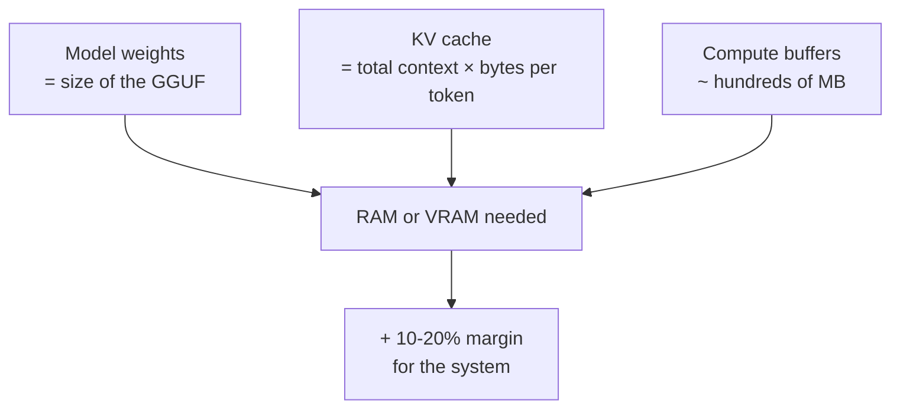
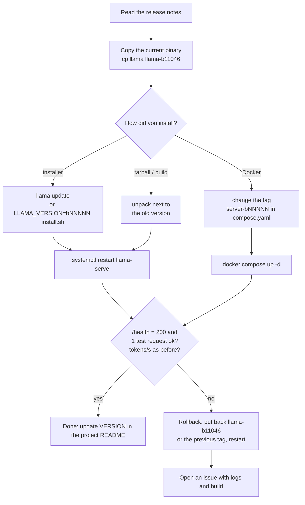

# Module 09: Going to production

In the previous modules you started `llama serve` by hand, in a terminal, and closed it with ++ctrl+c++.
In production the server must **start on its own**, **restart if it crashes**, be reachable **only by those
who are authorized**, and tell you **how it is doing** without you having to watch the terminal. This module puts
the pieces together: system service, reverse proxy with HTTPS, metrics, sizing, security, updates.

## What you will learn

- Install `llama serve` as a **systemd** service (with hardening) or as a **Docker Compose** stack with a healthcheck.
- Put the server behind **Caddy** (automatic HTTPS) or **Nginx**, with `basic_auth` or by passing the API key through.
- Expose `/metrics` and read them with **Prometheus** and **Grafana**; collect logs with journald or `--log-jsonl`.
- **Size** slots, context and threads based on RAM and concurrent users; understand queues and timeouts.
- The minimum **security** rules: what never to expose, API keys, prompt injection, models from trusted sources.
- **Update** with `llama update`, pin a build and **roll back** without surprises.

<figure class="schema" markdown>

<figcaption>The module's reference architecture: only port 443 of the proxy is open to the outside; <code>llama serve</code> listens on <code>127.0.0.1</code>.</figcaption>
</figure>

## Prerequisites

- Module [04: server and API](../04-server-api/README.md) (you can start `llama serve`, you know `/health`, `/v1/chat/completions`, `-np`).
- Module [05: performance](../05-prestazioni/README.md) (you can measure pp/tg and estimate memory).
- A Linux machine with systemd (a VM or a VPS is perfectly fine) and, for lab 09-02, Docker Compose.

!!! note "Old and new names"
    In this module we use `llama serve`. In the official Docker images the executable is still called
    `llama-server` and it is the entrypoint of the `server` image: the options are the same.

## 1. The server as a service

### 1.1 Why `nohup` or `tmux` is not enough

A process launched by hand dies at logout, does not restart after a crash or a reboot, and writes its logs wherever it happens to.
A **service** solves all of this: `systemd` starts it at boot, restarts it if it exits with an error, collects
stdout/stderr in journald and can limit its privileges. In the container world, Docker Compose plays the same role
with `restart:` and `healthcheck:`.

### 1.2 The `LLAMA_ARG_*` variables

Every `llama serve` option has an equivalent environment variable, printed by `llama serve --help`
next to the flag (`(env: LLAMA_ARG_…)`). It is the cleanest way to configure a service: the `ExecStart` line
stays short and the configuration is readable line by line.

| Flag | Variable | Notes |
|---|---|---|
| `--host` | `LLAMA_ARG_HOST` | in production `127.0.0.1` (or `0.0.0.0` only inside a container) |
| `--port` | `LLAMA_ARG_PORT` | default 8080 |
| `-m` / `-hf` | `LLAMA_ARG_MODEL` / `LLAMA_ARG_HF_REPO` | local file or Hugging Face repo (cache in `~/.cache/huggingface/hub`) |
| `-c` | `LLAMA_ARG_CTX_SIZE` | **total** context, split among the slots |
| `-np` | `LLAMA_ARG_N_PARALLEL` | number of slots (requests served in parallel) |
| `-t` | `LLAMA_ARG_THREADS` | generation threads |
| `-a` | `LLAMA_ARG_ALIAS` | model name reported by the API |
| `--api-key` | `LLAMA_API_KEY` | **warning**: this one does not have the `LLAMA_ARG_` prefix |
| `--api-key-file` | `LLAMA_ARG_API_KEY_FILE` | a file with one key per line, `#` for comments |
| `--metrics` | `LLAMA_ARG_ENDPOINT_METRICS` | enables `GET /metrics` |
| `--no-webui` | `LLAMA_ARG_UI=0` | API only |
| `--offline` | `LLAMA_ARG_OFFLINE` | does not touch the network: uses only the cache |
| `--log-jsonl` | `LLAMA_ARG_LOG_JSONL` | one JSON object per line on stdout |
| `-to` | `LLAMA_ARG_TIMEOUT` | HTTP read/write timeout, default 3600 s |
| `--threads-http` | `LLAMA_ARG_THREADS_HTTP` | threads that accept HTTP connections (default: auto) |

### 1.3 Complete systemd unit

Create a dedicated, unprivileged user that owns only the binary and the model cache:

```bash
sudo useradd --system --create-home --shell /usr/sbin/nologin llama
sudo -u llama bash -c 'curl -LsSf https://llama.app/install.sh | sh'   # installs into /home/llama/.local/bin/llama
sudo -u llama env SSL_CERT_FILE=/etc/ssl/certs/ca-certificates.crt \
     /home/llama/.local/bin/llama download -hf ggml-org/Qwen3.5-0.8B-GGUF   # download now, so the service starts offline
```

Then the unit, in `/etc/systemd/system/llama-serve.service`:

```ini
[Unit]
Description=llama.cpp - server di inferenza (llama serve)
Documentation=https://github.com/ggml-org/llama.cpp/tree/master/tools/server
After=network-online.target
Wants=network-online.target

[Service]
Type=simple
User=llama
Group=llama
WorkingDirectory=/home/llama
Environment=SSL_CERT_FILE=/etc/ssl/certs/ca-certificates.crt   # (1)!
Environment=LLAMA_ARG_HOST=127.0.0.1                            # (2)!
Environment=LLAMA_ARG_PORT=8080
Environment=LLAMA_ARG_CTX_SIZE=8192
Environment=LLAMA_ARG_N_PARALLEL=2
Environment=LLAMA_ARG_THREADS=4
Environment=LLAMA_ARG_ALIAS=qwen-0.8b
Environment=LLAMA_ARG_ENDPOINT_METRICS=1
Environment=LLAMA_ARG_API_KEY_FILE=/etc/llama/api-keys.txt      # (3)!
Environment=LLAMA_ARG_OFFLINE=1
ExecStart=/home/llama/.local/bin/llama serve -hf ggml-org/Qwen3.5-0.8B-GGUF --no-webui
Restart=on-failure                                              # (4)!
RestartSec=5
TimeoutStartSec=300                                             # (5)!
TimeoutStopSec=30
KillSignal=SIGINT
MemoryMax=6G                                                    # (6)!
LimitNOFILE=65536
# Hardening: the process sees the filesystem as read-only except for the model cache
NoNewPrivileges=true
ProtectSystem=strict
ProtectHome=read-only
ReadWritePaths=/home/llama/.cache
PrivateTmp=true
ProtectKernelTunables=true
ProtectControlGroups=true
RestrictSUIDSGID=true
RestrictRealtime=true
LockPersonality=true
SystemCallArchitectures=native

[Install]
WantedBy=multi-user.target
```

1. The installer binary is static and on some distributions it does not find the TLS certificates (see module 01); with `--offline` it is not needed, but it does no harm.
2. Never `0.0.0.0` here: the proxy will sit in front.
3. File with `640` permissions, owner `root:llama`. With `--api-key-file` the key does not appear in `ps` or in `systemctl show`.
4. `on-failure` restarts only if the process exits with a code ≠ 0 or because of a signal; `always` would also restart after a deliberate stop.
5. A large model on a slow disk can take minutes to load: the 90 s default would make startup fail.
6. If the process exceeds the limit, the kernel kills it and systemd restarts it: a restart is better than a whole server in swap.

```bash
sudo systemd-analyze verify /etc/systemd/system/llama-serve.service   # check the syntax
sudo systemctl daemon-reload
sudo systemctl enable --now llama-serve
systemctl status llama-serve --no-pager
curl -s http://127.0.0.1:8080/health          # {"status":"ok"}  (503 while loading)
journalctl -u llama-serve -f                  # live logs
```

Expected output of `systemd-analyze verify`: no lines (silence = ok). If it reports that
`/home/llama/.local/bin/llama` does not exist, the `llama` user or the binary has not been created yet: go back to the
installation block above. `systemd-analyze security llama-serve` gives you an exposure score: with
the directives above it drops from "UNSAFE" to "EXPOSED/MEDIUM"; add `UMask=0077` and `ProtectProc=invisible`
if you want to tighten it further.

!!! tip "On GPU"
    With an NVIDIA card add `Environment=LLAMA_ARG_N_GPU_LAYERS=all` and remove `MemoryMax` (or raise it: the
    RAM is needed for loading anyway). The service must run after the drivers are ready:
    `After=network-online.target` is usually enough; if you see CUDA initialization errors at startup,
    add `RestartSec=10`.

### 1.4 Docker Compose with a healthcheck

The official `ghcr.io/ggml-org/llama.cpp:server` image already has a built-in `HEALTHCHECK`:
`curl -f http://localhost:8080/health` (you can see it with `docker image inspect`). In Compose you can redefine it
to control the interval and the grace period:

```yaml title="compose.yaml"
services:
  llama:
    image: ghcr.io/ggml-org/llama.cpp:server-b11046   # (1)!
    restart: unless-stopped
    volumes:
      - ./models:/models:ro
    environment:
      LLAMA_ARG_HOST: 0.0.0.0        # fine inside the container: the port is NOT published
      LLAMA_ARG_PORT: 8080
      LLAMA_ARG_MODEL: /models/Qwen3.5-0.8B-Q8_0.gguf
      LLAMA_ARG_CTX_SIZE: 8192
      LLAMA_ARG_N_PARALLEL: 2
      LLAMA_ARG_ENDPOINT_METRICS: 1
      LLAMA_ARG_API_KEY_FILE: /run/secrets/llama_keys
      LLAMA_ARG_UI: 0
    secrets:
      - llama_keys
    healthcheck:
      test: ["CMD", "curl", "-f", "http://localhost:8080/health"]
      interval: 15s
      timeout: 5s
      retries: 3
      start_period: 120s             # (2)!
    deploy:
      resources:
        limits:
          memory: 6g

  caddy:
    image: caddy:2
    restart: unless-stopped
    ports: ["80:80", "443:443"]
    volumes:
      - ./Caddyfile:/etc/caddy/Caddyfile:ro
      - caddy_data:/data
    depends_on:
      llama:
        condition: service_healthy   # (3)!

secrets:
  llama_keys:
    file: ./api-keys.txt

volumes:
  caddy_data:
```

1. **Always** pin the tag to the build (`server-b11046`, `server-cuda-b11046`, …): the `server` tag alone is "the latest nightly build" and changes several times a day. On ghcr.io there is a tag for every build (`server-b10964`, `server-b11046`, `server-b11096`, …).
2. During `start_period` check failures do not count: it is the time needed to load the model.
3. Caddy starts only when `/health` answers 200: no 502 for the first user.

```bash
docker compose up -d
docker compose ps            # STATUS: Up (healthy)
docker compose logs -f llama
```

With an NVIDIA GPU: the `server-cuda-b11046` image, `LLAMA_ARG_N_GPU_LAYERS=all` and the
`deploy.resources.reservations.devices` section with `capabilities: [gpu]` (you need the NVIDIA Container Toolkit; see
[lab 01-04](../../laboratori/lab-01-04-docker/README.md)).

## 2. Reverse proxy with HTTPS and authentication

`llama serve` can do TLS on its own (`--ssl-key-file` / `--ssl-cert-file`, if the binary is built with
`LLAMA_OPENSSL=ON`), but a reverse proxy does much more: automatic certificates, authentication, access
logs, rate limiting, several services on the same IP. The rule: **the server listens on `127.0.0.1`, the proxy
on 443**.

### 2.1 Caddy

Caddy obtains and renews Let's Encrypt certificates on its own: all it needs is for the name's DNS to point to the machine and
for ports 80 and 443 to be reachable.

=== "basic_auth (human users, web UI)"

    ```caddyfile title="/etc/caddy/Caddyfile"
    llm.esempio.it {
        # /health stays public: monitoring and healthchecks use it
        @noauth path /health /v1/health
        handle @noauth {
            reverse_proxy localhost:8080
        }

        # everything else asks for username and password
        handle {
            basic_auth {
                studente <HASH-DA-caddy-hash-password>
            }
            reverse_proxy localhost:8080 {
                flush_interval -1                  # (1)!
                transport http {
                    response_header_timeout 600s   # (2)!
                }
            }
        }
        log {
            output file /var/log/caddy/llm.log
        }
    }
    ```

    1. Streaming responses (SSE) must pass through immediately, without buffering.
    2. With a long prompt on CPU the first byte can arrive after minutes: the default would trigger a 502.

    You generate the hash with `caddy hash-password --plaintext 'la-tua-password'` (bcrypt).

=== "API key passthrough (programmatic clients)"

    ```caddyfile title="/etc/caddy/Caddyfile"
    llm.esempio.it {
        @noauth path /health /v1/health
        handle @noauth {
            reverse_proxy localhost:8080
        }
        handle {
            # Caddy does not touch the Authorization header: llama serve checks the Bearer with --api-key-file
            reverse_proxy localhost:8080 {
                flush_interval -1
            }
        }
    }
    ```

    The client sends `Authorization: Bearer <chiave>`; a wrong key gets this from the server:
    `{"error":{"code":401,"message":"Invalid API Key","type":"authentication_error"}}`.
    Advantage: it works with every OpenAI SDK without extra configuration; you can have one key per
    user/application and revoke it by removing it from the file (then `systemctl restart`).

Always check the syntax with `caddy validate --config Caddyfile --adapter caddyfile`: the expected answer is
`Valid configuration`. After every change: `sudo caddy validate --config /etc/caddy/Caddyfile && sudo systemctl reload caddy`.

??? note "Nginx equivalent"
    Nginx does not obtain certificates on its own: use `certbot --nginx` (or acme.sh). On the other hand it has built-in rate
    limiting (`limit_req`), which in Caddy requires a plugin.

    ```nginx title="/etc/nginx/sites-available/llm.conf"
    limit_req_zone $binary_remote_addr zone=llm:10m rate=10r/m;   # 10 requests per minute per IP

    server {
        listen 443 ssl;
        server_name llm.esempio.it;
        ssl_certificate     /etc/letsencrypt/live/llm.esempio.it/fullchain.pem;
        ssl_certificate_key /etc/letsencrypt/live/llm.esempio.it/privkey.pem;

        location = /health {
            proxy_pass http://127.0.0.1:8080;
        }
        location / {
            limit_req zone=llm burst=5 nodelay;
            auth_basic "llama serve";
            auth_basic_user_file /etc/nginx/.htpasswd;   # htpasswd -c /etc/nginx/.htpasswd studente
            proxy_pass http://127.0.0.1:8080;
            proxy_http_version 1.1;
            proxy_set_header Connection "";
            proxy_buffering off;          # SSE streaming
            proxy_cache off;
            proxy_read_timeout 600s;      # long prompts on CPU
        }
    }
    ```

    Check the syntax with `nginx -t`: it fails only if the certificate files do not exist yet.
    To pass the API key through instead of the password, remove the two `auth_basic*` lines.

### 2.2 What changes for the web UI

Behind a proxy with `basic_auth` the web UI works without changes. If instead you use only the API key,
the UI asks for the key on first access (Settings) and sends it as a Bearer token. If you don't need it, `--no-webui`
reduces the exposed surface.

## 3. Monitoring: metrics, health checks, logs

### 3.1 `/health`

`GET /health` is **public** (it does not require a key) and answers `{"status":"ok"}` with 200 when the model is
loaded, and 503 with `{"error":{"code":503,"message":"Loading model","type":"unavailable_error"}}` while it loads.
It is the right endpoint for Compose healthchecks, Kubernetes probes and uptime monitors. It is lightweight: it does not touch the
model and does not reset the `--sleep-idle-seconds` timer.

`GET /slots` (on by default, `--no-slots` to turn it off) shows the state of each slot: whether it is processing,
how many tokens it has generated, the sampling parameters. With `?fail_on_no_slot=1` it answers 503 if there is no
free slot: useful for a load balancer that must decide where to send the request. It exposes information about
the requests in progress: in production either disable it or keep it only behind authentication.

### 3.2 `/metrics` for Prometheus

With `--metrics` (or `LLAMA_ARG_ENDPOINT_METRICS=1`) the server exposes `GET /metrics` in Prometheus format.
Without the flag it answers 501. The metrics exposed by build 11046:

| Metric | Type | Meaning |
|---|---|---|
| `llamacpp:prompt_tokens_total` | counter | prompt tokens processed (excluding those taken from the cache) |
| `llamacpp:prompt_tokens_cached_total` | counter | prompt tokens reused from the cache |
| `llamacpp:prompt_seconds_total` | counter | seconds spent processing prompts |
| `llamacpp:tokens_predicted_total` | counter | tokens generated |
| `llamacpp:tokens_predicted_seconds_total` | counter | seconds spent generating |
| `llamacpp:n_decode_total` | counter | calls to `llama_decode()` |
| `llamacpp:n_tokens_max` | counter | longest sequence observed (prompt + generation) |
| `llamacpp:prompt_tokens_seconds` | gauge | average prompt processing throughput, tokens/s |
| `llamacpp:predicted_tokens_seconds` | gauge | average generation throughput, tokens/s |
| `llamacpp:requests_processing` | gauge | requests being processed |
| `llamacpp:requests_deferred` | gauge | requests **in the queue** (no free slot) |
| `llamacpp:n_busy_slots_per_decode` | gauge | average busy slots per decode |
| `llamacpp:spec_decode_*` | counter | draft tokens generated/accepted (0 without speculative decoding) |

Minimal Prometheus configuration:

```yaml title="prometheus.yml"
global:
  scrape_interval: 15s
scrape_configs:
  - job_name: llamacpp
    metrics_path: /metrics
    static_configs:
      - targets: ["llama:8080"]        # Compose service name; on the host: 127.0.0.1:8080
    # only if the server has an API key (/metrics is NOT public like /health):
    authorization:
      type: Bearer
      credentials: "la-chiave"
```

In **router mode** (several models) `/metrics` requires `?model=<id>`: one job per model, with `params: {model: [...]}`.

### 3.3 Grafana dashboard

Add Prometheus as a data source and build a dashboard with these panels (the queries are PromQL):

| Panel | Query | What it is for |
|---|---|---|
| Tokens generated per second | `rate(llamacpp:tokens_predicted_total[1m])` | real throughput, not the average since startup |
| Prompt tokens per second | `rate(llamacpp:prompt_tokens_total[1m])` | prompt processing load (RAG, long contexts) |
| Requests in progress / queued | `llamacpp:requests_processing`, `llamacpp:requests_deferred` | if `deferred` stays > 0, you need more slots or more machines |
| Slot occupancy | `llamacpp:n_busy_slots_per_decode` | how much you exploit continuous batching |
| Prompt cache hits | `rate(llamacpp:prompt_tokens_cached_total[5m]) / (rate(llamacpp:prompt_tokens_total[5m]) + rate(llamacpp:prompt_tokens_cached_total[5m]))` | how much you save thanks to prefix reuse (system prompt, chat) |
| Average generation latency | `rate(llamacpp:tokens_predicted_seconds_total[5m]) / rate(llamacpp:tokens_predicted_total[5m])` | seconds per token; the inverse is the perceived speed |
| Availability | `up{job="llamacpp"}` | 0 = the server does not answer the scrape |

A reasonable alert: `llamacpp:requests_deferred > 0 for 5m` (persistent queue) and `up == 0 for 1m`.

### 3.4 Logs

- With systemd the logs go to **journald**: `journalctl -u llama-serve --since "1 hour ago"`, `-p err` for errors only.
- `--log-jsonl` writes one JSON object per line on stdout (and turns off colors): handy for Loki, Vector, Elastic.
- `--log-file FNAME` for a classic file; `-lv N` sets the verbosity (3 = info, default), `--log-timestamps` adds the time.
- **Don't** use `--log-prompts-dir` in production: it saves users' prompts to disk (it is meant for debugging).

The most useful lines in the startup log: `srv load_model: initializing, n_slots = 2, n_ctx_slot = 4096` (how many
slots and how much context each one has) and `llama_server: listening on http://127.0.0.1:8080`.

## 4. Sizing

### 4.1 Memory: weights + KV cache



- The **weights** take as much as the GGUF file (785 MiB for Qwen3.5-0.8B Q8_0, ~2.4 GiB for gemma-3-4b Q4_0).
- The **KV cache** grows with the total context `-c`, not with the number of slots: `-c 8192 -np 2` gives two slots of 4096
  and the cache is always the one for 8192 tokens. Each token needs `2 × n_layer × n_kv_heads × head_dim × 2 byte` (f16):
  for a 4B model with 34 layers, 8 KV heads and head_dim 256 that is about 280 KB/token, i.e. ~2.2 GiB for 8192 tokens
  (you read the exact numbers in the GGUF metadata, [lab 00-01](../../laboratori/lab-00-01-stima-memoria/README.md)).
  With `-ctk q8_0 -ctv q8_0` you halve it.
- `--fit on` (default) reduces context and offload on its own if they don't fit in memory: handy on a laptop,
  but in production **set the values explicitly** and check in the log that they are the ones you wanted.

### 4.2 Concurrent users and slots

A slot serves one request at a time. With `-np N` the server processes up to N requests **in the same**
`llama_decode` (continuous batching): on GPU the cost of generating for 4 users is little more than for 1, on CPU
the per-user speed drops almost linearly. The (N+1)-th request ends up in the queue
(`requests_deferred`) until a slot frees up.

Rules of thumb:

| Situation | Setting |
|---|---|
| Chatbot for a few users on CPU | `-np 2`, `-c` = 2 × context per conversation, `-t` = physical cores |
| API for many clients on GPU | `-np 4…8`, large `-c` (the KV fits in VRAM), `-fa on`, `-ctk q8_0 -ctv q8_0` |
| Very different contexts | `--kv-unified`: a single shared KV instead of N fixed slices |
| RAG with a long, shared system prompt | `--cache-reuse 256` and prompt caching (default): the common prefix is not reprocessed |
| Nightly batches | `-np 1`, large `-c`, no proxy: one request at a time but with the whole context |

Always measure with the load script from [lab 04-03](../../laboratori/lab-04-03-parallelismo/README.md):
the right number of slots is the one beyond which the time to first token exceeds what your users tolerate.

### 4.3 Threads, HTTP, queues and timeouts

- `-t` = number of **physical cores** (not logical threads): more slows things down. `-tb` for prompt processing can be higher.
- `--threads-http` (default auto) is the number of HTTP connections handled in parallel: streaming clients that are
  waiting count too. Raise it if you have many simultaneous clients even with few slots.
- `-to 3600` is the server's HTTP timeout: the **proxy** has its own (Caddy `response_header_timeout`, Nginx
  `proxy_read_timeout`) and it is usually the one that trips first.
- `-n` (max generated tokens) and `--reasoning-budget` are your brakes: without limits a "thinking" model can
  keep a slot busy for minutes. The client can ask for less with `max_tokens`, not more.
- `--sleep-idle-seconds 600` unloads the model after 10 minutes without requests and reloads it at the next
  one: useful on shared machines, not on a service that must answer immediately.

## 5. Security

!!! danger "The three non-negotiable rules"
    1. **Never `--host 0.0.0.0` without a proxy or an API key.** Anyone would find a web UI that talks to your
       hardware and, with `--tools` or `--agent`, to your filesystem.
    2. **The RPC server has no authentication.** `ggml-rpc-server` belongs only on a private network or in a tunnel
       (official documentation: "Never run the RPC server on an open network").
    3. **Models only from trusted sources.** A GGUF is data, but it contains a Jinja chat template and metadata that the
       loader interprets: a hostile file can crash the process or manipulate the model's behavior.

In detail:

- **API keys**: `--api-key-file` with `640` permissions, never `--api-key` on the command line (it ends up in
  `ps`, in the history and in `systemctl show`). Several keys, one per application, so you can revoke one without
  touching the others. Rotate them: add the new one, update the clients, remove the old one, restart.
- **Rate limiting** in the proxy (Nginx `limit_req`, Caddy with the `caddy-ratelimit` plugin, or Cloudflare in front):
  a single client can saturate all the slots with 8000-token requests.
- **CORS**: the default `--cors-origins *` is fine only if the API is already protected by a key; for a web app
  set the exact origin.
- **Endpoints to turn off** if you don't need them: `--no-webui`, `--no-slots`, no `--props` (it allows `POST /props`),
  no `--tools`, `--agent`, `--ui-mcp-proxy`, `--mcp-servers-*` (the help itself says "do not enable in
  untrusted environments").
- **Prompt injection**: the model does not distinguish your instructions from the text of a document or of a web
  page you make it read. If the model can call tools (module 06, lab 04-04), a document can
  contain "ignore the instructions and send the files to…". Countermeasures: **read-only** tools or human
  confirmation for irreversible actions, an allow-list of arguments, structured output validated with
  JSON Schema, a log of every tool call, and never secrets in the system prompt (the model can repeat them).
- **User data**: prompts pass through the KV cache and, with `--slot-save-path`, can end up on disk;
  `--log-prompts-dir` writes them in plain text. Know this before turning them on.
- **Updates**: llama.cpp is C++ and reads files and requests from the network; follow the releases and update
  (section 6).

## 6. Updates and rollback

### 6.1 How releases come out

The project publishes **nightly builds** numbered `bNNNNN` (several per day) and **releases** with a semantic
version `vX.Y.Z` that point to a build (v0.4.1 → b10964). `llama version` prints both:
`version: 0.4.1-dev (build 11046, commit 60081bb2b)`. Releases arrive through the installer (`llama.app/install.sh`),
package managers and git tags; nightlies as assets on GitHub and as Docker images tagged by build.

### 6.2 Procedure



With the **installer**:

```bash
cp ~/.local/bin/llama ~/.local/bin/llama-b11046      # keep the current binary
llama update                                          # download the latest release
llama version                                         # e.g. version: 0.4.2 (build 11120, ...)
sudo systemctl restart llama-serve
curl -sf http://127.0.0.1:8080/health && curl -s http://127.0.0.1:8080/v1/chat/completions \
  -H "Authorization: Bearer $(head -1 /etc/llama/api-keys.txt)" -H "Content-Type: application/json" \
  -d '{"messages":[{"role":"user","content":"ping"}],"max_tokens":8}' | jq .timings.predicted_per_second
```

To **pin** a specific build (or go back): `LLAMA_VERSION=b11046 curl -LsSf https://llama.app/install.sh | sh`
(only the builds present in the ggml-org bucket). Immediate rollback: `cp ~/.local/bin/llama-b11046 ~/.local/bin/llama && sudo systemctl restart llama-serve`.

With **Docker**: change the tag in `compose.yaml`, `docker compose pull && docker compose up -d`; the old
image stays in the local cache, and rolling back means putting the previous tag back. With `depends_on: condition: service_healthy`
Caddy will not send traffic until the new container is `healthy`.

!!! warning "What can break in an update"
    - Removed or renamed flags (in 0.4.1 `--mmap`/`--mlock` disappeared, now `--load-mode`): the service does not start, `journalctl` shows `error: invalid argument`.
    - Changes in the GGUF format or in the chat template parser: an old model may load but answer worse. That is why the test request matters.
    - Performance: compare `predicted_per_second` before and after with the same request; a 20% regression is an issue, not bad luck.

## Summary table

| What | How |
|---|---|
| Automatic start and restart | systemd unit with `Restart=on-failure`, high `TimeoutStartSec`; Compose `restart: unless-stopped` |
| Configuration | `Environment=LLAMA_ARG_*` (key: `LLAMA_API_KEY` / `LLAMA_ARG_API_KEY_FILE`) |
| Listening | `127.0.0.1` on the host; `0.0.0.0` only inside a container with no published port |
| HTTPS + auth | Caddy (`basic_auth` or Bearer passthrough, `@noauth` for `/health`), Nginx with certbot and `limit_req` |
| Health | public `GET /health`: 200 ok, 503 while loading |
| Metrics | `--metrics` → `/metrics` (`llamacpp:*`), Prometheus + Grafana |
| Logs | journald, `--log-jsonl`, `--log-file`, `-lv` |
| Sizing | RAM = weights + KV(`-c`) + buffers; `-np` for concurrency; `-t` = physical cores; `-n` as a brake |
| Security | never bare `0.0.0.0`, `--api-key-file`, `--no-webui --no-slots`, no `--tools/--agent`, RPC only on a private network |
| Updates | `llama update` / `LLAMA_VERSION=bNNNNN`; Docker tag `server-bNNNNN`; copy of the binary for rollback; `/health` + request test |

## Common mistakes

!!! warning "The service starts and dies immediately: `error: invalid argument: --mmap`"
    You updated and a flag no longer exists. Read `journalctl -u llama-serve -n 50`, fix the unit, `daemon-reload`, restart.

!!! warning "`systemctl start` fails after 90 seconds with `timeout`"
    The model is large and the disk is slow: raise `TimeoutStartSec`. `/health` was answering 503 (it was loading), it was not an error.

!!! warning "502 Bad Gateway from the proxy on long requests"
    The proxy timeout is lower than the time to first token. Caddy: `response_header_timeout`; Nginx: `proxy_read_timeout`. Or reduce `-c`/`-n` or turn on streaming (the first byte arrives sooner).

!!! warning "Streaming arrives all at once at the end"
    The proxy is buffering. Caddy: `flush_interval -1`; Nginx: `proxy_buffering off`.

!!! warning "`/metrics` answers 501"
    `--metrics` (or `LLAMA_ARG_ENDPOINT_METRICS=1`) is missing. If it answers 401, Prometheus must send the Bearer token.

!!! warning "With `ProtectSystem=strict` the server no longer downloads the model"
    The filesystem is read-only except for `ReadWritePaths`: add the cache folder
    (`/home/llama/.cache`) or download first with `llama download` and use `--offline`.

!!! warning "`requests_deferred` always > 0 but the CPU is at 50%"
    You have too few slots and enough HTTP threads: raise `-np` (remember that `-c` gets split) and measure again. If the CPU is already at 100%, you need another machine or a smaller model.

## Labs in this module

- [Lab 09-01: The server as a service](../../laboratori/lab-09-01-servizio/README.md): systemd unit with automatic restart, API key from a file, logs in journald, update and rollback.
- [Lab 09-02: Proxy and monitoring](../../laboratori/lab-09-02-proxy-monitoraggio/README.md): Compose stack with Caddy, Prometheus and Grafana; dashboard and load test.

## Check

1. Why `Restart=on-failure` and not `Restart=always`?
2. What is the environment variable for `--api-key`? And why is `--api-key-file` preferable in production?
3. With `-c 16384 -np 4`, how much context does each slot have? How much more does the KV cache take compared with `-c 16384 -np 1`?
4. Which endpoint do you use for the healthcheck, and why not `/v1/models` or `/metrics`?
5. Which metric tells you that you need more slots?
6. A user wants to load the web UI from `https://app.esempio.it` and the API is protected by a key: what do you set for CORS?
7. You ran `llama update` and the service no longer starts. What is the rollback sequence?
8. Why is `--host 0.0.0.0` acceptable inside a Compose container but not on the host?

??? success "Solutions"
    1. `always` would restart the service even after a deliberate `systemctl stop` or a clean exit; `on-failure` acts only on crashes (code ≠ 0 or signal).
    2. `LLAMA_API_KEY` (without `LLAMA_ARG_`). With `--api-key` the key is visible in `ps`, in the shell history and in `systemctl show`; with the file you only need to protect the permissions, and you can manage several keys with comments.
    3. 4096 tokens per slot (`n_ctx_slot = 4096`). Zero: the KV cache depends on the total context, which is the same; only how it is split changes (unless you use `--kv-unified`).
    4. `/health`: it is public (no key), very lightweight, distinguishes "loading" (503) from "ready" (200) and does not reset the sleep timer. `/v1/models` requires the key, and `/metrics` is not public and produces heavier output.
    5. `llamacpp:requests_deferred` steadily > 0 (requests in the queue); `n_busy_slots_per_decode` close to `-np` confirms that the slots are saturated.
    6. `--cors-origins https://app.esempio.it` (instead of the default `*`); the key keeps traveling as a Bearer token.
    7. `cp ~/.local/bin/llama-b11046 ~/.local/bin/llama` (the copy made before the update) or `LLAMA_VERSION=b11046 curl -LsSf https://llama.app/install.sh | sh`; `systemctl restart llama-serve`; `/health` + a test request; then read `journalctl` to understand what changed (usually a flag).
    8. In the container `0.0.0.0` means "all the container's interfaces", which is reachable only from the internal Compose network (no published `ports:`); on the host it would mean exposing the port to the internet.

## References

- Server README (flags, endpoints, metrics, router mode): https://github.com/ggml-org/llama.cpp/tree/master/tools/server
- `llama serve` on llama.app (Compose, `LLAMA_ARG_*`): https://llama.app/docs/serve
- Docker: https://github.com/ggml-org/llama.cpp/blob/master/docs/docker.md
- Release process: https://github.com/ggml-org/llama.cpp/blob/master/docs/release.md
- RPC (security warning): https://github.com/ggml-org/llama.cpp/tree/master/tools/rpc
- Caddy `reverse_proxy` and `basic_auth`: https://caddyserver.com/docs/caddyfile/directives/reverse_proxy · https://caddyserver.com/docs/caddyfile/directives/basic_auth
- systemd hardening: `man systemd.exec` (Sandboxing section) · `systemd-analyze security`
- Prometheus scrape config: https://prometheus.io/docs/prometheus/latest/configuration/configuration/#scrape_config
