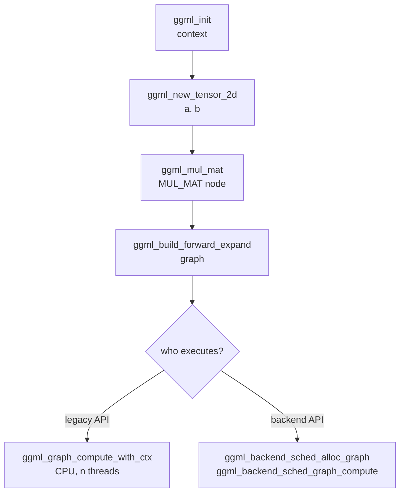
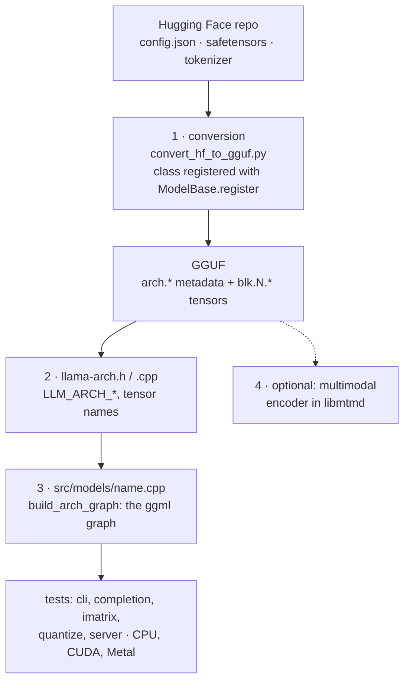
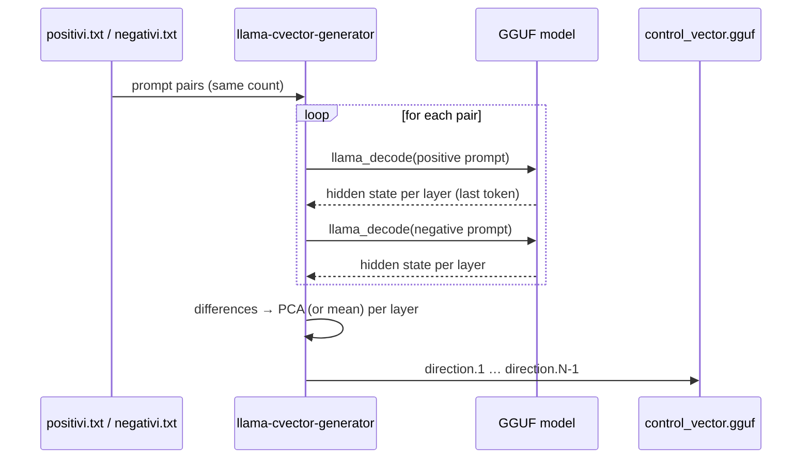
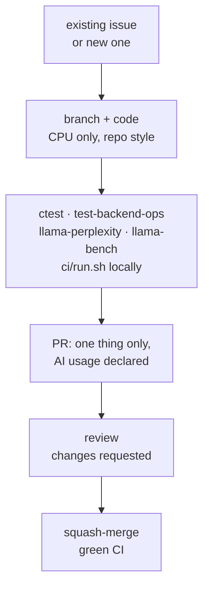

# Module 10: Deep dives: inside ggml and llama.cpp

In the previous modules you used llama.cpp as a tool. In this one you open it up: you see how **ggml** represents
tensors and computations, how a graph goes from the scheduler to the backends, what really happens between the text you
type and the token that appears, how a new architecture is added, how you "steer" a
model's behavior with a **control vector**, and how you contribute to the project without getting your PR closed.

!!! note "Command names and tools from source"
    `llama-cvector-generator`, `test-backend-ops` and the other tools in this module are **not** in the installer
    binary or in the release tarball: they exist only when you build llama.cpp from source
    (`cmake -B build && cmake --build build --config Release -j 8`, see [module 01](../01-installazione/README.md)).
    The `--control-vector*` options, instead, are in `llama cli`, `llama completion` and `llama serve` of any build.

## What you will learn

- Reading a ggml program: `ggml_context`, `ggml_tensor` (`ne`, `nb`, `type`, `op`, `src`), `ggml_cgraph`.
- Understanding the **graph → scheduler → backend → buffer** chain and why `-ngl` is nothing more than "which weights live in which buffer".
- Following the full cycle of a token: tokenization, embedding, layers, logits, sampler, detokenization.
- Knowing which files to touch to add an architecture (`convert_hf_to_gguf.py`, `gguf-py`, `llama-arch`, `src/models/`).
- Generating a control vector with `llama-cvector-generator` and applying it with `--control-vector`, `--control-vector-scaled`, `--control-vector-layer-range`.
- Preparing a PR that follows `CONTRIBUTING.md`: tests (`ctest`, `test-backend-ops`), style, AI usage policy, CI.

## 1. ggml: tensors, context, graph

[ggml](https://github.com/ggml-org/ggml) is the tensor library all of llama.cpp rests on: pure C/C++ with no
dependencies, cross-platform (x86, ARM, RISC-V, LoongArch, PowerPC, s390x, WebAssembly), SIMD kernels,
CPU/GPU/NPU backends, quantization from 2 to 8 bits plus the MXFP4 and NVFP4 formats, and a design rule that explains many
choices: **zero memory allocations during execution**. ggml lives in the `ggml-org/ggml` repository, but
changes to the core are proposed as PRs on llama.cpp (where the library is vendored in `ggml/`), because there the
CI tests it on all backends.

<figure class="schema" markdown>

<figcaption>The four ggml objects: the context that allocates tensors in a single arena, the compute graph (a DAG that computes nothing until it is executed), the scheduler that assigns nodes to backends and allocates buffers, and the backends with their buffers (RAM, VRAM or a remote machine via RPC).</figcaption>
</figure>

### The context

`ggml_init(params)` creates a **context**: a fixed-size memory arena (`mem_size`) in which
tensor objects are created. With `no_alloc = false` (the "legacy" API, CPU only) each tensor immediately also gets
space for its data; with `no_alloc = true` the context holds **only the metadata** and the data goes into a
backend buffer later. That is why you estimate the memory you need before `ggml_init`:
`ggml_tensor_overhead()` for each tensor, `ggml_graph_overhead()` for the graph, plus the data bytes if
`no_alloc` is false. If the estimate is too low, `ggml_new_tensor_*` fails with an assertion: that is the price
of the "no malloc at runtime" rule.

### The tensor

A `ggml_tensor` has up to 4 dimensions, `ne[0..3]` (number of elements) and `nb[0..3]` (stride in bytes), a
`type` (F32, F16, BF16, Q8_0, Q4_K, …), an `op` (the operation that produced it, `GGML_OP_NONE` for an input
tensor) and `src[]` (the operands). Two conventions confuse people coming from PyTorch:

- **`ne[0]` is the columns**, `ne[1]` the rows, `ne[2]` the matrices: the order is **reversed** compared to
  `torch.Size`. A `[n_embd, n_vocab]` tensor in GGUF is the embedding table with `n_vocab` rows of `n_embd` values.
- **`ggml_mul_mat(ctx, A, B)`** does not compute `A·B` but `C` such that `Cᵀ = A·Bᵀ`, that is `C = B·Aᵀ`: `A` and `B` must
  have the same `ne[0]` and the result has `ne[0] = A->ne[1]`, `ne[1] = B->ne[1]`. Lab 10-01 shows this with
  actual numbers.

### The compute graph

Calling `ggml_mul_mat`, `ggml_add`, `ggml_rms_norm`, `ggml_rope_ext`, `ggml_soft_max` … **computes nothing**:
it creates a new tensor with `op` and `src` set. `ggml_new_graph(ctx)` creates a `ggml_cgraph`, and
`ggml_build_forward_expand(gf, risultato)` fills it by walking the result's dependencies backwards: the
nodes end up in topological order, and `ggml_graph_node(gf, -1)` is the last one, that is, the result. Only at this
point does something execute the graph: `ggml_graph_compute_with_ctx(ctx, gf, n_threads)` on the CPU with the legacy API,
or the backend scheduler.



## 2. Backends, scheduler and buffers

A **backend** (`ggml_backend_t`) is a device that can execute operations: `ggml-cpu`, `ggml-cuda`,
`ggml-metal`, `ggml-vulkan`, `ggml-hip`, `ggml-sycl`, `ggml-rpc`, … They all implement the same interface
(`ggml_backend_i`) and own **buffers** (`ggml_backend_buffer_t`): a CPU buffer is RAM, a CUDA buffer is VRAM,
an RPC buffer lives in another machine's memory. Data goes in and out with `ggml_backend_tensor_set`
and `ggml_backend_tensor_get`, never with `memcpy` on `tensor->data` (which on a GPU is not a valid host
pointer).

Backends are **libraries loaded at runtime**: `ggml_backend_load_all()` looks for the `libggml-*.so` (or `.dll`,
`.dylib`) files next to the executable and registers them; `ggml_backend_init_best()` picks the best one available. This is
exactly what you see with `llama cli --list-devices`, and it is why the Ubuntu tarball contains a
dozen `libggml-cpu-<arch>.so` files (sandybridge … zen4, sapphirerapids): the CPU backend picks the variant
built for your CPU's instructions.

The **scheduler** (`ggml_backend_sched_t`) receives a list of backends in priority order and a graph, and:

1. **assigns each node to a backend**, based on where the weights are (a `MUL_MAT` whose weights are in VRAM runs
   on the GPU) and on which operations the backend supports (if one is missing, the node goes to the CPU);
2. **splits the graph** into consecutive per-backend splits and inserts the required tensor copies between devices;
3. **allocates the buffers** for the intermediate tensors (`ggml_backend_sched_alloc_graph`), reusing memory between nodes
   that do not overlap in time (this is the `ggml-alloc` allocator);
4. **executes** the splits in order (`ggml_backend_sched_graph_compute`).

That is why `-ngl N` simply means "put the weights of the first N layers in a GPU backend buffer": the
scheduler does the rest, including the CPU↔GPU copies between layers. And it is why `-ot "ffn_.*_exps=CPU"` works:
it moves certain tensors to a CPU buffer and their nodes follow.

| Object | Type | What it contains | Main APIs |
|---|---|---|---|
| Context | `ggml_context` | arena with tensor objects (and data, if `no_alloc=false`) | `ggml_init`, `ggml_free`, `ggml_new_tensor_*` |
| Tensor | `ggml_tensor` | `ne[]`, `nb[]`, `type`, `op`, `src[]`, `data`, `buffer` | `ggml_nbytes`, `ggml_nelements`, `ggml_set_name` |
| Graph | `ggml_cgraph` | nodes in topological order | `ggml_new_graph`, `ggml_build_forward_expand`, `ggml_graph_node` |
| Backend | `ggml_backend_t` | device + kernels | `ggml_backend_load_all`, `ggml_backend_init_best`, `ggml_backend_init_by_type`, `ggml_backend_free` |
| Buffer | `ggml_backend_buffer_t` | device memory | `ggml_backend_tensor_set/get`, `ggml_backend_alloc_ctx_tensors` |
| Scheduler | `ggml_backend_sched_t` | node→backend assignment, splits, allocation | `ggml_backend_sched_new`, `_reset`, `_alloc_graph`, `_graph_compute`, `_free` |

## 3. The cycle of a token

Every time the model "writes" a token, llama.cpp performs seven steps. The ggml graph of step 3 is built
by the model architecture's `build_arch_graph` and executed by the scheduler; everything else is code in the
`libllama` library (tokenizer, KV cache, sampler) and in the program that uses it.

<figure class="schema" markdown>

<figcaption>From "Ciao, come" to the next token: tokenization, embedding, N transformer layers with KV cache, logits, sampling, detokenization. The chosen token goes back in as a single-token batch. The ids are the real ones from Qwen3.5-0.8B.</figcaption>
</figure>

1. **Tokenization.** `llama_tokenize(vocab, testo, …)` turns the text into ids using the vocabulary stored
   in the GGUF (`tokenizer.ggml.model`, `tokenizer.ggml.tokens`, `tokenizer.ggml.merges`, `tokenizer.ggml.pre`). Even
   before that, in chat, the Jinja template has wrapped your message in the special tokens. With
   `llama-tokenize` (release tarball) on Qwen3.5-0.8B:

    ```bash
    llama-tokenize -m Qwen3.5-0.8B-Q8_0.gguf -p "Ciao, come"
    ```
    ```
        34 -> 'C'
     21817 -> 'iao'
        11 -> ','
      2445 -> ' come'
    ```

    Note the space included in the `' come'` token: in BPE tokenizers the space belongs to the word that follows it.

2. **Embedding.** Each id selects a row of `token_embd.weight` (`[n_embd, n_vocab]`, for Qwen3.5-0.8B
   `[1024, 248320]`) with `ggml_get_rows`: the batch of N tokens becomes an `[n_embd, N]` matrix.

3. **N transformer layers** (`blk.0` … `blk.N-1`; here `n_layer = 24`). In each one: normalization (`attn_norm`),
   Q/K/V projections with RoPE on the positions, attention that **reads the KV cache** of the previous tokens and
   **writes** the current token's K and V into it, `ffn_norm`, feed-forward (or the experts, in MoE models). Each layer reads all
   of its weights: this is where, during generation, memory bandwidth is consumed (module 05).

4. **Logits.** `output_norm` and then `output.weight` (the "lm_head", `[n_embd, n_vocab]`) produce a score for
   each of the 248,320 tokens in the vocabulary. From the API's point of view: `llama_decode(ctx, batch)` runs
   steps 2-4 and `llama_get_logits_ith(ctx, -1)` returns the logits of the last token.

5. **Sampler.** The logits pass through a **chain** of samplers (`llama_sampler_chain`). The `llama completion` log
   prints it exactly:

    ```
    sampler chain: logits -> ?penalties -> ?dry -> ?top-n-sigma -> top-k -> ?typical -> top-p -> min-p -> ?xtc -> temp-ext -> dist
    ```

    The `?` marks samplers that are inactive with the default parameters. `top-k` keeps the best 40, `top-p` and `min-p`
    cut the tail, `temp` scales the logits, `dist` draws a random token from the distribution. A GBNF
    grammar (module 06) is a sampler that zeroes out disallowed tokens. `llama_sampler_sample(smpl, ctx, -1)` returns the id.

6. **Detokenization.** `llama_token_to_piece(vocab, id, …)` gives back the piece of text (`200684 -> ' stai'`) that
   is printed or streamed to the client.

7. **The token goes back in.** The program builds a batch with that single token (`llama_batch_get_one(&id, 1)`) and
   returns to step 3. It stops when `llama_vocab_is_eog(vocab, id)` is true (end of answer) or at the `-n` limit.

!!! tip "pp and tg seen from the graph"
    *Prompt processing* is one `llama_decode` with all the prompt tokens in a batch: the matrices are
    `[n_embd, N]` with a large N and compute dominates. *Token generation* repeats steps 3-7 with N = 1: for each
    token all the weights are read again and bandwidth dominates. Module 05 starts from here.

## 4. Adding an architecture: the map

Implementing a new model is outside the scope of this course, but knowing **where** each piece lives helps you
read errors ("unknown model architecture", "tensor 'blk.0.attn_q.weight' not found") and follow PRs.
The official guide is [`docs/development/HOWTO-add-model.md`](https://github.com/ggml-org/llama.cpp/blob/master/docs/development/HOWTO-add-model.md); there are four steps.



1. **Conversion.** In `convert_hf_to_gguf.py` you add a class decorated with `@ModelBase.register("NomeForCausalLM")`
   (and `@ModelBase.example("user/model")` with a test model, preferably not gated) that extends `TextModel`
   or `MmprojModel`. In `gguf-py/gguf/constants.py` you add the `MODEL_ARCH` enum, the name and the list of tensors;
   in `tensor_mapping.py` the mapping between the original names (`transformer.h.{bid}.ln_1`) and the GGUF ones
   (`blk.{bid}.attn_norm`). If needed, you override `set_gguf_parameters`, `set_vocab`, `modify_tensors`.
   The docs insist: **choose the architecture name right away**, because once GGUFs are published it can no longer be renamed;
   and apply constant changes to the weights at conversion time (not in the graph), such as the `1 +` of Gemma's norms.
2. **Architecture in `src/llama-arch.h/.cpp`.** An `LLM_ARCH_*` value, the name in `LLM_ARCH_NAMES`, any new
   keys and tensors in `LLM_KV_NAMES`, `LLM_TENSOR_NAMES`, `LLM_TENSOR_INFOS`; the RoPE type in
   `llama_model_rope_type`; and every `switch` that iterates over `llm_arch` (a `grep LLM_ARCH_` finds them: forgetting
   one makes `test-llama-archs` fail in CI).
3. **The graph.** A struct that inherits from `llama_model_base` and implements `build_arch_graph`, in a
   `src/models/<nome>.cpp` file, added to `llama_model_mapping`. You start by copying a similar architecture
   (`llama`, `dbrx`, `bert`) and use the building blocks of `llm_graph_context` (`build_norm`, `build_attn`, `build_ffn`,
   `ggml_rope_ext`). To compare intermediate tensors with PyTorch there is `llama-eval-callback`.
4. **Multimodal (optional).** An `MmprojModel` subclass in conversion, the encoder in `tools/mtmd/clip.cpp`,
   the preprocessor in `mtmd.cpp`; existing encoders (siglip, pixtral, qwen) are reused with a specific projector.

Before the PR you check `cli`, `completion`, `imatrix`, `quantize` and `server` on the main backends, and the
first PR is **CPU only**: kernels for the other backends come in later PRs.

## 5. Control vectors

A **control vector** is one vector per layer (`[n_embd]`) that is **added to the hidden state** during
inference, shifting the model along a "conceptual" direction (cheerful ↔ sad, formal ↔ casual,
confident ↔ doubtful) without fine-tuning and without touching the weights. You derive the direction like this:

1. you write pairs of **positive** and **negative** prompts (same format, same number of lines, one per line,
   a literal `\n` for line breaks), already in the model's chat template format;
2. `llama-cvector-generator` runs each pair through the model, captures the hidden state **at the last token** of each
   layer (except the last layer, which is discarded) and computes the positive − negative differences;
3. on these differences it applies **PCA** (the default method, `--pca-iter 1000 --pca-batch 100`) or a **mean**
   (`--method mean`) to get the dominant direction of each layer;
4. it writes a GGUF with `general.architecture = controlvector`, `controlvector.model_hint` (the model's
   architecture, e.g. `qwen35`) and `controlvector.layer_count`, plus one `direction.<layer>` tensor per layer.



Commands (from source, `build/bin/`; options read from `common/arg.cpp`):

```bash
llama-cvector-generator -m Qwen3.5-0.8B-Q8_0.gguf \
    --positive-file positivi.txt --negative-file negativi.txt \
    -o allegro.gguf                    # default: control_vector.gguf
llama-cvector-generator -m modello.gguf -ngl 99 --pca-iter 2000 --pca-batch 100   # more iterations, GPU
llama-cvector-generator -m modello.gguf --method mean                              # mean instead of PCA
```

Applying it, with any build (options from `llama cli --help`, identical in `llama completion` and `llama serve`):

| Option | Meaning |
|---|---|
| `--control-vector FNAME` | adds a control vector with scale 1; multiple files separated by commas |
| `--control-vector-scaled FNAME:SCALE,...` | adds it with a custom scale (positive "toward" the positives, negative toward the negatives) |
| `--control-vector-layer-range START END` | applies only to layers from START to END inclusive |

```bash
llama cli -m Qwen3.5-0.8B-Q8_0.gguf --control-vector-scaled allegro.gguf:0.8 --control-vector-layer-range 10 23 -rea off
llama cli -m Qwen3.5-0.8B-Q8_0.gguf --control-vector-scaled allegro.gguf:-0.8 --control-vector-layer-range 10 23 -rea off   # toward "sad"
```

The official README suggests applying the vector **to the layers past the tenth**: in the early layers the model
is still "reading" and the push only produces incoherent text. You find the right scale by trial and error: too
high and the model repeats words or gets stuck, too low and nothing changes. Lab 10-02 guides you.

## 6. Contributing to the project

llama.cpp receives dozens of PRs a day and `CONTRIBUTING.md` is strict. In short, for a new contributor:

- **Before writing code**: search existing issues and PRs (duplicates get closed); a new feature
  starts from an **issue**, not a PR; a bug fix must come with a reproduction and a **regression
  test** that fails before and passes after; no trivial PRs (typos, formatting); **only one open PR**
  at a time; additions to the CLI or the public API face a higher bar.
- **AI usage**: generated code is allowed but you are 100% responsible for it: it must be **declared** explicitly,
  reviewed by hand (roughly one hour per 200-400 lines), and you must be able to explain every line; using
  AI to write issues, PR descriptions, discussions and replies is **forbidden**. Undeclared use leads to a ban. Details in `AGENTS.md`.
- **Tests**: run the full CI locally (`ci/README.md`); check that perplexity and performance do not get worse
  (`llama-perplexity`, `llama-bench`); if you touch ggml, run `test-backend-ops` (it compares operator results
  across two different backends, so you need at least two backends) and add cases for new operators.
  Unit tests run with `ctest` from the build folder (`cmake -B build -DLLAMA_BUILD_TESTS=ON`,
  then `ctest --test-dir build --output-on-failure`).
- **One PR per thing**, first version CPU only, and new quantization types require a converted model
  on Hugging Face, perplexity and KL-divergence comparisons, and performance numbers.
- **Style**: no external dependencies, simple C++ (`for` loops, no templates or "modern" STL), 4 spaces,
  braces on the same line, `void * ptr`, `int & a`, `snake_case`, uppercase enums with a prefix
  (`LLAMA_VOCAB_TYPE_BPE`), names in the form `<class>_<action>_<noun>` (`llama_sampler_chain_remove`), opaque types with `_t`,
  vertical alignment, `clang-format` when in doubt. Lowercase file names with dashes.
- **Afterwards**: expect change requests, rebase on `master` if the PR gets old, consider adding yourself to
  `CODEOWNERS`. Maintainers squash-merge with the title `<module> : <title> (#number)` and wait for CI.



## Summary

| Concept / flag | Where | In short |
|---|---|---|
| `ggml_init`, `no_alloc` | ggml | fixed arena; `true` = metadata only, data in backend buffers |
| `ne[0]` = columns, `mul_mat` = `A·Bᵀ` | ggml | dimensions reversed compared to PyTorch |
| `ggml_build_forward_expand` | ggml | builds the graph; no computation |
| `ggml_backend_sched_*` | ggml | assigns nodes to backends, splits, allocates, executes |
| `ggml_backend_tensor_set/get` | ggml | the only correct way to read/write a tensor's data |
| `llama_tokenize` → `llama_decode` → `llama_get_logits_ith` → `llama_sampler_sample` → `llama_token_to_piece` | libllama | the cycle of a token |
| `convert_hf_to_gguf.py`, `gguf-py/gguf/constants.py`, `src/llama-arch.*`, `src/models/*.cpp` | llama.cpp | the four places of a new architecture |
| `llama-cvector-generator --positive-file --negative-file -o --method --pca-iter --pca-batch` | source | generates the control vector |
| `--control-vector`, `--control-vector-scaled F:S`, `--control-vector-layer-range A B` | cli/completion/serve | applies the control vector |
| `ctest`, `test-backend-ops`, `ci/run.sh` | source | tests before the PR |

## Common mistakes

!!! warning "\"Transposed\" result or dimensions that do not add up in `ggml_mul_mat`"
    Remember `ne[0]` = columns and `C = B·Aᵀ`: the two operands must share `ne[0]`. If you need a classic `A·B`,
    pass `B` already transposed (as in lab 10-01) or use `ggml_transpose` + `ggml_cont`.

!!! warning "Assertion `not enough space in the context's memory pool`"
    The `mem_size` estimate is too low: add `ggml_tensor_overhead()` for each tensor (including the
    intermediate ones created by the ops!) and `ggml_graph_overhead()`. With `no_alloc=true` the data does not count.

!!! warning "`memcpy` on `tensor->data` with a GPU backend"
    With the backend API, `data` points to device memory: use `ggml_backend_tensor_set/get`, which perform
    the right copy even when the backend is the CPU.

!!! warning "`llama-cvector-generator: command not found`"
    The tool is not in the installer or in the tarball: you need a build from source (`build/bin/llama-cvector-generator`).
    The same applies to `test-backend-ops` and `llama-eval-callback`.

!!! warning "\"number of positive and negative prompts must be equal\""
    The two files must have the same number of non-empty lines, one pair per line. Check for empty lines at the end.

!!! warning "Control vector that produces incoherent text"
    The scale is too high or it is applied from the low layers. Lower the scale (0.3-0.8) and use `--control-vector-layer-range`
    starting from around layer 10. A vector generated with a different model (another quantization of the same
    model is fine, but a different architecture is not) is rejected or gives random results: check `model_hint`.

## Labs in this module

- [Lab 10-01 · A ggml graph by hand](../../laboratori/lab-10-01-grafo-ggml/README.md): two C programs (legacy API and backend API) that multiply two matrices, built with CMake against the ggml sources, on CPU and on GPU.
- [Lab 10-02 · Control vector](../../laboratori/lab-10-02-control-vector/README.md): generating a "cheerful ↔ sad" vector for Qwen3.5-0.8B and applying it with different scales and layer ranges.

## Check

1. What changes between `no_alloc = false` and `no_alloc = true` in `ggml_init`?
2. `ggml_mul_mat(ctx, A, B)` with `A` of `ne = [2, 4]` and `B` of `ne = [2, 3]`: what are the dimensions of the result and what does it compute?
3. Why does calling `ggml_add` not perform any addition?
4. In what sense is `-ngl 20` "just a matter of buffers"?
5. In the cycle of a token, where does a GBNF grammar act?
6. What are the four places in the code you touch to add a text architecture?
7. Why does the `cvector-generator` README recommend `--control-vector-layer-range 10 31` and not `0 31`?
8. You fixed a bug with the help of an AI assistant. What must your PR contain to comply with `CONTRIBUTING.md`?

??? success "Solutions"
    1. With `false` each tensor immediately gets its data in the context arena (CPU only, legacy API); with `true` the
       context has only the metadata and the data is allocated in a backend buffer by the scheduler or by
       `ggml_backend_alloc_ctx_tensors`.
    2. `ne = [4, 3]`: 3 rows of 4 values; it computes `C = B·Aᵀ` (equivalently `Cᵀ = A·Bᵀ`). The operands
       share `ne[0] = 2`.
    3. It only creates a new tensor with `op = GGML_OP_ADD` and `src[0], src[1]` set; the computation happens when the
       graph is executed by `ggml_graph_compute_with_ctx` or by the scheduler.
    4. The weights of the first 20 layers are allocated in a GPU backend buffer; the scheduler assigns the nodes that
       use them to the GPU and inserts the copies between devices. No other special logic.
    5. In the sampler chain, after the logits and before the draw: it zeroes the probability of the tokens the
       grammar does not allow in the current state.
    6. `convert_hf_to_gguf.py` (+ `gguf-py/gguf/constants.py` and `tensor_mapping.py`), `src/llama-arch.h/.cpp`,
       `src/models/<nome>.cpp` with `build_arch_graph`, `llama_model_mapping` in `src/llama-model.cpp`.
    7. In the low layers the model is still processing the form of the text and the push breaks coherence; the vector
       works better in the high layers, where the hidden state encodes abstract concepts (style, tone).
    8. A reproducible issue, a regression test that fails before and passes after, an explicit declaration of
       how AI was used, a PR description written by you (not by the AI), and your ability to explain every line.

## References

- [ggml: README](https://github.com/ggml-org/ggml) and [examples/simple](https://github.com/ggml-org/ggml/tree/master/examples/simple) (`simple-ctx.cpp`, `simple-backend.cpp`)
- [Introduction to ggml](https://huggingface.co/blog/introduction-to-ggml) (Hugging Face blog) and [GGML Tips & Tricks](https://github.com/ggml-org/llama.cpp/wiki/GGML-Tips-&-Tricks)
- [GGUF specification](https://github.com/ggml-org/ggml/blob/master/docs/gguf.md)
- [docs/development/HOWTO-add-model.md](https://github.com/ggml-org/llama.cpp/blob/master/docs/development/HOWTO-add-model.md)
- [tools/cvector-generator/README.md](https://github.com/ggml-org/llama.cpp/blob/master/tools/cvector-generator/README.md), [PR #5970](https://github.com/ggml-org/llama.cpp/pull/5970) (control vector support), [PR #7514](https://github.com/ggml-org/llama.cpp/pull/7514) (generator)
- [CONTRIBUTING.md](https://github.com/ggml-org/llama.cpp/blob/master/CONTRIBUTING.md), [AGENTS.md](https://github.com/ggml-org/llama.cpp/blob/master/AGENTS.md), [ci/README.md](https://github.com/ggml-org/llama.cpp/blob/master/ci/README.md)
- [include/llama.h](https://github.com/ggml-org/llama.cpp/blob/master/include/llama.h) and [ggml/include/ggml.h](https://github.com/ggml-org/llama.cpp/blob/master/ggml/include/ggml.h): the APIs cited in this module
- Course glossary: [tensor, graph, backend, KV cache, sampler](../../risorse/glossario.md)
