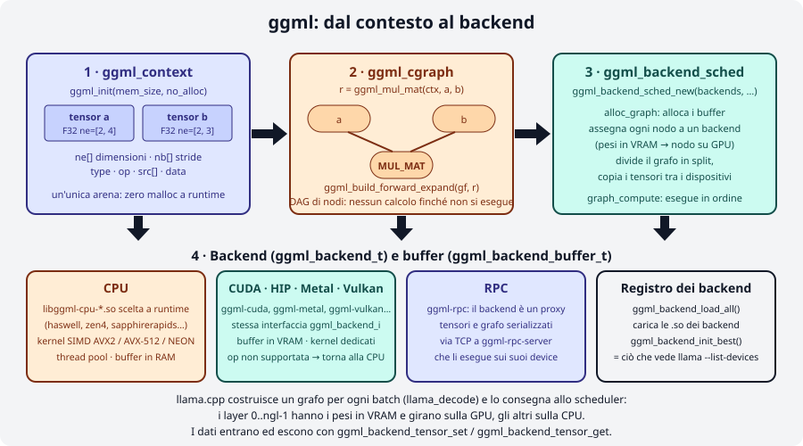
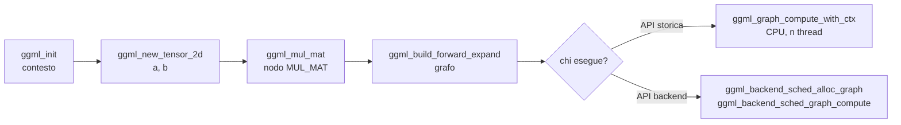
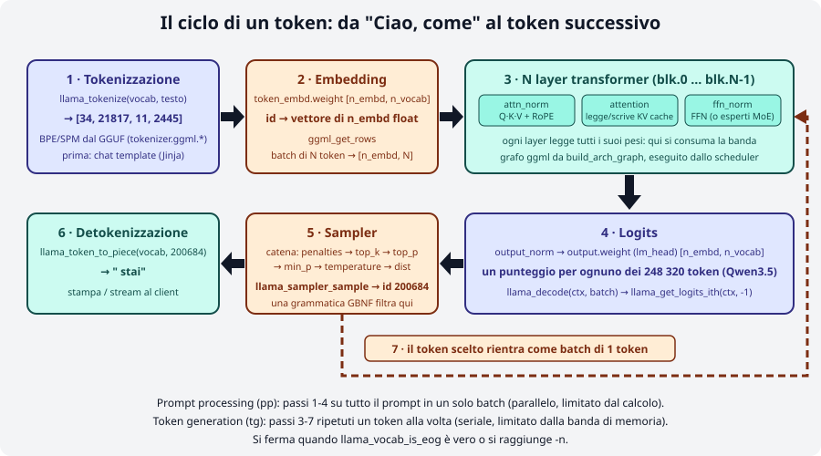
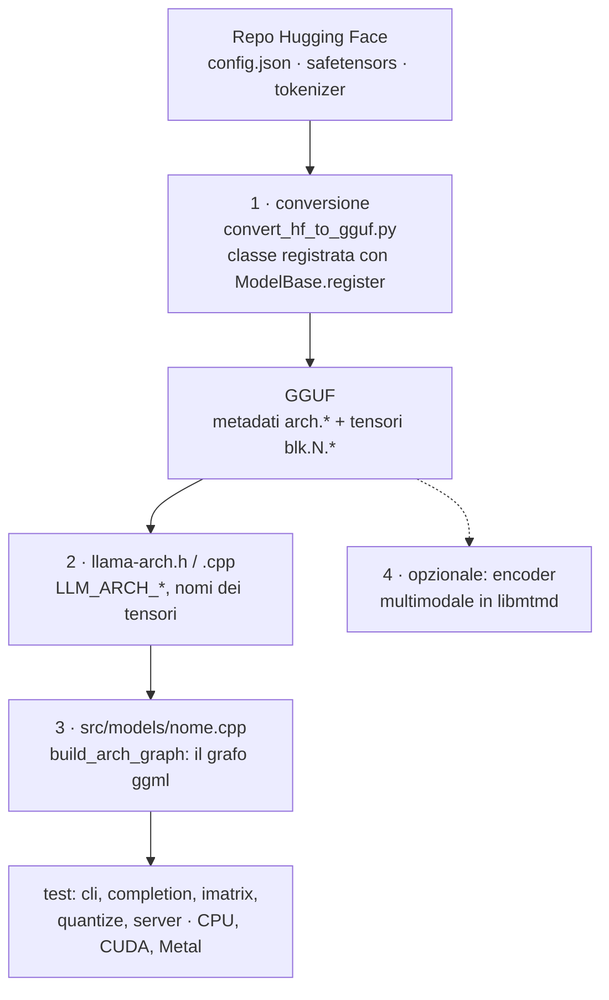
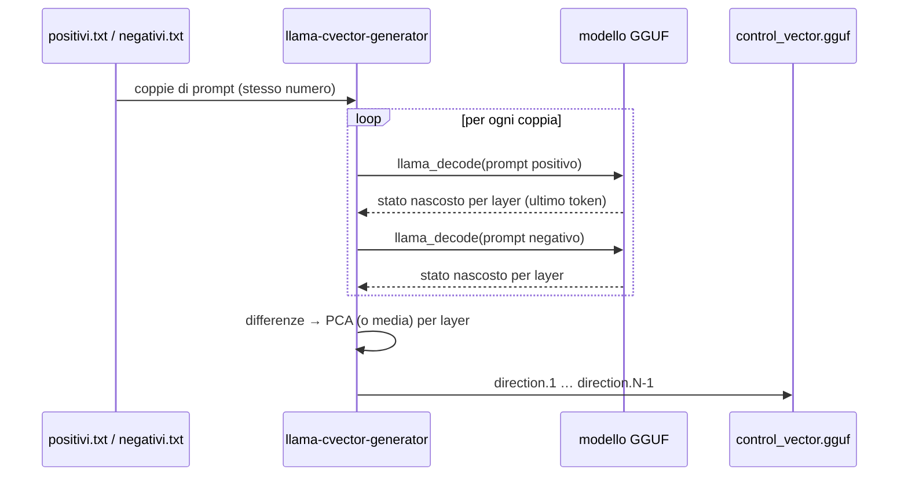
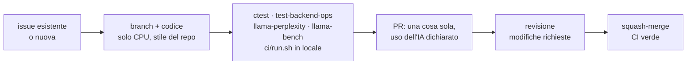

# Modulo 10: Approfondimenti: dentro ggml e llama.cpp

<span class="stato stato-verificato">verificato su b11046 (CPU): tokenizzazione, iperparametri, catena di sampler, flag</span> <span class="stato stato-bozza">bozza: compilazione dei programmi ggml, generazione del control vector e contributi: dalla documentazione e dai sorgenti ufficiali, non eseguiti su questa macchina</span>

Nei moduli precedenti hai usato llama.cpp come uno strumento. In questo lo apri: vedi come **ggml** rappresenta
tensori e calcoli, come un grafo passa dallo scheduler ai backend, che cosa succede davvero tra il testo che
scrivi e il token che compare, come si aggiunge un'architettura nuova, come si "sposta" il comportamento di un
modello con un **control vector** e come si contribuisce al progetto senza farsi chiudere la PR.

!!! note "Nomi dei comandi e strumenti dai sorgenti"
    `llama-cvector-generator`, `test-backend-ops` e gli altri strumenti di questo modulo **non** sono nel binario
    dell'installer né nel tarball delle release: esistono solo compilando llama.cpp dai sorgenti
    (`cmake -B build && cmake --build build --config Release -j 8`, vedi il [modulo 01](../01-installazione/README.md)).
    Le opzioni `--control-vector*` invece sono in `llama cli`, `llama completion` e `llama serve` di qualsiasi build.

## Cosa imparerai

- Leggere un programma ggml: `ggml_context`, `ggml_tensor` (`ne`, `nb`, `type`, `op`, `src`), `ggml_cgraph`.
- Capire la catena **grafo → scheduler → backend → buffer** e perché `-ngl` non è altro che "quali pesi stanno in quale buffer".
- Seguire il ciclo completo di un token: tokenizzazione, embedding, layer, logits, sampler, detokenizzazione.
- Sapere quali file toccare per aggiungere un'architettura (`convert_hf_to_gguf.py`, `gguf-py`, `llama-arch`, `src/models/`).
- Generare un control vector con `llama-cvector-generator` e applicarlo con `--control-vector`, `--control-vector-scaled`, `--control-vector-layer-range`.
- Preparare una PR che rispetti `CONTRIBUTING.md`: test (`ctest`, `test-backend-ops`), stile, politica sull'uso dell'IA, CI.

## 1. ggml: tensori, contesto, grafo

[ggml](https://github.com/ggml-org/ggml) è la libreria di tensori su cui poggia tutto llama.cpp: C/C++ puro senza
dipendenze, multipiattaforma (x86, ARM, RISC-V, LoongArch, PowerPC, s390x, WebAssembly), kernel SIMD, backend
CPU/GPU/NPU, quantizzazione da 2 a 8 bit più i formati MXFP4 e NVFP4, e una regola di progetto che spiega molte
scelte: **zero allocazioni di memoria durante l'esecuzione**. ggml vive nel repository `ggml-org/ggml` ma le
modifiche al nucleo si propongono come PR su llama.cpp (dove la libreria è vendorizzata in `ggml/`), perché lì la
CI la prova su tutti i backend.

<figure class="schema" markdown>

<figcaption>I quattro oggetti di ggml: il contesto che alloca i tensori in un'unica arena, il grafo di calcolo (un DAG che non calcola nulla finché non viene eseguito), lo scheduler che assegna i nodi ai backend e alloca i buffer, e i backend con i loro buffer (RAM, VRAM o una macchina remota via RPC).</figcaption>
</figure>

### Il contesto

`ggml_init(params)` crea un **contesto**: un'arena di memoria di dimensione fissa (`mem_size`) in cui vengono
creati gli oggetti tensore. Con `no_alloc = false` (API "storica", solo CPU) ogni tensore riceve subito anche lo
spazio per i dati; con `no_alloc = true` il contesto contiene **solo i metadati** e i dati verranno messi in un
buffer di backend più tardi. Per questo prima di `ggml_init` si stima la memoria necessaria:
`ggml_tensor_overhead()` per ogni tensore, `ggml_graph_overhead()` per il grafo, più i byte dei dati se
`no_alloc` è falso. Se la stima è troppo bassa, `ggml_new_tensor_*` fallisce con un'asserzione: è il prezzo
della regola "niente malloc a runtime".

### Il tensore

Un `ggml_tensor` ha fino a 4 dimensioni, `ne[0..3]` (numero di elementi) e `nb[0..3]` (stride in byte), un
`type` (F32, F16, BF16, Q8_0, Q4_K, …), un'`op` (l'operazione che lo ha prodotto, `GGML_OP_NONE` per un tensore
di input) e `src[]` (gli operandi). Due convenzioni che confondono chi arriva da PyTorch:

- **`ne[0]` sono le colonne**, `ne[1]` le righe, `ne[2]` le matrici: l'ordine è **inverso** rispetto a
  `torch.Size`. Un tensore `[n_embd, n_vocab]` in GGUF è la tabella di embedding con `n_vocab` righe di `n_embd` valori.
- **`ggml_mul_mat(ctx, A, B)`** non calcola `A·B` ma `C` tale che `Cᵀ = A·Bᵀ`, cioè `C = B·Aᵀ`: `A` e `B` devono
  avere lo stesso `ne[0]` e il risultato ha `ne[0] = A->ne[1]`, `ne[1] = B->ne[1]`. Il lab 10-01 lo mostra con
  numeri alla mano.

### Il grafo di calcolo

Chiamare `ggml_mul_mat`, `ggml_add`, `ggml_rms_norm`, `ggml_rope_ext`, `ggml_soft_max` … **non calcola nulla**:
crea un nuovo tensore con `op` e `src` impostati. `ggml_new_graph(ctx)` crea un `ggml_cgraph` e
`ggml_build_forward_expand(gf, risultato)` lo riempie percorrendo all'indietro le dipendenze del risultato: i
nodi finiscono in ordine topologico, e `ggml_graph_node(gf, -1)` è l'ultimo, cioè il risultato. Solo a questo
punto qualcuno esegue il grafo: `ggml_graph_compute_with_ctx(ctx, gf, n_threads)` sulla CPU con l'API storica,
oppure lo scheduler dei backend.



## 2. Backend, scheduler e buffer

Un **backend** (`ggml_backend_t`) è un dispositivo capace di eseguire operazioni: `ggml-cpu`, `ggml-cuda`,
`ggml-metal`, `ggml-vulkan`, `ggml-hip`, `ggml-sycl`, `ggml-rpc`, … Tutti implementano la stessa interfaccia
(`ggml_backend_i`) e possiedono **buffer** (`ggml_backend_buffer_t`): un buffer CPU è RAM, un buffer CUDA è VRAM,
un buffer RPC vive sulla memoria di un'altra macchina. I dati entrano ed escono con `ggml_backend_tensor_set`
e `ggml_backend_tensor_get`, mai con `memcpy` su `tensor->data` (che su una GPU non è un puntatore valido
dell'host).

I backend sono **librerie caricate a runtime**: `ggml_backend_load_all()` cerca le `libggml-*.so` (o `.dll`,
`.dylib`) accanto all'eseguibile e le registra; `ggml_backend_init_best()` sceglie il migliore disponibile. È
esattamente ciò che vedi con `llama cli --list-devices`, ed è il motivo per cui il tarball Ubuntu contiene una
dozzina di `libggml-cpu-<arch>.so` (sandybridge … zen4, sapphirerapids): il backend CPU sceglie la variante
compilata per le istruzioni della tua CPU.

Lo **scheduler** (`ggml_backend_sched_t`) riceve una lista di backend in ordine di priorità e un grafo, e:

1. **assegna ogni nodo a un backend**, in base a dove stanno i pesi (un `MUL_MAT` i cui pesi sono in VRAM gira
   sulla GPU) e a quali operazioni il backend supporta (se manca, il nodo va sulla CPU);
2. **divide il grafo in split** consecutivi per backend e inserisce le copie di tensori necessarie tra dispositivi;
3. **alloca i buffer** per i tensori intermedi (`ggml_backend_sched_alloc_graph`), riusando la memoria tra nodi
   che non si sovrappongono nel tempo (è l'allocatore `ggml-alloc`);
4. **esegue** gli split in ordine (`ggml_backend_sched_graph_compute`).

Ecco perché `-ngl N` significa semplicemente "metti i pesi dei primi N layer in un buffer del backend GPU": lo
scheduler farà il resto, comprese le copie CPU↔GPU tra i layer. E perché `-ot "ffn_.*_exps=CPU"` funziona:
sposta certi tensori in un buffer CPU e i loro nodi seguono.

| Oggetto | Tipo | Cosa contiene | API principali |
|---|---|---|---|
| Contesto | `ggml_context` | arena con oggetti tensore (e dati, se `no_alloc=false`) | `ggml_init`, `ggml_free`, `ggml_new_tensor_*` |
| Tensore | `ggml_tensor` | `ne[]`, `nb[]`, `type`, `op`, `src[]`, `data`, `buffer` | `ggml_nbytes`, `ggml_nelements`, `ggml_set_name` |
| Grafo | `ggml_cgraph` | nodi in ordine topologico | `ggml_new_graph`, `ggml_build_forward_expand`, `ggml_graph_node` |
| Backend | `ggml_backend_t` | dispositivo + kernel | `ggml_backend_load_all`, `ggml_backend_init_best`, `ggml_backend_init_by_type`, `ggml_backend_free` |
| Buffer | `ggml_backend_buffer_t` | memoria del dispositivo | `ggml_backend_tensor_set/get`, `ggml_backend_alloc_ctx_tensors` |
| Scheduler | `ggml_backend_sched_t` | assegnazione nodi→backend, split, allocazione | `ggml_backend_sched_new`, `_reset`, `_alloc_graph`, `_graph_compute`, `_free` |

## 3. Il ciclo di un token

Ogni volta che il modello "scrive" un token, llama.cpp compie sette passi. Il grafo ggml del passo 3 è costruito
da `build_arch_graph` dell'architettura del modello ed eseguito dallo scheduler; tutto il resto è codice della
libreria `libllama` (tokenizer, KV cache, sampler) e del programma che la usa.

<figure class="schema" markdown>

<figcaption>Da "Ciao, come" al token successivo: tokenizzazione, embedding, N layer transformer con KV cache, logits, campionamento, detokenizzazione. Il token scelto rientra come batch di un solo token. Gli id sono quelli reali di Qwen3.5-0.8B.</figcaption>
</figure>

1. **Tokenizzazione.** `llama_tokenize(vocab, testo, …)` trasforma il testo in id usando il vocabolario salvato
   nel GGUF (`tokenizer.ggml.model`, `tokenizer.ggml.tokens`, `tokenizer.ggml.merges`, `tokenizer.ggml.pre`). Prima
   ancora, in chat, il template Jinja ha avvolto il tuo messaggio nei token speciali. Verificato con
   `llama-tokenize` (tarball della release) su Qwen3.5-0.8B:

    ```bash
    llama-tokenize -m Qwen3.5-0.8B-Q8_0.gguf -p "Ciao, come"
    ```
    ```
        34 -> 'C'
     21817 -> 'iao'
        11 -> ','
      2445 -> ' come'
    ```

    Nota lo spazio incluso nel token `' come'`: nei tokenizer BPE lo spazio appartiene alla parola che lo segue.

2. **Embedding.** Ogni id seleziona una riga di `token_embd.weight` (`[n_embd, n_vocab]`, per Qwen3.5-0.8B
   `[1024, 248320]`) con `ggml_get_rows`: il batch di N token diventa una matrice `[n_embd, N]`.

3. **N layer transformer** (`blk.0` … `blk.N-1`; qui `n_layer = 24`). In ognuno: normalizzazione (`attn_norm`),
   proiezioni Q/K/V con RoPE sulle posizioni, attention che **legge la KV cache** dei token precedenti e vi
   **scrive** K e V del token corrente, `ffn_norm`, feed-forward (o gli esperti, nei MoE). Ogni layer legge tutti
   i suoi pesi: è qui che, in generazione, si consuma la banda di memoria (modulo 05).

4. **Logits.** `output_norm` e poi `output.weight` (la "lm_head", `[n_embd, n_vocab]`) producono un punteggio per
   ognuno dei 248 320 token del vocabolario. Dal punto di vista dell'API: `llama_decode(ctx, batch)` esegue i
   passi 2-4 e `llama_get_logits_ith(ctx, -1)` restituisce i logits dell'ultimo token.

5. **Sampler.** I logits passano in una **catena** di sampler (`llama_sampler_chain`). Il log di `llama completion`
   la stampa esattamente:

    ```
    sampler chain: logits -> ?penalties -> ?dry -> ?top-n-sigma -> top-k -> ?typical -> top-p -> min-p -> ?xtc -> temp-ext -> dist
    ```

    Il `?` marca i sampler inattivi con i parametri di default. `top-k` tiene i 40 migliori, `top-p` e `min-p`
    tagliano la coda, `temp` scala i logits, `dist` estrae un token a caso dalla distribuzione. Una grammatica
    GBNF (modulo 06) è un sampler che azzera i token non ammessi. `llama_sampler_sample(smpl, ctx, -1)` restituisce l'id.

6. **Detokenizzazione.** `llama_token_to_piece(vocab, id, …)` ridà il pezzo di testo (`200684 -> ' stai'`) che
   viene stampato o inviato al client in streaming.

7. **Il token rientra.** Il programma costruisce un batch con quel solo token (`llama_batch_get_one(&id, 1)`) e
   torna al passo 3. Si ferma quando `llama_vocab_is_eog(vocab, id)` è vero (fine risposta) o al limite `-n`.

!!! tip "pp e tg visti dal grafo"
    Il *prompt processing* è un `llama_decode` con tutti i token del prompt in un batch: le matrici sono
    `[n_embd, N]` con N grande e il calcolo domina. La *token generation* ripete i passi 3-7 con N = 1: per ogni
    token si rileggono tutti i pesi e la banda domina. Il modulo 05 parte da qui.

## 4. Aggiungere un'architettura: la mappa

Non è materia di questo corso implementare un modello nuovo, ma sapere **dove** vive ogni pezzo ti serve per
leggere gli errori ("unknown model architecture", "tensor 'blk.0.attn_q.weight' not found") e per seguire le PR.
La guida ufficiale è [`docs/development/HOWTO-add-model.md`](https://github.com/ggml-org/llama.cpp/blob/master/docs/development/HOWTO-add-model.md); i passi sono quattro.



1. **Conversione.** In `convert_hf_to_gguf.py` si aggiunge una classe decorata con `@ModelBase.register("NomeForCausalLM")`
   (e `@ModelBase.example("user/model")` con un modello di prova, preferibilmente non gated) che estende `TextModel`
   o `MmprojModel`. In `gguf-py/gguf/constants.py` si aggiunge l'enum `MODEL_ARCH`, il nome e la lista dei tensori;
   in `tensor_mapping.py` la corrispondenza tra i nomi originali (`transformer.h.{bid}.ln_1`) e quelli GGUF
   (`blk.{bid}.attn_norm`). Se serve, si sovrascrivono `set_gguf_parameters`, `set_vocab`, `modify_tensors`.
   La doc insiste: **scegli subito il nome dell'architettura**, perché una volta pubblicati dei GGUF non si rinomina più;
   e fai a conversione (non nel grafo) le modifiche costanti ai pesi, come il `1 +` delle norm di Gemma.
2. **Architettura in `src/llama-arch.h/.cpp`.** Un valore `LLM_ARCH_*`, il nome in `LLM_ARCH_NAMES`, eventuali
   chiavi e tensori nuovi in `LLM_KV_NAMES`, `LLM_TENSOR_NAMES`, `LLM_TENSOR_INFOS`; il tipo di RoPE in
   `llama_model_rope_type`; e tutti gli `switch` che iterano su `llm_arch` (un `grep LLM_ARCH_` li trova: dimenticarne
   uno fa fallire `test-llama-archs` in CI).
3. **Il grafo.** Una struct che eredita da `llama_model_base` e implementa `build_arch_graph`, in un file
   `src/models/<nome>.cpp`, aggiunta in `llama_model_mapping`. Si parte copiando un'architettura simile
   (`llama`, `dbrx`, `bert`) e si usano i mattoni di `llm_graph_context` (`build_norm`, `build_attn`, `build_ffn`,
   `ggml_rope_ext`). Per confrontare i tensori intermedi con PyTorch c'è `llama-eval-callback`.
4. **Multimodale (opzionale).** Sottoclasse `MmprojModel` in conversione, encoder in `tools/mtmd/clip.cpp`,
   preprocessore in `mtmd.cpp`; si riusano encoder esistenti (siglip, pixtral, qwen) con un proiettore specifico.

Prima della PR si verificano `cli`, `completion`, `imatrix`, `quantize` e `server` sui backend principali, e la
prima PR è **solo CPU**: i kernel per gli altri backend arrivano in PR successive.

## 5. Control vector

Un **control vector** è un vettore per ogni layer (`[n_embd]`) che viene **sommato allo stato nascosto** durante
l'inferenza, spostando il modello lungo una direzione "concettuale" (allegro ↔ triste, formale ↔ colloquiale,
sicuro ↔ dubbioso) senza fine-tuning e senza toccare i pesi. La direzione si ricava così:

1. si scrivono coppie di prompt **positivi** e **negativi** (stesso formato, stesso numero di righe, una per riga,
   `\n` letterale per gli a capo), già nel formato del chat template del modello;
2. `llama-cvector-generator` esegue ogni coppia nel modello, cattura lo stato nascosto **all'ultimo token** di ogni
   layer (tranne l'ultimo layer, che viene scartato) e calcola le differenze positivo − negativo;
3. su queste differenze applica una **PCA** (metodo di default, `--pca-iter 1000 --pca-batch 100`) o una **media**
   (`--method mean`) per ottenere la direzione dominante di ogni layer;
4. scrive un GGUF con `general.architecture = controlvector`, `controlvector.model_hint` (l'architettura del
   modello, es. `qwen35`) e `controlvector.layer_count`, più un tensore `direction.<layer>` per layer.



Comandi (dai sorgenti, `build/bin/`; opzioni lette in `common/arg.cpp`):

```bash
llama-cvector-generator -m Qwen3.5-0.8B-Q8_0.gguf \
    --positive-file positivi.txt --negative-file negativi.txt \
    -o allegro.gguf                    # default: control_vector.gguf
llama-cvector-generator -m modello.gguf -ngl 99 --pca-iter 2000 --pca-batch 100   # più iterazioni, GPU
llama-cvector-generator -m modello.gguf --method mean                              # media invece di PCA
```

Applicazione, con qualsiasi build (`help_cli.txt`, identiche in `llama completion` e `llama serve`):

| Opzione | Significato |
|---|---|
| `--control-vector FNAME` | aggiunge un control vector con scala 1; più file separati da virgola |
| `--control-vector-scaled FNAME:SCALE,...` | aggiunge con scala personalizzata (positiva "verso" i positivi, negativa verso i negativi) |
| `--control-vector-layer-range START END` | applica solo ai layer da START a END inclusi |

```bash
llama cli -m Qwen3.5-0.8B-Q8_0.gguf --control-vector-scaled allegro.gguf:0.8 --control-vector-layer-range 10 23 -rea off
llama cli -m Qwen3.5-0.8B-Q8_0.gguf --control-vector-scaled allegro.gguf:-0.8 --control-vector-layer-range 10 23 -rea off   # verso "triste"
```

Il README ufficiale suggerisce di applicare il vettore **ai layer oltre il decimo**: nei primi layer il modello
sta ancora "leggendo" e la spinta produce solo testo incoerente. La scala giusta si cerca a tentativi: troppo
alta e il modello ripete parole o si blocca, troppo bassa e non cambia nulla. Il lab 10-02 ti guida.

## 6. Contribuire al progetto

llama.cpp riceve decine di PR al giorno e `CONTRIBUTING.md` è severo. In sintesi, per un contributore nuovo:

- **Prima di scrivere codice**: cerca issue e PR esistenti (i duplicati vengono chiusi); una funzionalità nuova
  parte da una **issue**, non da una PR; una correzione di bug deve avere una riproduzione e un **test di
  regressione** che fallisce prima e passa dopo; niente PR banali (refusi, formattazione); **una sola PR aperta**
  alla volta; aggiunte alla CLI o all'API pubblica hanno un'asticella più alta.
- **Uso dell'IA**: il codice generato è ammesso ma ne rispondi al 100 %: va **dichiarato** esplicitamente,
  rivisto a mano (indicativamente un'ora ogni 200-400 righe), devi saper spiegare ogni riga; è **vietato** usare
  l'IA per scrivere issue, descrizioni di PR, discussioni e risposte. L'uso non dichiarato porta al ban. Dettagli in `AGENTS.md`.
- **Test**: esegui la CI completa in locale (`ci/README.md`); controlla che perplessità e prestazioni non peggiorino
  (`llama-perplexity`, `llama-bench`); se tocchi ggml, esegui `test-backend-ops` (confronta i risultati degli
  operatori su due backend diversi, servono quindi almeno due backend) e aggiungi i casi per gli operatori nuovi.
  I test unitari si lanciano con `ctest` dalla cartella di build (`cmake -B build -DLLAMA_BUILD_TESTS=ON`,
  poi `ctest --test-dir build --output-on-failure`).
- **Una PR per cosa**, prima versione solo CPU, e i tipi di quantizzazione nuovi richiedono un modello convertito
  su Hugging Face, confronti di perplessità e KL-divergenza, e numeri di prestazioni.
- **Stile**: nessuna dipendenza esterna, C++ semplice (cicli `for`, niente template o STL "moderna"), 4 spazi,
  parentesi sulla stessa riga, `void * ptr`, `int & a`, `snake_case`, enum in maiuscolo con prefisso
  (`LLAMA_VOCAB_TYPE_BPE`), nomi `<classe>_<azione>_<nome>` (`llama_sampler_chain_remove`), tipi opachi con `_t`,
  allineamento verticale, `clang-format` in caso di dubbio. Nomi di file minuscoli con trattini.
- **Dopo**: aspettati richieste di modifica, rebase su `master` se la PR invecchia, valuta di aggiungerti a
  `CODEOWNERS`. I maintainer fanno squash-merge con titolo `<modulo> : <titolo> (#numero)` e aspettano la CI.



## Riepilogo

| Concetto / flag | Dove | In breve |
|---|---|---|
| `ggml_init`, `no_alloc` | ggml | arena fissa; `true` = solo metadati, dati nei buffer di backend |
| `ne[0]` = colonne, `mul_mat` = `A·Bᵀ` | ggml | dimensioni invertite rispetto a PyTorch |
| `ggml_build_forward_expand` | ggml | costruisce il grafo; nessun calcolo |
| `ggml_backend_sched_*` | ggml | assegna nodi ai backend, split, alloca, esegue |
| `ggml_backend_tensor_set/get` | ggml | unico modo corretto di leggere/scrivere i dati di un tensore |
| `llama_tokenize` → `llama_decode` → `llama_get_logits_ith` → `llama_sampler_sample` → `llama_token_to_piece` | libllama | il ciclo di un token |
| `convert_hf_to_gguf.py`, `gguf-py/gguf/constants.py`, `src/llama-arch.*`, `src/models/*.cpp` | llama.cpp | i quattro luoghi di una nuova architettura |
| `llama-cvector-generator --positive-file --negative-file -o --method --pca-iter --pca-batch` | sorgenti | genera il control vector |
| `--control-vector`, `--control-vector-scaled F:S`, `--control-vector-layer-range A B` | cli/completion/serve | applica il control vector |
| `ctest`, `test-backend-ops`, `ci/run.sh` | sorgenti | test prima della PR |

## Errori comuni

!!! warning "Risultato \"trasposto\" o dimensioni che non tornano in `ggml_mul_mat`"
    Ricorda `ne[0]` = colonne e `C = B·Aᵀ`: i due operandi devono condividere `ne[0]`. Se ti serve `A·B` classico,
    passa `B` già trasposta (come nel lab 10-01) o usa `ggml_transpose` + `ggml_cont`.

!!! warning "Asserzione `not enough space in the context's memory pool`"
    La stima di `mem_size` è troppo bassa: aggiungi `ggml_tensor_overhead()` per ogni tensore (anche quelli
    intermedi creati dalle op!) e `ggml_graph_overhead()`. Con `no_alloc=true` i dati non contano.

!!! warning "`memcpy` su `tensor->data` con un backend GPU"
    Con l'API dei backend `data` punta a memoria del dispositivo: usa `ggml_backend_tensor_set/get`, che fanno
    la copia giusta anche quando il backend è la CPU.

!!! warning "`llama-cvector-generator: command not found`"
    Lo strumento non è nell'installer né nel tarball: serve la build dai sorgenti (`build/bin/llama-cvector-generator`).
    Lo stesso vale per `test-backend-ops` e `llama-eval-callback`.

!!! warning "\"number of positive and negative prompts must be equal\""
    I due file devono avere lo stesso numero di righe non vuote, una coppia per riga. Controlla righe vuote in fondo.

!!! warning "Control vector che produce testo incoerente"
    Scala troppo alta o applicato dai layer bassi. Riduci la scala (0,3-0,8) e usa `--control-vector-layer-range`
    partendo dal layer 10 circa. Un vettore generato con un altro modello (o un'altra quantizzazione dello stesso
    modello va bene, ma un'architettura diversa no) viene rifiutato o dà risultati casuali: controlla `model_hint`.

## Laboratori di questo modulo

- [Lab 10-01 · Un grafo ggml a mano](../../laboratori/lab-10-01-grafo-ggml/README.md): due programmi C (API storica e API backend) che moltiplicano due matrici, compilati con CMake contro i sorgenti di ggml, su CPU e su GPU.
- [Lab 10-02 · Control vector](../../laboratori/lab-10-02-control-vector/README.md): generare un vettore "allegro ↔ triste" per Qwen3.5-0.8B e applicarlo con scale e intervalli di layer diversi.

## Verifica

1. Che cosa cambia tra `no_alloc = false` e `no_alloc = true` in `ggml_init`?
2. `ggml_mul_mat(ctx, A, B)` con `A` di `ne = [2, 4]` e `B` di `ne = [2, 3]`: quali sono le dimensioni del risultato e cosa calcola?
3. Perché chiamare `ggml_add` non esegue nessuna somma?
4. In che senso `-ngl 20` è "solo una questione di buffer"?
5. Nel ciclo di un token, dove agisce una grammatica GBNF?
6. Quali sono i quattro luoghi del codice da toccare per aggiungere un'architettura testuale?
7. Perché il README di `cvector-generator` consiglia `--control-vector-layer-range 10 31` e non `0 31`?
8. Hai corretto un bug con l'aiuto di un assistente IA. Cosa deve contenere la tua PR per rispettare `CONTRIBUTING.md`?

??? success "Soluzioni"
    1. Con `false` ogni tensore riceve subito i dati nell'arena del contesto (solo CPU, API storica); con `true` il
       contesto ha solo i metadati e i dati vengono allocati in un buffer di backend dallo scheduler o da
       `ggml_backend_alloc_ctx_tensors`.
    2. `ne = [4, 3]`: 3 righe da 4 valori; calcola `C = B·Aᵀ` (equivalentemente `Cᵀ = A·Bᵀ`). Gli operandi
       condividono `ne[0] = 2`.
    3. Crea solo un nuovo tensore con `op = GGML_OP_ADD` e `src[0], src[1]` impostati; il calcolo avviene quando il
       grafo viene eseguito da `ggml_graph_compute_with_ctx` o dallo scheduler.
    4. I pesi dei primi 20 layer vengono allocati in un buffer del backend GPU; lo scheduler assegna i nodi che li
       usano alla GPU e inserisce le copie tra dispositivi. Nessun'altra logica speciale.
    5. Nella catena dei sampler, dopo i logits e prima dell'estrazione: azzera la probabilità dei token che la
       grammatica non ammette nello stato corrente.
    6. `convert_hf_to_gguf.py` (+ `gguf-py/gguf/constants.py` e `tensor_mapping.py`), `src/llama-arch.h/.cpp`,
       `src/models/<nome>.cpp` con `build_arch_graph`, `llama_model_mapping` in `src/llama-model.cpp`.
    7. Nei layer bassi il modello elabora ancora la forma del testo e la spinta rompe la coerenza; il vettore
       funziona meglio nei layer alti, dove lo stato nascosto codifica concetti astratti (stile, tono).
    8. Un'issue riproducibile, un test di regressione che fallisce prima e passa dopo, la dichiarazione esplicita di
       come è stata usata l'IA, una descrizione della PR scritta da te (non dall'IA), e la tua capacità di spiegare ogni riga.

## Riferimenti

- [ggml: README](https://github.com/ggml-org/ggml) e [examples/simple](https://github.com/ggml-org/ggml/tree/master/examples/simple) (`simple-ctx.cpp`, `simple-backend.cpp`)
- [Introduction to ggml](https://huggingface.co/blog/introduction-to-ggml) (blog Hugging Face) e [GGML Tips & Tricks](https://github.com/ggml-org/llama.cpp/wiki/GGML-Tips-&-Tricks)
- [Specifica GGUF](https://github.com/ggml-org/ggml/blob/master/docs/gguf.md)
- [docs/development/HOWTO-add-model.md](https://github.com/ggml-org/llama.cpp/blob/master/docs/development/HOWTO-add-model.md)
- [tools/cvector-generator/README.md](https://github.com/ggml-org/llama.cpp/blob/master/tools/cvector-generator/README.md), [PR #5970](https://github.com/ggml-org/llama.cpp/pull/5970) (supporto ai control vector), [PR #7514](https://github.com/ggml-org/llama.cpp/pull/7514) (generatore)
- [CONTRIBUTING.md](https://github.com/ggml-org/llama.cpp/blob/master/CONTRIBUTING.md), [AGENTS.md](https://github.com/ggml-org/llama.cpp/blob/master/AGENTS.md), [ci/README.md](https://github.com/ggml-org/llama.cpp/blob/master/ci/README.md)
- [include/llama.h](https://github.com/ggml-org/llama.cpp/blob/master/include/llama.h) e [ggml/include/ggml.h](https://github.com/ggml-org/llama.cpp/blob/master/ggml/include/ggml.h): le API citate in questo modulo
- Glossario del corso: [tensore, grafo, backend, KV cache, sampler](../../risorse/glossario.md)
