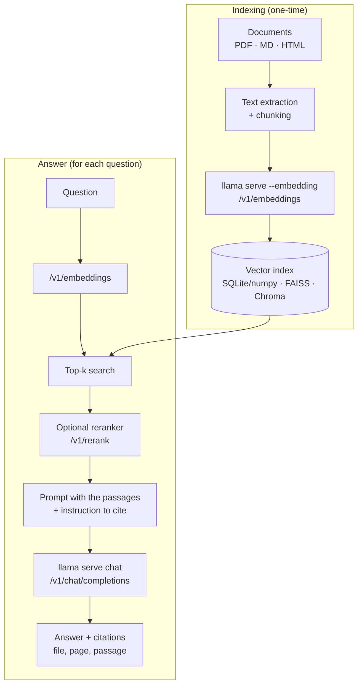

# P1: Local document assistant (RAG)

:material-book-open-page-variant:{ .meta-icon } Modules [02](../../moduli/02-primi-passi/README.md), [04](../../moduli/04-server-api/README.md), [08](../../moduli/08-integrazione-sviluppo/README.md)
:material-target:{ .meta-icon } Difficulty ●●○

## Description

An assistant that answers questions about an archive of your own documents (PDF, Markdown, HTML pages: course
notes, manuals, regulations, contracts) **entirely locally**, without a single line leaving the machine,
and that **cites the sources** (file and passage) it took the answer from. This is the right project if you want to
really understand what RAG (Retrieval-Augmented Generation) is beyond the libraries that hide it: here you
build it with `llama serve` for embeddings and chat, and with a vector index you choose.

## Architecture

Two instances of `llama serve` (one `--embedding`, one for chat) or a single one in **router mode** with two
models in the `--models-dir` folder.

## Minimum requirements

- Indexing of at least 20 documents (or 200 pages) with configurable chunking (size and overlap).
- Embeddings through the `/v1/embeddings` endpoint of `llama serve`; vector search (numpy + cosine is fine to start).
- Chat through `/v1/chat/completions` with the retrieved passages in the prompt and **verifiable citations** in the answer.
- Interface: interactive CLI or minimal web UI (the llama.cpp web UI is not enough: your pipeline must sit in front).
- Evaluation set of at least 25 questions with expected answer and source document; a script that computes:
  retrieval *recall@k* (is the right chunk among the first k?) and answer accuracy (human judgment or
  keyword matching).

## Extensions for full marks

- **Reranker** (`/v1/rerank` with `ggml-org/Qwen3-Reranker-0.6B-Q8_0-GGUF`) and measurement of the recall@3 gain.
- **Hybrid search**: BM25 (e.g. SQLite FTS5) + vector, with score fusion.
- **Streaming** of the answer in the interface and clickable citations that open the passage.
- "Smart" chunking by structure (Markdown headings, PDF pages) compared with fixed-window chunking.
- Structured output (module 06): the answer is a JSON `{risposta, citazioni:[{file, pagina, testo}]}` validated with JSON Schema.
- Prompt cache reuse: fixed system prompt and instructions at the head, variable passages at the tail; measure `prompt_tokens_cached_total`.

## Suggested milestones

| Week | Goal | Verifiable result |
|---|---|---|
| 1 | Ugly end-to-end pipeline: 5 documents, fixed chunks, numpy, answer with the file name | one question → one answer with the right source |
| 2 | Evaluation set, recall@k measurements as chunk size (256/512/1024 tokens) and k vary; comparison of 2 embedding models and 2 chat models | table with 4-6 rows of measurements |
| 3 | Reranker or hybrid search, interface, README, report, demo | a classmate reproduces the result in 15 minutes |

## Recommended models

| Role | Repository | File / quant | Size | Notes |
|---|---|---|---|---|
| Embedding | `ggml-org/embeddinggemma-300M-GGUF` | Q8_0 | 318 MiB | multilingual, 768 dim; alternative `unsloth/embeddinggemma-300m-GGUF` |
| Embedding (multilingual, larger) | `ggml-org/bge-m3-Q8_0-GGUF` | q8_0 | 605 MiB | excellent in Italian, 8k context |
| Reranker | `ggml-org/Qwen3-Reranker-0.6B-Q8_0-GGUF` | Q8_0 | 610 MiB | `--rerank --pooling rank` |
| Chat (8 GB) | `ggml-org/Qwen3.5-0.8B-GGUF` | Q8_0 | 785 MiB | turn thinking off (`enable_thinking:false`) |
| Chat (16 GB) | `ggml-org/gemma-3-4b-it-qat-GGUF` | Q4_0 | 2.4 GiB | much better answers in Italian |
| Chat (16 GB, alternative) | `unsloth/Qwen3.5-4B-GGUF` | Q4_K_M | 2.6 GiB | thinking can be enabled for hard questions |

Typical startup: `llama serve -hf ggml-org/embeddinggemma-300M-GGUF --embedding --port 8081` and
`llama serve -hf ggml-org/gemma-3-4b-it-qat-GGUF -c 8192 --port 8080`.

## Specific grading criteria

- Citations really point to the passage used (spot check on 10 answers).
- Recall@k measured and discussed: why that chunk size, why that k.
- Comparison of at least two models (embedding **or** chat) on the same set.
- Handling of the "I don't know" case: when retrieval finds nothing relevant, the assistant says so instead of making things up.
- No network calls: demonstrated (e.g. `--offline`, or a test with the network unplugged).

## Known pitfalls

- **Chunks that are too large** fill the context and the model "gets lost"; chunks that are too small lose the context of the sentence. Measure, don't guess.
- Embeddings must be normalized (the server does it with `--embd-normalize 2`, the default) and **the same model** must index and search: changing model means reindexing.
- Many PDFs have badly extracted text (columns, tables, scans without OCR): check the extracted text before blaming the model.
- Small models cite nonexistent sources: ask for citations in a strict format (e.g. `[1]`, `[2]` referring to numbered passages) and check in code that they exist.
- With thinking on, Qwen3.5 takes tens of seconds on CPU: `chat_template_kwargs: {"enable_thinking": false}` or `--reasoning-budget 0`.
- Server context: with `-np 2` and `-c 8192` each slot has 4096 tokens: 5 passages of 512 tokens + question + answer barely fit.

## Deliverables

- Repository with README, reproducible startup instructions and the llama.cpp version used.
- Evaluation set (questions, expected answers, sources) and measurement script with the results.
- Short report (problems encountered, choices, measurements) and 5-minute demo.

## Grading

See the [common rubric](../README.md#grading-rubric) plus the specific criteria above.
