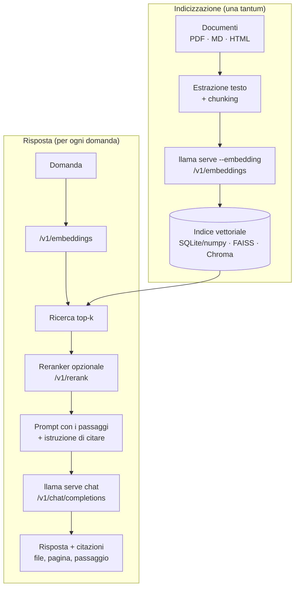

# P1: Assistente documentale locale (RAG)

:material-book-open-page-variant:{ .meta-icon } Moduli [02](../../moduli/02-primi-passi/README.md), [04](../../moduli/04-server-api/README.md), [08](../../moduli/08-integrazione-sviluppo/README.md)
:material-target:{ .meta-icon } Difficoltà ●●○

## Descrizione

Un assistente che risponde a domande su un archivio di documenti tuoi (PDF, Markdown, pagine HTML: appunti
del corso, manuali, regolamenti, contratti) **interamente in locale**, senza che una riga esca dalla macchina,
e che **cita le fonti** (file e passaggio) da cui ha preso la risposta. È il progetto giusto se vuoi capire
davvero cos'è il RAG (Retrieval-Augmented Generation) al di là delle librerie che lo nascondono: qui lo
costruisci con `llama serve` per gli embedding e per la chat, e con un indice vettoriale che scegli tu.

## Architettura

Due istanze di `llama serve` (una `--embedding`, una per la chat) oppure una sola in **router mode** con due
modelli nella cartella `--models-dir`.

## Requisiti minimi

- Indicizzazione di almeno 20 documenti (o 200 pagine) con chunking configurabile (dimensione e sovrapposizione).
- Embedding tramite `/v1/embeddings` di `llama serve`; ricerca vettoriale (anche numpy + coseno va bene per iniziare).
- Chat tramite `/v1/chat/completions` con i passaggi recuperati nel prompt e **citazioni verificabili** nella risposta.
- Interfaccia: CLI interattiva o web minimale (la web UI di llama.cpp non basta: serve la tua pipeline davanti).
- Set di valutazione di almeno 25 domande con risposta attesa e documento sorgente; script che calcola:
  *recall@k* del retrieval (il chunk giusto è tra i primi k?) e accuratezza della risposta (giudizio umano o
  confronto con parole chiave).

## Estensioni per il punteggio pieno

- **Reranker** (`/v1/rerank` con `ggml-org/Qwen3-Reranker-0.6B-Q8_0-GGUF`) e misura del guadagno di recall@3.
- **Ricerca ibrida**: BM25 (es. SQLite FTS5) + vettoriale, con fusione dei punteggi.
- **Streaming** della risposta nell'interfaccia e citazioni cliccabili che aprono il passaggio.
- Chunking "intelligente" per struttura (titoli Markdown, pagine PDF) e confronto con chunking a finestra fissa.
- Output strutturato (modulo 06): la risposta è un JSON `{risposta, citazioni:[{file, pagina, testo}]}` validato con JSON Schema.
- Riuso della cache del prompt: system prompt e istruzioni fissi in testa, passaggi variabili in coda; misura `prompt_tokens_cached_total`.

## Tappe suggerite

| Settimana | Obiettivo | Risultato verificabile |
|---|---|---|
| 1 | Pipeline end-to-end brutta: 5 documenti, chunk fissi, numpy, risposta con nome del file | una domanda → una risposta con la fonte giusta |
| 2 | Set di valutazione, misure di recall@k al variare di chunk size (256/512/1024 token) e di k; confronto tra 2 modelli di embedding e 2 di chat | tabella con 4-6 righe di misure |
| 3 | Reranker o ricerca ibrida, interfaccia, README, relazione, demo | un compagno riproduce il risultato in 15 minuti |

## Modelli consigliati

| Ruolo | Repository | File / quant | Dimensione | Note |
|---|---|---|---|---|
| Embedding | `ggml-org/embeddinggemma-300M-GGUF` | Q8_0 | 318 MiB | multilingue, 768 dim; alternativa `unsloth/embeddinggemma-300m-GGUF` |
| Embedding (multilingue, più grande) | `ggml-org/bge-m3-Q8_0-GGUF` | q8_0 | 605 MiB | ottimo in italiano, contesto 8k |
| Reranker | `ggml-org/Qwen3-Reranker-0.6B-Q8_0-GGUF` | Q8_0 | 610 MiB | `--rerank --pooling rank` |
| Chat (8 GB) | `ggml-org/Qwen3.5-0.8B-GGUF` | Q8_0 | 785 MiB | spegni il thinking (`enable_thinking:false`) |
| Chat (16 GB) | `ggml-org/gemma-3-4b-it-qat-GGUF` | Q4_0 | 2,4 GiB | risposte molto migliori in italiano |
| Chat (16 GB, alternativa) | `unsloth/Qwen3.5-4B-GGUF` | Q4_K_M | 2,6 GiB | thinking attivabile per domande difficili |

Avvio tipico: `llama serve -hf ggml-org/embeddinggemma-300M-GGUF --embedding --port 8081` e
`llama serve -hf ggml-org/gemma-3-4b-it-qat-GGUF -c 8192 --port 8080`.

## Criteri specifici di valutazione

- Le citazioni puntano davvero al passaggio usato (controllo a campione su 10 risposte).
- Recall@k misurato e discusso: perché quel chunk size, perché quel k.
- Confronto tra almeno due modelli (embedding **o** chat) sullo stesso set.
- Gestione del caso "non lo so": quando il retrieval non trova nulla di pertinente, l'assistente lo dice invece di inventare.
- Nessuna chiamata di rete: dimostrato (es. `--offline`, o test con la rete staccata).

## Insidie note

- **Chunk troppo grandi** riempiono il contesto e il modello "si perde"; troppo piccoli perdono il contesto della frase. Misura, non tirare a indovinare.
- Gli embedding vanno normalizzati (il server lo fa con `--embd-normalize 2`, default) e **lo stesso modello** deve indicizzare e cercare: cambiare modello vuol dire reindicizzare.
- Molti PDF hanno testo estratto male (colonne, tabelle, scansioni senza OCR): controlla il testo estratto prima di dare la colpa al modello.
- Modelli piccoli citano fonti inesistenti: chiedi citazioni in un formato rigido (es. `[1]`, `[2]` riferiti ai passaggi numerati) e verifica lato codice che esistano.
- Con il thinking acceso Qwen3.5 impiega decine di secondi su CPU: `chat_template_kwargs: {"enable_thinking": false}` o `--reasoning-budget 0`.
- Contesto del server: con `-np 2` e `-c 8192` ogni slot ha 4096 token: 5 passaggi da 512 token + domanda + risposta ci stanno appena.

## Consegna

- Repository con README, istruzioni di avvio riproducibili e versione di llama.cpp usata.
- Set di valutazione (domande, risposte attese, fonti) e script di misura con i risultati.
- Breve relazione (problemi incontrati, scelte, misure) e demo di 5 minuti.

## Valutazione

Vedi [griglia comune](../README.md#griglia-di-valutazione) più i criteri specifici sopra.
